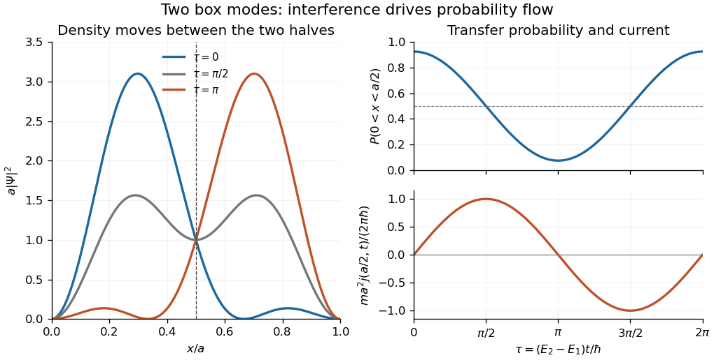

<h1 id="1/d/solution">Solution</h1>

↑ **Parent:** [D](../d.md)

At the midpoint the second sine vanishes, whereas the derivative of the first sine vanishes. Thus the [wavefunction](../../../../wave-function-split.md) and its spatial derivative simplify to

$$
\Psi(a/2,t)=\frac{e^{-iE_1t/\hbar}}{\sqrt a},\qquad \partial_x\Psi(a/2,t)=-\frac{2\pi}{a^{3/2}}e^{-iE_2t/\hbar}.
$$

Substitution in the [probability current](../../../../probability-current.md) gives

$$
\boxed{j(a/2,t)=\frac{2\pi\hbar}{ma^2}\sin\Omega t.}
$$

The [continuity equation](../../../../continuity-equation.md), integrated over the left half, gives $P_{\mathrm L}'(t)=j(0,t)-j(a/2,t)$. The [Dirichlet boundary condition](../../../../dirichlet-boundary-condition.md) makes $j(0,t)=0$, and the preceding [probability](../../../../probability.md) formula gives

$$
P_{\mathrm L}'(t)=-\frac{4\Omega}{3\pi}\sin\Omega t=-\frac{2\pi\hbar}{ma^2}\sin\Omega t=-j(a/2,t).
$$

**Positive midpoint current removes probability from the left half.** This is precisely the [midpoint current of a two-mode box state](../../../../midpoint-current-of-a-two-mode-box-state.md).

**[Figure 1](#1/d/image-interference-between-the-first-two-box-modes-transfers-probability-between-the-two-halves-midpoint-current-is-minus-the-derivative-of-left-half-probability). Interference between the first two box modes transfers probability between the two halves; midpoint current is minus the derivative of left-half probability**.

## ↑ Ancestors (12)

1. [D](../d.md)
2. [1](../../1.md)
3. [2014](../../../2014-split.md)
4. [Past exam of the quantum theory course of the University of Oxford](../../../split.md)
5. [Quantum theory course of the University of Oxford](../../../../quantum-theory-course-of-the-university-of-oxford.md)
6. [Year 2 of the mathematics course of the University of Oxford](../../../../year-2-of-the-mathematics-course-of-the-university-of-oxford.md)
7. [Mathematics course of the University of Oxford](../../../../mathematics-course-of-the-university-of-oxford.md)
8. [Undergraduate course of the University of Oxford](../../../../undergraduate-course-of-the-university-of-oxford.md)
9. [Course of the University of Oxford](../../../../course-of-the-university-of-oxford.md)
10. [University of Oxford](../../../../university-of-oxford-split.md)
11. [List of universities](../../../../list-of-universities.md)
12. [Codex Wiki](../../../../split.md)
