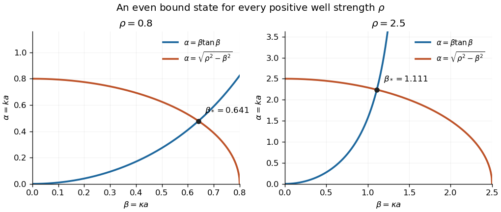
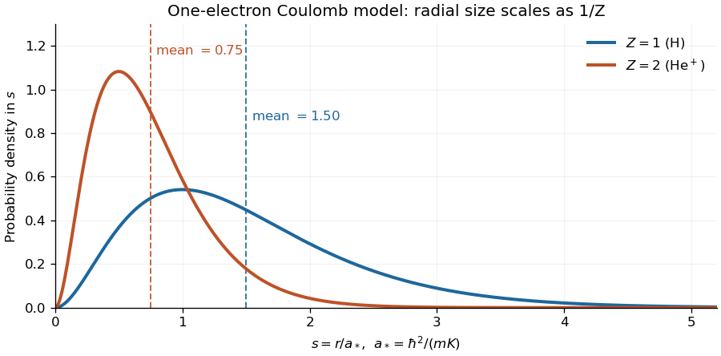

# 2015

↑ **Parent:** [Past exam of the quantum theory course of the University of Oxford](../past-exam-of-the-quantum-theory-course-of-the-university-of-oxford.md)

Source: [released examination archive](https://www.whatdotheyknow.com/request/maths_papers_2/response/1850333/attach/3/FOI%2020210708%201%20Data.zip?cookie_passthrough=1), member `FOI-20210708-1 - Data/a13761w1 (4).pdf`, four pages, 15 June 2015. All three questions and nineteen terminal parts are answered below. Oxford's [published policy](https://www.maths.ox.ac.uk/members/students/undergraduate-courses/examinations-assessments) excludes odd-year solutions other than 2019; a bounded search found no advertised answers to this exact paper.

**Table of contents**

- [1](#1)
  - [a](#1/a)
    - [i](#1/a/i)
      - [Solution](#1/a/i/solution)
    - [ii](#1/a/ii)
      - [Solution](#1/a/ii/solution)
    - [iii](#1/a/iii)
      - [Solution](#1/a/iii/solution)
  - [b](#1/b)
    - [i](#1/b/i)
      - [Solution](#1/b/i/solution)
    - [ii](#1/b/ii)
      - [Solution](#1/b/ii/solution)
    - [iii](#1/b/iii)
      - [Solution](#1/b/iii/solution)
    - [iv](#1/b/iv)
      - [Solution](#1/b/iv/solution)
- [2](#2)
  - [a](#2/a)
    - [Solution](#2/a/solution)
  - [b](#2/b)
    - [i](#2/b/i)
      - [Solution](#2/b/i/solution)
    - [ii](#2/b/ii)
      - [Solution](#2/b/ii/solution)
    - [iii](#2/b/iii)
      - [Solution](#2/b/iii/solution)
    - [iv](#2/b/iv)
      - [Solution](#2/b/iv/solution)
  - [c](#2/c)
    - [i](#2/c/i)
      - [Solution](#2/c/i/solution)
    - [ii](#2/c/ii)
      - [Solution](#2/c/ii/solution)
- [3](#3)
  - [i](#3/i)
    - [Solution](#3/i/solution)
  - [ii](#3/ii)
    - [Solution](#3/ii/solution)
  - [iii](#3/iii)
    - [Solution](#3/iii/solution)
  - [iv](#3/iv)
    - [Solution](#3/iv/solution)
  - [v](#3/v)
    - [Solution](#3/v/solution)

## 1

↑ **Parent:** [2015](2015.md)

<h3 id="1/a">a</h3>

↑ **Parent:** [1](#1)

<h4 id="1/a/i">i</h4>

↑ **Parent:** [A](#1/a)

<h5 id="1/a/i/solution">Solution</h5>

↑ **Parent:** [I](#1/a/i)

The [time-independent Schrödinger equation](../mathematical-physics.md#time-independent-schrodinger-equation) is the [energy eigenvalue](../energy-eigenvalue.md) equation for the [Hamiltonian operator](../quantum-system.md#hamiltonian-quantum-mechanics):

$$
\boxed{-\frac{\hbar^2}{2m}\frac{d^2\psi}{dx^2}+V(x)\psi(x)=E\psi(x).}
$$

Here $\hbar$ is the reduced [Planck constant](../quantum-mechanics.md#planck-constant). A corresponding stationary [wavefunction](../wave-function.md) evolves as $\Psi(x,t)=\psi(x)e^{-iEt/\hbar}$, which follows by substitution in the [Time-dependent Schrödinger equation](../mathematical-physics.md#time-dependent-schrodinger-equation). Its position [probability density](../wave-function.md#probability-density) is time independent because the time factor has unit modulus. Physical [energy eigenstates](../energy-eigenvalue.md#energy-eigenstate) must also satisfy the system's [boundary conditions](../differential-equation.md#boundary-condition); for a [bound state](../quantum-system.md#bound-state), [wavefunction normalization](../wave-function.md#wavefunction-normalization) requires $\int_{-\infty}^{\infty}|\psi(x)|^2\,dx=1$.

<h4 id="1/a/ii">ii</h4>

↑ **Parent:** [A](#1/a)

<h5 id="1/a/ii/solution">Solution</h5>

↑ **Parent:** [Ii](#1/a/ii)

Define the reflected function $\phi(x)=\psi(-x)$. The [chain rule](../calculus.md#chain-rule) gives $\phi'(x)=-\psi'(-x)$ and $\phi''(x)=\psi''(-x)$. Evaluating the [time-independent Schrödinger equation](../mathematical-physics.md#time-independent-schrodinger-equation) for $\psi$ at $-x$ and using the [even function](../calculus.md#even-function) identity $V(-x)=V(x)$ gives

$$
-\frac{\hbar^2}{2m}\phi''(x)+V(x)\phi(x)=E\phi(x).
$$

Thus reflection preserves the [energy eigenvalue](../energy-eigenvalue.md). The same substitution $y=-x$ in the [norm](../normed-vector-space.md#norm) gives

$$
\boxed{\int_{-\infty}^{\infty}|\phi(x)|^2\,dx=\int_{-\infty}^{\infty}|\psi(-x)|^2\,dx=\int_{-\infty}^{\infty}|\psi(y)|^2\,dy=1.}
$$

This is the action of the [parity operator](../quantum-mechanics.md#parity-operator) $R\psi(x)=\psi(-x)$, which is a [unitary operator](../vector-space.md#unitary-operator). For a reflection-symmetric physical problem it preserves the [Hamiltonian operator](../quantum-system.md#hamiltonian-quantum-mechanics)'s [operator domain](../vector-space.md#operator-domain) as well as its differential expression.

<h4 id="1/a/iii">iii</h4>

↑ **Parent:** [A](#1/a)

<h5 id="1/a/iii/solution">Solution</h5>

↑ **Parent:** [Iii](#1/a/iii)

By [linearity](../vector-space.md#linearity) of the [time-independent Schrödinger equation](../mathematical-physics.md#time-independent-schrodinger-equation), the even and odd parts

$$
\psi_+(x)=\frac{\psi(x)+\psi(-x)}2,\qquad \psi_-(x)=\frac{\psi(x)-\psi(-x)}2
$$

each satisfy the same [energy eigenvalue](../energy-eigenvalue.md) equation whenever they are nonzero. They obey $R\psi_+=\psi_+$ and $R\psi_-=-\psi_-$, so they have definite [parity](../quantum-mechanics.md#parity). At least one is nonzero, and $\psi=\psi_++\psi_-$. Each nonzero part can be normalized separately.

Therefore **a basis of stationary solutions can be chosen to have definite [parity](../quantum-mechanics.md#parity)**, and solving the even and odd sectors loses no [energy eigenvalues](../energy-eigenvalue.md). This does not assert that every possible [quantum superposition](../quantum-system.md#quantum-superposition) has definite [parity](../quantum-mechanics.md#parity); a superposition of the two sectors need not. For one-dimensional [bound states](../quantum-system.md#bound-state) in the usual regular setting, [nondegeneracy of one-dimensional bound states](../mathematical-physics.md#nondegeneracy-of-one-dimensional-bound-states) further implies that each individual [energy eigenstate](../energy-eigenvalue.md#energy-eigenstate) has definite [parity](../quantum-mechanics.md#parity).

<h3 id="1/b">b</h3>

↑ **Parent:** [1](#1)

<h4 id="1/b/i">i</h4>

↑ **Parent:** [B](#1/b)

<h5 id="1/b/i/solution">Solution</h5>

↑ **Parent:** [I](#1/b/i)

In either exterior region of the [finite square well](../quantum-mechanics.md#finite-square-well), the [time-independent Schrödinger equation](../mathematical-physics.md#time-independent-schrodinger-equation) reduces to $\psi''=k^2\psi$, since $E<0$. Its general solution is a [linear combination](../vector-space.md#linear-combination) of $e^{kx}$ and $e^{-kx}$. On the left, $e^{-kx}$ grows as $x\to-\infty$ and cannot be a [square-integrable function](../measure-theory.md#square-integrable-function), so its coefficient must be zero. On the right, the excluded growing term is $e^{kx}$. Hence the surviving tails are $Ae^{kx}$ for $x\leq-a$ and $De^{-kx}$ for $x\geq a$.

Inside the well, $E+V_0>0$ and the equation becomes $\psi''=-\kappa^2\psi$, whose general solution is $B\cos\kappa x+C\sin\kappa x$. Thus

$$
\boxed{\psi(x)=\begin{cases}Ae^{kx},&x\leq-a,\\B\cos\kappa x+C\sin\kappa x,&-a<x<a,\\De^{-kx},&x\geq a.\end{cases}}
$$

The coefficients are initially independent; [wavefunction matching at a finite potential step](../mathematical-physics.md#wavefunction-matching-at-a-finite-potential-step) imposes the remaining relations. Here the paper's $k$ is the exterior decay constant and $\kappa$ is the interior oscillation constant.

<h4 id="1/b/ii">ii</h4>

↑ **Parent:** [B](#1/b)

<h5 id="1/b/ii/solution">Solution</h5>

↑ **Parent:** [Ii](#1/b/ii)

For an [even function](../calculus.md#even-function), the interior sine term must vanish, because [sine](../geometry-and-topology.md#sine) is odd and [cosine](../geometry-and-topology.md#cosine) is even. Comparing reflected exterior tails at any $x>a$ gives $De^{-kx}=Ae^{-kx}$. Hence the [parity](../quantum-mechanics.md#parity) condition alone is

$$
\boxed{C=0,\qquad A=D.}
$$

It does not yet impose the matching condition on $B$. Continuity at $x=a$, when imposed in the next part, additionally gives $A=D=Be^{ka}\cos(\kappa a)$.

<h4 id="1/b/iii">iii</h4>

↑ **Parent:** [B](#1/b)

<h5 id="1/b/iii/solution">Solution</h5>

↑ **Parent:** [Iii](#1/b/iii)

At a finite jump in [potential energy](../energy.md#potential-energy), the [wavefunction](../wave-function.md) and its first [derivative](../calculus.md#derivative) must be continuous. A jump in the derivative would create a [Dirac delta function](../distribution-theory.md#dirac-delta-function) in $\psi''$, for which the finite potential has no balancing term. For the even solution, matching at $x=a$ gives

$$
B\cos\beta=De^{-\alpha},\qquad -B\kappa\sin\beta=-kDe^{-\alpha},\qquad \alpha=ka,\quad\beta=\kappa a.
$$

A nonzero solution cannot have $B=0$. It also cannot have $\cos\beta=0$: the first condition would give $D=0$, while the second would force $B\kappa\sin\beta=0$, a contradiction. Division is therefore valid and yields

$$
\boxed{\alpha=\beta\tan\beta.}
$$

[Parity](../quantum-mechanics.md#parity) makes the conditions at $x=-a$ identical to those already imposed. Finally the definitions of the decay and oscillation constants give

$$
\boxed{\alpha^2+\beta^2=a^2\left(-\frac{2mE}{\hbar^2}+\frac{2m(E+V_0)}{\hbar^2}\right)=\frac{2mV_0a^2}{\hbar^2}.}
$$

The circle relation fixes the well strength; the tangent relation selects its even [bound states](../quantum-system.md#bound-state).

<h4 id="1/b/iv">iv</h4>

↑ **Parent:** [B](#1/b)

<h5 id="1/b/iv/solution">Solution</h5>

↑ **Parent:** [Iv](#1/b/iv)

Write $\rho=a\sqrt{2mV_0}/\hbar>0$. On the first tangent branch, $0<\beta<\pi/2$, the matching relations are equivalent to

$$
\rho^2=\beta^2(1+\tan^2\beta),\qquad \rho=\frac\beta{\cos\beta}.
$$

The function $g(\beta)=\beta/\cos\beta$ is continuous and strictly increasing there:

$$
g'(\beta)=\sec\beta\left(1+\beta\tan\beta\right)>0,\qquad \lim_{\beta\to0^+}g(\beta)=0,\qquad \lim_{\beta\to(\pi/2)^-}g(\beta)=\infty.
$$

The [intermediate value theorem](../calculus.md#intermediate-value-theorem) therefore gives a unique first-branch root for **every $\rho>0$**. At this root $\beta<\rho$ and $\alpha=\beta\tan\beta>0$, so the [energy eigenvalue](../energy-eigenvalue.md)

$$
E=-\frac{\hbar^2\alpha^2}{2ma^2}
$$

obeys $-V_0<E<0$. This proves the [even bound state in every attractive square well](../quantum-mechanics.md#even-bound-state-in-every-attractive-square-well) result.

**[Figure 1](#1/b/iv/image-even-state-matching-in-a-finite-square-well-the-rising-tangent-branch-meets-the-decaying-circle-for-shallow-and-deeper-wells). Even-state matching in a finite square well: the rising tangent branch meets the decaying circle for shallow and deeper wells**.

To verify all the requested properties, take the resulting even [wavefunction](../wave-function.md) with exterior tails written in terms of their boundary values:

$$
\psi(x)=B\begin{cases}\cos(\kappa x),&|x|<a,\\\cos\beta\,e^{-k(|x|-a)},&|x|\geq a.\end{cases}
$$

The matching equation makes both the values and first [derivatives](../calculus.md#derivative) agree at the endpoints. The exterior tails are [square-integrable](../measure-theory.md#square-integrable-function) because $k>0$, and the interior interval is finite. More explicitly,

$$
\|\psi\|^2=|B|^2\left[a+\frac{\sin(2\beta)}{2\kappa}+\frac{\cos^2\beta}{k}\right],
$$

so choosing $B$ as the positive inverse square root of the bracket gives [wavefunction normalization](../wave-function.md#wavefunction-normalization). Thus **an even, continuously differentiable, normalizable stationary solution always exists**, however small the positive depth.

## 2

↑ **Parent:** [2015](2015.md)

<h3 id="2/a">a</h3>

↑ **Parent:** [2](#2)

<h4 id="2/a/solution">Solution</h4>

↑ **Parent:** [A](#2/a)

The [position operator](../quantum-mechanics.md#position-operator) $X$ and [momentum operator](../quantum-mechanics.md#momentum-operator) $P$ are [self-adjoint operators](../linear-operator-theory.md#self-adjoint-operator), so the [adjoint operator](../hilbert-space.md#adjoint-operator) is

$$
\boxed{a_+=P+im\omega X.}
$$

Use the [canonical commutation relation](../quantum-mechanics.md#canonical-commutation-relation) with the order of factors preserved:

$$
\begin{aligned}
a_+a_-&=(P+im\omega X)(P-im\omega X)\\
&=P^2+m^2\omega^2X^2+im\omega(XP-PX)\\
&=P^2+m^2\omega^2X^2-m\hbar\omega
=\boxed{2m\left(H-\frac12\hbar\omega\right)},\\
a_-a_+&=P^2+m^2\omega^2X^2-im\omega(XP-PX)\\
&=P^2+m^2\omega^2X^2+m\hbar\omega
=\boxed{2m\left(H+\frac12\hbar\omega\right)}.
\end{aligned}
$$

Subtracting the first product from the second proves

$$
\boxed{[a_-,a_+]=2m\hbar\omega I.}
$$

These [creation and annihilation operators](../quantum-harmonic-oscillator.md#creation-and-annihilation-operators) are unscaled and carry the paper's phase convention; their [commutator](../lie-algebra.md#commutator) is not the unit-normalized oscillator commutator.

<h3 id="2/b">b</h3>

↑ **Parent:** [2](#2)

<h4 id="2/b/i">i</h4>

↑ **Parent:** [B](#2/b)

<h5 id="2/b/i/solution">Solution</h5>

↑ **Parent:** [I](#2/b/i)

From $H=a_+a_-/(2m)+\hbar\omega/2$ and the [commutator product rule](../lie-algebra.md#commutator-product-rule),

$$
[H,a_+]=\frac1{2m}a_+[a_-,a_+]=\hbar\omega a_+,\qquad [H,a_-]=\frac1{2m}[a_+,a_-]a_-=-\hbar\omega a_-.
$$

Consequently, if $H\psi=E\psi$,

$$
\boxed{H(a_\pm\psi)=(E\pm\hbar\omega)(a_\pm\psi).}
$$

Thus the [creation operator](../quantum-harmonic-oscillator.md#creation-operator) raises the [energy eigenvalue](../energy-eigenvalue.md) by $\hbar\omega$, and the [annihilation operator](../quantum-harmonic-oscillator.md#annihilation-operator) lowers it by $\hbar\omega$, **provided the resulting vector is nonzero**. The zero vector is not an [eigenstate](../energy-eigenvalue.md#eigenstate); in particular the [ground state](../quantum-mechanics.md#ground-state) will be annihilated by $a_-$. The displayed operator identity holds even in that case.

<h4 id="2/b/ii">ii</h4>

↑ **Parent:** [B](#2/b)

<h5 id="2/b/ii/solution">Solution</h5>

↑ **Parent:** [Ii](#2/b/ii)

The squared [norm](../normed-vector-space.md#norm) is obtained by moving the [adjoint operator](../hilbert-space.md#adjoint-operator) to the other side of the [inner product](../inner-product.md):

$$
\|a_-\psi\|^2=\langle\psi,a_+a_-\psi\rangle
=2m\left\langle\psi,\left(H-\frac12\hbar\omega\right)\psi\right\rangle.
$$

For an [energy eigenstate](../energy-eigenvalue.md#energy-eigenstate), this is

$$
\boxed{\|a_-\psi\|^2=2m\left(E-\frac12\hbar\omega\right)\|\psi\|^2.}
$$

Since a squared [norm](../normed-vector-space.md#norm) is nonnegative, every nonzero [energy eigenstate](../energy-eigenvalue.md#energy-eigenstate) has $E\geq\hbar\omega/2$. Moreover $a_-\psi=0$ exactly when $E=\hbar\omega/2$.

<h4 id="2/b/iii">iii</h4>

↑ **Parent:** [B](#2/b)

<h5 id="2/b/iii/solution">Solution</h5>

↑ **Parent:** [Iii](#2/b/iii)

Write $E_0=\hbar\omega/2$. Repeated application of the [annihilation operator](../quantum-harmonic-oscillator.md#annihilation-operator) lowers the [energy eigenvalue](../energy-eigenvalue.md) in steps of $\hbar\omega$. The lower bound from part (ii) forces this process to stop. To see why it also quantizes the starting energy, write

$$
\frac{E-E_0}{\hbar\omega}=n+\delta,\qquad n\in\{0,1,2,\ldots\},\quad 0\leq\delta<1.
$$

The first $n$ lowering steps have positive squared [norms](../normed-vector-space.md#norm). If $\delta>0$, the next step is also nonzero by part (ii), and its energy would be $E_0+(\delta-1)\hbar\omega<E_0$, contradicting the bound. Thus $\delta=0$, and

$$
\boxed{E_n=\left(n+\frac12\right)\hbar\omega,\qquad n=0,1,2,\ldots.}
$$

Existence of the [ground state](../quantum-mechanics.md#ground-state) can also be checked directly in the position representation. The equation $a_-\psi_0=0$ is

$$
-i\hbar\psi_0'-im\omega x\psi_0=0,
$$

whose solution is proportional to $e^{-m\omega x^2/(2\hbar)}$. This [Gaussian function](../calculus.md#gaussian-function) is [square-integrable](../measure-theory.md#square-integrable-function), so it gives an actual [ground state](../quantum-mechanics.md#ground-state). Its normalization can be chosen using the [Gaussian integral](../integral.md#gaussian-integral).

All the displayed levels occur: for a nonzero state at $E_n$,

$$
\|a_+\psi_n\|^2=\langle\psi_n,a_-a_+\psi_n\rangle=2m\hbar\omega(n+1)\|\psi_n\|^2>0.
$$

Thus repeated raising creates a nonzero [energy eigenstate](../energy-eigenvalue.md#energy-eigenstate) at every $E_n$.

<h4 id="2/b/iv">iv</h4>

↑ **Parent:** [B](#2/b)

<h5 id="2/b/iv/solution">Solution</h5>

↑ **Parent:** [Iv](#2/b/iv)

Let $\psi$ have energy $E_n$ and put $\gamma=2m\hbar\omega$. The lowering [norm](../normed-vector-space.md#norm) formula gives, inductively,

$$
\|(a_-)^j\psi\|^2=\gamma^j\frac{n!}{(n-j)!}\|\psi\|^2,\qquad 0\leq j\leq n.
$$

In particular $(a_-)^n\psi$ is a nonzero [ground state](../quantum-mechanics.md#ground-state). By the assumed nondegeneracy, it equals $c\psi_0$ for some $c\ne0$.

It remains to show that raising this vector recovers $\psi$, rather than merely another state at the same energy. On an [energy eigenstate](../energy-eigenvalue.md#energy-eigenstate) at $E_n$, factorization gives $a_+a_-\psi=\gamma n\psi$. Iterating the factorization down the ladder yields

$$
(a_+)^n(a_-)^n\psi=\gamma^n n!\,\psi.
$$

Applying $(a_+)^n$ to $(a_-)^n\psi=c\psi_0$ therefore proves

$$
\boxed{\psi=\frac{c}{(2m\hbar\omega)^n n!}(a_+)^n\psi_0.}
$$

For $n=0$ this is the original ground-state assumption. This proves [nondegeneracy propagated by an oscillator ladder](../quantum-harmonic-oscillator.md#nondegeneracy-propagated-by-an-oscillator-ladder): every energy [eigenspace](../linear-operator-theory.md#eigenspace) is one-dimensional if the [ground state](../quantum-mechanics.md#ground-state) is nondegenerate.

<h3 id="2/c">c</h3>

↑ **Parent:** [2](#2)

<h4 id="2/c/i">i</h4>

↑ **Parent:** [C](#2/c)

<h5 id="2/c/i/solution">Solution</h5>

↑ **Parent:** [I](#2/c/i)

If $a_-\psi\ne0$, it has energy $E-\hbar\omega$, distinct from the energy of $\psi$. [Eigenstates](../energy-eigenvalue.md#eigenstate) of a [self-adjoint operator](../linear-operator-theory.md#self-adjoint-operator) with distinct [eigenvalues](../linear-operator-theory.md#eigenvalue) are [orthogonal](../inner-product.md#orthogonal-vectors). Explicitly,

$$
E\langle\psi,a_-\psi\rangle=\langle H\psi,a_-\psi\rangle=\langle\psi,H(a_-\psi)\rangle=(E-\hbar\omega)\langle\psi,a_-\psi\rangle,
$$

so $\langle\psi,a_-\psi\rangle=0$. If $a_-\psi=0$, the same conclusion is immediate.

Dividing by $\|\psi\|^2$ and using the definition of $a_-$ gives

$$
\mathbb E_\psi(P)-im\omega\mathbb E_\psi(X)=0.
$$

Both [expectation values](../quantum-system.md#expectation-value) are real because $P$ and $X$ are [self-adjoint operators](../linear-operator-theory.md#self-adjoint-operator). Its real and imaginary parts therefore vanish separately:

$$
\boxed{\mathbb E_\psi(X)=0,\qquad \mathbb E_\psi(P)=0.}
$$

An oscillator [energy eigenstate](../energy-eigenvalue.md#energy-eigenstate) is centered in both position and momentum, despite having nonzero [quantum uncertainties](../quantum-system.md#quantum-uncertainty).

<h4 id="2/c/ii">ii</h4>

↑ **Parent:** [C](#2/c)

<h5 id="2/c/ii/solution">Solution</h5>

↑ **Parent:** [Ii](#2/c/ii)

Twice applying the [creation operator](../quantum-harmonic-oscillator.md#creation-operator) or twice applying the [annihilation operator](../quantum-harmonic-oscillator.md#annihilation-operator) changes the [energy eigenvalue](../energy-eigenvalue.md) by $2\hbar\omega$, unless they give zero. The same [orthogonality](../inner-product.md#orthogonal-vectors) argument as in part (i) therefore gives

$$
\mathbb E_\psi(a_+^2)=0=\mathbb E_\psi(a_-^2).
$$

Also the factorization in part (a) gives

$$
\mathbb E_\psi(a_+a_-)=2m(E-\hbar\omega/2),\qquad \mathbb E_\psi(a_-a_+)=2m(E+\hbar\omega/2).
$$

Now $P=(a_++a_-)/2$ and $X=(a_+-a_-)/(2im\omega)$. Squaring in the correct operator order yields

$$
\begin{aligned}
\mathbb E_\psi(P^2)&=\frac14\mathbb E_\psi(a_+^2+a_+a_-+a_-a_++a_-^2)=mE,\\
\mathbb E_\psi(X^2)&=-\frac1{4m^2\omega^2}\mathbb E_\psi(a_+^2-a_+a_--a_-a_++a_-^2)=\frac{E}{m\omega^2}.
\end{aligned}
$$

By part (i), the means are zero, so these are the [variances](../variance.md). Taking positive square roots gives the requested [standard deviations](../variance.md#standard-deviation):

$$
\boxed{\Delta_\psi(X)=\sqrt{\frac{E}{m\omega^2}},\qquad \Delta_\psi(P)=\sqrt{mE}.}
$$

These [harmonic-oscillator number-state second moments](../quantum-harmonic-oscillator.md#harmonic-oscillator-number-state-second-moments) also show equal mean [kinetic energy](../energy.md#kinetic-energy) and [potential energy](../energy.md#potential-energy), each $E/2$. Their uncertainty product is $E/\omega=(n+\tfrac12)\hbar$, so the [ground state](../quantum-mechanics.md#ground-state) saturates the [Heisenberg uncertainty relation](../quantum-theory.md#heisenberg-uncertainty-relation).

## 3

↑ **Parent:** [2015](2015.md)

<h3 id="3/i">i</h3>

↑ **Parent:** [3](#3)

<h4 id="3/i/solution">Solution</h4>

↑ **Parent:** [I](#3/i)

Introduce the reduced [radial wavefunction](../wave-function.md#radial-wavefunction) $u(r)=r\psi(r)$. Multiplying the [radial Schrödinger equation for a central potential](../mathematical-physics.md#radial-schrodinger-equation-for-a-central-potential) by $-2mr/\hbar^2$ gives

$$
u''-\frac{\ell(\ell+1)}{r^2}u+\frac{2mKZ}{\hbar^2r}u+\frac{2mE}{\hbar^2}u=0.
$$

For the decaying [bound state](../quantum-system.md#bound-state), take $\alpha>0$ and put $u=f e^{-\alpha r}$. Differentiation yields

$$
u''=e^{-\alpha r}\left(f''-2\alpha f'+\alpha^2f\right).
$$

Since $2mE/\hbar^2=-\alpha^2$, the two constant multiples of $f$ cancel. Dividing by the nonzero exponential gives

$$
\boxed{f''-2\alpha f'-\frac{\ell(\ell+1)}{r^2}f+\frac{2mKZ}{\hbar^2r}f=0.}
$$

This separates the large-radius exponential decay from the remaining [Coulomb bound state](../quantum-system.md#coulomb-bound-state) equation.

<h3 id="3/ii">ii</h3>

↑ **Parent:** [3](#3)

<h4 id="3/ii/solution">Solution</h4>

↑ **Parent:** [Ii](#3/ii)

Apply the [Frobenius method](../complex-analysis.md#frobenius-method) at the origin. The lowest power in $f''-\ell(\ell+1)f/r^2$ is $r^{c-2}$, with coefficient

$$
\bigl[c(c-1)-\ell(\ell+1)\bigr]a_0.
$$

The terms $-2\alpha f'$ and $2mKZf/(\hbar^2r)$ start at power $r^{c-1}$ and therefore cannot cancel a nonzero $r^{c-2}$ coefficient. Because $a_0\ne0$, the [indicial equation](../linear-ordinary-differential-equation.md#indicial-equation) is

$$
\boxed{c(c-1)-\ell(\ell+1)=0,\qquad (c-\ell-1)(c+\ell)=0.}
$$

Its roots are $c=\ell+1$ and $c=-\ell$. Since $\psi=r^{-1}f e^{-\alpha r}$, their leading behaviors are respectively $\psi\sim r^\ell$ and $\psi\sim r^{-\ell-1}$. The physical choice is

$$
\boxed{c=\ell+1.}
$$

This is the [Coulomb radial origin condition](../mathematical-physics.md#coulomb-radial-origin-condition). For $\ell\geq1$, the other branch is not even locally normalizable: its radial [probability](../probability-theory.md#probability) integral behaves as $\int_0^\varepsilon r^2r^{-2\ell-2}\,dr=\int_0^\varepsilon r^{-2\ell}\,dr$, which diverges.

For $\ell=0$, the singular behavior $1/r$ is locally [square-integrable](../measure-theory.md#square-integrable-function) with the measure $r^2dr$, so local [wavefunction normalization](../wave-function.md#wavefunction-normalization) alone would not reject it. The ordinary three-dimensional [Coulomb potential](../electrostatics.md#coulomb-potential-energy) problem additionally requires the regular [boundary condition](../differential-equation.md#boundary-condition) $u(0)=0$. A $1/r$ branch violates that condition and has divergent [kinetic energy](../energy.md#kinetic-energy) integral $\int_0^\varepsilon r^2|\partial_r(1/r)|^2\,dr=\int_0^\varepsilon r^{-2}\,dr$. Thus it is excluded from the physical energy domain as well. The regular choice gives $u\sim r^{\ell+1}$ in every case.

<h3 id="3/iii">iii</h3>

↑ **Parent:** [3](#3)

<h4 id="3/iii/solution">Solution</h4>

↑ **Parent:** [Iii](#3/iii)

For brevity write $\gamma=mKZ/\hbar^2$. With the physical [indicial root](../linear-ordinary-differential-equation.md#indicial-root) $c=\ell+1$, substitute $f=\sum_{n\geq0}a_nr^{n+\ell+1}$ into the equation from part (i). The coefficient of $r^{n+\ell}$ is

$$
\bigl[(n+\ell+2)(n+\ell+1)-\ell(\ell+1)\bigr]a_{n+1}+
\bigl[2\gamma-2\alpha(n+\ell+1)\bigr]a_n=0.
$$

The [indicial equation](../linear-ordinary-differential-equation.md#indicial-equation) has already canceled the still lower power $r^{\ell-1}$. Rearranging gives the [recurrence relation](../sequence-and-series.md#recurrence-relation)

$$
\boxed{a_{n+1}=2a_n\frac{\alpha(n+\ell+1)-mKZ/\hbar^2}{(n+\ell+2)(n+\ell+1)-\ell(\ell+1)}.}
$$

Its denominator is $(n+1)(n+2\ell+2)>0$ for every $n\geq0$.

To impose [wavefunction normalization](../wave-function.md#wavefunction-normalization) at infinity, first suppose that the series never terminates. Then

$$
\frac{a_{n+1}}{a_n}\sim\frac{2\alpha}{n},\qquad n\to\infty.
$$

This is the exponential-series growth associated with $e^{2\alpha r}$, which would overwhelm the factor $e^{-\alpha r}$ in $\psi$. A direct lower-bound argument makes the conclusion precise. All sufficiently late recurrence ratios are real and positive, so after a common [global phase](../quantum-system.md#global-phase) choice the tail coefficients have one sign. For any $0<\eta<\alpha$, there is an index $N$ such that

$$
\frac{|a_{n+1}|}{|a_n|}\geq\frac{2\alpha-\eta}{n+1},\qquad n\geq N.
$$

Induction then bounds the tail below by a positive multiple of

$$
r^{\ell+1}\sum_{n\geq N}\frac{[(2\alpha-\eta)r]^n}{n!}.
$$

The finitely many earlier terms form a [polynomial](../polynomial.md) and cannot cancel this exponential growth. Thus $|\psi|=r^{-1}e^{-\alpha r}|f|$ grows at least as a positive multiple of $r^\ell e^{(\alpha-\eta)r}$ for large $r$, contradicting [wavefunction normalization](../wave-function.md#wavefunction-normalization). This proves that the regular series must terminate.

Since the denominator never vanishes, termination requires the numerator to vanish at some nonnegative integer $n$:

$$
\boxed{\alpha=\frac{mKZ}{(n+\ell+1)\hbar^2}.}
$$

Then $a_{n+1}=0$ and every later coefficient is zero. Consequently **$f$ is a polynomial of degree $n+\ell+1$**, with a factor $r^{\ell+1}$; equivalently,

$$
f(r)=r^{\ell+1}P_n(r),\qquad \psi(r)=r^\ell P_n(r)e^{-\alpha r},
$$

where $P_n$ has degree $n$. This is [series-termination quantization of the Coulomb radial equation](../mathematical-physics.md#series-termination-quantization-of-the-coulomb-radial-equation). If $N_{\rm p}=n+\ell+1$ denotes the [principal quantum number](../mathematical-physics.md#principal-quantum-number), the associated [energy eigenvalues](../energy-eigenvalue.md) are

$$
\boxed{E_{N_{\rm p}}=-\frac{mK^2Z^2}{2\hbar^2N_{\rm p}^2},\qquad N_{\rm p}=1,2,\ldots.}
$$

Here $n$ counts the degree of the remaining radial polynomial; it is not the principal [quantum number](../quantum-system.md#quantum-number) itself.

<h3 id="3/iv">iv</h3>

↑ **Parent:** [3](#3)

<h4 id="3/iv/solution">Solution</h4>

↑ **Parent:** [Iv](#3/iv)

The smallest [energy eigenvalue](../energy-eigenvalue.md) in part (iii) occurs at the smallest possible [principal quantum number](../mathematical-physics.md#principal-quantum-number), $N_{\rm p}=1$. Since $n,\ell\geq0$, this forces $n=0$ and $\ell=0$. Therefore $f=a_0r$, and

$$
\boxed{\psi_0(r)=a_0e^{-\alpha_0r},\qquad \alpha_0=\frac{mKZ}{\hbar^2},\qquad E_0=-\frac{mK^2Z^2}{2\hbar^2}.}
$$

For the spherically symmetric [ground state](../quantum-mechanics.md#ground-state), the full three-dimensional [wavefunction normalization](../wave-function.md#wavefunction-normalization) uses $d^3x=r^2dr\,d\Omega$. Integrating over the [solid angle](../euclidean-geometry.md#solid-angle) gives

$$
1=4\pi|a_0|^2\int_0^\infty r^2e^{-2\alpha_0r}\,dr.
$$

Put $R=2\alpha_0r$ and use the supplied [factorial](../combinatorics.md#factorial) integral:

$$
\int_0^\infty r^2e^{-2\alpha_0r}\,dr=\frac1{(2\alpha_0)^3}\int_0^\infty R^2e^{-R}\,dR=\frac{2!}{8\alpha_0^3}=\frac1{4\alpha_0^3}.
$$

Thus $|a_0|^2=\alpha_0^3/\pi$. Choosing the positive [global phase](../quantum-system.md#global-phase) convention gives

$$
\boxed{a_0=\left(\frac{\alpha_0^3}{\pi}\right)^{1/2}.}
$$

This is the [radial normalization of the hydrogen ground state](../mathematical-physics.md#radial-normalization-of-the-hydrogen-ground-state) convention in which the angular factor is absorbed into the spherically symmetric function. If instead one writes $\Psi=R(r)Y_{00}$ with the normalized [spherical harmonic](../analysis.md#spherical-harmonic) $Y_{00}=1/\sqrt{4\pi}$, then $R(r)=2\alpha_0^{3/2}e^{-\alpha_0r}$. Both conventions describe the same normalized three-dimensional [quantum state](../quantum-system.md#quantum-state).

<h3 id="3/v">v</h3>

↑ **Parent:** [3](#3)

<h4 id="3/v/solution">Solution</h4>

↑ **Parent:** [V](#3/v)

The [radial probability density](../wave-function.md#radial-probability-density) includes the spherical-shell volume factor:

$$
p(r)=4\pi r^2|\psi_0(r)|^2=4\alpha_0^3r^2e^{-2\alpha_0r},\qquad r\geq0.
$$

Consequently the radial [expectation value](../quantum-system.md#expectation-value) is

$$
\begin{aligned}
\mathbb E_{\psi_0}(r)&=4\alpha_0^3\int_0^\infty r^3e^{-2\alpha_0r}\,dr\\
&=4\alpha_0^3\frac{3!}{(2\alpha_0)^4}=\boxed{\frac3{2\alpha_0}=\frac{3\hbar^2}{2mKZ}.}
\end{aligned}
$$

Keeping $m$ and $K$ fixed, the [hydrogenic ground-state radius scaling](../mathematical-physics.md#hydrogenic-ground-state-radius-scaling) is therefore **$\langle r\rangle\propto1/Z$**: the $Z=2$ state has half the mean radius of the $Z=1$ state. Equivalently, with $a_*=\hbar^2/(mK)$, the mean radii are $3a_*/2$ and $3a_*/4$. For the physical electron-nucleus [Coulomb potential](../electrostatics.md#coulomb-potential-energy), $a_*$ is the [Bohr radius](../mathematical-physics.md#bohr-radius) of the fixed-nucleus [hydrogen atom](../mathematical-physics.md#hydrogen-atom) model.

**[Figure 2](#3/v/image-radial-probability-densities-for-the-one-electron-z-1-and-z-2-coulomb-bound-states-dashed-lines-mark-their-mean-radii). Radial probability densities for the one-electron $Z=1$ and $Z=2$ Coulomb bound states; dashed lines mark their mean radii**. The horizontal coordinate is $s=r/a_*$. The normalized densities are $4Z^3s^2e^{-2Zs}$, so their means are $3/(2Z)$.

The exact $Z=2$ comparison in this one-electron model describes the [hydrogen-like ion](../atomic-physics.md#hydrogen-like-ion) $\mathrm{He}^+$. A neutral [helium atom](../chemical-substance.md#helium-atom) has two [electrons](../physics.md#electron); its exact size also depends on their mutual [Coulomb interaction](../electrostatics.md#coulomb-interaction) and is not determined by this one-electron calculation. The stated half-radius conclusion is the prediction of the model supplied in the paper.

## ↑ Ancestors (9)

1. [Past exam of the quantum theory course of the University of Oxford](../past-exam-of-the-quantum-theory-course-of-the-university-of-oxford.md)
2. [Quantum theory course of the University of Oxford](../university-of-oxford.md#quantum-theory-course-of-the-university-of-oxford)
3. [Year 2 of the mathematics course of the University of Oxford](../university-of-oxford.md#year-2-of-the-mathematics-course-of-the-university-of-oxford)
4. [Mathematics course of the University of Oxford](../university-of-oxford.md#mathematics-course-of-the-university-of-oxford)
5. [Undergraduate course of the University of Oxford](../university-of-oxford.md#undergraduate-course-of-the-university-of-oxford)
6. [Course of the University of Oxford](../university-of-oxford.md#course-of-the-university-of-oxford)
7. [University of Oxford](../university-of-oxford.md)
8. [List of universities](../README.md#list-of-universities)
9. [Codex Wiki](../README.md)
