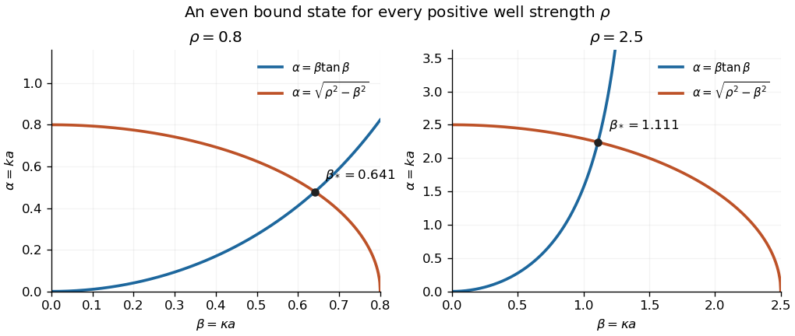

<h1 id="1/b/iv/solution">Solution</h1>

↑ **Parent:** [Iv](../iv.md)

Write $\rho=a\sqrt{2mV_0}/\hbar>0$. On the first tangent branch, $0<\beta<\pi/2$, the matching relations are equivalent to

$$
\rho^2=\beta^2(1+\tan^2\beta),\qquad \rho=\frac\beta{\cos\beta}.
$$

The function $g(\beta)=\beta/\cos\beta$ is continuous and strictly increasing there:

$$
g'(\beta)=\sec\beta\left(1+\beta\tan\beta\right)>0,\qquad \lim_{\beta\to0^+}g(\beta)=0,\qquad \lim_{\beta\to(\pi/2)^-}g(\beta)=\infty.
$$

The [intermediate value theorem](../../../../../intermediate-value-theorem.md) therefore gives a unique first-branch root for **every $\rho>0$**. At this root $\beta<\rho$ and $\alpha=\beta\tan\beta>0$, so the [energy eigenvalue](../../../../../energy-eigenvalue-split.md)

$$
E=-\frac{\hbar^2\alpha^2}{2ma^2}
$$

obeys $-V_0<E<0$. This proves the [even bound state in every attractive square well](../../../../../even-bound-state-in-every-attractive-square-well.md) result.

**[Figure 1](#1/b/iv/image-even-state-matching-in-a-finite-square-well-the-rising-tangent-branch-meets-the-decaying-circle-for-shallow-and-deeper-wells). Even-state matching in a finite square well: the rising tangent branch meets the decaying circle for shallow and deeper wells**.

To verify all the requested properties, take the resulting even [wavefunction](../../../../../wave-function-split.md) with exterior tails written in terms of their boundary values:

$$
\psi(x)=B\begin{cases}\cos(\kappa x),&|x|<a,\\\cos\beta\,e^{-k(|x|-a)},&|x|\geq a.\end{cases}
$$

The matching equation makes both the values and first [derivatives](../../../../../derivative.md) agree at the endpoints. The exterior tails are [square-integrable](../../../../../square-integrable-function.md) because $k>0$, and the interior interval is finite. More explicitly,

$$
\|\psi\|^2=|B|^2\left[a+\frac{\sin(2\beta)}{2\kappa}+\frac{\cos^2\beta}{k}\right],
$$

so choosing $B$ as the positive inverse square root of the bracket gives [wavefunction normalization](../../../../../wavefunction-normalization.md). Thus **an even, continuously differentiable, normalizable stationary solution always exists**, however small the positive depth.

## ↑ Ancestors (13)

1. [Iv](../iv.md)
2. [B](../../b.md)
3. [1](../../../1.md)
4. [2015](../../../../2015-split.md)
5. [Past exam of the quantum theory course of the University of Oxford](../../../../split.md)
6. [Quantum theory course of the University of Oxford](../../../../../quantum-theory-course-of-the-university-of-oxford.md)
7. [Year 2 of the mathematics course of the University of Oxford](../../../../../year-2-of-the-mathematics-course-of-the-university-of-oxford.md)
8. [Mathematics course of the University of Oxford](../../../../../mathematics-course-of-the-university-of-oxford.md)
9. [Undergraduate course of the University of Oxford](../../../../../undergraduate-course-of-the-university-of-oxford.md)
10. [Course of the University of Oxford](../../../../../course-of-the-university-of-oxford.md)
11. [University of Oxford](../../../../../university-of-oxford-split.md)
12. [List of universities](../../../../../list-of-universities.md)
13. [Codex Wiki](../../../../../split.md)
