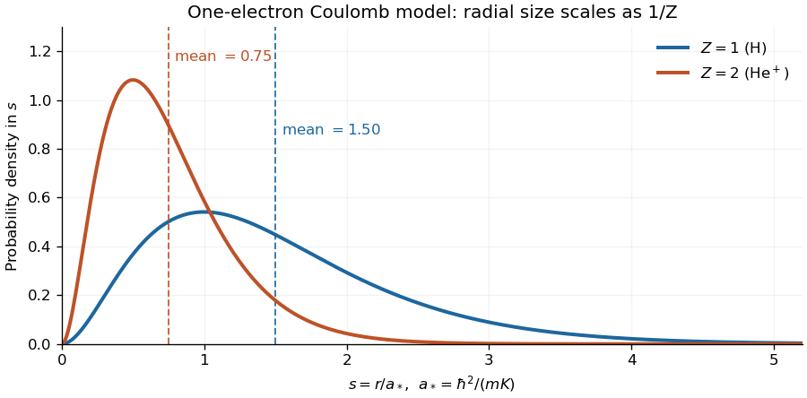

<h1 id="3/v/solution">Solution</h1>

↑ **Parent:** [V](../v.md)

The [radial probability density](../../../../radial-probability-density.md) includes the spherical-shell volume factor:

$$
p(r)=4\pi r^2|\psi_0(r)|^2=4\alpha_0^3r^2e^{-2\alpha_0r},\qquad r\geq0.
$$

Consequently the radial [expectation value](../../../../expectation-value.md) is

$$
\begin{aligned}
\mathbb E_{\psi_0}(r)&=4\alpha_0^3\int_0^\infty r^3e^{-2\alpha_0r}\,dr\\
&=4\alpha_0^3\frac{3!}{(2\alpha_0)^4}=\boxed{\frac3{2\alpha_0}=\frac{3\hbar^2}{2mKZ}.}
\end{aligned}
$$

Keeping $m$ and $K$ fixed, the [hydrogenic ground-state radius scaling](../../../../hydrogenic-ground-state-radius-scaling.md) is therefore **$\langle r\rangle\propto1/Z$**: the $Z=2$ state has half the mean radius of the $Z=1$ state. Equivalently, with $a_*=\hbar^2/(mK)$, the mean radii are $3a_*/2$ and $3a_*/4$. For the physical electron-nucleus [Coulomb potential](../../../../coulomb-potential-energy.md), $a_*$ is the [Bohr radius](../../../../bohr-radius.md) of the fixed-nucleus [hydrogen atom](../../../../hydrogen-atom.md) model.

**[Figure 2](#3/v/image-radial-probability-densities-for-the-one-electron-z-1-and-z-2-coulomb-bound-states-dashed-lines-mark-their-mean-radii). Radial probability densities for the one-electron $Z=1$ and $Z=2$ Coulomb bound states; dashed lines mark their mean radii**. The horizontal coordinate is $s=r/a_*$. The normalized densities are $4Z^3s^2e^{-2Zs}$, so their means are $3/(2Z)$.

The exact $Z=2$ comparison in this one-electron model describes the [hydrogen-like ion](../../../../hydrogen-like-ion.md) $\mathrm{He}^+$. A neutral [helium atom](../../../../helium-atom.md) has two [electrons](../../../../electron.md); its exact size also depends on their mutual [Coulomb interaction](../../../../coulomb-interaction.md) and is not determined by this one-electron calculation. The stated half-radius conclusion is the prediction of the model supplied in the paper.

## ↑ Ancestors (12)

1. [V](../v.md)
2. [3](../../3.md)
3. [2015](../../../2015-split.md)
4. [Past exam of the quantum theory course of the University of Oxford](../../../split.md)
5. [Quantum theory course of the University of Oxford](../../../../quantum-theory-course-of-the-university-of-oxford.md)
6. [Year 2 of the mathematics course of the University of Oxford](../../../../year-2-of-the-mathematics-course-of-the-university-of-oxford.md)
7. [Mathematics course of the University of Oxford](../../../../mathematics-course-of-the-university-of-oxford.md)
8. [Undergraduate course of the University of Oxford](../../../../undergraduate-course-of-the-university-of-oxford.md)
9. [Course of the University of Oxford](../../../../course-of-the-university-of-oxford.md)
10. [University of Oxford](../../../../university-of-oxford-split.md)
11. [List of universities](../../../../list-of-universities.md)
12. [Codex Wiki](../../../../split.md)
