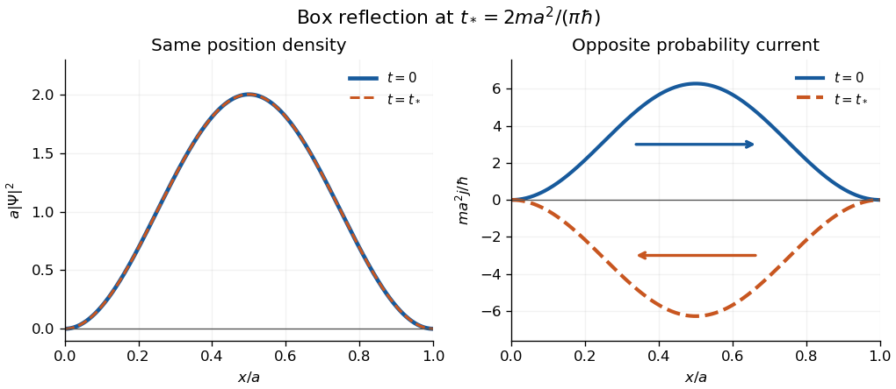

# 2017

↑ **Parent:** [Past exam of the quantum theory course of the University of Oxford](../past-exam-of-the-quantum-theory-course-of-the-university-of-oxford.md)

Source: [released examination archive](https://www.whatdotheyknow.com/request/maths_papers_2/response/1850333/attach/3/FOI%2020210708%201%20Data.zip?cookie_passthrough=1), member `FOI-20210708-1 - Data/a13761w1 (2).pdf`, four pages, 12 June 2017. The solutions below cover all three questions. Oxford's [published solutions policy](https://www.maths.ox.ac.uk/members/students/undergraduate-courses/examinations-assessments/overview-examinations) excludes odd years other than 2019; a bounded search found no advertised answers to this exact paper.

**Table of contents**

- [1](#1)
  - [a](#1/a)
    - [i](#1/a/i)
      - [Solution](#1/a/i/solution)
    - [ii](#1/a/ii)
      - [Solution](#1/a/ii/solution)
  - [b](#1/b)
    - [i](#1/b/i)
      - [Solution](#1/b/i/solution)
    - [ii](#1/b/ii)
      - [Solution](#1/b/ii/solution)
    - [iii](#1/b/iii)
      - [Solution](#1/b/iii/solution)
- [2](#2)
  - [a](#2/a)
    - [Solution](#2/a/solution)
  - [b](#2/b)
    - [Solution](#2/b/solution)
- [3](#3)
  - [a](#3/a)
    - [Solution](#3/a/solution)
  - [b](#3/b)
    - [i](#3/b/i)
      - [Solution](#3/b/i/solution)
    - [ii](#3/b/ii)
      - [Solution](#3/b/ii/solution)
    - [iii](#3/b/iii)
      - [Solution](#3/b/iii/solution)
    - [iv](#3/b/iv)
      - [Solution](#3/b/iv/solution)

## 1

↑ **Parent:** [2017](2017.md)

<h3 id="1/a">a</h3>

↑ **Parent:** [1](#1)

<h4 id="1/a/i">i</h4>

↑ **Parent:** [A](#1/a)

<h5 id="1/a/i/solution">Solution</h5>

↑ **Parent:** [I](#1/a/i)

Inside the [infinite square well](../quantum-mechanics.md#infinite-square-well), the [Schrödinger equation](../mathematical-physics.md#schrodinger-equation) and [Dirichlet boundary conditions](../differential-equation.md#dirichlet-boundary-condition) are

$$
i\hbar\frac{\partial\Psi}{\partial t}=-\frac{\hbar^2}{2m}\frac{\partial^2\Psi}{\partial x^2},\qquad 0<x<a,\qquad \Psi(0,t)=\Psi(a,t)=0.
$$

The [wavefunction](../wave-function.md) vanishes outside the box. These walls constrain its values, not its first derivatives: requiring both to vanish at an endpoint would eliminate all the nonzero stationary solutions.

For a nonzero separated solution, [separation of variables](../partial-differential-equation.md#separation-of-variables) gives

$$
i\hbar\frac{T'}T=-\frac{\hbar^2}{2m}\frac{\psi''}\psi=E,\qquad T(t)=T(0)e^{-iEt/\hbar},\qquad -\frac{\hbar^2}{2m}\psi''=E\psi.
$$

The last equation is the [time-independent Schrödinger equation](../mathematical-physics.md#time-independent-schrodinger-equation). Its [energy eigenvalue](../energy-eigenvalue.md) is real. Multiplication by $\psi^*$ and [integration by parts](../calculus.md#integration-by-parts), with the endpoint values zero, gives

$$
E\int_0^a|\psi|^2\,dx=\frac{\hbar^2}{2m}\int_0^a|\psi'|^2\,dx\geq0.
$$

Equality would force $\psi$ to be constant and hence zero, so a nonzero [energy eigenstate](../energy-eigenvalue.md#energy-eigenstate) has $E>0$. Writing $k=\sqrt{2mE}/\hbar$, the general solution is $A\sin kx+B\cos kx$. The left wall gives $B=0$; the right gives $\sin ka=0$. Negative integers reproduce the same functions up to a constant, and $n=0$ gives the zero function, leaving $k=n\pi/a$ for $n=1,2,\ldots$.

Finally $\int_0^a\sin^2(n\pi x/a)\,dx=a/2$. Thus [wavefunction normalization](../wave-function.md#wavefunction-normalization) with positive coefficient gives

$$
\boxed{\psi_n(x)=\sqrt{\frac2a}\sin\frac{n\pi x}{a},\qquad E_n=\frac{n^2\pi^2\hbar^2}{2ma^2},\qquad n\geq1.}
$$

An arbitrary constant [global phase](../quantum-system.md#global-phase) has no effect on the [quantum state](../quantum-system.md#quantum-state).

<h4 id="1/a/ii">ii</h4>

↑ **Parent:** [A](#1/a)

<h5 id="1/a/ii/solution">Solution</h5>

↑ **Parent:** [Ii](#1/a/ii)

The operator $R$ is the [midpoint parity operator](../quantum-mechanics.md#midpoint-parity-operator) about $a/2$. The angle-subtraction identity gives

$$
R\psi_n(x)=\sqrt{\frac2a}\sin\left(n\pi-\frac{n\pi x}{a}\right)=\boxed{(-1)^{n+1}\psi_n(x).}
$$

Consequently $HR\psi_n=RH\psi_n=E_n(-1)^{n+1}\psi_n$. The sine functions form a complete [orthonormal basis](../inner-product.md#orthonormal-basis) of $L^2(0,a)$, so the simultaneous diagonal action implies commutation on the [Hamiltonian operator](../quantum-system.md#hamiltonian-quantum-mechanics)'s [operator domain](../vector-space.md#operator-domain). More directly, $R$ preserves the [Dirichlet boundary conditions](../differential-equation.md#dirichlet-boundary-condition) and $(R\psi)''(x)=\psi''(a-x)$; hence $HR\psi=RH\psi$ whenever $H\psi$ is defined. This checks the domain as well as the differential expressions.

For arbitrary $f,g\in L^2(0,a)$, use $y=a-x$ in the [inner product](../inner-product.md):

$$
\langle f,Rg\rangle=\int_0^a f(x)^*g(a-x)\,dx=\int_0^a f(a-y)^*g(y)\,dy=\langle Rf,g\rangle.
$$

Also $\|Rf\|=\|f\|$, so $R$ is bounded and defined everywhere. The identity therefore proves $\boxed{R^*=R}$, with no extra domain restriction. In particular $R$ is a [self-adjoint operator](../linear-operator-theory.md#self-adjoint-operator); $R^2=I$ also makes it a [unitary operator](../vector-space.md#unitary-operator).

<h3 id="1/b">b</h3>

↑ **Parent:** [1](#1)

<h4 id="1/b/i">i</h4>

↑ **Parent:** [B](#1/b)

<h5 id="1/b/i/solution">Solution</h5>

↑ **Parent:** [I](#1/b/i)

The spatial [quantum phase](../quantum-system.md#quantum-phase) has unit modulus. Thus the [probability density](../wave-function.md#probability-density) and total [probability](../probability-theory.md#probability) are

$$
|\Psi(x,0)|^2=\frac2a\sin^2\frac{\pi x}{a},\qquad \boxed{\int_{-\infty}^{\infty}|\Psi(x,0)|^2\,dx=\frac2a\int_0^a\sin^2\frac{\pi x}{a}\,dx=1.}
$$

The exterior contributes zero. This establishes [wavefunction normalization](../wave-function.md#wavefunction-normalization), although the spatial [quantum phase](../quantum-system.md#quantum-phase) means the state is not the ground [energy eigenstate](../energy-eigenvalue.md#energy-eigenstate).

<h4 id="1/b/ii">ii</h4>

↑ **Parent:** [B](#1/b)

<h5 id="1/b/ii/solution">Solution</h5>

↑ **Parent:** [Ii](#1/b/ii)

The requested [energy eigenvalue](../energy-eigenvalue.md) is $E_2$. By the [Born rule](../wave-function.md#born-rule), its [probability amplitude](../wave-function.md#probability-amplitude) is the [inner product](../inner-product.md) $c_2=\langle\psi_2,\Psi(0)\rangle$. Put $u=\pi x/a$ and use $e^{iu}\sin u=\tfrac12\sin2u+i\sin^2u$:

$$
c_2=\frac2\pi\int_0^\pi\sin2u\,e^{iu}\sin u\,du=\frac1\pi\int_0^\pi\sin^22u\,du+\frac{2i}\pi\int_0^\pi\sin2u\sin^2u\,du=\frac12.
$$

The first integral is $\pi/2$; the second is zero under $u\mapsto\pi-u$. Therefore

$$
\boxed{\Pr(E=E_2)=|c_2|^2=\frac14.}
$$

For the time-independent [Hamiltonian operator](../quantum-system.md#hamiltonian-quantum-mechanics), expand in its [orthonormal basis](../inner-product.md#orthonormal-basis) of [energy eigenstates](../energy-eigenvalue.md#energy-eigenstate):

$$
\Psi(x,t)=\sum_{n\geq1}c_n e^{-iE_nt/\hbar}\psi_n(x).
$$

[Unitary time evolution](../quantum-system.md#unitary-time-evolution) changes $c_2$ to $c_2e^{-iE_2t/\hbar}$, whose modulus is unchanged. Thus the same [energy measurement](../wave-function.md#energy-measurement) [probability](../probability-theory.md#probability) holds at every time, even though relative [quantum phases](../quantum-system.md#quantum-phase) and other measurements can change.

<h4 id="1/b/iii">iii</h4>

↑ **Parent:** [B](#1/b)

<h5 id="1/b/iii/solution">Solution</h5>

↑ **Parent:** [Iii](#1/b/iii)

Write $k=\pi/a$, $A=\sqrt{2/a}$ and $\Psi_0=Ae^{ikx}\sin kx$. Its derivative is

$$
\Psi_0'=Ak e^{ikx}(\cos kx+i\sin kx),\qquad |\Psi_0'|^2=A^2k^2.
$$

[Integration by parts](../calculus.md#integration-by-parts) with the [Dirichlet boundary conditions](../differential-equation.md#dirichlet-boundary-condition) gives the [energy expectation](../quantum-measurement.md#energy-expectation)

$$
\langle H\rangle_0=\frac{\hbar^2}{2m}\int_0^a|\Psi_0'|^2\,dx=\boxed{\frac{\pi^2\hbar^2}{ma^2}=2E_1.}
$$

It is **constant in time**, since the time-independent [Hamiltonian operator](../quantum-system.md#hamiltonian-quantum-mechanics) has fixed [energy measurement](../wave-function.md#energy-measurement) probabilities: $\langle H\rangle_t=\sum_nE_n|c_n|^2$.

For the [midpoint parity operator](../quantum-mechanics.md#midpoint-parity-operator), $R\Psi_0=-Ae^{-ikx}\sin kx$. Hence, again putting $u=kx$,

$$
\langle R\rangle_0=-\frac2\pi\int_0^\pi e^{-2iu}\sin^2u\,du=\boxed{\frac12.}
$$

Indeed the imaginary part integrates to zero by reflection and $\int_0^\pi\cos2u\sin^2u\,du=-\pi/4$. This [expectation value](../quantum-system.md#expectation-value) is also **constant in time**, because the bounded [self-adjoint operator](../linear-operator-theory.md#self-adjoint-operator) $R$ commutes with $H$ and hence with its [time-evolution operator](../quantum-system.md#time-evolution-operator). Equivalently, $\langle R\rangle_t=\sum_n(-1)^{n+1}|c_n|^2$.

For the [momentum operator](../quantum-mechanics.md#momentum-operator), direct evaluation gives

$$
\begin{aligned}
\langle P\rangle_0&=-i\hbar A^2k\int_0^a\sin kx(\cos kx+i\sin kx)\,dx\\
&=\hbar A^2k\frac a2=\boxed{\frac{\pi\hbar}{a}.}
\end{aligned}
$$

The real sine-cosine integral vanishes. This [expectation value](../quantum-system.md#expectation-value) is **not constant in time**: the [infinite square well](../quantum-mechanics.md#infinite-square-well) walls reverse motion. One can prove the change exactly without approximating the [wavefunction](../wave-function.md). At

$$
t_* =\frac{\pi\hbar}{E_1}=\frac{2ma^2}{\pi\hbar},\qquad e^{-iE_nt_*/\hbar}=e^{-i\pi n^2}=(-1)^n,
$$

the [energy eigenstate](../energy-eigenvalue.md#energy-eigenstate) expansion and $R\psi_n=(-1)^{n+1}\psi_n$ give $\Psi(t_*)=-R\Psi_0$. Differentiation shows $PR=-RP$, so

$$
\boxed{\langle P\rangle_{t_*}=-\langle P\rangle_0=-\frac{\pi\hbar}{a}.}
$$

This [half revival in an infinite square well](../quantum-mechanics.md#half-revival-in-an-infinite-square-well) is a concrete counterexample to momentum conservation. The sign from $-R$ is only a [global phase](../quantum-system.md#global-phase).

**[Figure 1](#1/b/iii/image-the-box-state-at-0-and-t-identical-position-probability-density-opposite-probability-current). The box state at $0$ and $t_*$: identical position probability density, opposite probability current**. Analytic curves in dimensionless coordinates; arrows indicate the current direction. The integrated current gives $\langle P\rangle/m$, so the reversed currents have opposite mean momentum.

The apparent interior identity $[H,P]=0$ cannot justify conservation here: the [momentum operator](../quantum-mechanics.md#momentum-operator) does not preserve the [Dirichlet boundary conditions](../differential-equation.md#dirichlet-boundary-condition) of the [Hamiltonian operator](../quantum-system.md#hamiltonian-quantum-mechanics)'s [operator domain](../vector-space.md#operator-domain). For sufficiently regular states, retaining the boundary terms in [Ehrenfest theorem](../quantum-mechanics.md#ehrenfest-theorem) instead gives the [boundary force in an infinite square well](../quantum-mechanics.md#boundary-force-in-an-infinite-square-well),

$$
\frac{d\langle P\rangle}{dt}=\frac{\hbar^2}{2m}\left(|\partial_x\Psi(0,t)|^2-|\partial_x\Psi(a,t)|^2\right).
$$

In the strictly confined interval, $-i\hbar\partial_x$ with both endpoint values zero is symmetric but not itself a [self-adjoint operator](../linear-operator-theory.md#self-adjoint-operator). The requested integral is the conventional mean momentum; it also equals the full-line momentum mean of the zero-extended state, as measured upon releasing the walls. This domain distinction explains why the formal interior [commutator](../lie-algebra.md#commutator) misses the wall force.

## 2

↑ **Parent:** [2017](2017.md)

<h3 id="2/a">a</h3>

↑ **Parent:** [2](#2)

<h4 id="2/a/solution">Solution</h4>

↑ **Parent:** [A](#2/a)

On a smooth [wavefunction](../wave-function.md) $f$, the [position operator](../quantum-mechanics.md#position-operator) and [momentum operator](../quantum-mechanics.md#momentum-operator) give

$$
[X,P]f=-i\hbar xf'+i\hbar(xf)'=i\hbar f.
$$

Thus the [canonical commutation relation](../quantum-mechanics.md#canonical-commutation-relation) is $\boxed{[X,P]=i\hbar I}$. Since $X$ and $P$ are [self-adjoint operators](../linear-operator-theory.md#self-adjoint-operator) and $m,\omega$ are real, the [adjoint operator](../hilbert-space.md#adjoint-operator) of $a_-$ is

$$
\boxed{a_+=P+im\omega X.}
$$

Expanding the products in the stated order is essential:

$$
\begin{aligned}
a_+a_-&=P^2+m^2\omega^2X^2+im\omega[X,P]=2mH-m\hbar\omega,\\
a_-a_+&=P^2+m^2\omega^2X^2-im\omega[X,P]=2mH+m\hbar\omega.
\end{aligned}
$$

Subtracting gives $\boxed{[a_-,a_+]=2m\hbar\omega I}$. These identities initially hold on smooth rapidly decaying functions, which contain the [quantum harmonic oscillator](../quantum-harmonic-oscillator.md) [energy eigenstates](../energy-eigenvalue.md#energy-eigenstate) used below.

The factorization also proves a lower bound: for a normalized [energy eigenstate](../energy-eigenvalue.md#energy-eigenstate) $H\psi=E\psi$,

$$
0\leq\|a_-\psi\|^2=\langle\psi,a_+a_-\psi\rangle=2m\left(E-\frac12\hbar\omega\right).
$$

Therefore $E\geq E_0:=\hbar\omega/2$. The [commutator product rule](../lie-algebra.md#commutator-product-rule), applied to $H=a_+a_-/(2m)+E_0$, gives

$$
[H,a_+]=\hbar\omega a_+,\qquad [H,a_-]=-\hbar\omega a_-.
$$

So a nonzero application of the [creation operator](../quantum-harmonic-oscillator.md#creation-operator) $a_+$ raises the [energy eigenvalue](../energy-eigenvalue.md) by $\hbar\omega$, while the [annihilation operator](../quantum-harmonic-oscillator.md#annihilation-operator) $a_-$ lowers it by the same amount.

Begin with any [energy eigenstate](../energy-eigenvalue.md#energy-eigenstate), whose existence is assumed. Repeated lowering must terminate: otherwise it would eventually produce a nonzero [energy eigenstate](../energy-eigenvalue.md#energy-eigenstate) below $E_0$, contradicting the lower bound. More explicitly, if $(E-E_0)/(\hbar\omega)=N+r$ with integer $N\geq0$ and $0\leq r<1$, the first $N$ lowering steps are nonzero. If $r>0$, one further step is also nonzero by its positive squared [norm](../normed-vector-space.md#norm) and has energy $E_0+(r-1)\hbar\omega<E_0$, an impossibility. Thus $r=0$ and the last state satisfies $a_-\psi_0=0$. This proves

$$
\boxed{E_n=\left(n+\frac12\right)\hbar\omega,\qquad n=0,1,2,\ldots.}
$$

Every level exists as well: $\|a_+\psi_n\|^2=2m(E_n+\hbar\omega/2)=2m\hbar\omega(n+1)>0$, so repeated raising from $\psi_0$ never vanishes. The same factorization bounds the [energy expectation](../quantum-measurement.md#energy-expectation) of any normalized state in the [one-dimensional harmonic oscillator form domain](../quantum-harmonic-oscillator.md#one-dimensional-harmonic-oscillator-form-domain) below by $E_0$, proving that the terminated state really is a [ground state](../quantum-mechanics.md#ground-state).

To find its [probability density](../wave-function.md#probability-density), solve the first-order equation

$$
(P-im\omega X)\psi_0=-i\left(\hbar\psi_0'+m\omega x\psi_0\right)=0.
$$

Its solutions are $\psi_0=C_0\exp[-m\omega x^2/(2\hbar)]$. With $\alpha=m\omega/\hbar>0$, the supplied [Gaussian integral](../integral.md#gaussian-integral) gives

$$
1=|C_0|^2\int_{-\infty}^{\infty}e^{-\alpha x^2}\,dx=|C_0|^2\sqrt{\frac\pi\alpha}.
$$

Taking $C_0=(\alpha/\pi)^{1/4}$ fixes an irrelevant [global phase](../quantum-system.md#global-phase). Consequently

$$
\boxed{|\psi_0(x)|^2=\sqrt{\frac{m\omega}{\pi\hbar}}\exp\left(-\frac{m\omega x^2}{\hbar}\right).}
$$

The [ground-state energy](../quantum-mechanics.md#ground-state-energy) is positive even though the potential minimum is zero: it is the oscillator's [zero-point energy](../quantum-harmonic-oscillator.md#zero-point-energy).

<h3 id="2/b">b</h3>

↑ **Parent:** [2](#2)

<h4 id="2/b/solution">Solution</h4>

↑ **Parent:** [B](#2/b)

Put $\gamma=2m\hbar\omega$. If $\psi_n$ is a normalized [energy eigenstate](../energy-eigenvalue.md#energy-eigenstate) at $E_n$, the factorization from part (a) gives

$$
\|a_+\psi_n\|^2=\langle\psi_n,a_-a_+\psi_n\rangle=\gamma(n+1).
$$

It follows inductively that $v_n=(a_+)^n\psi_0$ has squared [norm](../normed-vector-space.md#norm) $\gamma^n n!$. The [commutator](../lie-algebra.md#commutator) with $H$ establishes its [energy eigenvalue](../energy-eigenvalue.md) at each step. Hence

$$
\boxed{\psi_n=\frac{(a_+)^n\psi_0}{(2m\hbar\omega)^{n/2}\sqrt{n!}}}
$$

is normalized and has $E_n=(n+\tfrac12)\hbar\omega$. Distinct levels are [orthogonal](../inner-product.md#orthogonal-vectors) because $H$ is a [self-adjoint operator](../linear-operator-theory.md#self-adjoint-operator). In particular,

$$
a_+\psi_n=\sqrt{\gamma(n+1)}\,\psi_{n+1},\qquad a_-\psi_n=\sqrt{\gamma n}\,\psi_{n-1}.
$$

To decompose the specified initial [wavefunction](../wave-function.md), retain this exact phase convention for the [creation and annihilation operators](../quantum-harmonic-oscillator.md#creation-and-annihilation-operators). Their difference gives

$$
X=\frac{a_+-a_-}{2im\omega}.
$$

Since $a_-\psi_0=0$ and $a_-a_+\psi_0=\gamma\psi_0$,

$$
\begin{aligned}
X^2\psi_0&=-\frac1{4m^2\omega^2}(a_+^2-a_+a_--a_-a_++a_-^2)\psi_0\\
&=\frac{\hbar}{2m\omega}\left(\psi_0-\sqrt2\,\psi_2\right).
\end{aligned}
$$

This [quadratic excitation of an oscillator ground state](../quantum-harmonic-oscillator.md#quadratic-excitation-of-an-oscillator-ground-state), $\Psi(x,0)=C_0^{-1}X^2\psi_0$, contains only the $n=0$ and $n=2$ [energy eigenstates](../energy-eigenvalue.md#energy-eigenstate). The printed initial function has an unspecified overall normalization, so the [Born rule](../wave-function.md#born-rule) requires division by its squared [norm](../normed-vector-space.md#norm). After [wavefunction normalization](../wave-function.md#wavefunction-normalization) the state is

$$
\frac1{\sqrt3}\psi_0-\sqrt{\frac23}\psi_2.
$$

The minus sign is consistent with the paper's convention: its $a_+$ is $i$ times the usual real-coordinate raising operator multiplied by $\sqrt\gamma$, so its $\psi_2$ has the opposite sign to the usual real second [harmonic oscillator eigenfunction](../quantum-harmonic-oscillator.md#harmonic-oscillator-eigenfunction). The [energy measurement](../wave-function.md#energy-measurement) probabilities are independent of this choice of phase.

Therefore the complete answer is

$$
\boxed{\Pr\left(E=\frac12\hbar\omega\right)=\frac13,\qquad \Pr\left(E=\frac52\hbar\omega\right)=\frac23.}
$$

**Every other energy has probability zero.** At any later time the two coefficients only acquire their separate [dynamical phases](../quantum-system.md#dynamical-phase), so these [probabilities](../probability-theory.md#probability) remain the same. A direct check of the normalization is

$$
\int_{-\infty}^{\infty}x^4e^{-\alpha x^2}\,dx=\frac{d^2}{d\alpha^2}\sqrt{\frac\pi\alpha}=\frac{3\sqrt\pi}{4\alpha^{5/2}},\qquad \alpha=\frac{m\omega}{\hbar}.
$$

This also confirms the factor of three in the squared [norm](../normed-vector-space.md#norm) of the two-component expansion.

## 3

↑ **Parent:** [2017](2017.md)

<h3 id="3/a">a</h3>

↑ **Parent:** [3](#3)

<h4 id="3/a/solution">Solution</h4>

↑ **Parent:** [A](#3/a)

The given [angular momentum commutation relations](../angular-momentum-operator.md#angular-momentum-commutation-relations) imply $[L_3,L_1]=i\hbar L_2$ and $[L_3,L_2]=-i\hbar L_1$. By [linearity](../vector-space.md#linearity),

$$
[L_3,L_\pm]=i\hbar L_2\pm i(-i\hbar L_1)=\boxed{\pm\hbar L_\pm}.
$$

Similarly,

$$
[L_+,L_-]=-2i[L_1,L_2]=\boxed{2\hbar L_3}.
$$

For the remaining [commutators](../lie-algebra.md#commutator), the [commutator product rule](../lie-algebra.md#commutator-product-rule) gives, for each $j$,

$$
[L^2,L_j]=\sum_i\left(L_i[L_i,L_j]+[L_i,L_j]L_i\right)=i\hbar\sum_{i,k}\epsilon_{ijk}(L_iL_k+L_kL_i)=0.
$$

The last sum vanishes because the [Levi-Civita symbol](../multivariable-calculus.md#levi-civita-symbol) is antisymmetric under $i\leftrightarrow k$, while $L_iL_k+L_kL_i$ is symmetric. Taking $j=3$ and then linear combinations with $j=1,2$ proves

$$
\boxed{[L^2,L_3]=0=[L^2,L_\pm].}
$$

If $L^2\psi=\lambda\hbar^2\psi$ and $L_3\psi=m\hbar\psi$, these identities yield

$$
L^2L_+\psi=L_+L^2\psi=\lambda\hbar^2L_+\psi,\qquad L_3L_+\psi=(L_+L_3+\hbar L_+)\psi=(m+1)\hbar L_+\psi.
$$

One must also prove that this candidate [eigenstate](../energy-eigenvalue.md#eigenstate) is nonzero. Since the [angular momentum operators](../angular-momentum-operator.md) are [self-adjoint operators](../linear-operator-theory.md#self-adjoint-operator), $L_+^*=L_-$, and expanding the product gives

$$
L_-L_+=L_1^2+L_2^2+i[L_1,L_2]=L^2-L_3^2-\hbar L_3.
$$

Therefore

$$
\|L_+\psi\|^2=\hbar^2\bigl[\lambda-m(m+1)\bigr]\|\psi\|^2.
$$

This is nonnegative and, by the assumed inequality, nonzero. Hence it is positive. The [angular momentum raising operator](../quantum-mechanics.md#angular-momentum-raising-operator) really does produce a nonzero simultaneous [eigenstate](../energy-eigenvalue.md#eigenstate) with the claimed [eigenvalues](../linear-operator-theory.md#eigenvalue).

To prove that raising terminates, let $v$ be any nonzero state reached after $r$ steps, with projection $q=m+r$. Positivity gives

$$
\lambda\hbar^2\|v\|^2=\sum_{i=1}^3\|L_iv\|^2\geq\|L_3v\|^2=q^2\hbar^2\|v\|^2,
$$

so $q^2\leq\lambda$. Thus the sequence cannot remain nonzero for every integer $r\geq0$. At its last nonzero state $v=(L_+)^k\psi$, one has $L_+v=0$, and the squared [norm](../normed-vector-space.md#norm) identity gives

$$
\boxed{\lambda=(m+k)(m+k+1)\quad\text{for some integer }k\geq0.}
$$

Under the paper's initial inequality the first step is nonzero, so in fact $k\geq1$. An [angular momentum ladder endpoint](../quantum-mechanics.md#angular-momentum-ladder-endpoint) must therefore be reached: bounded projection follows from positivity, and the final raising [norm](../normed-vector-space.md#norm) fixes the total [angular momentum](../momentum.md#angular-momentum) [eigenvalue](../linear-operator-theory.md#eigenvalue). Writing $j=m+k$, the complementary product $L_+L_-=L^2-L_3^2+\hbar L_3$ gives $\|L_-v\|^2=2j\hbar^2\|v\|^2$, also showing $j\geq0$.

<h3 id="3/b">b</h3>

↑ **Parent:** [3](#3)

<h4 id="3/b/i">i</h4>

↑ **Parent:** [B](#3/b)

<h5 id="3/b/i/solution">Solution</h5>

↑ **Parent:** [I](#3/b/i)

Put $f_l(\theta,\phi)=\sin^l\theta\,e^{-il\phi}$. For the regular, single-valued [orbital angular momentum](../quantum-mechanics.md#orbital-angular-momentum) states, $l$ is a nonnegative integer. Differentiation immediately gives

$$
L_3f_l=-i\hbar\partial_\phi f_l=(-i\hbar)(-il)f_l=\boxed{-l\hbar f_l}.
$$

For $0<\theta<\pi$, the derivatives needed for $L^2$ are

$$
\partial_\theta f_l=l\cot\theta f_l,\qquad \partial_\theta^2f_l=(l^2\cot^2\theta-l\csc^2\theta)f_l,\qquad \partial_\phi^2f_l=-l^2f_l.
$$

Consequently the angular differential expression inside the parentheses of $-L^2/\hbar^2$ equals

$$
\left[(l^2+l)\cot^2\theta-(l+l^2)\csc^2\theta\right]f_l=-l(l+1)f_l,
$$

using $\csc^2\theta-\cot^2\theta=1$. Therefore

$$
\boxed{L^2f_l=l(l+1)\hbar^2f_l.}
$$

The expressions extend regularly through the polar coordinate singularities: $f_l$ is the restriction of the polynomial $(x-iy)^l$ to the unit sphere. It is proportional to the lowest-projection [spherical harmonic](../analysis.md#spherical-harmonic) of degree $l$; for $l=0$ it is the constant state.

<h4 id="3/b/ii">ii</h4>

↑ **Parent:** [B](#3/b)

<h5 id="3/b/ii/solution">Solution</h5>

↑ **Parent:** [Ii](#3/b/ii)

Starting from $f_{-1}=\sin\theta\,e^{-i\phi}$, part (i) gives $L^2f_{-1}=2\hbar^2f_{-1}$ and $L_3f_{-1}=-\hbar f_{-1}$. Apply the [angular momentum raising operator](../quantum-mechanics.md#angular-momentum-raising-operator) explicitly:

$$
L_+f_{-1}=\hbar e^{i\phi}\left(\cos\theta e^{-i\phi}+i\cot\theta(-i\sin\theta e^{-i\phi})\right)=2\hbar\cos\theta.
$$

A second application gives

$$
L_+\cos\theta=-\hbar\sin\theta e^{i\phi}.
$$

Since $L_+$ commutes with $L^2$, both raised functions retain the [eigenvalue](../linear-operator-theory.md#eigenvalue) $2\hbar^2$. Their $L_3$ [eigenvalues](../linear-operator-theory.md#eigenvalue) follow either by differentiating their $\phi$ dependence or from $[L_3,L_+]=\hbar L_+$. Thus three valid unnormalized functions, in the requested order, are

$$
\boxed{f_{-1}=\sin\theta e^{-i\phi},\qquad f_0=\cos\theta,\qquad f_{+1}=\sin\theta e^{i\phi}.}
$$

For later [Born rule](../wave-function.md#born-rule) calculations, normalize with the [solid angle](../euclidean-geometry.md#solid-angle) measure $d\Omega=\sin\theta\,d\theta\,d\phi$. Their squared [norms](../normed-vector-space.md#norm) are $8\pi/3$, $4\pi/3$, $8\pi/3$, respectively. For example $\int_0^\pi\sin^3\theta\,d\theta=4/3$ and $\int_0^\pi\cos^2\theta\sin\theta\,d\theta=2/3$. A convenient [orthonormal basis](../inner-product.md#orthonormal-basis) is therefore

$$
\chi_{-1}=\sqrt{\frac3{8\pi}}\sin\theta e^{-i\phi},\qquad \chi_0=\sqrt{\frac3{4\pi}}\cos\theta,\qquad \chi_{+1}=\sqrt{\frac3{8\pi}}\sin\theta e^{i\phi}.
$$

[Orthogonality](../inner-product.md#orthogonal-vectors) follows from the distinct Fourier factors in $\phi$. An overall phase of each basis function is arbitrary; these choices need not impose the usual phase convention for the [spherical harmonics](../analysis.md#spherical-harmonic).

<h4 id="3/b/iii">iii</h4>

↑ **Parent:** [B](#3/b)

<h5 id="3/b/iii/solution">Solution</h5>

↑ **Parent:** [Iii](#3/b/iii)

Recover $L_1$ from the given [angular momentum raising operator](../quantum-mechanics.md#angular-momentum-raising-operator) and [angular momentum lowering operator](../angular-momentum-operator.md#angular-momentum-lowering-operator):

$$
L_1=\frac12(L_++L_-)=i\hbar\left(\sin\phi\,\partial_\theta+\cot\theta\cos\phi\,\partial_\phi\right).
$$

This is the generator of [rotations](../riemannian-geometry.md#rotation-mathematics) about the first coordinate axis. A natural candidate is the angular function pointing along that axis, $f_x=\sin\theta\cos\phi$. Direct substitution gives

$$
L_1f_x=i\hbar\left(\sin\phi\cos\theta\cos\phi-\cot\theta\cos\phi\sin\theta\sin\phi\right)=0.
$$

Also $f_x=(f_{+1}+f_{-1})/2$, so [linearity](../vector-space.md#linearity) and part (ii) give $L^2f_x=2\hbar^2f_x$. Thus an answer is $\sin\theta\cos\phi$. Its squared [norm](../normed-vector-space.md#norm) on the sphere is

$$
\int_0^{2\pi}\cos^2\phi\,d\phi\int_0^\pi\sin^3\theta\,d\theta=\pi\frac43=\frac{4\pi}3,
$$

so the normalized [quantum state](../quantum-system.md#quantum-state) is

$$
\boxed{\psi_x(\theta,\phi)=\sqrt{\frac3{4\pi}}\sin\theta\cos\phi,\qquad L^2\psi_x=2\hbar^2\psi_x,\qquad L_1\psi_x=0.}
$$

The supplied starting state gives an alternative derivation with a changed [quantization axis](../angular-momentum-operator.md#quantization-axis). Put $g=\cos\theta+i\sin\theta\sin\phi$ and $K_+=L_2+iL_3$. The [angular momentum commutation relations](../angular-momentum-operator.md#angular-momentum-commutation-relations) give $[L_1,K_+]=\hbar K_+$ and $[L^2,K_+]=0$, so $K_+$ raises the $L_1$ projection from $-\hbar$ to zero. Direct differentiation gives

$$
L_2g=i\hbar\sin\theta\cos\phi,\qquad L_3g=\hbar\sin\theta\cos\phi,\qquad K_+g=2i\hbar\sin\theta\cos\phi,
$$

which is nonzero and proportional to the same $\psi_x$. This also connects the construction directly to the given state.

<h4 id="3/b/iv">iv</h4>

↑ **Parent:** [B](#3/b)

<h5 id="3/b/iv/solution">Solution</h5>

↑ **Parent:** [Iv](#3/b/iv)

Use the normalized $L_3$ [eigenstates](../energy-eigenvalue.md#eigenstate) from part (ii). The [quantum state](../quantum-system.md#quantum-state) found in part (iii) has the decomposition

$$
\psi_x=\sqrt{\frac3{4\pi}}\frac{\sin\theta e^{i\phi}+\sin\theta e^{-i\phi}}2=\frac{\chi_{+1}+\chi_{-1}}{\sqrt2}.
$$

There is no $\chi_0$ component. Equivalently, its [inner product](../inner-product.md) with $\chi_0$ contains $\int_0^{2\pi}\cos\phi\,d\phi=0$. The [Born rule](../wave-function.md#born-rule) therefore gives

$$
\boxed{\Pr(L_3=0)=|\langle\chi_0,\psi_x\rangle|^2=0.}
$$

For completeness the only outcomes are $L_3=\pm\hbar$, each with [probability](../probability-theory.md#probability) $1/2$. Thus $\langle L_3\rangle=0$ does not mean that zero is a possible result in this state: its [quantum uncertainty](../quantum-system.md#quantum-uncertainty) in $L_3$ is $\hbar$, even though $L_1$ is exactly zero.

## ↑ Ancestors (9)

1. [Past exam of the quantum theory course of the University of Oxford](../past-exam-of-the-quantum-theory-course-of-the-university-of-oxford.md)
2. [Quantum theory course of the University of Oxford](../university-of-oxford.md#quantum-theory-course-of-the-university-of-oxford)
3. [Year 2 of the mathematics course of the University of Oxford](../university-of-oxford.md#year-2-of-the-mathematics-course-of-the-university-of-oxford)
4. [Mathematics course of the University of Oxford](../university-of-oxford.md#mathematics-course-of-the-university-of-oxford)
5. [Undergraduate course of the University of Oxford](../university-of-oxford.md#undergraduate-course-of-the-university-of-oxford)
6. [Course of the University of Oxford](../university-of-oxford.md#course-of-the-university-of-oxford)
7. [University of Oxford](../university-of-oxford.md)
8. [List of universities](../README.md#list-of-universities)
9. [Codex Wiki](../README.md)
