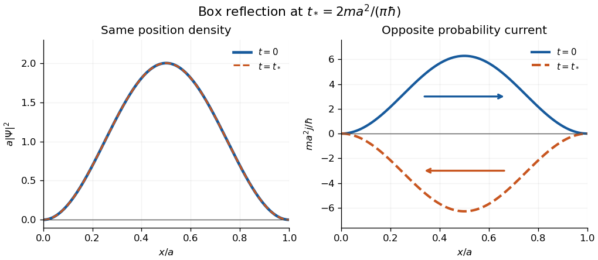

<h1 id="1/b/iii/solution">Solution</h1>

↑ **Parent:** [Iii](../iii.md)

Write $k=\pi/a$, $A=\sqrt{2/a}$ and $\Psi_0=Ae^{ikx}\sin kx$. Its derivative is

$$
\Psi_0'=Ak e^{ikx}(\cos kx+i\sin kx),\qquad |\Psi_0'|^2=A^2k^2.
$$

[Integration by parts](../../../../../integration-by-parts.md) with the [Dirichlet boundary conditions](../../../../../dirichlet-boundary-condition.md) gives the [energy expectation](../../../../../energy-expectation.md)

$$
\langle H\rangle_0=\frac{\hbar^2}{2m}\int_0^a|\Psi_0'|^2\,dx=\boxed{\frac{\pi^2\hbar^2}{ma^2}=2E_1.}
$$

It is **constant in time**, since the time-independent [Hamiltonian operator](../../../../../hamiltonian-quantum-mechanics.md) has fixed [energy measurement](../../../../../energy-measurement.md) probabilities: $\langle H\rangle_t=\sum_nE_n|c_n|^2$.

For the [midpoint parity operator](../../../../../midpoint-parity-operator.md), $R\Psi_0=-Ae^{-ikx}\sin kx$. Hence, again putting $u=kx$,

$$
\langle R\rangle_0=-\frac2\pi\int_0^\pi e^{-2iu}\sin^2u\,du=\boxed{\frac12.}
$$

Indeed the imaginary part integrates to zero by reflection and $\int_0^\pi\cos2u\sin^2u\,du=-\pi/4$. This [expectation value](../../../../../expectation-value.md) is also **constant in time**, because the bounded [self-adjoint operator](../../../../../self-adjoint-operator.md) $R$ commutes with $H$ and hence with its [time-evolution operator](../../../../../time-evolution-operator.md). Equivalently, $\langle R\rangle_t=\sum_n(-1)^{n+1}|c_n|^2$.

For the [momentum operator](../../../../../momentum-operator.md), direct evaluation gives

$$
\begin{aligned}
\langle P\rangle_0&=-i\hbar A^2k\int_0^a\sin kx(\cos kx+i\sin kx)\,dx\\
&=\hbar A^2k\frac a2=\boxed{\frac{\pi\hbar}{a}.}
\end{aligned}
$$

The real sine-cosine integral vanishes. This [expectation value](../../../../../expectation-value.md) is **not constant in time**: the [infinite square well](../../../../../infinite-square-well.md) walls reverse motion. One can prove the change exactly without approximating the [wavefunction](../../../../../wave-function-split.md). At

$$
t_* =\frac{\pi\hbar}{E_1}=\frac{2ma^2}{\pi\hbar},\qquad e^{-iE_nt_*/\hbar}=e^{-i\pi n^2}=(-1)^n,
$$

the [energy eigenstate](../../../../../energy-eigenstate.md) expansion and $R\psi_n=(-1)^{n+1}\psi_n$ give $\Psi(t_*)=-R\Psi_0$. Differentiation shows $PR=-RP$, so

$$
\boxed{\langle P\rangle_{t_*}=-\langle P\rangle_0=-\frac{\pi\hbar}{a}.}
$$

This [half revival in an infinite square well](../../../../../half-revival-in-an-infinite-square-well.md) is a concrete counterexample to momentum conservation. The sign from $-R$ is only a [global phase](../../../../../global-phase.md).

**[Figure 1](#1/b/iii/image-the-box-state-at-0-and-t-identical-position-probability-density-opposite-probability-current). The box state at $0$ and $t_*$: identical position probability density, opposite probability current**. Analytic curves in dimensionless coordinates; arrows indicate the current direction. The integrated current gives $\langle P\rangle/m$, so the reversed currents have opposite mean momentum.

The apparent interior identity $[H,P]=0$ cannot justify conservation here: the [momentum operator](../../../../../momentum-operator.md) does not preserve the [Dirichlet boundary conditions](../../../../../dirichlet-boundary-condition.md) of the [Hamiltonian operator](../../../../../hamiltonian-quantum-mechanics.md)'s [operator domain](../../../../../operator-domain.md). For sufficiently regular states, retaining the boundary terms in [Ehrenfest theorem](../../../../../ehrenfest-theorem.md) instead gives the [boundary force in an infinite square well](../../../../../boundary-force-in-an-infinite-square-well.md),

$$
\frac{d\langle P\rangle}{dt}=\frac{\hbar^2}{2m}\left(|\partial_x\Psi(0,t)|^2-|\partial_x\Psi(a,t)|^2\right).
$$

In the strictly confined interval, $-i\hbar\partial_x$ with both endpoint values zero is symmetric but not itself a [self-adjoint operator](../../../../../self-adjoint-operator.md). The requested integral is the conventional mean momentum; it also equals the full-line momentum mean of the zero-extended state, as measured upon releasing the walls. This domain distinction explains why the formal interior [commutator](../../../../../commutator.md) misses the wall force.

## ↑ Ancestors (13)

1. [Iii](../iii.md)
2. [B](../../b.md)
3. [1](../../../1.md)
4. [2017](../../../../2017-split.md)
5. [Past exam of the quantum theory course of the University of Oxford](../../../../split.md)
6. [Quantum theory course of the University of Oxford](../../../../../quantum-theory-course-of-the-university-of-oxford.md)
7. [Year 2 of the mathematics course of the University of Oxford](../../../../../year-2-of-the-mathematics-course-of-the-university-of-oxford.md)
8. [Mathematics course of the University of Oxford](../../../../../mathematics-course-of-the-university-of-oxford.md)
9. [Undergraduate course of the University of Oxford](../../../../../undergraduate-course-of-the-university-of-oxford.md)
10. [Course of the University of Oxford](../../../../../course-of-the-university-of-oxford.md)
11. [University of Oxford](../../../../../university-of-oxford-split.md)
12. [List of universities](../../../../../list-of-universities.md)
13. [Codex Wiki](../../../../../split.md)
