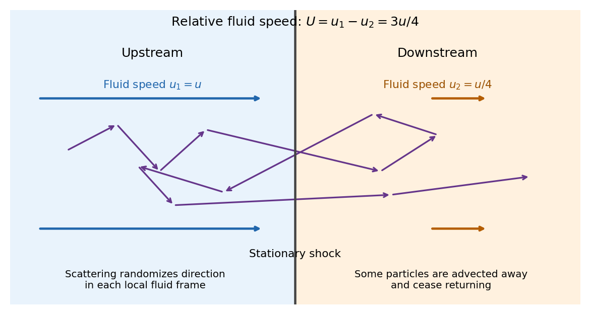
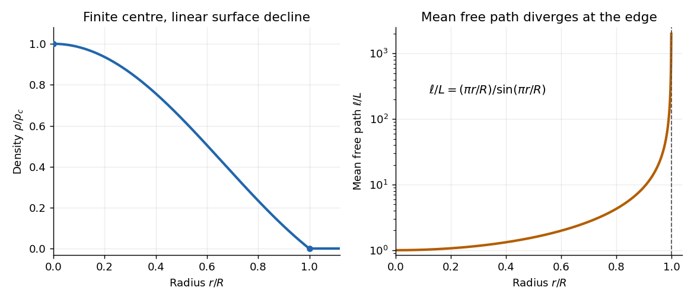

# 2024

↑ **Parent:** [Past exam of the radiative processes and high energy astrophysics course of the University of Oxford](../past-exam-of-the-radiative-processes-and-high-energy-astrophysics-course-of-the-university-of-oxford.md)

Source PDF: [Oxford, A15809W1, 10 June 2024](https://mmathphys.physics.ox.ac.uk/sites/g/files/vzsiac2991/files/mmathphys/documents/media/radiative_processes_and_high_energy_astrophysics.pdf). Solutions cover all three questions. The crossing convention in 1(b), the escape criterion and thermalization assumptions in 2, and the sightline in 3(e) are made explicit below.

**Table of contents**

- [1](#1)
  - [a](#1/a)
    - [Solution](#1/a/solution)
  - [b](#1/b)
    - [Solution](#1/b/solution)
  - [c](#1/c)
    - [Solution](#1/c/solution)
  - [d](#1/d)
    - [Solution](#1/d/solution)
  - [e](#1/e)
    - [Solution](#1/e/solution)
  - [f](#1/f)
    - [Solution](#1/f/solution)
- [2](#2)
  - [a](#2/a)
    - [Solution](#2/a/solution)
  - [b](#2/b)
    - [Solution](#2/b/solution)
  - [c](#2/c)
    - [Solution](#2/c/solution)
  - [d](#2/d)
    - [Solution](#2/d/solution)
  - [e](#2/e)
    - [Solution](#2/e/solution)
- [3](#3)
  - [a](#3/a)
    - [Solution](#3/a/solution)
  - [b](#3/b)
    - [Solution](#3/b/solution)
  - [c](#3/c)
    - [Solution](#3/c/solution)
  - [d](#3/d)
    - [Solution](#3/d/solution)
  - [e](#3/e)
    - [Solution](#3/e/solution)
  - [f](#3/f)
    - [Solution](#3/f/solution)

## 1

↑ **Parent:** [2024](2024.md)

<h3 id="1/a">a</h3>

↑ **Parent:** [1](#1)

<h4 id="1/a/solution">Solution</h4>

↑ **Parent:** [A](#1/a)

Use the [shock frame](../compressible-flow.md#shock-frame), with upstream and downstream fluid [velocities](../classical-mechanics.md#velocity) $u_1=u$ and $u_2=u/4$ pointing in the same direction. These are the [Strong-shock Rankine-Hugoniot conditions](../compressible-flow.md#strong-shock-rankine-hugoniot-conditions) for a nonrelativistic [monatomic gas](../ideal-gas.md#monatomic-gas) with [adiabatic index](../ideal-gas.md#heat-capacity-ratio) $5/3$. The two scattering media approach one another at relative [speed](../classical-mechanics.md#speed) $U=u_1-u_2=3u/4$, to first order in $u/c$. An energetic [electron](../physics.md#electron) repeatedly crosses the [shock wave](../transport-equation.md#shock-wave), scatters from [magnetic turbulence](../magnetohydrodynamics.md#magnetic-turbulence) carried by the local [plasma](../physics.md#plasma-physics), and returns. Each scattering approximately conserves its [energy](../energy.md) in the local fluid rest frame while changing its direction; comparing successive fluid frames produces a systematic [energy](../energy.md) and [momentum](../momentum.md) gain. The [energy](../energy.md) comes from the converging bulk flow, through the moving [magnetic field](../magnetic-field.md) irregularities and their associated [electric fields](../electric-field.md). This is [diffusive shock acceleration](../galaxy.md#diffusive-shock-acceleration), a [first-order Fermi acceleration](../galaxy.md#first-order-fermi-acceleration) process.

**[Figure 1](#1/a/image-repeated-shock-crossings-and-the-distinct-upstream-and-downstream-fluid-speeds-in-the-shock-frame). Repeated shock crossings and the distinct upstream and downstream fluid speeds in the shock frame**.

Let $\eta$ be the positive cosine of the crossing angle with the [shock wave](../transport-equation.md#shock-wave)'s normal. The [Lorentz transformation](../special-relativity.md#lorentz-transformation) between fluid frames gives, for either crossing direction with the corresponding sign of the normal reversed,

$$
E'=E+Up\eta+O(U^2/c^2).
$$

For an almost [isotropic](../continuum-mechanics.md#isotropy) population, the number crossing a unit area is weighted by its normal [velocity](../classical-mechanics.md#velocity). Thus the normalized crossing distribution is $2\eta\,d\eta$, rather than a uniform distribution in $\eta$, and

$$
\langle\eta\rangle=\frac{\int_0^1\eta^2\,d\eta}{\int_0^1\eta\,d\eta}=\frac23,
\qquad
\boxed{\langle\Delta E\rangle_{\rm crossing}=\frac23Up=\frac12up.}
$$

For an ultrarelativistic [electron](../physics.md#electron), $E\simeq pc$ and its [speed](../classical-mechanics.md#speed) $v\simeq c$, so

$$
\boxed{\frac{\langle\Delta E\rangle}{E}=\frac{u}{2c},\qquad
\frac{\langle\Delta p\rangle}{p}=\frac{u}{2c}.}
$$

More generally $dE/dp=v$ gives $\langle\Delta p\rangle/p=2U/(3v)$, while a nonrelativistic [kinetic energy](../energy.md#kinetic-energy) has $\langle\Delta K\rangle/K=4U/(3v)$. A complete upstream–downstream–upstream cycle contains **two** crossings and has ultrarelativistic fractional [energy](../energy.md) gain $u/c$.

The initially cold [electrons](../physics.md#electron) need an injection stage: [shock wave](../transport-equation.md#shock-wave) heating and small-scale [plasma](../physics.md#plasma-physics) processes must first produce particles with [speed](../classical-mechanics.md#speed) much larger than $u$ that can return across the front. The $v\simeq c$ result is a description of that accelerated population; a cold [electron](../physics.md#electron) cannot simply be assigned $E\simeq pc$ at its first encounter.

<h3 id="1/b">b</h3>

↑ **Parent:** [1](#1)

<h4 id="1/b/solution">Solution</h4>

↑ **Parent:** [B](#1/b)

In the ultrarelativistic regime of [a](#1/a), retaining a constant mean fractional [energy](../energy.md) gain and ignoring losses gives, after $N$ individual crossings,

$$
\boxed{E_N\simeq E_0\left(1+\frac{u}{2c}\right)^N
\simeq E_0\exp\!\left(\frac{Nu}{2c}\right).}
$$

After $n$ complete return cycles, $N=2n$ and $E_n\simeq E_0(1+u/c)^n$, to the same first-order accuracy. These products approximate the mean amplification; individual [electron](../physics.md#electron) crossing angles give a distribution around it.

The downstream [electron](../physics.md#electron) distribution is nearly [isotropic](../continuum-mechanics.md#isotropy). Its crossing [particle flux](../physics.md#particle-flux) per unit area is $n_{\rm a}c/4$, where $n_{\rm a}$ is the accelerated-particle [number density](../statistical-physics.md#number-density). The downstream flow permanently advects particles away at [particle flux](../physics.md#particle-flux) $n_{\rm a}u_2$. Their ratio estimates the escape probability after a downstream visit:

$$
P_{\rm esc}\simeq\frac{n_{\rm a}u_2}{n_{\rm a}c/4}
=\frac{4u_2}{c}=\frac uc,
\qquad \boxed{P_{\rm ret}\simeq1-\frac uc.}
$$

Upstream particles are swept back towards the [shock wave](../transport-equation.md#shock-wave) in this idealized infinite-upstream model. Consequently this return probability applies once per **complete cycle**, not once per individual crossing or local scattering event.

Let $A\simeq1+u/c$ be the amplification per complete cycle and $P=P_{\rm ret}$. A steady injection of $\mathcal N_0$ particles leaves $\mathcal N_0P^n$ surviving to reach $E=E_0A^n$. Eliminating $n$ gives the cumulative [power law](../analysis.md#power-law) and differential [energy](../energy.md) distribution

$$
\mathcal N(>E)\propto E^{\ln P/\ln A},\qquad
\frac{d\mathcal N}{dE}\propto E^{-s},\qquad
s=1-\frac{\ln P}{\ln A}\simeq2.
$$

The escape distribution has the same differential exponent when $P$ is independent of [energy](../energy.md). Thus the standard [Strong-shock Rankine-Hugoniot conditions](../compressible-flow.md#strong-shock-rankine-hugoniot-conditions) give

$$
\boxed{\mathcal N(>E)\propto E^{-1},\qquad d\mathcal N/dE\propto E^{-2}.}
$$

Equivalently the phase-space [one-particle distribution function](../boltzmann-equation.md#one-particle-distribution-function) is $f(p)\propto p^{-4}$ for ultrarelativistic particles. Equal logarithmic intervals then contain equal particle [energy](../energy.md). A finite source age, upstream escape, and radiative losses eventually introduce cutoffs or breaks.

A particle exponent is not automatically the [radiation spectral index](../electromagnetic-radiation.md#radiation-spectral-index). For [optically thin](../astrophysics.md#optically-thin-medium) uncooled [synchrotron radiation](../electromagnetic-radiation.md#synchrotron-radiation) from $d\mathcal N/dE\propto E^{-s}$, the characteristic [frequency](../wave.md#frequency) scales as $\nu\propto E^2$ and the emitted [power](../energy.md#power) as $E^2$. Hence $L_\nu\propto E^{-s}E^2/(d\nu/dE)\propto\nu^{-(s-1)/2}$. With the convention $L_\nu\propto\nu^{-\alpha}$, this gives $\boxed{\alpha\simeq1/2}$ and $\nu L_\nu\propto\nu^{1/2}$. Strong [synchrotron cooling](../electromagnetic-radiation.md#synchrotron-cooling) steepens a continuously injected particle distribution by one exponent, giving $\alpha\simeq1$ above its cooling break. A [photon](../quantum-mechanics.md#photon) number distribution $d\dot N_\gamma/d\varepsilon\propto\varepsilon^{-\Gamma}$ has $\Gamma=\alpha+1$, or $3/2$ in the uncooled case.

**Convention qualification.** If the printed $P=1-u/c$ is instead imposed independently at every individual crossing, its combination with $A_{\rm crossing}=1+u/(2c)$ gives $s\simeq3$ and uncooled $\alpha\simeq1$. For example $u/c=0.01$ gives $s=1-\ln(0.99)/\ln(1.005)\simeq3.015$, whereas the consistent cycle model gives $s\simeq2.010$. The standard $s=2$ estimate requires matching the probability and amplification to the same complete cycle.

<h3 id="1/c">c</h3>

↑ **Parent:** [1](#1)

<h4 id="1/c/solution">Solution</h4>

↑ **Parent:** [C](#1/c)

In a sufficiently tight [binary star](../stellar-astrophysics.md#binary-star), the [main sequence](../stellar-astrophysics.md#main-sequence) companion can fill its [Roche lobe](../stellar-astrophysics.md#roche-lobe). [Roche-lobe overflow](../stellar-astrophysics.md#roche-lobe-overflow) then transfers gas through the [inner Lagrange point](../celestial-mechanics.md#inner-lagrange-point) towards the [neutron star](../stellar-astrophysics.md#neutron-star). The gas carries [angular momentum](../momentum.md#angular-momentum), so it generally forms an [accretion disk](../astrophysical-disk.md#accretion-disk) rather than falling radially onto the surface. Internal stresses carry [angular momentum](../momentum.md#angular-momentum) outwards and permit [accretion](../astrophysics.md#accretion) inwards. Capture of a stellar wind is another possible supply mechanism if the companion does not fill its [Roche lobe](../stellar-astrophysics.md#roche-lobe).

Near the [neutron star](../stellar-astrophysics.md#neutron-star), the rapidly increasing [magnetic dipole field](../magnetic-field.md#magnetic-dipole-field), with $B\propto r^{-3}$, becomes dynamically important when its [magnetic pressure](../magnetohydrodynamics.md#magnetic-pressure) $B^2/(2\mu_0)$ is comparable to the inflow stresses. The [accretion disk](../astrophysical-disk.md#accretion-disk) is truncated around a magnetospheric radius. Ionized material attaches to [magnetic field lines](../magnetic-field.md#magnetic-field-line) and streams along them in [magnetically channelled accretion](../astrophysical-disk.md#magnetically-channelled-accretion), forming an [accretion column](../astrophysical-disk.md#accretion-column) above one or both magnetic poles. The [Lorentz force](../relativistic-electromagnetism.md#lorentz-force) impedes motion across the [magnetic field](../magnetic-field.md), but does not forbid motion parallel to it. Gas can therefore reach the polar surface, with its gravitational [potential energy](../energy.md#potential-energy) released in a hot [shock wave](../transport-equation.md#shock-wave) and radiation.

This description presumes the [neutron star](../stellar-astrophysics.md#neutron-star) rotates slowly enough for material to reach it: sufficiently rapid rotation can centrifugally expel the inflow instead. A strong [magnetic field](../magnetic-field.md) by itself does not guarantee surface [accretion](../astrophysics.md#accretion).

<h3 id="1/d">d</h3>

↑ **Parent:** [1](#1)

<h4 id="1/d/solution">Solution</h4>

↑ **Parent:** [D](#1/d)

Work in the locally planar [shock frame](../compressible-flow.md#shock-frame), taking $v_u,v_d>0$ towards the surface. For a stationary [normal shock wave](../compressible-flow.md#normal-shock-wave) with negligible radiative loss inside the discontinuity, the [Rankine-Hugoniot conditions for a perfect gas](../compressible-flow.md#rankine-hugoniot-conditions-for-a-perfect-gas) express [conservation of mass](../continuum-mechanics.md#mass-conservation), [conservation of momentum](../momentum.md#momentum-conservation), and [conservation of energy](../mathematical-physics.md#conservation-of-energy) per unit area as

$$
\boxed{\rho_uv_u=\rho_dv_d\equiv J,}
$$

$$
\boxed{P_u+\rho_uv_u^2=P_d+\rho_dv_d^2,}
$$

$$
\boxed{J\left(\frac{v_u^2}{2}+h_u\right)
=J\left(\frac{v_d^2}{2}+h_d\right),\qquad
h=\frac{\gamma}{\gamma-1}\frac P\rho.}
$$

Here $h$ is [specific enthalpy](../enthalpy.md#specific-enthalpy), including the [pressure](../pressure.md) work; using only [internal energy](../internal-energy.md) would omit that work. The [gravitational potential](../newton-s-law-of-universal-gravitation.md#newtonian-potential-of-a-point-mass) is continuous across an infinitesimally thin front. For cold upstream gas, $P_u$ and $h_u$ are negligible, while a [monatomic gas](../ideal-gas.md#monatomic-gas) has $\gamma=5/3$ and $h=5P/(2\rho)$.

The hydrodynamic equations apply to flow parallel to the guiding [magnetic field](../magnetic-field.md) when its stress contributions cancel across the front. An oblique [magnetohydrodynamic shock](../ideal-magnetohydrodynamics.md#magnetohydrodynamic-shock) requires magnetic stresses and [Poynting flux](../electromagnetic-wave.md#poynting-flux); a radiation-mediated front or appreciable escaping radiation requires the corresponding radiative [momentum](../momentum.md) and [energy flux](../mathematical-physics.md#energy-flux) terms. These are additional physics, not terms hidden in $h$ here.

<h3 id="1/e">e</h3>

↑ **Parent:** [1](#1)

<h4 id="1/e/solution">Solution</h4>

↑ **Parent:** [E](#1/e)

For the stipulated [Strong-shock Rankine-Hugoniot conditions](../compressible-flow.md#strong-shock-rankine-hugoniot-conditions), $\rho_d=4\rho_u$ and $v_d=v_u/4$. The [ideal gas law](../ideal-gas.md#ideal-gas-law) is $P_d=\rho_d k_BT_d/\mu$, with $\mu$ a dimensional [mean particle mass](../ideal-gas.md#mean-particle-mass). The [specific enthalpy](../enthalpy.md#specific-enthalpy) of a nonrelativistic [monatomic gas](../ideal-gas.md#monatomic-gas) is $5k_BT/(2\mu)$. Dividing the [energy flux](../mathematical-physics.md#energy-flux) equation in [d](#1/d) by the common [mass flux](../mathematical-physics.md#mass-flux) gives

$$
\frac{v_u^2}{2}=\frac{v_u^2}{32}+\frac{5k_BT_d}{2\mu}.
$$

Therefore

$$
\frac{5k_BT_d}{2\mu}=\frac{15v_u^2}{32},\qquad
\boxed{k_BT_d=\frac{3}{16}\mu v_u^2.}
$$

As an independent check, [conservation of momentum](../momentum.md#momentum-conservation) gives $P_d=\rho_uv_u^2-4\rho_u(v_u/4)^2=3\rho_uv_u^2/4$, and division by $\rho_d=4\rho_u$ gives exactly the same [temperature](../temperature.md). The numerical coefficient relies on $\gamma=5/3$ and the absence of dynamically important radiative or magnetic stresses.

<h3 id="1/f">f</h3>

↑ **Parent:** [1](#1)

<h4 id="1/f/solution">Solution</h4>

↑ **Parent:** [F](#1/f)

Interpret the terminal infall [speed](../classical-mechanics.md#speed) as the free-fall [speed](../classical-mechanics.md#speed) from a radius much larger than the [neutron star](../stellar-astrophysics.md#neutron-star) radius $R_*=12\,\mathrm{km}$. In the Newtonian estimate,

$$
v_u\simeq\sqrt{\frac{2GM_*}{R_*}}
=2.00\times10^8\,\mathrm{m\,s^{-1}}\simeq0.666c,
\qquad M_*=1.8M_\odot.
$$

For fully ionized [hydrogen](../chemical-substance.md#hydrogen) with [electrons](../physics.md#electron) and [protons](../physics.md#proton) at a common [temperature](../temperature.md), there are two particles per atom and $\mu=(m_p+m_e)/2\simeq m_p/2$. The result of [e](#1/e) then yields

$$
\boxed{k_BT_d=\frac{3GM_*m_p}{16R_*}\simeq39\,\mathrm{MeV},\qquad
T_d\simeq4.5\times10^{11}\,\mathrm K.}
$$

This is the thermal [energy](../energy.md) scale $k_BT_d$ per particle. In the same classical [monatomic gas](../ideal-gas.md#monatomic-gas) approximation, the mean random [kinetic energy](../energy.md#kinetic-energy) per particle is $3k_BT_d/2\simeq59\,\mathrm{MeV}$. Before the [shock wave](../transport-equation.md#shock-wave), the bulk [kinetic energy](../energy.md#kinetic-energy) per [proton](../physics.md#proton) is $m_pv_u^2/2=GM_*m_p/R_*\simeq208\,\mathrm{MeV}$. Distinguishing these quantities avoids an ambiguity in “particle energy”. If only the ions support the downstream [pressure](../pressure.md) because [electrons](../physics.md#electron) have not equilibrated, $\mu\simeq m_p$ instead gives $k_BT_i\simeq78\,\mathrm{MeV}$; that is a different, two-temperature assumption.

These are estimates within the question's Newtonian, $\gamma=5/3$ model. Its self-consistency is poor here: $2GM_*/(R_*c^2)\simeq0.443$, and $39\,\mathrm{MeV}$ is much larger than the [electron](../physics.md#electron) rest [energy](../energy.md) $0.511\,\mathrm{MeV}$. Relativistic [electrons](../physics.md#electron), electron–positron [pair production](../perturbative-quantum-field-theory.md#pair-production), radiation, unequal species [temperatures](../temperature.md), and [general relativity](../general-relativity.md) can alter the [equation of state](../pressure.md#equation-of-state) and [shock wave](../transport-equation.md#shock-wave) structure. In particular, the numerical $39\,\mathrm{MeV}$ must not be presented as a precision surface [temperature](../temperature.md) prediction.

## 2

↑ **Parent:** [2024](2024.md)

<h3 id="2/a">a</h3>

↑ **Parent:** [2](#2)

<h4 id="2/a/solution">Solution</h4>

↑ **Parent:** [A](#2/a)

Write $x=ar=\pi r/R$. The [mass density](../fluid-mechanics.md#density) has a finite central value because $\sin x/x\to1$ as $x\to0$, is monotonically decreasing on $0<x<\pi$, and first vanishes at $r=R$. Near the centre, $\rho/\rho_c=1-\pi^2r^2/(6R^2)+O(r^4/R^4)$; near the surface, $\rho/\rho_c\simeq(R-r)/R$. It is zero outside. The enclosed [mass](../classical-mechanics.md#mass) is

$$
m(r)=4\pi\int_0^r s^2\rho(s)\,ds
=\frac{4\pi\rho_c}{a^3}(\sin x-x\cos x).
$$

Consequently $M=m(R)=4\pi^2\rho_c/a^3=4\rho_cR^3/\pi$, so

$$
\boxed{\rho_c=\frac{\pi M}{4R^3},\qquad
\frac{\rho_c}{\bar\rho}=\frac{\pi^2}{3},\qquad
\bar\rho=\frac{3M}{4\pi R^3}.}
$$

This is the [polytrope of index one](../stellar-structure.md#polytrope-of-index-one) profile. Its derivative is negative because $\sin x-x\cos x>0$ for $0<x<\pi$: the latter function vanishes at zero and has derivative $x\sin x>0$.

**[Figure 2](#2/a/image-the-index-one-stellar-density-profile-and-the-diverging-thomson-scattering-mean-free-path). The index-one stellar density profile and the diverging Thomson-scattering mean free path**.

<h3 id="2/b">b</h3>

↑ **Parent:** [2](#2)

<h4 id="2/b/solution">Solution</h4>

↑ **Parent:** [B](#2/b)

Charge neutrality in fully ionized [hydrogen](../chemical-substance.md#hydrogen) gives $n_e=n_p$ and $\rho=(m_p+m_e)n_e\simeq m_pn_e$. With only [Thomson scattering](../cosmic-microwave-background-anisotropy.md#thomson-scattering), the [photon](../quantum-mechanics.md#photon) [mean free path](../ideal-gas.md#mean-free-path) is $\ell=(n_e\sigma_T)^{-1}$. Hence

$$
\boxed{\ell(r)=L\frac{ar}{\sin ar},\qquad
L=\frac{m_p}{\sigma_T\rho_c}=\frac{4m_pR^3}{\pi\sigma_TM},\qquad
\frac LR=\frac{4m_pR^2}{\pi\sigma_TM}.}
$$

Here and below the tiny [electron mass](../physics.md#electron-mass) correction can be retained by replacing $m_p$ by $m_p+m_e$. $L$ is the central [mean free path](../ideal-gas.md#mean-free-path), not a [luminosity](../astrophysics.md#luminosity). The divergence at $r=R$ reflects the vanishing [electron](../physics.md#electron) [number density](../statistical-physics.md#number-density).

Using $M_\odot=1.9885\times10^{30}\,\mathrm{kg}$, $R_\odot=6.957\times10^8\,\mathrm m$, $m_p=1.6726\times10^{-27}\,\mathrm{kg}$, and $\sigma_T=6.6525\times10^{-29}\,\mathrm{m^2}$ gives

$$
\rho_c\simeq4.64\times10^3\,\mathrm{kg\,m^{-3}},\qquad
\boxed{L_\odot\simeq5.42\times10^{-3}\,\mathrm m,\qquad L_\odot/R_\odot\simeq7.79\times10^{-12}.}
$$

These are this profile's values, rather than the [Sun](../stellar-astrophysics.md#sun)'s actual central [mass density](../fluid-mechanics.md#density) or opacity profile.

<h3 id="2/c">c</h3>

↑ **Parent:** [2](#2)

<h4 id="2/c/solution">Solution</h4>

↑ **Parent:** [C](#2/c)

Put $\Delta=R-r\ll R$. The near-surface [mass density](../fluid-mechanics.md#density) and [mean free path](../ideal-gas.md#mean-free-path) from [a](#2/a) and [b](#2/b) are

$$
\rho\simeq\rho_c\frac\Delta R,\qquad
\ell\simeq\frac{LR}{\Delta}.
$$

A simple local escape estimate sets the remaining distance equal to the [mean free path](../ideal-gas.md#mean-free-path), $\ell\simeq\Delta$. It gives

$$
\boxed{\Delta R_{\rm esc,local}\simeq\sqrt{LR},\qquad
\frac{\Delta R_{\rm esc,local}}R\simeq\sqrt{\frac LR}.}
$$

For the [Sun](../stellar-astrophysics.md#sun)'s parameters this is $\boxed{\Delta R_{\rm esc,local}\simeq1.94\,\mathrm{km},\quad\Delta R_{\rm esc,local}/R\simeq2.79\times10^{-6}}$.

A more precise operational definition uses the outward radial [optical depth](../astrophysics.md#optical-depth). In this varying [mass density](../fluid-mechanics.md#density),

$$
\tau(r)=\int_r^R\frac{ds}{\ell(s)}
=\frac1{aL}\int_{ar}^{\pi}\frac{\sin x}{x}\,dx
\simeq\frac{\Delta^2}{2LR}.
$$

The chance of an outward radial [photon](../quantum-mechanics.md#photon) escaping without another scattering is $e^{-\tau}$. Thus the conventional $\tau=1$ last-scattering depth gives

$$
\boxed{\Delta R_{\rm esc,\tau=1}\simeq\sqrt{2LR}
\simeq2.75\,\mathrm{km},\qquad
\Delta R_{\rm esc,\tau=1}/R\simeq3.95\times10^{-6}.}
$$

There is no sharp escape surface: $\tau\ll1$ gives nearly free propagation, and oblique rays have different [optical depths](../astrophysics.md#optical-depth). The local $\ell=\Delta$ estimate actually has $\tau\simeq1/2$ in this model, not $1$; the factor $\sqrt2$ is a convention-dependent order-one correction, not a discrepancy in the [Thomson cross-section](../cosmic-microwave-background-anisotropy.md#thomson-cross-section). Neither scattering criterion establishes a thermalization surface.

<h3 id="2/d">d</h3>

↑ **Parent:** [2](#2)

<h4 id="2/d/solution">Solution</h4>

↑ **Parent:** [D](#2/d)

For a spherical [star](../stellar-astrophysics.md#star) in Newtonian [hydrostatic equilibrium](../statistical-physics.md#hydrostatic-equilibrium), the total supporting [pressure](../pressure.md) satisfies

$$
\frac{dP}{dr}=-\frac{Gm(r)\rho(r)}{r^2},\qquad P(R)=0,
$$

where zero external [pressure](../pressure.md) is the idealized vacuum boundary condition. Substitute the enclosed [mass](../classical-mechanics.md#mass) from [a](#2/a), set $x=ar$, and integrate inwards:

$$
P(r)=\frac{4\pi G\rho_c^2}{a^2}
\int_{ar}^{\pi}\frac{\sin x(\sin x-x\cos x)}{x^3}\,dx.
$$

The supplied [integral](../integral.md) follows directly by differentiating $\tfrac12(\sin x/x)^2$. It yields

$$
\boxed{P(r)=\frac{2\pi G\rho_c^2}{a^2}
\left(\frac{\sin ar}{ar}\right)^2
=\frac{2GR^2}{\pi}\rho(r)^2.}
$$

Thus $P_c=\pi GM^2/(8R^4)$, about $4.42\times10^{14}\,\mathrm{Pa}$ for the [Sun](../stellar-astrophysics.md#sun)'s parameters. This is precisely the [equation of state](../pressure.md#equation-of-state) of a [polytrope of index one](../stellar-structure.md#polytrope-of-index-one).

For nonrelativistic fully ionized [hydrogen](../chemical-substance.md#hydrogen) with [electrons](../physics.md#electron) and [protons](../physics.md#proton) at a common [temperature](../temperature.md), the [gas pressure](../pressure.md#gas-pressure) is $P_g=(n_e+n_p)k_BT=2\rho k_BT/m_p$. If [gas pressure](../pressure.md#gas-pressure) dominates, the resulting [temperature](../temperature.md) profile is

$$
\boxed{T_g(r)=\frac{m_pP(r)}{2k_B\rho(r)}
=T_c\frac{\sin ar}{ar},\qquad
T_c=\frac{GMm_p}{4Rk_B}.}
$$

Numerically $T_c\simeq5.78\times10^6\,\mathrm K$ for the [Sun](../stellar-astrophysics.md#sun)'s parameters, and $T_g$ tends to zero at the idealized outer edge.

If the [photons](../quantum-mechanics.md#photon) are additionally assumed to be in [local thermodynamic equilibrium](../astrophysics.md#local-thermodynamic-equilibrium) with this gas, their [radiation pressure](../pressure.md#radiation-pressure) is $a_{\rm rad}T^4/3$, with $a_{\rm rad}=4\sigma_{\rm SB}/c$. The consistent [temperature](../temperature.md) is instead the unique nonnegative root of

$$
\boxed{\frac{2\rho(r)k_B}{m_p}T(r)+\frac{a_{\rm rad}}3T(r)^4=P(r).}
$$

The left side is strictly increasing in $T$ for $r<R$, so the root is unique. Evaluating the [radiation pressure](../pressure.md#radiation-pressure) at $T_g$ gives at most $P_{\rm rad}/P\simeq6.4\times10^{-4}$ for the [Sun](../stellar-astrophysics.md#sun)'s parameters, at the centre; the ratio decreases approximately as $(\sin ar/ar)^2$ outwards. The gas-only profile is consequently an excellent approximation _within this imposed stellar model_.

[Hydrostatic equilibrium](../statistical-physics.md#hydrostatic-equilibrium) by itself fixes total [pressure](../pressure.md), not how it is divided between gas and radiation. [Thomson scattering](../cosmic-microwave-background-anisotropy.md#thomson-scattering) alone does not enforce a common gas–radiation [temperature](../temperature.md) or a [Planck photon distribution](../statistical-physics.md#planck-photon-distribution). Without either neglecting [radiation pressure](../pressure.md#radiation-pressure) or specifying the radiation field and its thermodynamic closure, a unique gas [temperature](../temperature.md) cannot be inferred from the given [mass density](../fluid-mechanics.md#density) alone.

<h3 id="2/e">e</h3>

↑ **Parent:** [2](#2)

<h4 id="2/e/solution">Solution</h4>

↑ **Parent:** [E](#2/e)

Under an additional thermalization assumption, an opaque [star](../stellar-astrophysics.md#star) emits approximately [black-body radiation](../statistical-physics.md#black-body-radiation) characterized by the [temperature](../temperature.md) near the layer from which thermal [photons](../quantum-mechanics.md#photon) escape. [Planck's law](../statistical-physics.md#planck-s-law) gives a [Rayleigh-Jeans law](../astrophysics.md#rayleigh-jeans-law) low-[frequency](../wave.md#frequency) tail $B_\nu\propto T\nu^2$ and a [Wien approximation](../astrophysics.md#wien-approximation) high-[frequency](../wave.md#frequency) tail $B_\nu\propto\nu^3e^{-h\nu/(k_BT)}$.

Using the gas-dominated [temperature](../temperature.md) profile in [d](#2/d) and the local escape criterion in [c](#2/c), the model's putative emission [temperature](../temperature.md) for the [Sun](../stellar-astrophysics.md#sun)'s parameters would be

$$
T_{\rm esc}\simeq T_c\frac{\Delta R_{\rm esc}}R
\simeq16.1\,\mathrm K.
$$

Using radial $\tau=1$ instead gives $22.8\,\mathrm K$. The [frequency form of Wien's displacement law](../astrophysics.md#frequency-form-of-wien-s-displacement-law) for the maximum of $B_\nu$ is $h\nu_{\max}/(k_BT)=2.82144$, so these two prescriptions predict

$$
\boxed{\nu_{\max}\simeq9.5\times10^{11}\,\mathrm{Hz}
\quad\hbox{or}\quad1.34\times10^{12}\,\mathrm{Hz},}
$$

respectively, in the far infrared/submillimetre region. These are conditional estimates for this model, not observed solar peaks. A realistic solar [effective temperature](../stellar-structure.md#effective-temperature) near $5.8\times10^3\,\mathrm K$ gives $\nu_{\max}\simeq3.4\times10^{14}\,\mathrm{Hz}$ in $B_\nu$. The maximum of $B_\lambda$ occurs near $0.50\,\mathrm{\mu m}$; it is not obtained by simply taking $c/\nu_{\max}$, because spectral densities transform with a [Jacobian determinant](../multivariable-calculus.md#jacobian-determinant).

The model is unsuitable for the solar [photosphere](../stellar-structure.md#photosphere): fully ionized [hydrogen](../chemical-substance.md#hydrogen) at $16$–$23\,\mathrm K$ is inconsistent with thermal ionization, and the assumed opacity and near-surface [temperature](../temperature.md) gradient do not resemble the [Sun](../stellar-astrophysics.md#sun)'s. Even its central [temperature](../temperature.md) is substantially below the actual solar value, about $1.6\times10^7\,\mathrm K$.

There is a further logical limitation: the question retains **only [Thomson scattering](../cosmic-microwave-background-anisotropy.md#thomson-scattering)**. In its coherent, cold-[electron](../physics.md#electron) limit, this redistributes [photon](../quantum-mechanics.md#photon) directions without generating a [Planck photon distribution](../statistical-physics.md#planck-photon-distribution). For a concrete counterexample, monochromatic injected radiation remains monochromatic after any number of such elastic scatterings; large [optical depth](../astrophysics.md#optical-depth) cannot turn it into [black-body radiation](../statistical-physics.md#black-body-radiation). True absorption and emission, or a specified pre-existing thermal radiation field with appropriate energy exchange, are missing. Thus an approximately [blackbody](../astrophysics.md#blackbody) emergent spectrum is the usual additional physical assumption, while the stated scattering-only model does not uniquely predict an emergent spectrum or its peak.

## 3

↑ **Parent:** [2024](2024.md)

<h3 id="3/a">a</h3>

↑ **Parent:** [3](#3)

<h4 id="3/a/solution">Solution</h4>

↑ **Parent:** [A](#3/a)

[Thermal bremsstrahlung](../astrophysics.md#thermal-bremsstrahlung) is radiation from the acceleration of [electrons](../physics.md#electron) in the [Coulomb force](../electrostatics.md#coulomb-force) of ions. At fixed [temperature](../temperature.md), the encounter rate per [electron](../physics.md#electron) is proportional to ion [number density](../statistical-physics.md#number-density) $n_i$, and the number of radiating [electrons](../physics.md#electron) per unit [volume](../geometry-and-topology.md#volume) is $n_e$. Therefore $j_\nu\propto n_en_i$ in a dilute, [optically thin](../astrophysics.md#optically-thin-medium) [plasma](../physics.md#plasma-physics). This is a binary-encounter rate, not a one-particle emission process.

For a fixed encounter geometry, the ionic [electric field](../electric-field.md) and hence the [electron](../physics.md#electron) acceleration are proportional to ionic charge $Ze$. The [Larmor formula](../electromagnetic-radiation.md#larmor-formula) is quadratic in acceleration, giving $j_\nu\propto Z^2$ at fixed species [number densities](../statistical-physics.md#number-density). The dimensionless [Gaunt factor](../astrophysics.md#gaunt-factor) $g(\nu,T)$ corrects the simple classical result for the detailed quantum scattering and radiation calculation, after averaging over the thermal [electron](../physics.md#electron) distribution. It depends on [frequency](../wave.md#frequency) and [temperature](../temperature.md) and, in a more complete notation, ionic charge.

<h3 id="3/b">b</h3>

↑ **Parent:** [3](#3)

<h4 id="3/b/solution">Solution</h4>

↑ **Parent:** [B](#3/b)

For $h\nu\ll k_BT$, expand the exponential in the [thermal free-free emissivity](../astrophysics.md#thermal-free-free-emissivity):

$$
e^{-h\nu/(k_BT)}=1-\frac{h\nu}{k_BT}+O\!\left(\frac{h^2\nu^2}{k_B^2T^2}\right).
$$

The [energy](../energy.md) emitted per unit [frequency](../wave.md#frequency) is therefore approximately flat, with the weak [Gaunt factor](../astrophysics.md#gaunt-factor) dependence superposed. At these low [photon](../quantum-mechanics.md#photon) [energies](../energy.md), most of the thermal [electrons](../physics.md#electron) can participate in emission; there is no exponentially small population threshold.

For $h\nu>k_BT$, the spectrum turns down approximately as $e^{-h\nu/(k_BT)}$, apart from the [Gaunt factor](../astrophysics.md#gaunt-factor). [Conservation of energy](../mathematical-physics.md#conservation-of-energy) requires an emitting [electron](../physics.md#electron) to supply at least $h\nu$. The high-[energy](../energy.md) tail of its [Maxwell-Boltzmann distribution](../quantum-ideal-gas-statistics.md#maxwell-boltzmann-distribution) is exponentially rare, which produces this cutoff.

“Flat” refers to $j_\nu$, an [energy](../energy.md) spectrum per unit [frequency](../wave.md#frequency). The emitted [photon](../quantum-mechanics.md#photon) number spectrum instead contains $1/(h\nu)$, while [energy](../energy.md) per logarithmic [frequency](../wave.md#frequency) interval is $\nu j_\nu$. At sufficiently low [frequency](../wave.md#frequency) the [plasma](../physics.md#plasma-physics) can also become [optically thick](../astrophysics.md#optically-thick-medium) to [free-free absorption](../electromagnetic-radiation.md#free-free-absorption); the given optically thin emissivity is then not the escaping spectrum.

<h3 id="3/c">c</h3>

↑ **Parent:** [3](#3)

<h4 id="3/c/solution">Solution</h4>

↑ **Parent:** [C](#3/c)

Neglect [electron mass](../physics.md#electron-mass) and nuclear binding corrections when converting [mass density](../fluid-mechanics.md#density) $\rho$ into [hydrogen](../chemical-substance.md#hydrogen) and [helium](../chemical-substance.md#helium) [number densities](../statistical-physics.md#number-density). With $x=x_H$,

$$
n_H=\frac{x\rho}{m_p},\qquad n_{\rm He}=\frac{(1-x)\rho}{4m_p},\qquad
n_e=n_H+2n_{\rm He}=\frac{(1+x)\rho}{2m_p}.
$$

The [thermal free-free emissivity](../astrophysics.md#thermal-free-free-emissivity) adds over ion species with weights $Z_i^2$. Consequently

$$
\sum_i Z_i^2n_i=n_H+4n_{\rm He}=\frac\rho{m_p}=\frac{2n_e}{1+x}.
$$

With each [Gaunt factor](../astrophysics.md#gaunt-factor) set to one, the mixture has

$$
\boxed{j_\nu=j_0\frac{2}{1+x_H}
\left(\frac{n_e}{10^{-3}\,\mathrm{cm}^{-3}}\right)^2
\sqrt{\frac{T_0}{T}}e^{-h\nu/(k_BT)}.}
$$

At fixed $n_e$, pure [hydrogen](../chemical-substance.md#hydrogen) gives the composition factor $1$, and pure [helium](../chemical-substance.md#helium) gives $2$. The latter check follows independently from $n_{\rm He}=n_e/2$ and $Z^2=4$; simply replacing $Z$ by an average charge would lose this weighting.

<h3 id="3/d">d</h3>

↑ **Parent:** [3](#3)

<h4 id="3/d/solution">Solution</h4>

↑ **Parent:** [D](#3/d)

The coefficient $j_\nu$ is [power](../energy.md#power) per unit [volume](../geometry-and-topology.md#volume), [frequency](../wave.md#frequency) and [solid angle](../euclidean-geometry.md#solid-angle). For uniform, [optically thin](../astrophysics.md#optically-thin-medium), [isotropic](../continuum-mechanics.md#isotropy) emission from $V=4\pi R^3/3$, the [spectral luminosity](../astrophysics.md#spectral-luminosity) is $L_\nu=4\pi Vj_\nu$. With [photon](../quantum-mechanics.md#photon) [energy](../energy.md) $\varepsilon=h\nu$, [conservation of energy](../mathematical-physics.md#conservation-of-energy) and the change of spectral variable give

$$
L_\nu\,d\nu=\varepsilon L_\varepsilon^X\,d\varepsilon,
\qquad d\nu=\frac{d\varepsilon}{h}.
$$

Thus

$$
\boxed{L_\varepsilon^X=\frac{4\pi}{h\varepsilon}\frac{4\pi R^3}{3}
 j_0\frac{2}{1+x_H}
\left(\frac{n_e}{10^{-3}\,\mathrm{cm}^{-3}}\right)^2
\sqrt{\frac{T_0}{T}}e^{-\varepsilon/(k_BT)}.}
$$

The $4\pi$ outside $V$ integrates over emitted [solid angle](../euclidean-geometry.md#solid-angle); $1/\varepsilon$ changes radiated [energy](../energy.md) to a [photon](../quantum-mechanics.md#photon) count, and $1/h$ is the [Jacobian determinant](../multivariable-calculus.md#jacobian-determinant) from [frequency](../wave.md#frequency) to [energy](../energy.md).

With $h$ in $\mathrm{J\,s}$ and $\varepsilon$ in joules, this formula produces $\mathrm{J^{-1}\,s^{-1}}$. To compare with counts per $\mathrm{keV}$, multiply by $1.602176634\times10^{-16}\,\mathrm{J/keV}$. Equivalently, the conversion cancels the same joule-per-$\mathrm{keV}$ factor in $\varepsilon$: one can use the numerical $\varepsilon$ in $\mathrm{keV}$ in the $1/\varepsilon$ factor, retain $h$ in $\mathrm{J\,s}$, and express $k_BT$ in $\mathrm{keV}$ in the exponential. The radius in the [volume](../geometry-and-topology.md#volume) must still be converted to metres because $j_0$ is per $\mathrm{m^3}$.

<h3 id="3/e">e</h3>

↑ **Parent:** [3](#3)

<h4 id="3/e/solution">Solution</h4>

↑ **Parent:** [E](#3/e)

In the [thermal Sunyaev-Zeldovich effect](../cosmic-microwave-background.md#thermal-sunyaev-zeldovich-effect), hot intracluster [electrons](../physics.md#electron) transfer [energy](../energy.md) to [cosmic microwave background](../cosmic-microwave-background.md) [photons](../quantum-mechanics.md#photon) by [inverse Compton scattering](../mathematical-physics.md#inverse-compton-scattering). Their thermal [energy](../energy.md) is much larger than the [CMB](../cosmic-microwave-background.md) [photon](../quantum-mechanics.md#photon) [energy](../energy.md); in the nonrelativistic limit the mean fractional [photon](../quantum-mechanics.md#photon) [energy](../energy.md) gain per scattering is about $4k_BT/(m_ec^2)$. Multiplication by the incremental [Thomson scattering](../cosmic-microwave-background-anisotropy.md#thomson-scattering) [optical depth](../astrophysics.md#optical-depth) $d\tau=\sigma_Tn_e\,dx$ explains why $y=\int[k_BT/(m_ec^2)]\,d\tau$ measures the electron [pressure](../pressure.md) integrated along the line of sight. The result is a spectral distortion, with a low-[frequency](../wave.md#frequency) decrement and a high-[frequency](../wave.md#frequency) increment, rather than a positive additional emission component at every [frequency](../wave.md#frequency).

For a uniform sphere, a line of sight at impact parameter $b$ has path length $2\sqrt{R^2-b^2}$. Therefore

$$
\boxed{y(b)=\frac{2\sigma_T}{m_ec^2}n_ek_BT\sqrt{R^2-b^2},\qquad 0\le b\le R.}
$$

On the central line of sight this reduces to the requested expression

$$
\boxed{y(0)=\frac{2\sigma_T}{m_ec^2}Rn_ek_BT.}
$$

The central-ray qualification matters: the average over the projected disk is $\bar y=(2/3)y(0)$, while the tangent ray $b=R$ has $y(R)=0$. Thus the printed formula does not hold for an arbitrary sightline. Part [f](#3/f) uses the specified $y$ as this central value, as required by the preceding formula.

<h3 id="3/f">f</h3>

↑ **Parent:** [3](#3)

<h4 id="3/f/solution">Solution</h4>

↑ **Parent:** [F](#3/f)

Write $\Theta=k_BT$ in $\mathrm{keV}$. The [photon](../quantum-mechanics.md#photon) count ratio in [d](#3/d) eliminates [radius](../topology.md#radius), [electron](../physics.md#electron) [number density](../statistical-physics.md#number-density) and the common normalization:

$$
\frac{L_{\varepsilon_1}^X}{L_{\varepsilon_2}^X}
=\frac{\varepsilon_2}{\varepsilon_1}
\exp\!\left(\frac{\varepsilon_2-\varepsilon_1}{\Theta}\right).
$$

The extra $\varepsilon_2/\varepsilon_1$ is essential for a [photon](../quantum-mechanics.md#photon) number spectrum. Hence

$$
\boxed{\Theta=\frac{5-0.2}{\ln\!\left[\frac{(2.88\times10^{54})(0.2)}{(4.40\times10^{50})(5)}\right]}
=0.86212\,\mathrm{keV},\qquad
T=1.00045\times10^7\,\mathrm K.}
$$

The measured central [Compton y parameter](../mathematical-physics.md#compton-y-parameter) and the supplied conversion coefficient then determine a column combination:

$$
Rn_e=\frac{y}{2(0.004)\Theta}
=2.00087\times10^{-3}\,\mathrm{Mpc\,cm^{-3}}\equiv Y.
$$

To determine the two remaining quantities separately, define $\widehat R=R/(1\,\mathrm{Mpc})$ and $\widehat n=n_e/(1\,\mathrm{cm^{-3}})$. Use $1\,\mathrm{Mpc}=3.08567758\times10^{22}\,\mathrm m$, $h=6.62607015\times10^{-34}\,\mathrm{J\,s}$, $j_0=4.885\times10^{-51}\,\mathrm{W\,m^{-3}\,Hz^{-1}\,sr^{-1}}$, $T_0=1.977\times10^9\,\mathrm K$, and $x_H=0.76$ in [d](#3/d). With the spectral unit conversion explained there, the $0.2\,\mathrm{keV}$ count [luminosity](../astrophysics.md#luminosity) is

$$
L_{0.2}^X=\left(7.22106\times10^{59}\,\mathrm{keV^{-1}\,s^{-1}}\right)
\widehat R^3\widehat n^2.
$$

Explicitly the numerical coefficient is

$$
\frac{4\pi}{h(0.2)}\frac{4\pi}{3}
(3.08567758\times10^{22})^3j_0\frac{2}{1.76}
10^6\sqrt{\frac{T_0}{T}}e^{-0.2/\Theta}.
$$

Since $\widehat R\widehat n=0.00200087$, substitution gives $\widehat R^3\widehat n^2=\widehat R(0.00200087)^2$, so

$$
\boxed{R=0.9962\,\mathrm{Mpc}\simeq1.00\,\mathrm{Mpc},\qquad
n_e=2.0085\times10^{-3}\,\mathrm{cm^{-3}}\simeq2.00\times10^{-3}\,\mathrm{cm^{-3}}.}
$$

Rounding consistently with the supplied coefficient $0.004$, the cluster has $T\simeq10^7\,\mathrm K$, $R\simeq1\,\mathrm{Mpc}$ and $n_e\simeq2\times10^{-3}\,\mathrm{cm^{-3}}$. Substituting the unrounded values into both [X-ray](../electromagnetic-radiation.md#x-ray) count [luminosities](../astrophysics.md#luminosity) gives $2.8800\times10^{54}$ and $4.4000\times10^{50}\,\mathrm{keV^{-1}\,s^{-1}}$, and the central [Compton y parameter](../mathematical-physics.md#compton-y-parameter) returns $1.3800\times10^{-5}$. If the observed $y$ were a projected-disk average, its central value would be $3/2$ times larger and this same inversion would give $R$ smaller by $4/9$ and $n_e$ larger by $27/8$; specifying the sightline is therefore part of the inference.

## ↑ Ancestors (9)

1. [Past exam of the radiative processes and high energy astrophysics course of the University of Oxford](../past-exam-of-the-radiative-processes-and-high-energy-astrophysics-course-of-the-university-of-oxford.md)
2. [Radiative processes and high energy astrophysics course of the University of Oxford](../university-of-oxford.md#radiative-processes-and-high-energy-astrophysics-course-of-the-university-of-oxford)
3. [Year 4 of the mathematical and theoretical physics course of the University of Oxford](../university-of-oxford.md#year-4-of-the-mathematical-and-theoretical-physics-course-of-the-university-of-oxford)
4. [Mathematical and theoretical physics course of the University of Oxford](../university-of-oxford.md#mathematical-and-theoretical-physics-course-of-the-university-of-oxford)
5. [Undergraduate course of the University of Oxford](../university-of-oxford.md#undergraduate-course-of-the-university-of-oxford)
6. [Course of the University of Oxford](../university-of-oxford.md#course-of-the-university-of-oxford)
7. [University of Oxford](../university-of-oxford.md)
8. [List of universities](../README.md#list-of-universities)
9. [Codex Wiki](../README.md)
