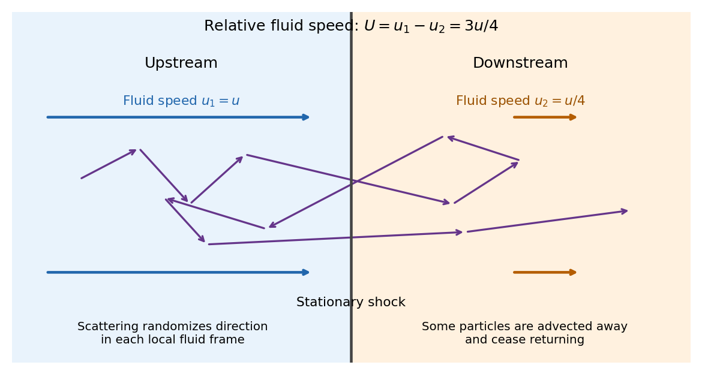

<h1 id="1/a/solution">Solution</h1>

↑ **Parent:** [A](../a.md)

Use the [shock frame](../../../../shock-frame.md), with upstream and downstream fluid [velocities](../../../../velocity.md) $u_1=u$ and $u_2=u/4$ pointing in the same direction. These are the [Strong-shock Rankine-Hugoniot conditions](../../../../strong-shock-rankine-hugoniot-conditions.md) for a nonrelativistic [monatomic gas](../../../../monatomic-gas.md) with [adiabatic index](../../../../heat-capacity-ratio.md) $5/3$. The two scattering media approach one another at relative [speed](../../../../speed.md) $U=u_1-u_2=3u/4$, to first order in $u/c$. An energetic [electron](../../../../electron.md) repeatedly crosses the [shock wave](../../../../shock-wave.md), scatters from [magnetic turbulence](../../../../magnetic-turbulence.md) carried by the local [plasma](../../../../plasma-physics.md), and returns. Each scattering approximately conserves its [energy](../../../../energy-split.md) in the local fluid rest frame while changing its direction; comparing successive fluid frames produces a systematic [energy](../../../../energy-split.md) and [momentum](../../../../momentum-split.md) gain. The [energy](../../../../energy-split.md) comes from the converging bulk flow, through the moving [magnetic field](../../../../magnetic-field-split.md) irregularities and their associated [electric fields](../../../../electric-field-split.md). This is [diffusive shock acceleration](../../../../diffusive-shock-acceleration.md), a [first-order Fermi acceleration](../../../../first-order-fermi-acceleration.md) process.

**[Figure 1](#1/a/image-repeated-shock-crossings-and-the-distinct-upstream-and-downstream-fluid-speeds-in-the-shock-frame). Repeated shock crossings and the distinct upstream and downstream fluid speeds in the shock frame**.

Let $\eta$ be the positive cosine of the crossing angle with the [shock wave](../../../../shock-wave.md)'s normal. The [Lorentz transformation](../../../../lorentz-transformation.md) between fluid frames gives, for either crossing direction with the corresponding sign of the normal reversed,

$$
E'=E+Up\eta+O(U^2/c^2).
$$

For an almost [isotropic](../../../../isotropy.md) population, the number crossing a unit area is weighted by its normal [velocity](../../../../velocity.md). Thus the normalized crossing distribution is $2\eta\,d\eta$, rather than a uniform distribution in $\eta$, and

$$
\langle\eta\rangle=\frac{\int_0^1\eta^2\,d\eta}{\int_0^1\eta\,d\eta}=\frac23,
\qquad
\boxed{\langle\Delta E\rangle_{\rm crossing}=\frac23Up=\frac12up.}
$$

For an ultrarelativistic [electron](../../../../electron.md), $E\simeq pc$ and its [speed](../../../../speed.md) $v\simeq c$, so

$$
\boxed{\frac{\langle\Delta E\rangle}{E}=\frac{u}{2c},\qquad
\frac{\langle\Delta p\rangle}{p}=\frac{u}{2c}.}
$$

More generally $dE/dp=v$ gives $\langle\Delta p\rangle/p=2U/(3v)$, while a nonrelativistic [kinetic energy](../../../../kinetic-energy.md) has $\langle\Delta K\rangle/K=4U/(3v)$. A complete upstream–downstream–upstream cycle contains **two** crossings and has ultrarelativistic fractional [energy](../../../../energy-split.md) gain $u/c$.

The initially cold [electrons](../../../../electron.md) need an injection stage: [shock wave](../../../../shock-wave.md) heating and small-scale [plasma](../../../../plasma-physics.md) processes must first produce particles with [speed](../../../../speed.md) much larger than $u$ that can return across the front. The $v\simeq c$ result is a description of that accelerated population; a cold [electron](../../../../electron.md) cannot simply be assigned $E\simeq pc$ at its first encounter.

## ↑ Ancestors (12)

1. [A](../a.md)
2. [1](../../1.md)
3. [2024](../../../2024-split.md)
4. [Past exam of the radiative processes and high energy astrophysics course of the University of Oxford](../../../split.md)
5. [Radiative processes and high energy astrophysics course of the University of Oxford](../../../../radiative-processes-and-high-energy-astrophysics-course-of-the-university-of-oxford.md)
6. [Year 4 of the mathematical and theoretical physics course of the University of Oxford](../../../../year-4-of-the-mathematical-and-theoretical-physics-course-of-the-university-of-oxford.md)
7. [Mathematical and theoretical physics course of the University of Oxford](../../../../mathematical-and-theoretical-physics-course-of-the-university-of-oxford.md)
8. [Undergraduate course of the University of Oxford](../../../../undergraduate-course-of-the-university-of-oxford.md)
9. [Course of the University of Oxford](../../../../course-of-the-university-of-oxford.md)
10. [University of Oxford](../../../../university-of-oxford-split.md)
11. [List of universities](../../../../list-of-universities.md)
12. [Codex Wiki](../../../../split.md)
