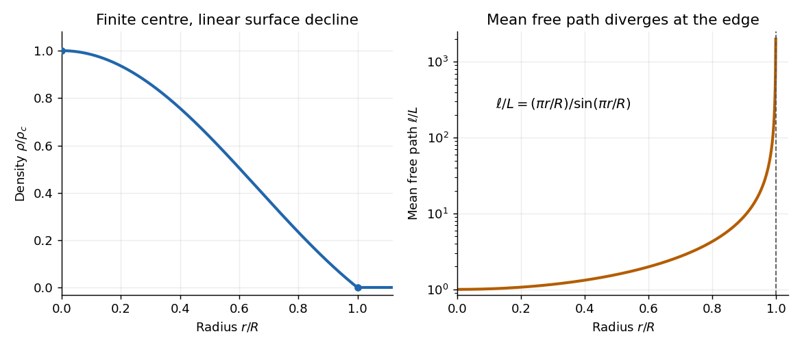

<h1 id="2/a/solution">Solution</h1>

↑ **Parent:** [A](../a.md)

Write $x=ar=\pi r/R$. The [mass density](../../../../density.md) has a finite central value because $\sin x/x\to1$ as $x\to0$, is monotonically decreasing on $0<x<\pi$, and first vanishes at $r=R$. Near the centre, $\rho/\rho_c=1-\pi^2r^2/(6R^2)+O(r^4/R^4)$; near the surface, $\rho/\rho_c\simeq(R-r)/R$. It is zero outside. The enclosed [mass](../../../../mass.md) is

$$
m(r)=4\pi\int_0^r s^2\rho(s)\,ds
=\frac{4\pi\rho_c}{a^3}(\sin x-x\cos x).
$$

Consequently $M=m(R)=4\pi^2\rho_c/a^3=4\rho_cR^3/\pi$, so

$$
\boxed{\rho_c=\frac{\pi M}{4R^3},\qquad
\frac{\rho_c}{\bar\rho}=\frac{\pi^2}{3},\qquad
\bar\rho=\frac{3M}{4\pi R^3}.}
$$

This is the [polytrope of index one](../../../../polytrope-of-index-one.md) profile. Its derivative is negative because $\sin x-x\cos x>0$ for $0<x<\pi$: the latter function vanishes at zero and has derivative $x\sin x>0$.

**[Figure 2](#2/a/image-the-index-one-stellar-density-profile-and-the-diverging-thomson-scattering-mean-free-path). The index-one stellar density profile and the diverging Thomson-scattering mean free path**.

## ↑ Ancestors (12)

1. [A](../a.md)
2. [2](../../2.md)
3. [2024](../../../2024-split.md)
4. [Past exam of the radiative processes and high energy astrophysics course of the University of Oxford](../../../split.md)
5. [Radiative processes and high energy astrophysics course of the University of Oxford](../../../../radiative-processes-and-high-energy-astrophysics-course-of-the-university-of-oxford.md)
6. [Year 4 of the mathematical and theoretical physics course of the University of Oxford](../../../../year-4-of-the-mathematical-and-theoretical-physics-course-of-the-university-of-oxford.md)
7. [Mathematical and theoretical physics course of the University of Oxford](../../../../mathematical-and-theoretical-physics-course-of-the-university-of-oxford.md)
8. [Undergraduate course of the University of Oxford](../../../../undergraduate-course-of-the-university-of-oxford.md)
9. [Course of the University of Oxford](../../../../course-of-the-university-of-oxford.md)
10. [University of Oxford](../../../../university-of-oxford-split.md)
11. [List of universities](../../../../list-of-universities.md)
12. [Codex Wiki](../../../../split.md)
