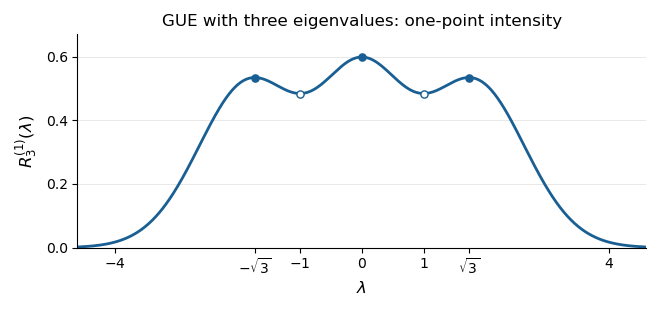

# 2025

↑ **Parent:** [Past exam of the random matrix theory course of the University of Oxford](../past-exam-of-the-random-matrix-theory-course-of-the-university-of-oxford.md)

Source: [Oxford examination paper C7.7, A17489H1, 2025; parent PDF pages 23–26](https://www.whatdotheyknow.com/request/past_papers_omms/response/3521346/attach/3/FOI%20202607%20785%20Exam%20Papers%20OMMS.pdf#page=23).

**Table of contents**

- [1](#1)
  - [a](#1/a)
    - [i](#1/a/i)
      - [Solution](#1/a/i/solution)
    - [ii](#1/a/ii)
      - [Solution](#1/a/ii/solution)
    - [iii](#1/a/iii)
      - [Solution](#1/a/iii/solution)
  - [b](#1/b)
    - [i](#1/b/i)
      - [Solution](#1/b/i/solution)
    - [ii](#1/b/ii)
      - [Solution](#1/b/ii/solution)
  - [c](#1/c)
    - [i](#1/c/i)
      - [Solution](#1/c/i/solution)
    - [ii](#1/c/ii)
      - [Solution](#1/c/ii/solution)
- [2](#2)
  - [a](#2/a)
    - [i](#2/a/i)
      - [Solution](#2/a/i/solution)
    - [ii](#2/a/ii)
      - [Solution](#2/a/ii/solution)
  - [b](#2/b)
    - [i](#2/b/i)
      - [Solution](#2/b/i/solution)
    - [ii](#2/b/ii)
      - [Solution](#2/b/ii/solution)
    - [iii](#2/b/iii)
      - [Solution](#2/b/iii/solution)
  - [c](#2/c)
    - [i](#2/c/i)
      - [Solution](#2/c/i/solution)
    - [ii](#2/c/ii)
      - [Solution](#2/c/ii/solution)
    - [iii](#2/c/iii)
      - [Solution](#2/c/iii/solution)
- [3](#3)
  - [a](#3/a)
    - [i](#3/a/i)
      - [Solution](#3/a/i/solution)
    - [ii](#3/a/ii)
      - [Solution](#3/a/ii/solution)
  - [b](#3/b)
    - [i](#3/b/i)
      - [Solution](#3/b/i/solution)
    - [ii](#3/b/ii)
      - [Solution](#3/b/ii/solution)
  - [c](#3/c)
    - [i](#3/c/i)
      - [Solution](#3/c/i/solution)
    - [ii](#3/c/ii)
      - [Solution](#3/c/ii/solution)
  - [d](#3/d)
    - [Solution](#3/d/solution)

## 1

↑ **Parent:** [2025](2025.md)

<h3 id="1/a">a</h3>

↑ **Parent:** [1](#1)

<h4 id="1/a/i">i</h4>

↑ **Parent:** [A](#1/a)

<h5 id="1/a/i/solution">Solution</h5>

↑ **Parent:** [I](#1/a/i)

Taking the [transpose](../vector-space.md#transpose) gives $M^T=(X^T+X)/\sqrt2=M$, so $M$ is a [symmetric matrix](../linear-algebra.md#symmetric-matrix). For $i<j$, $M_{ij}=(X_{ij}+X_{ji})/\sqrt2$ has the [standard normal distribution](../probability-distribution.md#standard-normal-distribution), whereas $M_{ii}=\sqrt2X_{ii}$ has the [normal distribution](../probability-distribution.md#normal-distribution) $N(0,2)$. Distinct upper-triangular entries depend on disjoint sets of the original [independent random variables](../random-variable.md#independent-random-variables), so they remain [independent](../random-variable.md#independent-random-variables).

Consequently the [joint probability density function](../continuous-probability-distribution.md#joint-probability-density), relative to $\prod_{i\leq j}dm_{ij}$, is

$$
\boxed{
f((m_{ij})_{i\leq j})
=(4\pi)^{-n/2}(2\pi)^{-n(n-1)/4}
\exp\!\left(-\frac14\sum_i m_{ii}^2-\frac12\sum_{i<j}m_{ij}^2\right)
=\frac{\exp[-\operatorname{tr}(m^2)/4]}
{(4\pi)^{n/2}(2\pi)^{n(n-1)/4}}.}
$$

Here $\operatorname{tr}(m^2)=\sum_i m_{ii}^2+2\sum_{i<j}m_{ij}^2$ because $m$ is a [symmetric matrix](../linear-algebra.md#symmetric-matrix). This is the **[Gaussian orthogonal ensemble](../probability-theory.md#gaussian-orthogonal-ensemble)**, with off-diagonal [variance](../variance.md) one and diagonal [variance](../variance.md) two; the rescaled [matrix](../vector-space.md#matrix) $M/\sqrt n$ has the corresponding $1/n$ off-diagonal [variance](../variance.md).

We will also use its entry [covariance](../variance.md#covariance). Expanding in the [independent](../random-variable.md#independent-random-variables) entries of $X$, for which $\mathbb E[X_{ij}X_{kl}]=\delta_{ik}\delta_{jl}$, gives

$$
\boxed{\mathbb E[M_{ij}M_{kl}]
=\delta_{ik}\delta_{jl}+\delta_{il}\delta_{jk}.}
$$

The symbols $\delta_{ab}$ are [Kronecker deltas](../multilinear-algebra.md#kronecker-delta). This formula includes the diagonal case, where the two terms both contribute.

<h4 id="1/a/ii">ii</h4>

↑ **Parent:** [A](#1/a)

<h5 id="1/a/ii/solution">Solution</h5>

↑ **Parent:** [Ii](#1/a/ii)

The [joint probability distribution](../probability-distribution.md#joint-probability-distribution) of all entries of $X$ is unchanged by $X\mapsto-X$, so $M$ and $-M$ have the same [probability distribution](../probability-distribution.md). For the specified cyclic product $P=M_{i_1i_2}\cdots M_{i_ki_1}$, this transformation multiplies $P$ by $(-1)^k$. Every such product is an [integrable random variable](../expected-value.md#integrable-random-variable), since [normal random variables](../probability-distribution.md#gaussian-random-variable) have finite [moments](../expected-value.md#moment) of all orders. Thus, for odd $k$,

$$
\mathbb EP=\mathbb E[(-1)^kP]=-\mathbb EP,
\qquad\boxed{\mathbb E[M_{i_1i_2}\cdots M_{i_ki_1}]=0.}
$$

Repeated indices cause no difficulty: all factors change sign simultaneously. It would be incorrect to assume that these factors are [independent](../random-variable.md#independent-random-variables).

<h4 id="1/a/iii">iii</h4>

↑ **Parent:** [A](#1/a)

<h5 id="1/a/iii/solution">Solution</h5>

↑ **Parent:** [Iii](#1/a/iii)

The probabilistic form of [Wick's theorem](../perturbative-quantum-field-theory.md#wick-s-theorem) is [Isserlis's theorem](../probability-distribution.md#isserlis-s-theorem). If $(Y_1,\ldots,Y_k)$ is a centered [random vector](../random-variable.md#random-vector) with a [multivariate Gaussian distribution](../probability-distribution.md#multivariate-gaussian-distribution) and [covariance matrix](../variance.md#covariance-matrix) $C$, its odd product [moments](../expected-value.md#moment) vanish, and, for even $k$,

$$
\boxed{\mathbb E\prod_{a=1}^kY_a
=\sum_{\pi\in\mathcal P_2(k)}\prod_{\{a,b\}\in\pi}C_{ab}.}
$$

Here $\mathcal P_2(k)$ is the set of [perfect matchings](../matching-graph-theory.md#perfect-matching) of the $k$ labelled positions. The formula allows repeated coordinates and singular [covariance matrices](../variance.md#covariance-matrix). To see the pairing rule, differentiate the [moment-generating function](../probability-distribution.md#moment-generating-function) $\exp(t^TCt/2)$ once in each coordinate and set $t=0$: only terms pairing all differentiated coordinates survive, each with the displayed product of [covariances](../variance.md#covariance).

Take $Y_a=M_{i_ai_{a+1}}$, with $i_{k+1}=i_1$. These variables are linear combinations of the original [independent](../random-variable.md#independent-random-variables) [normal random variables](../probability-distribution.md#gaussian-random-variable), hence are jointly [Gaussian](../probability-distribution.md#normal-distribution). They have zero [means](../expected-value.md), so

$$
\boxed{\mathbb E[M_{i_1i_2}\cdots M_{i_ki_1}]
=\sum_{\pi\in\mathcal P_2(k)}\prod_{\{a,b\}\in\pi}
\left(\delta_{i_ai_b}\delta_{i_{a+1}i_{b+1}}
+\delta_{i_ai_{b+1}}\delta_{i_{a+1}i_b}\right).}
$$

Substituting the entry [covariance](../variance.md#covariance) from part (a)(i) identifies each parenthesis with $\mathbb E[M_{i_ai_{a+1}}M_{i_bi_{b+1}}]$, giving the requested identity.

<h3 id="1/b">b</h3>

↑ **Parent:** [1](#1)

<h4 id="1/b/i">i</h4>

↑ **Parent:** [B](#1/b)

<h5 id="1/b/i/solution">Solution</h5>

↑ **Parent:** [I](#1/b/i)

The [spectral theorem for real symmetric matrices](../linear-algebra.md#spectral-theorem-for-real-symmetric-matrices) identifies the sum of the $k$th powers of the [eigenvalues](../linear-operator-theory.md#eigenvalue) with the [trace](../linear-algebra.md#matrix-trace) of the $k$th [matrix](../vector-space.md#matrix) power. Therefore the [moment](../expected-value.md#moment) of the [empirical spectral measure](../probability-theory.md#empirical-spectral-measure) is

$$
\boxed{m_k(n)=n^{-1-k/2}\operatorname{tr}(M^k)
=n^{-1-k/2}\sum_{i_1,\ldots,i_k=1}^n
M_{i_1i_2}M_{i_2i_3}\cdots M_{i_ki_1}.}
$$

For odd $k$, every summand has zero [expectation](../expected-value.md) by part (a)(ii), so $\boxed{\mathbb E[m_k(n)]=0}$ for every $n$.

For the second [moment](../expected-value.md#moment), use $M_{ji}=M_{ij}$. There are $n$ diagonal entries with [variance](../variance.md) two and $n(n-1)$ ordered off-diagonal entries with [variance](../variance.md) one. Their [means](../expected-value.md) vanish, giving

$$
\mathbb E[m_2(n)]
=n^{-2}\sum_{i,j}\mathbb E[M_{ij}^2]
=\frac{2n+n(n-1)}{n^2}
=1+\frac1n.
$$

Hence $\boxed{\lim_{n\to\infty}\mathbb E[m_2(n)]=1}$.

<h4 id="1/b/ii">ii</h4>

↑ **Parent:** [B](#1/b)

<h5 id="1/b/ii/solution">Solution</h5>

↑ **Parent:** [Ii](#1/b/ii)

Write the four cyclic factors as $A=M_{ij}$, $B=M_{jk}$, $C=M_{kl}$ and $D=M_{li}$. The [Gaussian moment pairing theorem](../probability-distribution.md#isserlis-s-theorem) gives three terms, corresponding to $(AB)(CD)$, $(AC)(BD)$ and $(AD)(BC)$. We sum each term over $i,j,k,l$.

For $(AB)(CD)$, the entry [covariance](../variance.md#covariance) gives

$$
\begin{aligned}
\sum_{i,j,k,l}\mathbb E[AB]\mathbb E[CD]
&=\sum_{i,j,k,l}(\delta_{ik}+\delta_{ij}\delta_{jk})
(\delta_{ik}+\delta_{kl}\delta_{li})\\
&=n^3+2n^2+n.
\end{aligned}
$$

Indeed the four products leave respectively three, two, two and one free indices. A cyclic relabelling gives exactly the same sum for $(AD)(BC)$.

For the crossing pairing $(AC)(BD)$,

$$
\begin{aligned}
\sum_{i,j,k,l}\mathbb E[AC]\mathbb E[BD]
&=\sum_{i,j,k,l}(\delta_{ik}\delta_{jl}+\delta_{il}\delta_{jk})
(\delta_{jl}\delta_{ki}+\delta_{ji}\delta_{kl})\\
&=n^2+3n.
\end{aligned}
$$

The first product allows $i=k$ and $j=l$ freely, whereas each other product forces all four indices to coincide. Combining the three pairings and the [trace](../linear-algebra.md#matrix-trace) normalization,

$$
\boxed{\mathbb E[m_4(n)]
=\frac{2(n^3+2n^2+n)+(n^2+3n)}{n^3}
=2+\frac5n+\frac5{n^2}\ \longrightarrow\ 2.}
$$

<h3 id="1/c">c</h3>

↑ **Parent:** [1](#1)

<h4 id="1/c/i">i</h4>

↑ **Parent:** [C](#1/c)

<h5 id="1/c/i/solution">Solution</h5>

↑ **Parent:** [I](#1/c/i)

First $W^T=W$, so the [spectral theorem for real symmetric matrices](../linear-algebra.md#spectral-theorem-for-real-symmetric-matrices) gives real [eigenvalues](../linear-operator-theory.md#eigenvalue) and an [orthonormal basis](../inner-product.md#orthonormal-basis) of [eigenvectors](../linear-operator-theory.md#eigenvector). Moreover, for every real [vector](../vector-space.md#vector) $v$,

$$
v^TWv=\frac1n v^TXX^Tv=\frac1n\lVert X^Tv\rVert^2\geq0.
$$

Thus $W$ is a [positive semidefinite matrix](../quadratic-form.md#positive-semidefinite-matrix). For any nonzero [eigenvector](../linear-operator-theory.md#eigenvector) $v$ with [eigenvalue](../linear-operator-theory.md#eigenvalue) $\lambda$,

$$
\lambda\lVert v\rVert^2=v^TWv\geq0,
\qquad\boxed{\lambda\in[0,\infty).}
$$

This [matrix](../vector-space.md#matrix) is a scaled example of the [Wishart distribution](../probability-theory.md#wishart-distribution).

<h4 id="1/c/ii">ii</h4>

↑ **Parent:** [C](#1/c)

<h5 id="1/c/ii/solution">Solution</h5>

↑ **Parent:** [Ii](#1/c/ii)

Let $g_i=(X_{i1},\ldots,X_{in})$ be row $i$ of $X$, viewed as a real [vector](../vector-space.md#vector). These are [independent](../random-variable.md#independent-random-variables) standard [Gaussian](../probability-distribution.md#normal-distribution) [random vectors](../random-variable.md#random-vector), and $(XX^T)_{ij}=g_i\cdot g_j$. The [trace](../linear-algebra.md#matrix-trace) expression for the [empirical spectral measure](../probability-theory.md#empirical-spectral-measure) gives

$$
\widetilde m_k(n)
=n^{-k-1}\sum_{i_1,\ldots,i_k}
(g_{i_1}\cdot g_{i_2})\cdots(g_{i_k}\cdot g_{i_1}).
$$

We need the norm [moments](../expected-value.md#moment)

$$
\mathbb E\lVert g_i\rVert^2=n,\qquad
\mathbb E\lVert g_i\rVert^4=n(n+2),\qquad
\mathbb E\lVert g_i\rVert^6=n(n+2)(n+4).
$$

For completeness, $S=\lVert g_i\rVert^2$ has the [chi-squared distribution](../probability-distribution.md#chi-squared-distribution) with $n$ degrees of freedom. By [independence](../random-variable.md#independent-random-variables) and the [Gaussian integral](../integral.md#gaussian-integral), its [moment-generating function](../probability-distribution.md#moment-generating-function) is $\mathbb E e^{sS}=(1-2s)^{-n/2}$ for $s<1/2$. Differentiating at zero once, twice and three times proves these three identities.

For the first [moment](../expected-value.md#moment),

$$
\boxed{\mathbb E[\widetilde m_1(n)]
=n^{-2}\sum_i\mathbb E\lVert g_i\rVert^2=1.}
$$

For the second [moment](../expected-value.md#moment), if $i\ne j$, [conditional expectation](../measure-theory.md#conditional-expectation) given $g_i$ gives $\mathbb E[(g_i\cdot g_j)^2\mid g_i]=\lVert g_i\rVert^2$, hence an unconditional value $n$. Separating equal and unequal row indices yields

$$
\boxed{\mathbb E[\widetilde m_2(n)]
=n^{-3}\{n\,n(n+2)+n(n-1)n\}=2+\frac1n.}
$$

For the third [moment](../expected-value.md#moment), the summand is $(g_i\cdot g_j)(g_j\cdot g_k)(g_k\cdot g_i)$. There are three disjoint cases.

- If $i,j,k$ are all different, average over $g_k$ first. Its [covariance matrix](../variance.md#covariance-matrix) is the identity, so the [conditional expectation](../measure-theory.md#conditional-expectation) of the last two factors is $g_j\cdot g_i$. The summand's [expectation](../expected-value.md) is therefore $\mathbb E(g_i\cdot g_j)^2=n$. There are $n(n-1)(n-2)$ such triples.
- If exactly two indices agree, cyclic symmetry reduces the calculation to $i=j\ne k$. The product is $\lVert g_i\rVert^2(g_i\cdot g_k)^2$, whose [conditional expectation](../measure-theory.md#conditional-expectation) given $g_i$ is $\lVert g_i\rVert^4$. Its [expectation](../expected-value.md) is $n(n+2)$, and there are $3n(n-1)$ such triples.
- If all three indices agree, the product is $\lVert g_i\rVert^6$, with [expectation](../expected-value.md) $n(n+2)(n+4)$. There are $n$ choices.

Consequently

$$
\begin{aligned}
\mathbb E[\widetilde m_3(n)]
&=n^{-4}\{n^2(n-1)(n-2)
+3n^2(n-1)(n+2)+n^2(n+2)(n+4)\}\\
&=5+\frac6n+\frac4{n^2}.
\end{aligned}
$$

The three limiting [expected values](../expected-value.md) are therefore

$$
\boxed{\lim_{n\to\infty}\mathbb E[\widetilde m_k(n)]
=\begin{cases}1,&k=1,\\2,&k=2,\\5,&k=3.\end{cases}}
$$

## 2

↑ **Parent:** [2025](2025.md)

<h3 id="2/a">a</h3>

↑ **Parent:** [2](#2)

<h4 id="2/a/i">i</h4>

↑ **Parent:** [A](#2/a)

<h5 id="2/a/i/solution">Solution</h5>

↑ **Parent:** [I](#2/a/i)

Let $P$ be the $3$-by-$3$ evaluation [matrix](../vector-space.md#matrix) $P_{i,\ell+1}=p_\ell(\lambda_i)$. The kernel evaluation [matrix](../vector-space.md#matrix) is the [Gram matrix](../inner-product.md#gram-matrix) $PP^T$, so [multiplicativity of the determinant](../multilinear-algebra.md#multiplicativity-of-the-determinant) gives

$$
\det[K_3(\lambda_i,\lambda_j)]_{i,j=1}^3
=\det(PP^T)=(\det P)^2.
$$

Because the [polynomials](../polynomial.md) are [monic](../polynomial.md#monic-polynomial) of consecutive degrees, their coefficient [matrix](../vector-space.md#matrix) relative to $1,x,x^2$ is a [triangular matrix](../linear-algebra.md#triangular-matrix) with unit diagonal. It has [determinant](../multilinear-algebra.md#determinant) one, so the [Vandermonde determinant invariance under monic basis change](../galois-theory.md#vandermonde-determinant-invariance-under-monic-basis-change) gives

$$
\det P=\det\begin{pmatrix}
1&\lambda_1&\lambda_1^2\\
1&\lambda_2&\lambda_2^2\\
1&\lambda_3&\lambda_3^2
\end{pmatrix}
=\prod_{i<j}(\lambda_j-\lambda_i).
$$

Squaring removes the ordering sign. Thus the [Gaussian unitary ensemble](../probability-theory.md#gaussian-unitary-ensemble) [joint probability density function](../continuous-probability-distribution.md#joint-probability-density) has precisely the kernel form

$$
\boxed{\rho_3(\boldsymbol\lambda)
=c_3\det[K_3(\lambda_i,\lambda_j)]_{i,j=1}^3
\exp\!\left(-\frac12\sum_i\lambda_i^2\right).}
$$

No [orthogonality](../inner-product.md#orthogonal-vectors) of the [polynomials](../polynomial.md) is needed for this step.

<h4 id="2/a/ii">ii</h4>

↑ **Parent:** [A](#2/a)

<h5 id="2/a/ii/solution">Solution</h5>

↑ **Parent:** [Ii](#2/a/ii)

Use the [inner product](../inner-product.md) $\langle f,g\rangle=\mathbb E[f(Z)g(Z)]$ for a [standard normal random variable](../probability-distribution.md#standard-normal-random-variable) $Z$. The degree-zero [monic polynomial](../polynomial.md#monic-polynomial) is $p_0=1$. Write $p_1=x+a$ and $p_2=x^2+bx+c$. The conditions

$$
0=\langle p_1,1\rangle=a,\qquad
0=\langle p_2,1\rangle=1+c,\qquad
0=\langle p_2,x\rangle=b
$$

use $\mathbb EZ=\mathbb EZ^3=0$ and $\mathbb EZ^2=1$. Hence these first three [Probabilists' Hermite polynomials](../orthogonal-polynomial.md#probabilists-hermite-polynomial) are

$$
\boxed{p_0(x)=1,\qquad p_1(x)=x,\qquad p_2(x)=x^2-1.}
$$

The [Gaussian fourth moment](../probability-distribution.md#gaussian-fourth-moment) is $\mathbb EZ^4=3$, so their squared [norms](../normed-vector-space.md#norm) are

$$
\boxed{h_0=1,\qquad h_1=1,\qquad
h_2=\mathbb E(Z^2-1)^2=3-2+1=2,}
\qquad
h_\ell=\int_{\mathbb R}p_\ell(x)^2\frac{e^{-x^2/2}}{\sqrt{2\pi}}\,dx.
$$

<h3 id="2/b">b</h3>

↑ **Parent:** [2](#2)

<h4 id="2/b/i">i</h4>

↑ **Parent:** [B](#2/b)

<h5 id="2/b/i/solution">Solution</h5>

↑ **Parent:** [I](#2/b/i)

[Gaudin's lemma](../functional-analysis.md#projection-kernel-determinant-integration) is the [projection kernel determinant integration](../functional-analysis.md#projection-kernel-determinant-integration) identity. Suppose an [integral kernel](../functional-analysis.md#integral-kernel) $K$ satisfies

$$
\int K(x,y)K(y,z)\,d\mu(y)=K(x,z),
\qquad \int K(x,x)\,d\mu(x)=N,
$$

with the relevant integrals absolutely convergent. Define $D_k(x_1,\ldots,x_k)=\det[K(x_i,x_j)]_{i,j=1}^k$ and $D_0=1$. Then

$$
\boxed{\int D_k(x_1,\ldots,x_k)\,d\mu(x_k)
=(N-k+1)D_{k-1}(x_1,\ldots,x_{k-1}).}
$$

In particular, a [finite-rank projection kernel](../functional-analysis.md#finite-rank-projection-kernel) of rank $N$ has $\int D_N\,d\mu^N=N!$.

One can see the factor directly from the [permutation](../combinatorics.md#permutation) expansion of the [determinant](../multilinear-algebra.md#determinant). Terms whose [permutation](../combinatorics.md#permutation) fixes $k$ integrate to $ND_{k-1}$. Every [permutation](../combinatorics.md#permutation) on the other $k-1$ indices admits $k-1$ insertions of $k$ into a cycle. Each insertion reverses its sign, and the reproducing identity contracts its two adjacent kernel factors into one. These terms integrate to $-(k-1)D_{k-1}$, proving the formula.

<h4 id="2/b/ii">ii</h4>

↑ **Parent:** [B](#2/b)

<h5 id="2/b/ii/solution">Solution</h5>

↑ **Parent:** [Ii](#2/b/ii)

The squared [norm](../normed-vector-space.md#norm) of $p_\ell(x)e^{-x^2/4}$ in $L^2(\mathbb R,dx)$ is $\sqrt{2\pi}\,h_\ell$, where $(h_0,h_1,h_2)=(1,1,2)$. Choose positive normalizing constants

$$
\boxed{\kappa_0=\kappa_1=(2\pi)^{1/4},\qquad
\kappa_2=\sqrt2(2\pi)^{1/4}.}
$$

Then $\phi_0,\phi_1,\phi_2$ are an [orthonormal set](../inner-product.md#orthonormal-set) for [Lebesgue measure](../measure-theory.md#lebesgue-measure). Expanding the finite sums gives

$$
\begin{aligned}
\int\widetilde K_3(x,y)\widetilde K_3(y,z)\,dy
&=\sum_{\ell,m=0}^2\phi_\ell(x)\phi_m(z)
\int\phi_\ell(y)\phi_m(y)\,dy\\
&=\sum_{\ell=0}^2\phi_\ell(x)\phi_\ell(z)
=\widetilde K_3(x,z).
\end{aligned}
$$

Thus this is an [orthogonal polynomial projection kernel](../functional-analysis.md#orthogonal-polynomial-projection-kernel), explicitly

$$
\boxed{\widetilde K_3(x,y)
=\frac{e^{-(x^2+y^2)/4}}{\sqrt{2\pi}}
\left[1+xy+\frac{(x^2-1)(y^2-1)}2\right].}
$$

The positive constants above are forced by the reproducing identity: before normalization, its convolution multiplies each independent term $\phi_\ell(x)\phi_\ell(z)$ by $\sqrt{2\pi}h_\ell/\kappa_\ell^2$. Each multiplier must equal one. Changing the sign of a real $\kappa_\ell$ leaves the kernel unchanged.

<h4 id="2/b/iii">iii</h4>

↑ **Parent:** [B](#2/b)

<h5 id="2/b/iii/solution">Solution</h5>

↑ **Parent:** [Iii](#2/b/iii)

Use the symmetric [joint probability density function](../continuous-probability-distribution.md#joint-probability-density) of exchangeably labelled [eigenvalues](../linear-operator-theory.md#eigenvalue), normalized over all of $\mathbb R^3$. The [finite-rank projection kernel](../functional-analysis.md#finite-rank-projection-kernel) has

$$
\int\widetilde K_3(x,x)\,dx
=\sum_{\ell=0}^2\lVert\phi_\ell\rVert_2^2=3.
$$

Successive applications of [Gaudin's lemma](../functional-analysis.md#projection-kernel-determinant-integration) therefore give

$$
\int_{\mathbb R^3}\det[\widetilde K_3(\lambda_i,\lambda_j)]_{i,j=1}^3
\,d\lambda_1d\lambda_2d\lambda_3
=1\cdot2\cdot3=6.
$$

It follows that

$$
\boxed{\widetilde c_3=\frac1{3!}=\frac16.}
$$

As a normalization check, the [weighted Vandermonde determinant](../galois-theory.md#weighted-vandermonde-determinant) yields

$$
\det[\widetilde K_3(\lambda_i,\lambda_j)]
=\frac{\prod_{i<j}(\lambda_i-\lambda_j)^2e^{-\sum_i\lambda_i^2/2}}
{\kappa_0^2\kappa_1^2\kappa_2^2},
\qquad
\boxed{c_3=\frac1{12(2\pi)^{3/2}}.}
$$

If instead one uses ordered [eigenvalues](../linear-operator-theory.md#eigenvalue) on $\lambda_1<\lambda_2<\lambda_3$, the normalized density on that chamber is six times the labelled density. In that convention the determinant prefactor on the chamber is one.

<h3 id="2/c">c</h3>

↑ **Parent:** [2](#2)

<h4 id="2/c/i">i</h4>

↑ **Parent:** [C](#2/c)

<h5 id="2/c/i/solution">Solution</h5>

↑ **Parent:** [I](#2/c/i)

The [correlation functions of a point process](../probability-theory.md#correlation-function-of-a-point-process) use factorial normalization:

$$
R_3^{(k)}(x_1,\ldots,x_k)
=\frac{3!}{(3-k)!}\int_{\mathbb R^{3-k}}
\rho_3(x_1,x_2,x_3)\,dx_{k+1}\cdots dx_3.
$$

Start with $\rho_3=D_3/6$. By [Gaudin's lemma](../functional-analysis.md#projection-kernel-determinant-integration), integrating $D_3$ once gives $D_2$, and integrating $D_2$ once gives $2D_1$. The factorial factors cancel, so the [eigenvalues](../linear-operator-theory.md#eigenvalue) form a [determinantal point process](../probability-theory.md#determinantal-point-process) with

$$
\boxed{R_3^{(1)}(x)=\widetilde K_3(x,x),}
$$

and

$$
\boxed{R_3^{(2)}(x,y)
=\det\begin{pmatrix}
\widetilde K_3(x,x)&\widetilde K_3(x,y)\\
\widetilde K_3(y,x)&\widetilde K_3(y,y)
\end{pmatrix}
=\widetilde K_3(x,x)\widetilde K_3(y,y)-\widetilde K_3(x,y)^2.}
$$

The last equality uses the real symmetry of this kernel. In particular, $\int R_3^{(1)}=3$ and $\iint R_3^{(2)}=6$, as required for three points and six ordered pairs of distinct points.

<h4 id="2/c/ii">ii</h4>

↑ **Parent:** [C](#2/c)

<h5 id="2/c/ii/solution">Solution</h5>

↑ **Parent:** [Ii](#2/c/ii)

Evaluate the [orthogonal polynomial projection kernel](../functional-analysis.md#orthogonal-polynomial-projection-kernel) on its diagonal:

$$
\begin{aligned}
R_3^{(1)}(\lambda)
&=\sum_{\ell=0}^2\phi_\ell(\lambda)^2\\
&=\frac{e^{-\lambda^2/2}}{\sqrt{2\pi}}
\left[1+\lambda^2+\frac{(\lambda^2-1)^2}{2}\right]\\
&=\boxed{\frac{\lambda^4+3}{2\sqrt{2\pi}}e^{-\lambda^2/2}.}
\end{aligned}
$$

The $\lambda^2$ terms cancel. Integrating against [Lebesgue measure](../measure-theory.md#lebesgue-measure) gives $(\mathbb EZ^4+3)/2=3$ for a [standard normal random variable](../probability-distribution.md#standard-normal-random-variable) $Z$, checking the [correlation function of a point process](../probability-theory.md#correlation-function-of-a-point-process) normalization.

<h4 id="2/c/iii">iii</h4>

↑ **Parent:** [C](#2/c)

<h5 id="2/c/iii/solution">Solution</h5>

↑ **Parent:** [Iii](#2/c/iii)

The [correlation function of a point process](../probability-theory.md#correlation-function-of-a-point-process) is even and tends to zero as $|\lambda|\to\infty$. Its [derivative](../calculus.md#derivative) factors as

$$
\frac{d}{d\lambda}R_3^{(1)}(\lambda)
=-\frac{\lambda(\lambda^2-1)(\lambda^2-3)}{2\sqrt{2\pi}}
e^{-\lambda^2/2}.
$$

Consequently its local maxima occur at $0,\pm\sqrt3$, and its local minima at $\pm1$. The heights are

$$
\begin{aligned}
R_3^{(1)}(0)&=\frac3{2\sqrt{2\pi}}\simeq0.5984,\\
R_3^{(1)}(\pm1)&=\frac{2e^{-1/2}}{\sqrt{2\pi}}\simeq0.4839,\\
R_3^{(1)}(\pm\sqrt3)&=\frac{6e^{-3/2}}{\sqrt{2\pi}}\simeq0.5341.
\end{aligned}
$$

**[Figure 1](#2/c/iii/image-the-three-peaks-of-the-gue-one-point-correlation-function). The three peaks of the GUE one-point correlation function**. Original plot of the exact [correlation function of a point process](../probability-theory.md#correlation-function-of-a-point-process) calculated above. Filled markers indicate local maxima at $-\sqrt3,0,\sqrt3$; hollow markers indicate the local minima at $-1,1$. The total area is three.

For an interval $I$, $\int_I R_3^{(1)}(\lambda)\,d\lambda$ is the [expected value](../expected-value.md) of the number of [eigenvalues](../linear-operator-theory.md#eigenvalue) in $I$. Thus equally short intervals have the highest expected counts near

$$
\boxed{\lambda=-\sqrt3,\quad0,\quad\sqrt3,}
$$

with the central peak highest. Each exchangeably labelled [eigenvalue](../linear-operator-theory.md#eigenvalue) has the same marginal [probability density function](../continuous-probability-distribution.md#probability-density-function) $R_3^{(1)}/3$. The three peaks should not be interpreted as three separate marginal densities for ordered [eigenvalues](../linear-operator-theory.md#eigenvalue).

In this case the most likely joint configuration also lies at these three positions. On the ordered chamber, the logarithm of the [joint probability density function](../continuous-probability-distribution.md#joint-probability-density), up to a constant, is

$$
L(\boldsymbol\lambda)=2\sum_{i<j}\log(\lambda_j-\lambda_i)
-\frac12\sum_i\lambda_i^2.
$$

Its stationary equations are $\lambda_i=2\sum_{j\ne i}(\lambda_i-\lambda_j)^{-1}$, satisfied by $(-\sqrt3,0,\sqrt3)$. For every nonzero real [vector](../vector-space.md#vector) $v$, the second directional [derivative](../calculus.md#derivative) is

$$
D^2L[v,v]=-\sum_i v_i^2
-2\sum_{i<j}\frac{(v_i-v_j)^2}{(\lambda_i-\lambda_j)^2}<0.
$$

Thus $L$ is strictly [concave](../real-analysis.md#concave-function) on this convex chamber, proving that the stationary configuration is its unique global maximum. Permuting the labels gives the other maxima on $\mathbb R^3$.

## 3

↑ **Parent:** [2025](2025.md)

<h3 id="3/a">a</h3>

↑ **Parent:** [3](#3)

<h4 id="3/a/i">i</h4>

↑ **Parent:** [A](#3/a)

<h5 id="3/a/i/solution">Solution</h5>

↑ **Parent:** [I](#3/a/i)

The [characteristic polynomial](../linear-operator-theory.md#characteristic-polynomial) of the [rotation matrix](../linear-algebra.md#rotation-matrix) is

$$
\det(M-zI)=(\cos U-z)^2+\sin^2U
=z^2-2z\cos U+1.
$$

Its roots are $\cos U\pm i\sin U$, so

$$
\boxed{e^{i\Theta^+}=e^{iU},\qquad e^{i\Theta^-}=e^{-iU},
\qquad\Theta^\pm=\pm U\pmod{2\pi}.}
$$

For example $(1,i)^T$ is an [eigenvector](../linear-operator-theory.md#eigenvector) for $e^{iU}$ and $(1,-i)^T$ for $e^{-iU}$. At $U=0$ or $\pi$ the two [eigenvalues](../linear-operator-theory.md#eigenvalue) coincide; these events have [probability](../probability-theory.md#probability) zero under the [uniform distribution](../continuous-probability-distribution.md#continuous-uniform-distribution).

<h4 id="3/a/ii">ii</h4>

↑ **Parent:** [A](#3/a)

<h5 id="3/a/ii/solution">Solution</h5>

↑ **Parent:** [Ii](#3/a/ii)

The difference of the two [eigenvalues](../linear-operator-theory.md#eigenvalue) is $2i\sin U$, hence $\Delta=\sin^2U$. Its [expectation](../expected-value.md) is

$$
\boxed{\mathbb E\Delta=\frac1{2\pi}\int_0^{2\pi}\sin^2u\,du=\frac12.}
$$

For $0\leq x\leq1$, put $\alpha=\arcsin\sqrt{x}\in[0,\pi/2]$. The set of angles satisfying $|\sin u|\leq\sqrt{x}$ consists of $[0,\alpha]$, $[\pi-\alpha,\pi+\alpha]$ and $[2\pi-\alpha,2\pi]$, of total length $4\alpha$. Thus the full [cumulative distribution function](../probability-distribution.md#cumulative-distribution-function) is

$$
\boxed{F_\Delta(x)=
\begin{cases}
0,&x<0,\\
\dfrac2\pi\arcsin\sqrt{x},&0\leq x\leq1,\\
1,&x>1.
\end{cases}}
$$

Differentiating on $(0,1)$ gives the [probability density function](../continuous-probability-distribution.md#probability-density-function)

$$
\boxed{f_\Delta(x)=\frac1{\pi\sqrt{x(1-x)}},\qquad0<x<1.}
$$

This is the [arcsine distribution](../continuous-probability-distribution.md#arcsine-distribution), equivalently the [beta distribution](../probability-distribution.md#beta-distribution) with both parameters $1/2$. It has no atoms at either endpoint.

<h3 id="3/b">b</h3>

↑ **Parent:** [3](#3)

<h4 id="3/b/i">i</h4>

↑ **Parent:** [B](#3/b)

<h5 id="3/b/i/solution">Solution</h5>

↑ **Parent:** [I](#3/b/i)

Apply the same [characteristic polynomial](../linear-operator-theory.md#characteristic-polynomial) calculation with $U$ replaced by $B(t)$. Pathwise,

$$
\boxed{e^{i\Theta^+(t)}=e^{iB(t)},\qquad
e^{i\Theta^-(t)}=e^{-iB(t)},\qquad
\Theta^\pm(t)=\pm B(t)\pmod{2\pi}.}
$$

The real-valued processes $\pm B(t)$ give continuous lifts of these angles. The [eigenvalues](../linear-operator-theory.md#eigenvalue) coincide whenever $B(t)\in\pi\mathbb Z$; the exponential formulas remain valid at those times.

<h4 id="3/b/ii">ii</h4>

↑ **Parent:** [B](#3/b)

<h5 id="3/b/ii/solution">Solution</h5>

↑ **Parent:** [Ii](#3/b/ii)

Here $\Delta(t)=\sin^2B(t)$. For $f(b)=\sin^2b$, $f'(b)=\sin2b$ and $f''(b)=2\cos2b$. Since standard [Brownian motion](../brownian-motion.md) has [quadratic variation](../stochastic-calculus.md#quadratic-variation) $dt$, [Itô's formula](../stochastic-calculus.md#ito-s-lemma) gives

$$
\boxed{d\Delta(t)=\sin(2B(t))\,dB(t)+\cos(2B(t))\,dt.}
$$

Therefore

$$
\boxed{V(t)=\sin(2B(t)),\qquad
D(t)=\cos(2B(t))=1-2\Delta(t).}
$$

The squared diffusion coefficient is $V(t)^2=4\Delta(t)(1-\Delta(t))$. Its sign depends on $B(t)$: one cannot replace $\sin(2B(t))$ by the nonnegative square root while retaining the same driving [Brownian motion](../brownian-motion.md).

<h3 id="3/c">c</h3>

↑ **Parent:** [3](#3)

<h4 id="3/c/i">i</h4>

↑ **Parent:** [C](#3/c)

<h5 id="3/c/i/solution">Solution</h5>

↑ **Parent:** [I](#3/c/i)

The [characteristic function](../characteristic-function.md) of $B(t)\sim N(0,t)$ gives $\mathbb E e^{2iB(t)}=e^{-2t}$. Taking real parts and using $\sin^2b=(1-\cos2b)/2$,

$$
\boxed{\mathbb E\Delta(t)=\frac{1-e^{-2t}}2,
\qquad \lim_{t\to\infty}\mathbb E\Delta(t)=\frac12.}
$$

There is also a direct check from the [stochastic differential equation](../stochastic-calculus.md#stochastic-differential-equation). Its [Itô integral](../stochastic-calculus.md#ito-integral) has zero [expectation](../expected-value.md) because its integrand is bounded. Thus $m(t)=\mathbb E\Delta(t)$ satisfies $m'(t)=1-2m(t)$ and $m(0)=0$, whose solution is the same expression.

<h4 id="3/c/ii">ii</h4>

↑ **Parent:** [C](#3/c)

<h5 id="3/c/ii/solution">Solution</h5>

↑ **Parent:** [Ii](#3/c/ii)

Interpret the source's missing variable in the limit arrow as $t\to\infty$. We prove [convergence in distribution](../convergence-of-random-variables.md#convergence-in-distribution) by showing that the angle of the [Brownian motion](../brownian-motion.md) becomes uniform on the [circle group](../lie-theory.md#circle-group).

Let $Z_t=e^{iB(t)}$. For every integer $m$, its angular [Fourier coefficients](../fourier-series.md#fourier-coefficient) satisfy

$$
\mathbb E[Z_t^m]=e^{-m^2t/2}
\longrightarrow
\begin{cases}1,&m=0,\\0,&m\ne0.\end{cases}
$$

These are precisely the [Fourier coefficients](../fourier-series.md#fourier-coefficient) of the [uniform distribution](../continuous-probability-distribution.md#continuous-uniform-distribution) on the [unit circle](../complex-analysis.md#complex-unit-circle). Thus [expectations](../expected-value.md) of every [trigonometric polynomial](../fourier-series.md#trigonometric-polynomial) converge to its uniform angular average. By the [Stone-Weierstrass theorem](../functional-analysis.md#stone-weierstrass-theorem), [trigonometric polynomials](../fourier-series.md#trigonometric-polynomial) approximate continuous functions on the [unit circle](../complex-analysis.md#complex-unit-circle) uniformly. Given an approximation error $\varepsilon$, the discrepancy of [expectations](../expected-value.md) is at most the polynomial discrepancy plus $2\varepsilon$. Taking $t\to\infty$ and then $\varepsilon\to0$ proves [weak convergence of probability measures](../convergence-of-random-variables.md#weak-convergence-of-probability-measures) to uniform angular measure.

The [function](../function.md) $z\mapsto(\operatorname{Im}z)^2$ is continuous on the [unit circle](../complex-analysis.md#complex-unit-circle), so the [continuous mapping theorem](../convergence-of-random-variables.md#continuous-mapping-theorem) and part (a)(ii) imply

$$
\boxed{\Delta(t)\ \xrightarrow[t\to\infty]{\mathrm d}\ A,
\qquad A\sim\operatorname{Beta}\!\left(\frac12,\frac12\right).}
$$

Equivalently, the limiting [arcsine distribution](../continuous-probability-distribution.md#arcsine-distribution) has [cumulative distribution function](../probability-distribution.md#cumulative-distribution-function) $2\arcsin\sqrt{x}/\pi$ for $0\leq x\leq1$, and [probability density function](../continuous-probability-distribution.md#probability-density-function) $1/(\pi\sqrt{x(1-x)})$ for $0<x<1$. This proves the limiting law rather than inferring it merely from the limiting [mean](../expected-value.md).

<h3 id="3/d">d</h3>

↑ **Parent:** [3](#3)

<h4 id="3/d/solution">Solution</h4>

↑ **Parent:** [D](#3/d)

Use [Haar sampling by Gaussian QR decomposition](../measure.md#haar-sampling-by-gaussian-qr-decomposition):

- Generate an $n$-by-$n$ real [matrix](../vector-space.md#matrix) $G$ with [independent](../random-variable.md#independent-random-variables) entries having the [standard normal distribution](../probability-distribution.md#standard-normal-distribution).
- Compute a [QR decomposition](../inner-product.md#qr-decomposition) $G=Q_0R_0$ with $Q_0$ an [orthogonal matrix](../linear-algebra.md#orthogonal-matrix) and $R_0$ an [upper triangular matrix](../linear-algebra.md#upper-triangular-matrix).
- Put $S=\operatorname{diag}(\operatorname{sgn}(R_{0,11}),\ldots,\operatorname{sgn}(R_{0,nn}))$ and return $\boxed{M=Q_0S}$. Then $G=MR$ with $R=SR_0$ having strictly positive diagonal.

The [matrix](../vector-space.md#matrix) $G$ is invertible [almost surely](../convergence-of-random-variables.md#almost-sure-convergence). Indeed, successively sampled [Gaussian](../probability-distribution.md#normal-distribution) columns have [probability](../probability-theory.md#probability) zero of lying in the proper [linear subspace](../vector-space.md#vector-subspace) spanned by the previous columns. Thus the diagonal signs used above exist with [probability](../probability-theory.md#probability) one. Equivalently, apply the [Gram-Schmidt process](../inner-product.md#gram-schmidt-process) to the columns, always dividing each residual by its positive [Euclidean norm](../normed-vector-space.md#euclidean-norm); this produces $M$ directly.

To prove uniformity, fix $H\in O(n)$. Each column of $G$ has density proportional to $e^{-\lVert x\rVert^2/2}$, so [orthogonal transformations](../linear-algebra.md#orthogonal-transformation) preserve its [probability distribution](../probability-distribution.md). Column [independence](../random-variable.md#independent-random-variables) therefore gives $HG\overset{\mathrm d}=G$.

The [QR decomposition](../inner-product.md#qr-decomposition) with positive diagonal is unique: if $G=Q_1R_1=Q_2R_2$, then $Q_2^TQ_1=R_2R_1^{-1}$ is both an [orthogonal matrix](../linear-algebra.md#orthogonal-matrix) and an [upper triangular matrix](../linear-algebra.md#upper-triangular-matrix), hence diagonal with entries $\pm1$. Its diagonal entries are positive, so it is the identity. It follows that the orthogonal factor of $HG=HMR$ is $HM$. Therefore

$$
\boxed{HM\overset{\mathrm d}=M\quad\text{for every }H\in O(n).}
$$

By uniqueness of normalized [Haar measure](../measure.md#haar-measure) on the [compact group](../topological-group.md#compact-group) $O(n)$, the returned [matrix](../vector-space.md#matrix) has exactly the required [probability distribution](../probability-distribution.md). Reflection invariance gives each [determinant](../multilinear-algebra.md#determinant) sign [probability](../probability-theory.md#probability) $1/2$, so the algorithm samples both components of the [orthogonal group](../linear-algebra.md#orthogonal-group). The positive-diagonal correction is essential when a numerical [QR decomposition](../inner-product.md#qr-decomposition) chooses its own signs.

## ↑ Ancestors (9)

1. [Past exam of the random matrix theory course of the University of Oxford](../past-exam-of-the-random-matrix-theory-course-of-the-university-of-oxford.md)
2. [Random matrix theory course of the University of Oxford](../university-of-oxford.md#random-matrix-theory-course-of-the-university-of-oxford)
3. [Year 4 of the mathematics course of the University of Oxford](../university-of-oxford.md#year-4-of-the-mathematics-course-of-the-university-of-oxford)
4. [Mathematics course of the University of Oxford](../university-of-oxford.md#mathematics-course-of-the-university-of-oxford)
5. [Undergraduate course of the University of Oxford](../university-of-oxford.md#undergraduate-course-of-the-university-of-oxford)
6. [Course of the University of Oxford](../university-of-oxford.md#course-of-the-university-of-oxford)
7. [University of Oxford](../university-of-oxford.md)
8. [List of universities](../README.md#list-of-universities)
9. [Codex Wiki](../README.md)
