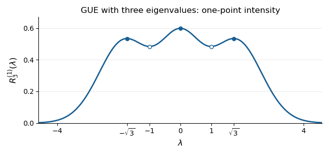

<h1 id="2/c/iii/solution">Solution</h1>

↑ **Parent:** [Iii](../iii.md)

The [correlation function of a point process](../../../../../correlation-function-of-a-point-process.md) is even and tends to zero as $|\lambda|\to\infty$. Its [derivative](../../../../../derivative.md) factors as

$$
\frac{d}{d\lambda}R_3^{(1)}(\lambda)
=-\frac{\lambda(\lambda^2-1)(\lambda^2-3)}{2\sqrt{2\pi}}
e^{-\lambda^2/2}.
$$

Consequently its local maxima occur at $0,\pm\sqrt3$, and its local minima at $\pm1$. The heights are

$$
\begin{aligned}
R_3^{(1)}(0)&=\frac3{2\sqrt{2\pi}}\simeq0.5984,\\
R_3^{(1)}(\pm1)&=\frac{2e^{-1/2}}{\sqrt{2\pi}}\simeq0.4839,\\
R_3^{(1)}(\pm\sqrt3)&=\frac{6e^{-3/2}}{\sqrt{2\pi}}\simeq0.5341.
\end{aligned}
$$

**[Figure 1](#2/c/iii/image-the-three-peaks-of-the-gue-one-point-correlation-function). The three peaks of the GUE one-point correlation function**. Original plot of the exact [correlation function of a point process](../../../../../correlation-function-of-a-point-process.md) calculated above. Filled markers indicate local maxima at $-\sqrt3,0,\sqrt3$; hollow markers indicate the local minima at $-1,1$. The total area is three.

For an interval $I$, $\int_I R_3^{(1)}(\lambda)\,d\lambda$ is the [expected value](../../../../../expected-value-split.md) of the number of [eigenvalues](../../../../../eigenvalue.md) in $I$. Thus equally short intervals have the highest expected counts near

$$
\boxed{\lambda=-\sqrt3,\quad0,\quad\sqrt3,}
$$

with the central peak highest. Each exchangeably labelled [eigenvalue](../../../../../eigenvalue.md) has the same marginal [probability density function](../../../../../probability-density-function.md) $R_3^{(1)}/3$. The three peaks should not be interpreted as three separate marginal densities for ordered [eigenvalues](../../../../../eigenvalue.md).

In this case the most likely joint configuration also lies at these three positions. On the ordered chamber, the logarithm of the [joint probability density function](../../../../../joint-probability-density.md), up to a constant, is

$$
L(\boldsymbol\lambda)=2\sum_{i<j}\log(\lambda_j-\lambda_i)
-\frac12\sum_i\lambda_i^2.
$$

Its stationary equations are $\lambda_i=2\sum_{j\ne i}(\lambda_i-\lambda_j)^{-1}$, satisfied by $(-\sqrt3,0,\sqrt3)$. For every nonzero real [vector](../../../../../vector.md) $v$, the second directional [derivative](../../../../../derivative.md) is

$$
D^2L[v,v]=-\sum_i v_i^2
-2\sum_{i<j}\frac{(v_i-v_j)^2}{(\lambda_i-\lambda_j)^2}<0.
$$

Thus $L$ is strictly [concave](../../../../../concave-function.md) on this convex chamber, proving that the stationary configuration is its unique global maximum. Permuting the labels gives the other maxima on $\mathbb R^3$.

## ↑ Ancestors (13)

1. [Iii](../iii.md)
2. [C](../../c.md)
3. [2](../../../2.md)
4. [2025](../../../../2025-split.md)
5. [Past exam of the random matrix theory course of the University of Oxford](../../../../split.md)
6. [Random matrix theory course of the University of Oxford](../../../../../random-matrix-theory-course-of-the-university-of-oxford.md)
7. [Year 4 of the mathematics course of the University of Oxford](../../../../../year-4-of-the-mathematics-course-of-the-university-of-oxford.md)
8. [Mathematics course of the University of Oxford](../../../../../mathematics-course-of-the-university-of-oxford.md)
9. [Undergraduate course of the University of Oxford](../../../../../undergraduate-course-of-the-university-of-oxford.md)
10. [Course of the University of Oxford](../../../../../course-of-the-university-of-oxford.md)
11. [University of Oxford](../../../../../university-of-oxford-split.md)
12. [List of universities](../../../../../list-of-universities.md)
13. [Codex Wiki](../../../../../split.md)
