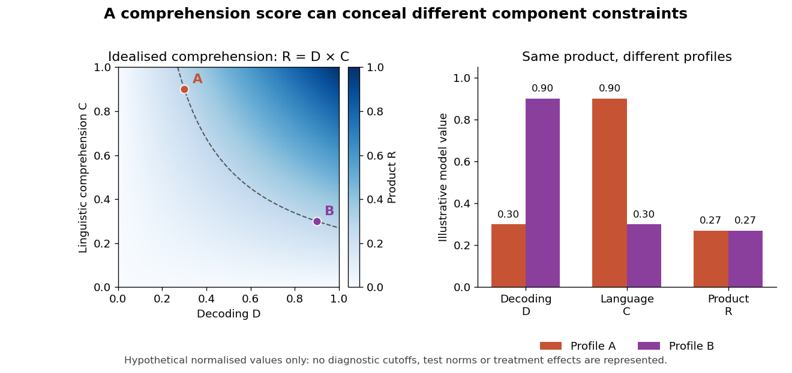

# 2022

↑ **Parent:** [Past exam of the reading and language: development and disorder course of the University of Oxford](../past-exam-of-the-reading-and-language-development-and-disorder-course-of-the-university-of-oxford.md)

[Reading](../psychology.md#reading) and [language](../README.md#language): development and disorder, Trinity Term 2022, 1 June at 09:30 BST. This undergraduate Part II advanced option has a three-hour writing period; the cover identifies the Second Public Examination without printing a Part number. Every essay option is treated below using evidence available by 1 June 2022.

Course: [Reading and language: development and disorder course of the University of Oxford](../university-of-oxford.md#reading-and-language-development-and-disorder-course-of-the-university-of-oxford). Public source: [Oxford-supplied archive, a10986w1.pdf](https://www.whatdotheyknow.com/request/experimental_psychology_past_exa/response/2757831/attach/3/New%20Compressed%20zipped%20Folder.zip?cookie_passthrough=1).[Cover and all six options on page 2, A10986W1](../psychology-bibliography.md#reading-and-language-development-and-disorder-2022-by-university-of-oxford)

**Table of contents**

- [1](#1)
  - [Solution](#1/solution)
- [2](#2)
  - [Solution](#2/solution)
- [3](#3)
  - [Solution](#3/solution)
- [4](#4)
  - [Solution](#4/solution)
- [5](#5)
  - [Solution](#5/solution)
- [6](#6)
  - [Solution](#6/solution)

## 1

↑ **Parent:** [2022](2022.md)

<h3 id="1/solution">Solution</h3>

↑ **Parent:** [1](#1)

[Reading comprehension](../psychology.md#reading-comprehension) is measurable as performance on specified tasks and as a theoretically organised construct, but it is not a context-free quantity revealed equally well by every test. A score reflects a reader, a text, a question and an assessment format. The important question is whether the intended interpretation is supported: screening for difficulty, explaining an individual profile and evaluating an intervention can require different measurements.

A useful framework is the [simple view of reading](../psychology.md#simple-view-of-reading), which distinguishes [decoding](../psychology.md#word-decoding) from [linguistic comprehension](../psychology.md#linguistic-comprehension). [Wesley A. Hoover](../README.md#wesley-a-hoover) and [Philip B. Gough](../README.md#philip-b-gough) tested predictions from a product relation in a longitudinal bilingual sample. The model captures the idea that understanding spoken [language](../README.md#language) cannot compensate for completely inaccessible print, while accurate word [reading](../psychology.md#reading) alone cannot supply the meanings of the words. It does not imply that all raw test scores can simply be multiplied, or that each broad component is psychologically indivisible.[Reading and Writing 2, 127–160; decoding, linguistic comprehension and product predictions in a longitudinal bilingual sample](../psychology-bibliography.md#the-simple-view-of-reading-by-wesley-a-hoover-and-philip-b-gough)

For an illustration, suppose [decoding](../psychology.md#word-decoding) $D$ and [linguistic comprehension](../psychology.md#linguistic-comprehension) $C$ are represented on idealised scales from zero to one and $R=DC$. Profiles $(D,C)=(0.3,0.9)$ and $(0.9,0.3)$ both give $R=0.27$. The same comprehension outcome can therefore arise from different bottlenecks. These are hypothetical model values, not diagnostic cutoffs or observations about [children](../organism.md#child). The distinction motivates measuring component skills rather than assigning one intervention from an aggregate score alone.

**[Figure 1](#1/image-different-component-profiles-can-yield-the-same-product-in-the-simple-view-of-reading). Different component profiles can yield the same product in the simple view of reading**.

Direct comparisons show that tests are not interchangeable. [Janice M. Keenan](../README.md#janice-m-keenan) and colleagues compared five [reading comprehension](../psychology.md#reading-comprehension) measures. [Decoding](../psychology.md#word-decoding) explained more variation in the [PIAT](../psychology.md#peabody-individual-achievement-test) and Woodcock–Johnson passage task, whereas [listening comprehension](../psychology.md#listening-comprehension) contributed more strongly to the [Gray Oral Reading Test](../psychology.md#gray-oral-reading-test) and the two [Qualitative Reading Inventory](../psychology.md#qualitative-reading-inventory) measures. The demands of some tests also changed with developmental level. Modest agreement therefore need not mean that comprehension is unreal: it can reveal different mixtures of processes and content, alongside measurement error.[Scientific Studies of Reading 12, 281–300; five measures, differential decoding/listening dependence and developmental changes](../psychology-bibliography.md#reading-comprehension-tests-vary-in-the-skills-they-assess-differential-dependence-on-decoding-and-oral-comprehension-by-janice-m-keenan-and-others)

Assessment design determines what evidence is available. A short cloze item may be solved through local word knowledge and [decoding](../psychology.md#word-decoding), while questions about a passage can require integrating information across sentences. Retelling additionally requires organising and producing an answer. Removing the text increases [memory](../neuroscience.md#memory-in-animals) demands; keeping it visible permits rereading and strategic search. Oral answers may expose expressive-language difficulties that a recognition format does not. None is automatically superior: the format must match the intended inference.

Reliability and validity are distinct. Repeated passages and sufficiently sampled items can improve precision, but a highly consistent score can still overemphasise [decoding](../psychology.md#word-decoding) when the goal is discourse understanding. Convergence across texts and formats strengthens a construct interpretation; disagreement can identify task-specific demands. [Measurement invariance](../psychology.md#measurement-invariance) matters when comparing ages or groups, because the same item format can depend on different skills as [word recognition](../neuroscience.md#word-recognition) improves. A change in a standard score is not automatically an equal change in the underlying process at every age.

The first pressure point is efficient access to printed words. Slow or inaccurate [decoding](../psychology.md#word-decoding) limits which propositions become available and can consume resources needed for integration. Assessment should distinguish familiar-word accuracy, unfamiliar-word [decoding](../psychology.md#word-decoding) and fluency rather than assume that one word-reading score captures all three. A reader can identify isolated words accurately yet struggle to coordinate them in connected text.

The second pressure point is linguistic knowledge. [Vocabulary breadth](../README.md#vocabulary-breadth) and depth determine whether word meanings are accessible and appropriate to context; [grammar](../README.md#grammar) helps assign relations between entities and events. A text can be decoded accurately while remaining opaque because its meanings or sentence structures are unfamiliar. Background knowledge can support interpretation, but can also produce confident answers unsupported by the passage. Text selection should therefore vary topics rather than make one knowledge domain stand for general comprehension.

Higher-level processes provide further pressure points: generating necessary inferences, building a coherent representation, identifying relevant information and noticing inconsistencies. [Kate Cain](../psychologist.md#kate-cain) and colleagues assessed [children](../organism.md#child) at eight, nine and eleven and related comprehension to [working memory](../neuroscience.md#working-memory) and component skills. The study supports a multicomponent analysis, while its concurrent prediction models do not establish that training any correlated component will improve [reading](../psychology.md#reading). [Working memory](../neuroscience.md#working-memory) demands are also partly determined by the text and response format.[Journal of Educational Psychology 96, 31–42; assessments at eight, nine and eleven, component skills and concurrent prediction](../psychology-bibliography.md#children-s-reading-comprehension-ability-concurrent-prediction-by-working-memory-verbal-ability-and-component-skills-by-kate-cain-and-others)

A useful assessment combines a comprehension measure with [listening comprehension](../psychology.md#listening-comprehension), [vocabulary](../README.md#vocabulary), [grammar](../README.md#grammar), [decoding](../psychology.md#word-decoding) and fluency, then investigates the [child](../organism.md#child)'s actual errors. Can they explain a referent, connect two statements or notice a contradiction when word-reading demands are reduced? Contrasting written and spoken versions can test a proposed bottleneck, although listening itself has [memory](../neuroscience.md#memory-in-animals) and [attention](../psychology.md#attention) demands. A profile is a hypothesis about performance, not proof of a separate disorder or a unique cause.

Intervention supplies complementary evidence. [Paula J. Clarke](../README.md#paula-j-clarke) and colleagues [randomised](../causal-inference.md#randomization) [children](../organism.md#child) with accurate [reading](../psychology.md#reading) but poor comprehension to text-focused, [oral language](../README.md#oral-language), combined or untreated conditions. Comprehension improved in the intervention groups, with continued gains after [oral language](../README.md#oral-language) training. This demonstrates that difficulties can be modified through more than [word decoding](../psychology.md#word-decoding), but an improvement in a package does not isolate one underlying process. Maintenance, untrained texts and independent assessment are important when distinguishing [learning](../animal-behaviour.md#learning) the assessment from broader transfer.[Psychological Science 21, 1106–1116; text/oral/combined interventions, untreated comparison and eleven-month follow-up](../psychology-bibliography.md#ameliorating-children-s-reading-comprehension-difficulties-a-randomized-controlled-trial-by-paula-j-clarke-and-others)

The defensible conclusion is that comprehension is a measurable but task-dependent achievement supported by interacting skills. Its pressure points can lie in print access, [language](../README.md#language) knowledge, integration, inference or monitoring, and their relative importance changes with the reader and text. Good measurement makes those dependencies explicit and samples enough situations to support the intended decision, rather than treating a single score as a complete explanation of failure.

## 2

↑ **Parent:** [2022](2022.md)

<h3 id="2/solution">Solution</h3>

↑ **Parent:** [2](#2)

Longitudinal data are critical for several developmental questions because they show whether an earlier characteristic precedes later [reading](../psychology.md#reading), how individuals change and whether apparently similar outcomes have different histories. They are not sufficient to identify causes, and they are not the only informative evidence. The strongest understanding combines repeated observation with experiments, intervention and explicit models of measurement and development.

A cross-sectional age comparison confounds age with cohort, instruction and selection. Older and younger [children](../organism.md#child) may have received different teaching or differ in who remains in a sample. Following the same [children](../organism.md#child) can establish continuity and change, show whether an early weakness persists, and locate periods when a skill becomes more predictive. It also permits assessment before conventional [reading instruction](../psychology.md#reading-instruction), reducing the risk of describing a consequence of [reading](../psychology.md#reading) experience as its original cause.

[Valerie Muter](../README.md#valerie-muter) and colleagues followed ninety school entrants over two years. Earlier letter knowledge and [phoneme](../README.md#phoneme) sensitivity predicted [word recognition](../neuroscience.md#word-recognition), whereas comprehension drew on [word recognition](../neuroscience.md#word-recognition), [vocabulary](../README.md#vocabulary) and [grammar](../README.md#grammar). The temporally ordered pattern supports distinguishing developmental pathways rather than using a single readiness score. It does not prove that a predictor is sufficient, immutable or uniquely causal: teaching, family experience and other correlated skills may contribute to both the early measure and later outcome.[Developmental Psychology 40, 665–681; ninety school entrants, two-year follow-up and distinct predictors](../psychology-bibliography.md#phonemes-rimes-vocabulary-and-grammatical-skills-as-foundations-of-early-reading-development-evidence-from-a-longitudinal-study-by-valerie-muter-and-others)

Developmental relations can change as constraints shift. When [decoding](../psychology.md#word-decoding) is effortful, individual differences in print access may dominate a comprehension measure; later, [oral language](../README.md#oral-language) differences can become more visible. In [Arne Lervåg](../README.md#arne-lervag) and colleagues' five-year study beginning at about seven and a half, shared variation across [vocabulary](../README.md#vocabulary), [grammar](../README.md#grammar), verbal [working memory](../neuroscience.md#working-memory) and inference predicted listening and [reading comprehension](../psychology.md#reading-comprehension). Their modelling included interactions and nonlinearities. This shows why a fixed linear contribution estimated at one age may not describe the developmental process.[Child Development 89, 1821–1838; 198 children, five-year study starting at 7.5, shared language variance and nonlinear relations](../psychology-bibliography.md#unpicking-the-developmental-relationship-between-oral-language-skills-and-reading-comprehension-it-s-simple-but-complex-by-arne-lervag-and-others)

Repeated observation can distinguish trajectories concealed by an endpoint. Two [children](../organism.md#child) with similar [reading](../psychology.md#reading) at nine may differ because one began with weak [decoding](../psychology.md#word-decoding) and improved, while another decoded adequately but developed a widening comprehension difficulty as texts became linguistically demanding. These histories generate different hypotheses about support and assessment. Conversely, using the later outcome to define groups can bias retrospective descriptions of their predictors, especially when classifications depend on noisy scores.

Longitudinal data are also needed to investigate reciprocal influence. [Oral language](../README.md#oral-language) knowledge can facilitate [reading](../psychology.md#reading), while [reading](../psychology.md#reading) supplies new words and makes phonological structure more explicit. A path from an earlier [reading](../psychology.md#reading) score to later [vocabulary](../README.md#vocabulary) is compatible with feedback, but it can also reflect stable differences in home experience or [language](../README.md#language) ability. A conventional cross-lagged model may mix between-child differences with within-child change. Temporal ordering and statistical adjustment constrain explanations without automatically identifying the effect of changing a particular [child](../organism.md#child)'s experience.

The home-literacy study by [Monique Sénéchal](../psychologist.md#monique-senechal) and [Jo-Anne LeFevre](../psychologist.md#jo-anne-lefevre) illustrates both the value and limits. Their five-year sample linked book exposure with [language](../README.md#language) outcomes and direct parental teaching with early literacy, followed by later [reading](../psychology.md#reading). Measuring activities and skills at different stages helps specify candidate routes that a single concurrent [correlation](../variance.md#pearson-correlation-coefficient) would conceal. The observational design and relatively advantaged sample, however, do not establish that prescribing the measured activity would reproduce the association across all families.[Child Development 73, 445–460; 168 middle/upper-middle-class children, home activities and distinct language/literacy pathways](../psychology-bibliography.md#parental-involvement-in-the-development-of-children-s-reading-skill-a-five-year-longitudinal-study-by-monique-senechal-and-jo-anne-lefevre)

Several methodological conditions are essential. The measures must remain interpretable across time: replacing an easy early task with a harder later one can be sensible, but common anchors or defensible latent models are needed for growth comparisons. Ceiling and floor effects can create apparent changes in prediction. A reliable group-average effect does not guarantee reliable ranking of individuals. Multiple measures can reduce [task impurity](../design-of-experiments.md#task-impurity), although a fitted latent factor still depends on its indicator and model assumptions.

[Attrition](../causal-inference.md#study-attrition) can distort a trajectory if [children](../organism.md#child) with greater difficulty or disadvantage are less likely to remain. Recruitment and retention should be reported alongside the handling of missing observations. Statistical methods cannot recover information without assumptions, so sensitivity analyses should examine plausible departures from them. More waves do not automatically solve this problem, and closely spaced assessments can introduce [practice effects](../psychology.md#practice-effect) while widely spaced assessments miss the timing of change.

Intervention provides additional causal leverage. [Peter J. Hatcher](../README.md#peter-j-hatcher) and colleagues compared matched groups of seven-year-old poor readers receiving [reading](../psychology.md#reading), phonological work, their integration or a control condition. Phonology-only work most improved the phonological tasks, while the integrated programme produced the greatest [reading](../psychology.md#reading) progress. This demonstrates why a longitudinal predictor cannot simply be translated into an isolated training prescription. The design supports the tested contrast, while allocation, contact and the content of each teaching package constrain finer causal claims.[Child Development 65, 41–57; matched groups of seven-year-old poor readers, reading/phonology/combined/control conditions](../psychology-bibliography.md#ameliorating-early-reading-failure-by-integrating-the-teaching-of-reading-and-phonological-skills-the-phonological-linkage-hypothesis-by-peter-j-hatcher-and-others)

An informative future programme would begin before instruction, repeatedly measure [oral language](../README.md#oral-language), phonological skills, letter knowledge, teaching and [reading](../psychology.md#reading), and retain an inclusive range of [children](../organism.md#child). Embedded [randomisation](../causal-inference.md#randomization) could vary a specified teaching component while keeping adequate instruction available to everyone. Assess near-term target engagement, generalisation to untrained material and later comprehension. This combines developmental timing with an intervention contrast instead of treating observational paths as effects of manipulation.

Cross-linguistic and [artificial orthography](../README.md#artificial-orthography) experiments can answer questions that a single natural cohort cannot. They can hold [learning](../animal-behaviour.md#learning) opportunities constant while changing the consistency or distribution of print-to-sound mappings. Longitudinal classroom studies then test whether the proposed process survives ordinary instruction and changing [language](../README.md#language) demands. Agreement across methods is more persuasive than extending the duration of one observational design indefinitely.

Longitudinal data are therefore indispensable when the claim concerns ordering, change, persistence or reciprocal development. They are not a substitute for credible measurement or causal design. Their greatest contribution is to make developmental explanations more precise and testable, while experiments and interventions establish which changes in experience actually alter the path.

## 3

↑ **Parent:** [2022](2022.md)

<h3 id="3/solution">Solution</h3>

↑ **Parent:** [3](#3)

A meaningful distinction can be made between [developmental language disorder](../animal-behaviour.md#developmental-language-disorder) and [reading disorders](../psychology.md#reading-disorder), provided it is expressed as a distinction between dimensions and profiles rather than a claim that every [child](../organism.md#child) falls into one isolated biological category. Spoken-language difficulty and impaired word [reading](../psychology.md#reading) can occur separately or together. Their overlap is informative, and the definition of '[reading disorder](../psychology.md#reading-disorder)' matters: [dyslexia](../psychology.md#dyslexia) centred on word-level [reading](../psychology.md#reading) is not synonymous with every form of poor [reading comprehension](../psychology.md#reading-comprehension).

The [CATALISE](../psychology.md#catalise) consensus endorsed [developmental language disorder](../animal-behaviour.md#developmental-language-disorder) for persistent [language](../README.md#language) difficulties associated with [functional impairment](../psychology.md#functional-impairment) and poor prognosis, without a known associated biomedical aetiology. [Risk factors](../biology.md#risk-factor) do not automatically exclude the [diagnosis](../psychology.md#clinical-diagnosis), and a verbal–nonverbal discrepancy is not required. This is a research and clinical terminology agreement, not an experiment proving a natural boundary. Earlier studies of [specific language impairment](../psychology.md#specific-language-impairment) used criteria that must be examined before their groups are equated with contemporary [DLD](../animal-behaviour.md#developmental-language-disorder).[Journal of Child Psychology and Psychiatry 58, 1068–1080; 57-member terminology consensus, impairment, prognosis and biomedical associations](../psychology-bibliography.md#phase-2-of-catalise-a-multinational-and-multidisciplinary-delphi-consensus-study-of-problems-with-language-development-terminology-by-dorothy-v-m-bishop-and-others)

[Dyslexia](../psychology.md#dyslexia) typically concerns persistent difficulties in accurate or fluent word [reading](../psychology.md#reading) and [spelling](../README.md#spelling). A [child](../organism.md#child) can have these difficulties while understanding spoken [language](../README.md#language) relatively well. Another [child](../organism.md#child) can decode words adequately but struggle with [vocabulary](../README.md#vocabulary), [grammar](../README.md#grammar) or discourse understanding, limiting comprehension in both spoken and written form. A third can have both profiles. The [simple view of reading](../psychology.md#simple-view-of-reading) provides a useful two-dimensional description, while actual assessment must also consider fluency, instruction, [language](../README.md#language) experience and the demands of the text.

[Hugh W. Catts](../psychology.md#hugh-w-catts) and colleagues tested the relation prospectively in a representative 527-child sample, comparing kindergarten [language](../README.md#language) impairment with later [dyslexia](../psychology.md#dyslexia) classifications. They found overlap but not identity. In a separate profile analysis, [dyslexia](../psychology.md#dyslexia) was more closely associated with pronounced phonological-processing weaknesses, whereas [language](../README.md#language) impairment without [dyslexia](../psychology.md#dyslexia) showed milder phonological difficulties. The evidence supports distinguishable profiles, but depends on the diagnostic rules, measures and developmental occasions used.[Journal of Speech, Language, and Hearing Research 48, 1378–1396; 527-child longitudinal sample and separate phonological-profile subsample](../psychology-bibliography.md#are-specific-language-impairment-and-dyslexia-distinct-disorders-by-hugh-w-catts-and-others)

[Margaret J. Snowling](../README.md#margaret-snowling) and colleagues followed a cohort enriched for familial [reading](../psychology.md#reading) risk or preschool [language](../README.md#language) difficulty. At eight, they identified dyslexia-only, DLD-only and comorbid groups; comprehension was measured at eight and nine. All groups had difficulties relative to controls, but the dyslexia-only group's comprehension weakness was milder than that of the groups with [DLD](../animal-behaviour.md#developmental-language-disorder). This is consistent with different routes to a shared outcome. [Comorbidity](../psychology.md#comorbidity) rates in an enriched sample should not be treated as population prevalence.[Journal of Child Psychology and Psychiatry 61, 672–680; dyslexia-only, DLD-only and comorbid groups at eight, comprehension at eight/nine](../psychology-bibliography.md#dyslexia-and-developmental-language-disorder-comorbid-disorders-with-distinct-effects-on-reading-comprehension-by-margaret-j-snowling-and-others)

The contrast between studies is itself useful. A representative cohort and a risk-enriched cohort can produce different overlap estimates without one necessarily invalidating the other. Selecting families with early [language](../README.md#language) problems increases the chance of observing both difficulties. Restricting one group to normal [decoding](../psychology.md#word-decoding) or [oral language](../README.md#oral-language) also creates cleaner profiles than may occur in routine assessment. Group definitions can therefore sharpen a theoretical contrast while understating the continuum of mixed presentations.

There are plausible shared and distinct developmental processes. Weak phonological representations or awareness can hinder [learning](../animal-behaviour.md#learning) letter–sound relations, while broader lexical, grammatical and discourse weaknesses affect understanding beyond word identification. These processes can covary because [language](../README.md#language) systems interact and because experiences support several skills together. A phonological difficulty does not have to account for every aspect of [DLD](../animal-behaviour.md#developmental-language-disorder), and broader [language](../README.md#language) risk does not guarantee [dyslexia](../psychology.md#dyslexia). A probabilistic multiple-risk account fits overlap more naturally than a necessary-and-sufficient deficit assigned to every [child](../organism.md#child) in a label.

Assessment should therefore specify the difficulty rather than infer it from the category. Include unfamiliar-word [decoding](../psychology.md#word-decoding), familiar-word accuracy and fluency, [spelling](../README.md#spelling), [vocabulary](../README.md#vocabulary), [grammar](../README.md#grammar), [listening comprehension](../psychology.md#listening-comprehension) and discourse tasks. Nonword repetition and phoneme-awareness measures can contribute, but each has perceptual, [memory](../neuroscience.md#memory-in-animals), motor or metalinguistic demands. Hearing, opportunity to learn, multilingual experience and functional impact also require consideration. Low performance in the [language](../README.md#language) of schooling is not, by itself, evidence of an intrinsic [language disorder](../psychology.md#language-disorder).

The distinction matters when choosing an intervention target. A [child](../organism.md#child) whose main barrier is acquiring written word forms needs teaching that addresses that barrier; accurate [decoding](../psychology.md#word-decoding) cannot be assumed to resolve a broader comprehension weakness. [Paula J. Clarke](../README.md#paula-j-clarke) and colleagues' trial of [children](../organism.md#child) with specific comprehension difficulties showed benefit from [oral language](../README.md#oral-language) and text-focused interventions, beyond the [children](../organism.md#child)'s existing accurate [reading](../psychology.md#reading). It supports treating the identified [language](../README.md#language)/comprehension problem, while not proving that a diagnostic label uniquely determines the best programme.[Psychological Science 21, 1106–1116; text/oral/combined interventions, untreated comparison and eleven-month follow-up](../psychology-bibliography.md#ameliorating-children-s-reading-comprehension-difficulties-a-randomized-controlled-trial-by-paula-j-clarke-and-others)

The combined profile may require support on both dimensions. Improvement should be monitored separately for word [reading](../psychology.md#reading), [oral language](../README.md#oral-language) and comprehension, because a gain in one can leave the other limiting performance. A programme's effect on a trained task is not enough: transfer to untrained passages and everyday educational participation are relevant outcomes. Categories can help communication and access to services, but should not prevent a [child](../organism.md#child) with mixed needs from receiving both forms of support.

A stronger test of separability would recruit [children](../organism.md#child) before [reading instruction](../psychology.md#reading-instruction), use reliable repeated measures and examine profiles without selecting only extreme, nonoverlapping groups. Dimensional models can be compared with categorical models, and competing predictions preregistered. An intervention study could test whether targeted [decoding](../psychology.md#word-decoding) and [oral language](../README.md#oral-language) components have different effects across baseline profiles, with adequate [power](../probability-and-statistics.md#statistical-power) for interactions. Mere significance in one group and nonsignificance in another would not establish a differential response.

The meaningful distinction is consequently between patterns of spoken-language and written-word difficulty, with implications for mechanisms, assessment and support. The evidence rejects a simple equation of [DLD](../animal-behaviour.md#developmental-language-disorder) with [dyslexia](../psychology.md#dyslexia) and also rejects treating [reading comprehension](../psychology.md#reading-comprehension) failure as one homogeneous condition. It does not require sharp, immutable boundaries or deny shared risks, [comorbidity](../psychology.md#comorbidity) and developmental change.

## 4

↑ **Parent:** [2022](2022.md)

<h3 id="4/solution">Solution</h3>

↑ **Parent:** [4](#4)

[Visual word recognition](../neuroscience.md#visual-word-recognition) develops through sensitivity to statistical structure at several levels: visual letter patterns, relations between print and sound, and relations between word forms and meanings. Calling it [statistical learning](../animal-behaviour.md#distributional-learning) is meaningful when it generates predictions about which experiences change performance and what transfers to new items. It is less informative if it merely redescribes every consequence of practice, or implies that [children](../organism.md#child) learn to read without explicit instruction.

An alphabetic writing system contains systematic but imperfect correspondences. A printed unit can map to different sounds depending on its neighbours, while several [spellings](../README.md#spelling) can express a similar sound. Frequency makes some patterns more available than others; consistency affects how strongly a local cue predicts an outcome. Whole-word familiarity, sublexical generalisation and [semantic](../README.md#semantics) support can therefore develop together. Recognising a trained item does not by itself establish what unit or relation was learned.

[David L. Share](../README.md#david-l-share)'s self-teaching experiment provides a concrete developmental mechanism. Second-grade readers encountered novel written forms while [reading](../psychology.md#reading) short texts aloud. Three days later they showed preferential [learning](../animal-behaviour.md#learning) of the encountered [spelling](../README.md#spelling) over a homophonic alternative on [spelling](../README.md#spelling) choice, naming and [spelling](../README.md#spelling) tasks. Conditions limiting phonological processing reduced [learning](../animal-behaviour.md#learning), with additional controls addressing visual-exposure explanations. This supports a role for successful recoding in acquiring word-specific representations, rather than treating [orthographic learning](../neuroscience.md#orthographic-learning) as a purely visual accumulation of letter shapes.[Journal of Experimental Child Psychology 72, 95–129; second-grade pseudoword reading, delayed spelling-choice/naming/spelling and recoding controls](../psychology-bibliography.md#phonological-recoding-and-orthographic-learning-a-direct-test-of-the-self-teaching-hypothesis-by-david-l-share)

Self-teaching also clarifies what the learner's input is. A [child](../organism.md#child) does not receive an unlimited sequence of perfectly labelled examples. They must attempt a pronunciation, connect it with a known spoken form or a context, and sometimes correct an initial interpretation. [Reading](../psychology.md#reading) skill changes which texts are encountered and which mappings are successfully extracted. [Statistical learning](../animal-behaviour.md#distributional-learning) therefore occurs within an actively selected developmental environment, supported by prior [language](../README.md#language) knowledge and instruction.

[Artificial orthographies](../README.md#artificial-orthography) make some of these influences experimentally separable. [Joanne S. H. Taylor](../README.md#joanne-s-h-taylor) and colleagues trained adults on novel written forms and manipulated frequency, consistency and prior phonological or [semantic](../README.md#semantics) knowledge. Participants learned trained items and generalised to new ones, showing sensitivity to more than isolated visual tokens. Pretraining could favour [item-specific learning](../animal-behaviour.md#item-specific-learning) while reducing generalisation. This dissociation demonstrates why [learning](../animal-behaviour.md#learning) many familiar words and abstracting reusable mappings should be measured separately.[Journal of Experimental Psychology: Learning, Memory, and Cognition 37, 60–76; sixteen/32 adults, novel script, frequency/consistency and pretraining](../psychology-bibliography.md#the-influence-of-consistency-frequency-and-semantics-on-learning-to-read-an-artificial-orthography-paradigm-by-joanne-s-h-taylor-and-others)

The apparatus in such studies is comparatively simple but powerful: unfamiliar characters and controlled pronunciations allow the experimenter to define the [learning](../animal-behaviour.md#learning) history. Training and test items can be chosen so that memorising the trained strings will not solve the transfer test. Naming, lexical decisions and generalisation can then constrain what was acquired. Adult participants, short training and artificial scripts limit extrapolation to [children](../organism.md#child)'s years of classroom [learning](../animal-behaviour.md#learning), and successful transfer does not uniquely identify a particular [neural network](../statistical-learning.md#neural-network) or rule-learning algorithm.

[Child](../organism.md#child) evidence strengthens the link to ordinary instruction. [Keith S. Apfelbaum](../README.md#keith-s-apfelbaum) and colleagues trained 224 first graders on vowel letter–sound relations embedded in words with either varied or similar consonants. Greater variation in the irrelevant consonants benefited [learning](../animal-behaviour.md#learning) and transfer across words and tasks. The result shows that the distribution of examples matters, not merely their total number. It does not establish one optimal curriculum for every [spelling](../README.md#spelling) system or learner.[Developmental Psychology 49, 1348–1365; 224 first graders, vowel mappings with varied/similar consonants and transfer tasks](../psychology-bibliography.md#statistical-learning-in-reading-variability-in-irrelevant-letters-helps-children-learn-phonics-skills-by-keith-s-apfelbaum-and-others)

The idea is intuitive: if one vowel pattern occurs with many different consonants, the invariant mapping is easier to distinguish from accidental properties of a few whole words. This is a hypothesis about cue selection and generalisation. A competing possibility is that highly similar examples force a fine-grained contrast. Experiments can adjudicate these principles by matching exposure and manipulating irrelevant variation, rather than assuming that either maximum variety or maximum similarity must always be best.

Explicit teaching is compatible with this account. [Joanne S. H. Taylor](../README.md#joanne-s-h-taylor) and colleagues taught 24 adults two unfamiliar scripts, contrasting emphasis on print-to-sound and print-to-meaning relations. Print-to-sound emphasis benefited naming, generalisation and single-word comprehension. Their behavioural and imaging results constrain how experience is organised, but do not constitute a classroom trial in beginning readers. The study shows why a statistical account should include what instructions direct the learner to notice.[Journal of Experimental Psychology: General 146, 826–858; 24 adults, two novel scripts, eight-day training, generalisation and fMRI](../psychology-bibliography.md#comparing-and-validating-methods-of-reading-instruction-using-behavioural-and-neural-findings-in-an-artificial-orthography-by-joanne-s-h-taylor-and-others)

Several levels of explanation must remain distinct. An observed frequency effect identifies a property of performance. A [learning](../animal-behaviour.md#learning) model must specify representations, [learning](../animal-behaviour.md#learning) rules and the input needed to produce it. A developmental theory must additionally explain changes in prior [language](../README.md#language), [attention](../psychology.md#attention), instruction and [reading](../psychology.md#reading) experience. A computational system fitted to skilled performance may not reproduce acquisition, and a model that learns successfully from an unrealistic input has not established how [children](../organism.md#child) solve the problem.

The [word recognition](../neuroscience.md#word-recognition) task also extends beyond an isolated spelling-to-sound mapping. Efficient recognition must tolerate changes in font and case, distinguish similar forms, access meaning and operate in context. Different scripts make different statistical units useful. Evidence from one English-trained adult sample should not be presented as proving an identical grain size across [languages](../README.md#language). [Statistical learning](../animal-behaviour.md#distributional-learning) can be a common principle while the representations and instructional demands differ.

A decisive developmental test would hold total exposures and teaching time constant while varying a specified distribution, measure both trained and untrained forms, and assess retention after a delay. Pre-existing [decoding](../psychology.md#word-decoding) and [oral language](../README.md#oral-language) skills should be measured before allocation, with prespecified tests of moderation. Eye movements or response times can supplement accuracy, but each needs an explicit model linking the measurement to the [learning](../animal-behaviour.md#learning) hypothesis. A classroom replication should then test whether the predicted advantage survives ordinary teaching and broader text demands.

[Visual word recognition](../neuroscience.md#visual-word-recognition) is thus a feat of [statistical learning](../animal-behaviour.md#distributional-learning) in a substantive sense: readers extract useful relations from a structured, partly inconsistent environment and generalise beyond particular experiences. The claim becomes explanatory when it specifies the input, units, [learning](../animal-behaviour.md#learning) process and transfer predictions. It remains compatible with [phonological recoding](../psychology.md#phonological-recoding), [semantic](../README.md#semantics) knowledge and explicit instruction, and it requires more than observing that frequently encountered words are read quickly.

## 5

↑ **Parent:** [2022](2022.md)

<h3 id="5/solution">Solution</h3>

↑ **Parent:** [5](#5)

By June 2022, important principles of [reading](../psychology.md#reading) acquisition were established, including the need to learn written word forms and to understand the [language](../README.md#language) they express. The major unanswered questions concerned how these skills become efficient and integrated, why [children](../organism.md#child) respond differently to experience and instruction, and how experimental gains become sustained comprehension and participation. Useful future research should target those uncertainties with explicit competing predictions rather than reopen every instructional question as if no evidence existed.

One question concerns what is learned from a successful encounter with a new written word. Does the [child](../organism.md#child) acquire an item-specific [spelling](../README.md#spelling), a reusable mapping, a contextual guess, or some combination? [David L. Share](../README.md#david-l-share)'s delayed [learning](../animal-behaviour.md#learning) experiments motivate the distinction, while [artificial orthography](../README.md#artificial-orthography) work shows that strong item [learning](../animal-behaviour.md#learning) and generalisation need not move together. Future studies should therefore distinguish recognition of practised items from transfer to novel combinations and later retention, rather than use one immediate naming test as a complete index of [learning](../animal-behaviour.md#learning).[Journal of Experimental Child Psychology 72, 95–129; second-grade pseudoword reading, delayed spelling-choice/naming/spelling and recoding controls](../psychology-bibliography.md#phonological-recoding-and-orthographic-learning-a-direct-test-of-the-self-teaching-hypothesis-by-david-l-share) [Journal of Experimental Psychology: Learning, Memory, and Cognition 37, 60–76; sixteen/32 adults, novel script, frequency/consistency and pretraining](../psychology-bibliography.md#the-influence-of-consistency-frequency-and-semantics-on-learning-to-read-an-artificial-orthography-paradigm-by-joanne-s-h-taylor-and-others)

A specific experiment could [randomise](../causal-inference.md#randomization) unfamiliar but pronounceable items to matched exposure schedules varying the consistency of a [spelling](../README.md#spelling)–sound relation. Hold the number of encounters, visual complexity and oral [vocabulary](../README.md#vocabulary) knowledge constant. Assess trained [spellings](../README.md#spelling) against homophonic alternatives after a delay, and test untrained recombinations that require the relevant mapping. [Eye tracking](../neuroscience.md#eye-tracking) during text [reading](../psychology.md#reading) could establish where the new form attracts [attention](../psychology.md#attention), while comprehension questions verify meaningful engagement. The experiment should specify whether its prediction concerns initial [learning](../animal-behaviour.md#learning), retention or generalisation.

A second question is how the distribution of teaching examples interacts with the learner's existing knowledge. [Keith S. Apfelbaum](../README.md#keith-s-apfelbaum) and colleagues found that varied irrelevant consonants helped first graders learn vowel mappings. It remains necessary to identify when variation helps, whether its effects depend on prior [decoding](../psychology.md#word-decoding) and how long the advantage lasts. A multisite classroom experiment could independently vary relevant consistency and irrelevant variation while matching total teaching time and opportunities to respond.[Developmental Psychology 49, 1348–1365; 224 first graders, vowel mappings with varied/similar consonants and transfer tasks](../psychology-bibliography.md#statistical-learning-in-reading-variability-in-irrelevant-letters-helps-children-learn-phonics-skills-by-keith-s-apfelbaum-and-others)

Pretraining measures should be collected before [randomisation](../causal-inference.md#randomization), and interaction tests [powered](../probability-and-statistics.md#statistical-power) prospectively. A significant benefit in one subgroup and a nonsignificant effect in another does not demonstrate different treatment effects. Instructional [fidelity](../psychology.md#treatment-fidelity) and actual exposure need observation because a teacher may adapt a nominally identical activity in different ways. Broader [spelling](../README.md#spelling), unfamiliar-word [reading](../psychology.md#reading) and later passage comprehension would distinguish a useful instructional principle from a narrow training-task effect.

A third question is how best to coordinate word-level and language-level support. [Margaret J. Snowling](../README.md#margaret-snowling) and colleagues' longitudinal profiles show that [dyslexia](../psychology.md#dyslexia), [DLD](../animal-behaviour.md#developmental-language-disorder) and their co-occurrence can lead to comprehension difficulty through different constraints. The unresolved question is not whether either dimension matters, but which combination, timing and intensity of support helps a specified [child](../organism.md#child). Diagnostic categories are too coarse to substitute for a measured profile.[Journal of Child Psychology and Psychiatry 61, 672–680; dyslexia-only, DLD-only and comorbid groups at eight, comprehension at eight/nine](../psychology-bibliography.md#dyslexia-and-developmental-language-disorder-comorbid-disorders-with-distinct-effects-on-reading-comprehension-by-margaret-j-snowling-and-others)

A factorial teaching trial could retain adequate core [reading instruction](../psychology.md#reading-instruction) for everyone and independently [randomise](../causal-inference.md#randomization) additional [decoding](../psychology.md#word-decoding) and [oral language](../README.md#oral-language) components, with contact and resource use measured. Include [children](../organism.md#child) across the skill distribution rather than only extreme, mutually exclusive categories. Prespecify [primary outcomes](../probability-and-statistics.md#primary-outcome) for word [reading](../psychology.md#reading), [language](../README.md#language) and comprehension, with delayed follow-up. A subsequent adaptive stage could [randomise](../causal-inference.md#randomization) a well-defined change for [children](../organism.md#child) not responding, instead of attributing improvement after an uncontrolled adjustment to personalisation itself.

The trial would also address a fourth question: what constitutes meaningful transfer? [Janice M. Keenan](../README.md#janice-m-keenan) and colleagues showed that comprehension assessments differ in their reliance on component skills. An intervention can look more successful simply because its outcome task resembles training. Future evaluations need independent passages, several assessment formats and checks that the construct retains a comparable meaning across time and groups. Function in the classroom and the [child](../organism.md#child)'s experience should accompany test scores, without treating either as a substitute for accurate measurement.[Scientific Studies of Reading 12, 281–300; five measures, differential decoding/listening dependence and developmental changes](../psychology-bibliography.md#reading-comprehension-tests-vary-in-the-skills-they-assess-differential-dependence-on-decoding-and-oral-comprehension-by-janice-m-keenan-and-others)

A fifth uncertainty concerns how findings generalise across writing systems, [language](../README.md#language) backgrounds and educational environments. Artificial-script work offers experimental control, but [Joanne S. H. Taylor](../README.md#joanne-s-h-taylor) and colleagues' instruction study used adults [learning](../animal-behaviour.md#learning) small novel [vocabularies](../README.md#vocabulary). It cannot establish the full trajectory of a multilingual [child](../organism.md#child) encountering an unfamiliar [language](../README.md#language) of instruction. Coordinated cross-language studies should define the mappings and [language](../README.md#language) experiences that differ, rather than merely compare national averages.[Journal of Experimental Psychology: General 146, 826–858; 24 adults, two novel scripts, eight-day training, generalisation and fMRI](../psychology-bibliography.md#comparing-and-validating-methods-of-reading-instruction-using-behavioural-and-neural-findings-in-an-artificial-orthography-by-joanne-s-h-taylor-and-others)

Recruitment should include varied socioeconomic circumstances and [children](../organism.md#child) whose [language](../README.md#language) development differs from the majority sample. Assessment needs to separate opportunity to learn from persistent difficulty and to examine the validity of the measures in each context. Shared protocols and culturally appropriate materials can coexist. The aim is to test which mechanisms generalise and which depend on script, [vocabulary](../README.md#vocabulary) or teaching, not presume that every observed group difference reveals an intrinsic deficit.

Computational models can sharpen all these questions. A model should learn from a specified developmental input, make predictions for held-out items and trajectories, and face comparison with alternatives that use different representations or [learning](../animal-behaviour.md#learning) rules. Matching average skilled-reader accuracy is weaker than predicting the effect of an experimental change in input. Parameters should not be allowed to absorb every individual difference without independent constraints; failure should inform revision rather than invite unrestricted refitting.

Finally, the timescale of research must match the educational claim. Short experiments identify candidate processes, longitudinal cohorts reveal ordering and trajectories, and controlled implementation studies assess delivery and lasting benefit. [Preregistration](../README.md#preregistration), transparent exclusions, appropriate handling of school clustering and missing follow-up, and independent replication make the chain more credible. The central unanswered problem is how to connect the [child](../organism.md#child)'s particular [learning](../animal-behaviour.md#learning) history and profile with an instructionally manipulable process that produces durable, generalisable gains.

## 6

↑ **Parent:** [2022](2022.md)

<h3 id="6/solution">Solution</h3>

↑ **Parent:** [6](#6)

[Oral language](../README.md#oral-language) shapes [written language](../README.md#written-language) development by supplying the phonological, lexical, grammatical and discourse knowledge that print must connect with. The influence is not unidirectional. [Learning](../animal-behaviour.md#learning) to read and write can make speech structure more explicit, expand [vocabulary](../README.md#vocabulary) and alter the processing of spoken words. The strength and direction of a particular relation depend on age, writing system, instruction and the aspect of [language](../README.md#language) being measured.

At the word level, alphabetic [reading](../psychology.md#reading) links [graphemes](../README.md#grapheme) with speech sounds and familiar spoken forms. [Phonological awareness](../README.md#phonological-awareness) can help a [child](../organism.md#child) analyse a word and use letter–sound relations, but it is not identical to speech comprehension or to the ability to pronounce a word. A [child](../organism.md#child) may understand a spoken word without being able to segment its [phonemes](../README.md#phoneme) deliberately. [Reading instruction](../psychology.md#reading-instruction) and [metalinguistic awareness](../animal-behaviour.md#metalinguistic-awareness) can consequently develop together rather than one being wholly completed before the other starts.

Longitudinal evidence separates some routes. [Valerie Muter](../README.md#valerie-muter) and colleagues found that letter knowledge and [phoneme](../README.md#phoneme) sensitivity predicted early [word recognition](../neuroscience.md#word-recognition), while [vocabulary](../README.md#vocabulary) and [grammar](../README.md#grammar) contributed to comprehension alongside [word recognition](../neuroscience.md#word-recognition). The result supports a differentiated [oral language](../README.md#oral-language) foundation. It does not imply that [vocabulary](../README.md#vocabulary) is irrelevant to every unfamiliar-word problem or that the observed predictors alone specify a complete teaching programme.[Developmental Psychology 40, 665–681; ninety school entrants, two-year follow-up and distinct predictors](../psychology-bibliography.md#phonemes-rimes-vocabulary-and-grammatical-skills-as-foundations-of-early-reading-development-evidence-from-a-longitudinal-study-by-valerie-muter-and-others)

For text comprehension, oral [vocabulary](../README.md#vocabulary) supplies meanings and [grammar](../README.md#grammar) supports interpretation of relations and reference. Inferencing and discourse knowledge connect information beyond a sentence. [Listening comprehension](../psychology.md#listening-comprehension) offers a useful comparison when [decoding](../psychology.md#word-decoding) is suspected to be the bottleneck, but it is not a demand-free measure of [language](../README.md#language). Speech unfolds over time and can tax [attention](../psychology.md#attention) and [memory](../neuroscience.md#memory-in-animals); written text can be reread. These differences should be considered before interpreting a written–spoken discrepancy as a pure [decoding](../psychology.md#word-decoding) deficit.

[Oral language](../README.md#oral-language) also contributes to producing [written language](../README.md#written-language). Choosing words, constructing sentences and organising a narrative draw on [language](../README.md#language) knowledge, while [spelling](../README.md#spelling) and transcription add constraints. [Julie E. Dockrell](../README.md#julie-e-dockrell) and colleagues followed 64 [children](../organism.md#child) with a history of [language](../README.md#language) impairment, assessing them at eight and their written text at ten. The writing showed difficulties in sentence structure and organisation; concurrent [vocabulary](../README.md#vocabulary) and [reading](../psychology.md#reading) helped explain variation. The associations support a broad profile, not proof that an isolated [vocabulary](../README.md#vocabulary) treatment would resolve composition difficulties.[Exceptional Children 73, 147–164; 64 children with language-impairment history, measures at eight and written text at ten](../psychology-bibliography.md#constraints-in-the-production-of-written-text-in-children-with-specific-language-impairments-by-julie-e-dockrell-and-others)

Intervention gives stronger leverage on one direction. [Paula J. Clarke](../README.md#paula-j-clarke) and colleagues' [oral language](../README.md#oral-language) programme improved [reading comprehension](../psychology.md#reading-comprehension) in [children](../organism.md#child) who could already read accurately, with gains extending beyond the intervention period. This supports [oral language](../README.md#oral-language) as a modifiable contributor, while the multicomponent programme and untreated comparator leave its precise ingredients partly open. An implication is that improving [word recognition](../neuroscience.md#word-recognition) alone may leave a language-level limitation unresolved.[Psychological Science 21, 1106–1116; text/oral/combined interventions, untreated comparison and eleven-month follow-up](../psychology-bibliography.md#ameliorating-children-s-reading-comprehension-difficulties-a-randomized-controlled-trial-by-paula-j-clarke-and-others)

Home experiences provide potentially different inputs. [Monique Sénéchal](../psychologist.md#monique-senechal) and [Jo-Anne LeFevre](../psychologist.md#jo-anne-lefevre) linked book exposure with [vocabulary](../README.md#vocabulary) and [listening comprehension](../psychology.md#listening-comprehension), and direct parental teaching with early literacy in a five-year study. These routes help explain why 'home literacy' is not one uniform activity. The observational, relatively advantaged sample limits causal and population inference; shared [reading](../psychology.md#reading) can involve both spoken interaction and print exposure, making it difficult to assign its effects exclusively to either medium.[Child Development 73, 445–460; 168 middle/upper-middle-class children, home activities and distinct language/literacy pathways](../psychology-bibliography.md#parental-involvement-in-the-development-of-children-s-reading-skill-a-five-year-longitudinal-study-by-monique-senechal-and-jo-anne-lefevre)

Evidence for the reverse direction has a long history. [José Morais](../psychologist.md#jose-morais) and colleagues compared adults who remained illiterate with people who had learned to read in adulthood. The former had difficulty deliberately adding or deleting a speech phone, whereas adult readers performed the tasks more readily. The contrast suggests that explicit access to phonemic structure is not an automatic consequence of mature spoken [language](../README.md#language). Because literacy was not randomly assigned, schooling and selection remain alternative contributors; the result concerns metalinguistic performance rather than absence of ordinary speech perception.[Cognition 7, 323–331; illiterate and adult-literate comparisons on phone addition/deletion](../psychology-bibliography.md#does-awareness-of-speech-as-a-sequence-of-phones-arise-spontaneously-by-jose-morais-and-others)

[Written language](../README.md#written-language) also supplies new lexical knowledge. [William E. Nagy](../README.md#william-e-nagy) and colleagues found small but reliable gains in knowledge of unfamiliar words encountered in natural text. Repeated [reading](../psychology.md#reading) can therefore contribute to [vocabulary](../README.md#vocabulary) growth, rather than [vocabulary](../README.md#vocabulary) always being an independent precursor. The amount learned from a passage depends on prior knowledge, context and assessment sensitivity, so tentative population extrapolations should not be confused with a guaranteed [learning](../animal-behaviour.md#learning) rate for every [child](../organism.md#child).[Reading Research Quarterly 20, 233–253; incidental word knowledge after reading natural text and limited extrapolation](../psychology-bibliography.md#learning-words-from-context-by-william-e-nagy-and-others)

Neuroscience provides converging evidence of reorganisation. [Stanislas Dehaene](../neuroscientist.md#stanislas-dehaene) and colleagues compared adults with different literacy histories using [fMRI](../nuclear-magnetic-resonance.md#functional-magnetic-resonance-imaging) responses to written and spoken material. Literacy was associated with changed visual responses to writing, stronger phonological responses to speech and activation of orthographic information from spoken input. The inclusion of adult learners shows that relevant differences are not restricted to childhood schooling, but the groups were not randomly assigned. The imaging does not by itself identify a unique instructional cause or show that larger activation is always better.[Science 330, 1359–1364; 10 illiterate/22 adult-literate/31 childhood-literate adults, visual and spoken-language fMRI](../psychology-bibliography.md#how-learning-to-read-changes-the-cortical-networks-for-vision-and-language-by-stanislas-dehaene-and-others)

The developmental relation can thus be recursive. Better [language](../README.md#language) knowledge helps a [child](../organism.md#child) understand print; successful [reading](../psychology.md#reading) permits more independent encounters with words and structures; those encounters can support later [oral language](../README.md#oral-language) performance. Difficulty at either stage may restrict opportunities at the next. Such a loop is a hypothesis about mechanisms and experience, not a reason to assume that all observed growth differences are self-amplifying or irreversible.

A strong test would combine repeated measures before and after instruction with controlled changes to oral or written experience. One study could compare [learning](../animal-behaviour.md#learning) the same unfamiliar meanings through listening, independent [reading](../psychology.md#reading) or supported [reading](../psychology.md#reading) while matching content and exposure. Test both spoken understanding and written use after a delay, alongside [decoding](../psychology.md#word-decoding) and prior [vocabulary](../README.md#vocabulary). Another could vary print support during [phoneme](../README.md#phoneme) instruction while assessing untrained speech-segmentation tasks. These designs can distinguish medium, content, instruction and transfer more clearly than a concurrent [correlation](../variance.md#pearson-correlation-coefficient).

Writing outcomes should remain part of that programme. Oral retelling, dictated composition and independent writing can help distinguish [language](../README.md#language) formulation from [spelling](../README.md#spelling) and transcription demands, though the tasks still differ in support and planning. Cross-language and multilingual studies can test whether reciprocity depends on script or experience rather than assuming that an English alphabetic result is universal.

[Oral language](../README.md#oral-language) is therefore a major foundation for [reading](../psychology.md#reading) and writing, but literacy is also an experience that reshapes [language](../README.md#language) knowledge and access. The most useful account specifies the component and timescale in each direction. It treats experimental, longitudinal, intervention and imaging evidence as complementary constraints on a reciprocal developmental system.

## ↑ Ancestors (9)

1. [Past exam of the reading and language: development and disorder course of the University of Oxford](../past-exam-of-the-reading-and-language-development-and-disorder-course-of-the-university-of-oxford.md)
2. [Reading and language: development and disorder course of the University of Oxford](../university-of-oxford.md#reading-and-language-development-and-disorder-course-of-the-university-of-oxford)
3. [Year 3 of the psychology (experimental) course of the University of Oxford](../university-of-oxford.md#year-3-of-the-psychology-experimental-course-of-the-university-of-oxford)
4. [Psychology (experimental) course of the University of Oxford](../university-of-oxford.md#psychology-experimental-course-of-the-university-of-oxford)
5. [Undergraduate course of the University of Oxford](../university-of-oxford.md#undergraduate-course-of-the-university-of-oxford)
6. [Course of the University of Oxford](../university-of-oxford.md#course-of-the-university-of-oxford)
7. [University of Oxford](../university-of-oxford.md)
8. [List of universities](../README.md#list-of-universities)
9. [Codex Wiki](../README.md)
