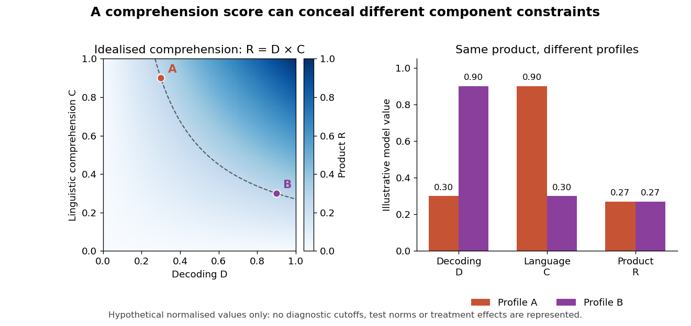

<h1 id="1/solution">Solution</h1>

↑ **Parent:** [1](../1.md)

[Reading comprehension](../../../reading-comprehension.md) is measurable as performance on specified tasks and as a theoretically organised construct, but it is not a context-free quantity revealed equally well by every test. A score reflects a reader, a text, a question and an assessment format. The important question is whether the intended interpretation is supported: screening for difficulty, explaining an individual profile and evaluating an intervention can require different measurements.

A useful framework is the [simple view of reading](../../../simple-view-of-reading.md), which distinguishes [decoding](../../../word-decoding.md) from [linguistic comprehension](../../../linguistic-comprehension.md). [Wesley A. Hoover](../../../wesley-a-hoover.md) and [Philip B. Gough](../../../philip-b-gough.md) tested predictions from a product relation in a longitudinal bilingual sample. The model captures the idea that understanding spoken [language](../../../language.md) cannot compensate for completely inaccessible print, while accurate word [reading](../../../reading.md) alone cannot supply the meanings of the words. It does not imply that all raw test scores can simply be multiplied, or that each broad component is psychologically indivisible.[Reading and Writing 2, 127–160; decoding, linguistic comprehension and product predictions in a longitudinal bilingual sample](../../../the-simple-view-of-reading-by-wesley-a-hoover-and-philip-b-gough.md)

For an illustration, suppose [decoding](../../../word-decoding.md) $D$ and [linguistic comprehension](../../../linguistic-comprehension.md) $C$ are represented on idealised scales from zero to one and $R=DC$. Profiles $(D,C)=(0.3,0.9)$ and $(0.9,0.3)$ both give $R=0.27$. The same comprehension outcome can therefore arise from different bottlenecks. These are hypothetical model values, not diagnostic cutoffs or observations about [children](../../../child.md). The distinction motivates measuring component skills rather than assigning one intervention from an aggregate score alone.

**[Figure 1](#1/image-different-component-profiles-can-yield-the-same-product-in-the-simple-view-of-reading). Different component profiles can yield the same product in the simple view of reading**.

Direct comparisons show that tests are not interchangeable. [Janice M. Keenan](../../../janice-m-keenan.md) and colleagues compared five [reading comprehension](../../../reading-comprehension.md) measures. [Decoding](../../../word-decoding.md) explained more variation in the [PIAT](../../../peabody-individual-achievement-test.md) and Woodcock–Johnson passage task, whereas [listening comprehension](../../../listening-comprehension.md) contributed more strongly to the [Gray Oral Reading Test](../../../gray-oral-reading-test.md) and the two [Qualitative Reading Inventory](../../../qualitative-reading-inventory.md) measures. The demands of some tests also changed with developmental level. Modest agreement therefore need not mean that comprehension is unreal: it can reveal different mixtures of processes and content, alongside measurement error.[Scientific Studies of Reading 12, 281–300; five measures, differential decoding/listening dependence and developmental changes](../../../reading-comprehension-tests-vary-in-the-skills-they-assess-differential-dependence-on-decoding-and-oral-comprehension-by-janice-m-keenan-and-others.md)

Assessment design determines what evidence is available. A short cloze item may be solved through local word knowledge and [decoding](../../../word-decoding.md), while questions about a passage can require integrating information across sentences. Retelling additionally requires organising and producing an answer. Removing the text increases [memory](../../../memory-in-animals.md) demands; keeping it visible permits rereading and strategic search. Oral answers may expose expressive-language difficulties that a recognition format does not. None is automatically superior: the format must match the intended inference.

Reliability and validity are distinct. Repeated passages and sufficiently sampled items can improve precision, but a highly consistent score can still overemphasise [decoding](../../../word-decoding.md) when the goal is discourse understanding. Convergence across texts and formats strengthens a construct interpretation; disagreement can identify task-specific demands. [Measurement invariance](../../../measurement-invariance.md) matters when comparing ages or groups, because the same item format can depend on different skills as [word recognition](../../../word-recognition.md) improves. A change in a standard score is not automatically an equal change in the underlying process at every age.

The first pressure point is efficient access to printed words. Slow or inaccurate [decoding](../../../word-decoding.md) limits which propositions become available and can consume resources needed for integration. Assessment should distinguish familiar-word accuracy, unfamiliar-word [decoding](../../../word-decoding.md) and fluency rather than assume that one word-reading score captures all three. A reader can identify isolated words accurately yet struggle to coordinate them in connected text.

The second pressure point is linguistic knowledge. [Vocabulary breadth](../../../vocabulary-breadth.md) and depth determine whether word meanings are accessible and appropriate to context; [grammar](../../../grammar.md) helps assign relations between entities and events. A text can be decoded accurately while remaining opaque because its meanings or sentence structures are unfamiliar. Background knowledge can support interpretation, but can also produce confident answers unsupported by the passage. Text selection should therefore vary topics rather than make one knowledge domain stand for general comprehension.

Higher-level processes provide further pressure points: generating necessary inferences, building a coherent representation, identifying relevant information and noticing inconsistencies. [Kate Cain](../../../kate-cain.md) and colleagues assessed [children](../../../child.md) at eight, nine and eleven and related comprehension to [working memory](../../../working-memory.md) and component skills. The study supports a multicomponent analysis, while its concurrent prediction models do not establish that training any correlated component will improve [reading](../../../reading.md). [Working memory](../../../working-memory.md) demands are also partly determined by the text and response format.[Journal of Educational Psychology 96, 31–42; assessments at eight, nine and eleven, component skills and concurrent prediction](../../../children-s-reading-comprehension-ability-concurrent-prediction-by-working-memory-verbal-ability-and-component-skills-by-kate-cain-and-others.md)

A useful assessment combines a comprehension measure with [listening comprehension](../../../listening-comprehension.md), [vocabulary](../../../vocabulary.md), [grammar](../../../grammar.md), [decoding](../../../word-decoding.md) and fluency, then investigates the [child](../../../child.md)'s actual errors. Can they explain a referent, connect two statements or notice a contradiction when word-reading demands are reduced? Contrasting written and spoken versions can test a proposed bottleneck, although listening itself has [memory](../../../memory-in-animals.md) and [attention](../../../attention.md) demands. A profile is a hypothesis about performance, not proof of a separate disorder or a unique cause.

Intervention supplies complementary evidence. [Paula J. Clarke](../../../paula-j-clarke.md) and colleagues [randomised](../../../randomization.md) [children](../../../child.md) with accurate [reading](../../../reading.md) but poor comprehension to text-focused, [oral language](../../../oral-language.md), combined or untreated conditions. Comprehension improved in the intervention groups, with continued gains after [oral language](../../../oral-language.md) training. This demonstrates that difficulties can be modified through more than [word decoding](../../../word-decoding.md), but an improvement in a package does not isolate one underlying process. Maintenance, untrained texts and independent assessment are important when distinguishing [learning](../../../learning.md) the assessment from broader transfer.[Psychological Science 21, 1106–1116; text/oral/combined interventions, untreated comparison and eleven-month follow-up](../../../ameliorating-children-s-reading-comprehension-difficulties-a-randomized-controlled-trial-by-paula-j-clarke-and-others.md)

The defensible conclusion is that comprehension is a measurable but task-dependent achievement supported by interacting skills. Its pressure points can lie in print access, [language](../../../language.md) knowledge, integration, inference or monitoring, and their relative importance changes with the reader and text. Good measurement makes those dependencies explicit and samples enough situations to support the intended decision, rather than treating a single score as a complete explanation of failure.

## ↑ Ancestors (11)

1. [1](../1.md)
2. [2022](../../2022-split.md)
3. [Past exam of the reading and language: development and disorder course of the University of Oxford](../../split.md)
4. [Reading and language: development and disorder course of the University of Oxford](../../../reading-and-language-development-and-disorder-course-of-the-university-of-oxford.md)
5. [Year 3 of the psychology (experimental) course of the University of Oxford](../../../year-3-of-the-psychology-experimental-course-of-the-university-of-oxford.md)
6. [Psychology (experimental) course of the University of Oxford](../../../psychology-experimental-course-of-the-university-of-oxford.md)
7. [Undergraduate course of the University of Oxford](../../../undergraduate-course-of-the-university-of-oxford.md)
8. [Course of the University of Oxford](../../../course-of-the-university-of-oxford.md)
9. [University of Oxford](../../../university-of-oxford-split.md)
10. [List of universities](../../../list-of-universities.md)
11. [Codex Wiki](../../../split.md)
