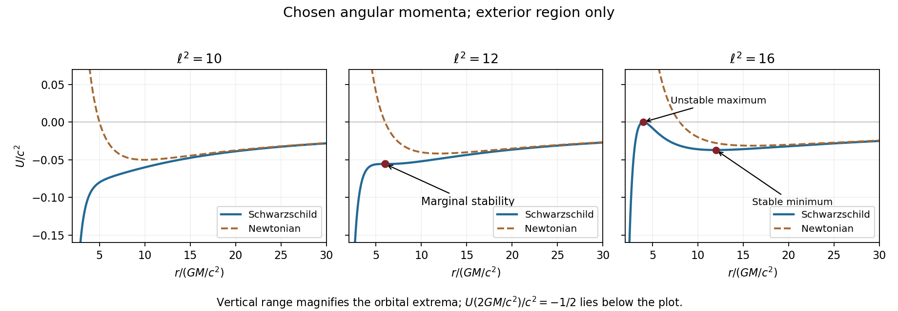

# Paper 1

↑ **Parent:** [2012](../2012.md)

[Original public PDF, physical pages 458–461; dated 17 January 2012](https://www.whatdotheyknow.com/request/natural_science_tripos_physics_e_2/response/2340776/attach/2/FOI%202023%20399%20Zahid%20materials.pdf?cookie_passthrough=1)

**Table of contents**

- [1](#1)
  - [Solution](#1/solution)
- [2](#2)
  - [Solution](#2/solution)
  - [a](#2/a)
    - [Solution](#2/a/solution)
  - [b](#2/b)
    - [Solution](#2/b/solution)
  - [c](#2/c)
    - [Solution](#2/c/solution)
- [3](#3)
  - [a](#3/a)
    - [Solution](#3/a/solution)
  - [b](#3/b)
    - [Solution](#3/b/solution)
  - [c](#3/c)
    - [Solution](#3/c/solution)
  - [d](#3/d)
    - [Solution](#3/d/solution)
  - [e](#3/e)
    - [Solution](#3/e/solution)

## 1

↑ **Parent:** [Paper 1](paper-1.md)

<h3 id="1/solution">Solution</h3>

↑ **Parent:** [1](#1)

Take overdots in this question to mean differentiation with respect to the orbiting particle's [proper time](../../special-relativity.md#proper-time) $\tau$. Write $\mu=GM/c^2$, $x=r/\mu$ and $\ell=hc/(GM)$, with $h$ the [specific angular momentum](../../celestial-mechanics.md#specific-angular-momentum). Then the dimensionless timelike effective potential is

$$
u(x)=\frac{U}{c^2}=-\frac1x+\frac{\ell^2}{2x^2}-\frac{\ell^2}{x^3}.
$$

The last term is the relativistic correction to the Newtonian centrifugal-plus-gravitational potential. At large $r$ the two agree. Newtonian [angular momentum](../../momentum.md#angular-momentum) gives an infinite inner [centrifugal barrier](../../mathematical-physics.md#centrifugal-barrier) for nonzero $h$; the relativistic correction lowers that barrier and permits plunge. The exterior problem starts at $r=2\mu$, where $U=-c^2/2$; extrapolating the potential towards $r=0$ is not a static exterior description.

Circular orbits obey

$$
U'=0\quad\Longleftrightarrow\quad GMr^2-h^2r+3\mu h^2=0,
\qquad h^2=\frac{GMr^2}{r-3\mu}.
$$

There are two extrema when $h^2>12(GM/c)^2$: an inner maximum representing an unstable circular orbit and an outer minimum representing a stable one. At equality they merge at $r=6\mu$; below it neither exists. More explicitly, evaluate the [curvature](../../differential-geometry.md#curvature) at a circular orbit:

$$
\left.U''\right|_{\rm circ}=\frac{GM(r-6\mu)}{r^3(r-3\mu)}.
$$

Timelike circular orbits require $r>3\mu$. They are radially stable for $r>6\mu$, so **the marginally stable inner limit is $r_{\rm ISCO}=6GM/c^2$**. The Newtonian potential instead has one stable minimum at $r=h^2/(GM)$, without an [innermost stable circular orbit](../../astrophysical-black-hole.md#innermost-stable-circular-orbit).

**[Figure 1](#1/image-schwarzschild-and-newtonian-potentials). Schwarzschild and Newtonian potentials**.

For the [Schwarzschild circular-orbit local speed](../../schwarzschild-spacetime.md#schwarzschild-circular-orbit-local-speed) in the question, $\gamma$ is the [Lorentz factor](../../special-relativity.md#lorentz-factor) relative to a local [Schwarzschild static observer](../../schwarzschild-spacetime.md#schwarzschild-static-observer), not $dt/d\tau$. That observer's clock obeys $dT=\sqrt{1-2\mu/r}\,dt$. Since the particle passes with local speed $v$, $r\,d\phi/d\tau=\gamma v$. Circular normalization gives

$$
\frac{(r\dot\phi)^2}{c^2}=\frac{\mu}{r-3\mu},\qquad
\gamma^2=1+\frac{(r\dot\phi)^2}{c^2}=\frac{r-2\mu}{r-3\mu},
\qquad \frac{v^2}{c^2}=\frac{\mu}{r-2\mu}.
$$

Thus **$v=c/2$ at the [innermost stable circular orbit](../../astrophysical-black-hole.md#innermost-stable-circular-orbit)**. Using [Schwarzschild time](../../schwarzschild-spacetime.md#schwarzschild-time) in place of the local clock would give a different speed.

For the conserved particle [energy](../../energy.md) measured at infinity, substitute $h^2$ in the circular [energy](../../energy.md) equation. Setting $y=\mu/r$ gives

$$
k^2=1-2y+\frac{y(1-2y)}{1-3y}
=\frac{(1-2y)^2}{1-3y},
\qquad\boxed{E=mc^2\frac{1-2\mu/r}{\sqrt{1-3\mu/r}}}.
$$

Take the positive root for a future-directed exterior orbit. It approaches $mc^2-GMm/(2r)$ at large radius. The [marginally bound circular Schwarzschild orbit](../../schwarzschild-spacetime.md#marginally-bound-circular-schwarzschild-orbit) solves $k=1$, giving $y(4y-1)=0$ and hence **$r_{\rm mb}=4GM/c^2$** at finite radius. It is unstable; strictly bound circular orbits have $r>4\mu$, with $E<mc^2$. The phrase smallest bound orbit here denotes this marginal circular limit, not a prohibition on a bound-energy trajectory plunging below it.

At the [innermost stable circular orbit](../../astrophysical-black-hole.md#innermost-stable-circular-orbit),

$$
\boxed{E_{\rm ISCO}=\sqrt{\frac89}\,mc^2\simeq0.94281mc^2},\qquad
\eta=1-\sqrt{\frac89}\simeq\boxed{0.0572}.
$$

A radiatively efficient [thin disc](../../astrophysical-disk.md#thin-disk) with a [zero-torque inner boundary condition](../../astrophysical-disk.md#zero-torque-inner-boundary-condition) can therefore release about 5.7% of the accreted [rest energy](../../special-relativity.md#rest-energy) before the plunge. [energy](../../energy.md) advection, stress at the inner edge and [photon](../../quantum-mechanics.md#photon) capture can alter the escaping [luminosity](../../astrophysics.md#luminosity), so this is a model efficiency rather than a universal emitted fraction.

For the [Kerr ISCO spin limits](../../astrophysical-black-hole.md#kerr-isco-spin-limits) of an equatorial prograde disc around a rapidly rotating [Kerr black hole](../../black-hole.md#kerr-black-hole), the [innermost stable circular orbit](../../astrophysical-black-hole.md#innermost-stable-circular-orbit) moves inward and its specific [energy](../../energy.md) decreases. In the ideal extremal limit its Boyer-Lindquist radius tends to $\mu$, $E/(mc^2)\to1/\sqrt3$, and the corresponding binding-energy efficiency tends to 42.3%. Retrograde rotation has the opposite trend: the extremal limit is $r_{\rm ISCO}=9\mu$, $E/(mc^2)=5/(3\sqrt3)$, giving about 3.8%. The prograde limiting coordinate radius does not identify a massive orbit with the null horizon generator.[§II, Eqs. 2.20–2.23 and Fig. 1, pp. 351–353](../../physics-bibliography.md#rotating-black-holes-locally-nonrotating-frames-energy-extraction-and-scalar-synchrotron-radiation-by-james-m-bardeen-and-others)

Finally $\dot t=k/(1-2\mu/r)=1/\sqrt{1-3\mu/r}$. Dividing $\dot\phi=h/r^2$ by this gives

$$
\boxed{\Omega_\infty=\frac{d\phi}{dt}=\sqrt{\frac{GM}{r^3}}}.
$$

Its algebraic form is exactly Newtonian, but $r$ is the [Schwarzschild spacetime](../../schwarzschild-spacetime.md) [areal radius](../../general-relativity.md#areal-radius) and $t$ [Schwarzschild time](../../schwarzschild-spacetime.md#schwarzschild-time), normalized at infinity. Local clock rates, orbit stability and [binding energy](../../energy.md#binding-energy) remain relativistic. With $GM_\odot\simeq1.3271\times10^{20}\,\mathrm{m^3\,s^{-2}}$,

$$
\boxed{f_{\rm ISCO,\infty}=\frac{c^3}{2\pi6^{3/2}G(10M_\odot)}\simeq0.220\,\mathrm{kHz}},
\qquad\boxed{\frac{f_{\rm ISCO}}{f_{\rm mb}}=\left(\frac46\right)^{3/2}\simeq0.544}.
$$

The marginally bound circular-orbit [frequency](../../wave.md#frequency) is about $0.404\,\mathrm{kHz}$. These [Schwarzschild ISCO orbital frequencies](../../astrophysical-black-hole.md#schwarzschild-isco-orbital-frequency) and marginally bound [frequencies](../../wave.md#frequency) are rotation [frequencies](../../wave.md#frequency) per distant stationary observer's time, as intended by using $d\phi/dt$. A static observer at finite radius $r_o$ instead divides both [frequencies](../../wave.md#frequency) by $\sqrt{1-2\mu/r_o}$, leaving their ratio unchanged. Identifying an observed [quasi-periodic oscillation](../../astrophysical-black-hole.md#quasi-periodic-oscillation) with the [innermost stable circular orbit](../../astrophysical-black-hole.md#innermost-stable-circular-orbit) orbital [frequency](../../wave.md#frequency) is an additional astrophysical assumption.

## 2

↑ **Parent:** [Paper 1](paper-1.md)

<h3 id="2/solution">Solution</h3>

↑ **Parent:** [2](#2)

Here $R(t)$ is the cosmological [scale factor](../../cosmology.md#scale-factor-cosmology), $t$ is [cosmic time](../../cosmology.md#cosmic-time) and $H=\dot R/R$ is the [Hubble parameter](../../cosmology.md#hubble-parameter). With $R$ a length, $k=+1,0,-1$ labels positively curved, flat and negatively curved spatial sections. This $k$ is unrelated to Question 1's specific orbital [energy](../../energy.md). The density $\rho$ is mass-equivalent [energy density](../../statistical-physics.md#energy-density): $\rho c^2$ has energy-per-volume units. In the displayed [Friedmann equation](../../cosmology.md#friedmann-equations) $\Lambda$ has units $\mathrm{s^{-2}}$; the geometric [cosmological constant](../../cosmology.md#cosmological-constant) is $\Lambda_{\rm geom}=\Lambda/c^2$. For a separately conserved fluid of constant [equation of state](../../pressure.md#equation-of-state) $p=w\rho c^2$, the [cosmological perfect-fluid continuity equation](../../cosmology.md#cosmological-perfect-fluid-continuity-equation) gives $\rho\propto R^{-3(1+w)}$, so $\epsilon=3w$: zero for [pressureless matter](../../cosmology.md#pressureless-matter) and one for radiation. With several fluids, sum their densities in the expansion equation and evolve each separately.

Setting [cosmological spatial curvature](../../cosmology.md#spatial-curvature-of-an-flrw-universe) and the [cosmological constant](../../cosmology.md#cosmological-constant) to zero gives the [mass-equivalent cosmological critical density](../../cosmology.md#mass-equivalent-cosmological-critical-density),

$$
\boxed{\rho_{\rm crit}(t)=\frac{3H(t)^2}{8\pi G}}.
$$

Its energy-density version is $\rho_{\rm crit}c^2$; keeping this distinction is necessary when dividing a [radiation energy density](../../statistical-physics.md#radiation-energy-density) by $c^2$ below.

In an [Einstein-de Sitter universe](../../large-scale-structure-of-the-universe.md#einstein-de-sitter-universe), $H^2\propto R^{-3}$ integrates to $R\propto t^{2/3}$ and $H=2/(3t)$. With $1+z=R_0/R$,

$$
t(z)=\frac{2}{3H_0}(1+z)^{-3/2},\qquad
\boxed{t_2-t_1=\frac{2}{3H_0}\left[(1+z_2)^{-3/2}-(1+z_1)^{-3/2}\right]}.
$$

Here $z_1>z_2$ are the two epoch redshifts relative to today. This is elapsed [cosmic time](../../cosmology.md#cosmic-time), not [comoving distance](../../cosmology.md#comoving-radial-distance) divided by $c$.

For [collisionless preservation of a Planck spectrum](../../cosmology.md#collisionless-preservation-of-a-planck-spectrum), use [frequency](../../wave.md#frequency) redshift as well as photon-number conservation. Let $f=R/R_i$, so a [frequency](../../wave.md#frequency) bin $d\nu$ now corresponds to $d\nu_i=f\,d\nu$ and $\nu_i=f\nu$ initially. Collisionless propagation conserves [photon](../../quantum-mechanics.md#photon) number in the corresponding comoving bin:

$$
R^3n_\nu(t)\,d\nu=R_i^3n_{f\nu}(t_i)\,f\,d\nu,
\qquad n_\nu(t)=f^{-2}n_{f\nu}(t_i).
$$

For an initial [blackbody spectrum](../../statistical-physics.md#blackbody-spectrum), insert its [Planck distribution](../../statistical-physics.md#planck-photon-distribution) to obtain

$$
n_\nu(t)=\frac{8\pi\nu^2}{c^3\left[\exp\{h\nu/(k_B T_i/f)\}-1\right]},
\qquad\boxed{T_{\rm rad}=T_i/f=T_0(1+z)}.
$$

The factors $f^2$ from the numerator cancel the spectral dilution factor, while the exponent changes only the [temperature](../../temperature.md). Integrating gives [photon number density](../../statistical-physics.md#photon-number-density) proportional to $T^3\propto R^{-3}$ and [radiation energy density](../../statistical-physics.md#radiation-energy-density) proportional to $T^4\propto R^{-4}$. Conservation of total [photon](../../quantum-mechanics.md#photon) number alone would not guarantee a [blackbody spectrum](../../statistical-physics.md#blackbody-spectrum) shape; the frequency-bin mapping and absence of injection or spectral redistribution are essential.

For the numerical density comparisons, the supplied [Hubble constant](../../cosmology.md#hubble-constant) is $H_0=2.33312\times10^{-18}\,\mathrm{s^{-1}}$. Taking $G=6.67430\times10^{-11}\,\mathrm{m^3\,kg^{-1}\,s^{-2}}$ and $c=2.99792458\times10^8\,\mathrm{m\,s^{-1}}$ gives

$$
\rho_{\rm crit,0}=9.7353\times10^{-27}\,\mathrm{kg\,m^{-3}},\quad
\rho_{\gamma0}=\frac{aT_0^4}{c^2}=4.6760\times10^{-31}\,\mathrm{kg\,m^{-3}},\quad
\Omega_{\gamma0}=4.8032\times10^{-5}.
$$

The radiation specified here is [cosmic microwave background](../../cosmic-microwave-background.md) [photons](../../quantum-mechanics.md#photon) only. Adding a relic [neutrino](../../standard-model.md#neutrino) density would change the [photon-only matter-radiation equality](../../cosmology.md#photon-only-matter-radiation-equality) result. The rounded present matter and vacuum fractions sum to one without this small [photon](../../quantum-mechanics.md#photon) contribution; the requested pairwise density comparisons do not require silently renormalizing them.

For the final unlabelled flight-time request, insert the case-(c) value $1+z_c=(0.7/\Omega_{\gamma0})^{1/4}=10.98735$ into the stipulated Einstein-de Sitter formula:

$$
\Delta t=\frac{2}{3H_0}\left[10.98735^{-3/2}-1101^{-3/2}\right]
=7.838\times10^{15}\,\mathrm s\simeq\boxed{2.48\times10^8\,\mathrm{yr}}.
$$

The two model ages are approximately $2.486\times10^8$ and $2.478\times10^5$ years. This uses exactly the instructed matter-only model with the same $H_0$. It is not an exact age difference in the matter-plus-vacuum cosmology; a high-redshift matter-era normalization using $H_0\sqrt{\Omega_{m0}}$ would be a different approximation.

**[Figure 2](#2/image-matter-photon-and-vacuum-density-crossings). Matter, photon and vacuum density crossings**.

<h3 id="2/a">a</h3>

↑ **Parent:** [2](#2)

<h4 id="2/a/solution">Solution</h4>

↑ **Parent:** [A](#2/a)

Density parameters at the same epoch share a common critical-density denominator. Thus compare the densities directly: $\rho_m=\rho_{m0}(1+z)^3$ and $\rho_\gamma=\rho_{\gamma0}(1+z)^4$. Equality gives

$$
\boxed{1+z_{m\gamma}=\frac{\Omega_{m0}}{\Omega_{\gamma0}}=6245.89,\qquad z_{m\gamma}\simeq6244.89\simeq6.24\times10^3}.
$$

This is the [photon-only matter-radiation equality](../../cosmology.md#photon-only-matter-radiation-equality) appropriate to the specified radiation density, not the equality including all relativistic species.

<h3 id="2/b">b</h3>

↑ **Parent:** [2](#2)

<h4 id="2/b/solution">Solution</h4>

↑ **Parent:** [B](#2/b)

Vacuum density is constant for a true [cosmological constant](../../cosmology.md#cosmological-constant). Hence $0.3(1+z)^3=0.7$ gives

$$
\boxed{z_{m\Lambda}=\left(\frac{0.7}{0.3}\right)^{1/3}-1\simeq0.32635}.
$$

[matter-vacuum density equality](../../cosmology.md#matter-vacuum-density-equality) is not the same event as the start of [accelerating expansion](../../cosmology.md#accelerating-expansion-of-the-universe): neglecting radiation, acceleration begins when $\rho_m=2\rho_\Lambda$.

<h3 id="2/c">c</h3>

↑ **Parent:** [2](#2)

<h4 id="2/c/solution">Solution</h4>

↑ **Parent:** [C](#2/c)

Comparing [photons](../../quantum-mechanics.md#photon) with the constant vacuum density gives $\Omega_{\gamma0}(1+z)^4=0.7$, so

$$
\boxed{z_{\gamma\Lambda}=\left(\frac{0.7}{4.8032\times10^{-5}}\right)^{1/4}-1\simeq9.98735}.
$$

Matter dominates both at this crossing: its density in units of today's [critical density](../../cosmology.md#critical-density) is $0.3(10.98735)^3\simeq398$, compared with $0.7$ for each of the other components. [radiation-vacuum density equality](../../cosmology.md#radiation-vacuum-density-equality) therefore does not itself mark a switch in the dominant component.

## 3

↑ **Parent:** [Paper 1](paper-1.md)

<h3 id="3/a">a</h3>

↑ **Parent:** [3](#3)

<h4 id="3/a/solution">Solution</h4>

↑ **Parent:** [A](#3/a)

A donor star can feed a compact companion through [Roche-lobe overflow](../../stellar-astrophysics.md#roche-lobe-overflow) near the inner [Lagrange point](../../celestial-mechanics.md#lagrange-point), or through capture of a [stellar wind](../../stellar-astrophysics.md#stellar-wind). The transferred [gas](../../thermodynamics.md#gas) usually carries [angular momentum](../../momentum.md#angular-momentum); when its circularization radius exceeds the accretor's effective inner radius it forms an [accretion disc](../../astrophysical-disk.md#accretion-disk). Outward [angular momentum transport](../../momentum.md#angular-momentum-transport) permits inward [mass](../../classical-mechanics.md#mass) flow, while dissipation converts gravitational [binding energy](../../energy.md#binding-energy) into heat and radiation. For a compact object with a surface $L\sim GM\dot M/R$; for a [black hole](../../black-hole.md) write $L=\eta\dot Mc^2$, with efficiency determined by the flow and inner boundary. Optically thick disc regions emit a sum of thermal [radiation spectrum](../../electromagnetic-radiation.md#radiation-spectrum) components; a hot optically thin [accretion corona](../../astrophysical-disk.md#accretion-corona) can inverse-Compton scatter softer [photons](../../quantum-mechanics.md#photon) into a harder [X-ray](../../electromagnetic-radiation.md#x-ray) component. A [black hole](../../black-hole.md) has no material surface on which to radiate a stellar boundary layer.

An explicit example is the [wind-fed black-hole binary](../../stellar-astrophysics.md#wind-fed-black-hole-binary) [Cygnus X-1](../../stellar-astrophysics.md#cygnus-x-1). Its massive stellar companion supplies [gas](../../thermodynamics.md#gas), and the [accretion](../../astrophysics.md#accretion) flow produces strong [X-ray](../../electromagnetic-radiation.md#x-ray) emission.[abstract, H-alpha wind monitoring and X-ray-state comparison](../../physics-bibliography.md#wind-accretion-and-state-transitions-in-cygnus-x-1-by-d-r-gies-and-others) Compact-object evidence comes from orbital dynamics rather than [X-ray](../../electromagnetic-radiation.md#x-ray) brightness alone. The single-lined [binary mass function](../../stellar-astrophysics.md#binary-mass-function) constrains the unseen [mass](../../classical-mechanics.md#mass); inclination, donor properties and [distance](../../geometry-and-topology.md#distance) refine it. [Jerome A. Orosz](../../physicist.md#jerome-a-orosz) and collaborators combined optical photometry, [radial velocities](../../euler-equations-for-an-inviscid-fluid.md#radial-velocity), rotation and a [distance](../../geometry-and-topology.md#distance) constraint to obtain a black-hole [mass](../../classical-mechanics.md#mass) of $14.8\pm1.0M_\odot$ in their 2011 analysis. The inference depends on the stellar and orbital model, and that historical value should not be confused with a latest measurement.[abstract; dynamical modelling and observational constraints](../../physics-bibliography.md#the-mass-of-the-black-hole-in-cygnus-x-1-by-jerome-a-orosz-and-others)

**Binary [accretion](../../astrophysics.md#accretion) converts orbital [mass](../../classical-mechanics.md#mass) transfer into compact gravitational-energy release; a dynamical [mass](../../classical-mechanics.md#mass) measurement identifies the accretor more securely than [luminosity](../../astrophysics.md#luminosity) alone.**

<h3 id="3/b">b</h3>

↑ **Parent:** [3](#3)

<h4 id="3/b/solution">Solution</h4>

↑ **Parent:** [B](#3/b)

A positive [cosmological constant](../../cosmology.md#cosmological-constant) contributes a constant [vacuum energy](../../perturbative-quantum-field-theory.md#vacuum-energy) density and negative pressure. In the time-unit convention of Question 2,

$$
\rho_\Lambda=\frac{\Lambda}{8\pi G},\qquad p_\Lambda=-\rho_\Lambda c^2,\qquad
\frac{\ddot R}{R}=-\frac{4\pi G}{3}\left(\rho+\frac{3p}{c^2}\right)+\frac{\Lambda}{3}.
$$

It therefore causes [accelerating expansion](../../cosmology.md#accelerating-expansion-of-the-universe) once its negative-pressure effect outweighs the decelerating components. Its density stays constant while matter dilutes, so a small early contribution can dominate late. For an isolated positive-vacuum component the [scale factor](../../cosmology.md#scale-factor-cosmology) grows exponentially. The [cosmological constant](../../cosmology.md#cosmological-constant) problem is the mismatch between the small inferred vacuum density and generic quantum-field vacuum-energy expectations, rather than a failure of the background solution itself.

The key direct expansion evidence came from [Type Ia supernova](../../stellar-astrophysics.md#type-ia-supernova) distance-redshift measurements. After light-curve and colour standardization, distant events were fainter than expected in simple decelerating matter-only models, indicating larger [luminosity distances](../../cosmology.md#luminosity-distance). Riess and collaborators' 1998 analysis and Perlmutter and collaborators' independent 42-supernova study favoured an accelerating low-matter-density cosmology with a positive vacuum contribution. Dust, source evolution, selection effects, [photometric calibration](../../optics.md#photometric-calibration) and [peculiar velocities](../../cosmology.md#peculiar-velocity) must be controlled: faintness alone is not a model-independent measurement of $\Lambda$.[abstract; distance fitting and systematic-error discussion](../../physics-bibliography.md#observational-evidence-from-supernovae-for-an-accelerating-universe-and-a-cosmological-constant-by-adam-riess-and-others)[abstract; cosmological likelihoods and systematic checks](../../physics-bibliography.md#measurements-of-omega-and-lambda-from-42-high-redshift-supernovae-by-saul-perlmutter-and-others)

[cosmic microwave background](../../cosmic-microwave-background.md) acoustic geometry and independent matter-density constraints help break the supernova parameter degeneracy: nearly flat geometry with substantially less than critical matter requires another component within the FLRW model. [large-scale structure of the universe](../../large-scale-structure-of-the-universe.md) and [distance](../../geometry-and-topology.md#distance) measurements provide further consistency tests. **The combined evidence supports a dark-energy contribution compatible with a constant; [accelerating expansion](../../cosmology.md#accelerating-expansion-of-the-universe) by itself does not prove exactly constant [vacuum energy](../../perturbative-quantum-field-theory.md#vacuum-energy) or rule out every alternative gravity model.**

<h3 id="3/c">c</h3>

↑ **Parent:** [3](#3)

<h4 id="3/c/solution">Solution</h4>

↑ **Parent:** [C](#3/c)

A [quasar](../../astrophysical-black-hole.md#quasar) is a luminous [active galactic nucleus](../../astrophysical-black-hole.md#active-galactic-nucleus) powered by [gas](../../thermodynamics.md#gas) [accretion](../../astrophysics.md#accretion) onto a [supermassive black hole](../../astrophysical-black-hole.md#supermassive-black-hole). The hot disc produces much of the optical/ultraviolet continuum; surrounding [gas](../../thermodynamics.md#gas) gives broad and narrow [emission lines](../../stellar-astrophysics.md#emission-line), while some systems have [relativistic jets](../../astrophysics.md#relativistic-jet). A small emitting region is inferred from rapid variability, $R\lesssim c\Delta t_{\rm obs}/(1+z)$ when beaming is absent. Sustaining a high [luminosity](../../astrophysics.md#luminosity) from such a compact region favours [accretion](../../astrophysics.md#accretion) over ordinary stellar power. For approximately spherical, ionized hydrogen with electron-scattering opacity,

$$
L_E=\frac{4\pi GMm_pc}{\sigma_T}\simeq1.26\times10^{31}\frac{M}{M_\odot}\,\mathrm W.
$$

Comparing [luminosity](../../astrophysics.md#luminosity) with this Eddington scale constrains [mass](../../classical-mechanics.md#mass) only after assumptions about anisotropy, opacity and [accretion](../../astrophysics.md#accretion) state. The emitted power obeys $L=\eta\dot Mc^2$; high binding-energy efficiency makes growth of a massive compact accretor energetically plausible.

Broad-line [reverberation mapping](../../astrophysical-black-hole.md#reverberation-mapping) estimates a [gas](../../thermodynamics.md#gas) radius from a continuum-to-line time lag, $R\sim c\tau$, and combines it with line velocity width to infer $M\sim f_{\rm vir}Rv^2/G$. Geometry, inclination and nongravitational [gas](../../thermodynamics.md#gas) motions enter the factor $f_{\rm vir}$. Independent evidence for compact massive nuclei comes from resolved stellar or [gas](../../thermodynamics.md#gas) orbits in nearby galaxies. [Andrea M. Ghez](../../astronomy.md#andrea-m-ghez) and collaborators' Galactic-centre stellar-orbit study fitted a common central potential and [distance](../../geometry-and-topology.md#distance), demonstrating a compact dark [mass](../../classical-mechanics.md#mass) of order four million [solar masses](../../stellar-astrophysics.md#solar-mass); the Galactic centre is a low-luminosity example rather than a [quasar](../../astrophysical-black-hole.md#quasar).[abstract; joint potential/distance fits and systematic-error analysis](../../physics-bibliography.md#measuring-distance-and-properties-of-the-milky-way-s-central-supermassive-black-hole-with-stellar-orbits-by-andrea-m-ghez-and-others)

**[quasars](../../astrophysical-black-hole.md#quasar) are an [accretion](../../astrophysics.md#accretion) phase of massive nuclear [black holes](../../black-hole.md); [luminosity](../../astrophysics.md#luminosity), variability and dynamical evidence constrain different aspects of that interpretation.** A finite-resolution dark-mass measurement by itself is not a direct image of an [event horizon](../../black-hole.md#event-horizon).

<h3 id="3/d">d</h3>

↑ **Parent:** [3](#3)

<h4 id="3/d/solution">Solution</h4>

↑ **Parent:** [D](#3/d)

The [weak equivalence principle](../../general-relativity.md#weak-equivalence-principle) says that freely falling test bodies with identical initial conditions follow the same trajectory independently of composition, when nongravitational forces and appreciable self-gravity are negligible. In Newtonian language it implies universal gravitational-to-inertial [mass](../../classical-mechanics.md#mass) ratio. The [Einstein equivalence principle](../../general-relativity.md#einstein-equivalence-principle) additionally requires [local Lorentz invariance](../../general-relativity.md#local-lorentz-invariance) and [local position invariance](../../general-relativity.md#local-position-invariance) of nongravitational experiments: a sufficiently small freely falling laboratory realizes [special relativity](../../special-relativity.md). The [strong equivalence principle](../../general-relativity.md#strong-equivalence-principle) extends universality to gravitational experiments and self-gravitating bodies.

A falling elevator makes the local content clear. Uniform gravitational acceleration can be removed along a freely falling [worldline](../../special-relativity.md#world-line) by a suitable frame, but [curvature](../../differential-geometry.md#curvature) cannot generally be removed over an extended region. Nearby [geodesics](../../riemannian-geometry.md#geodesic) have relative acceleration

$$
\frac{D^2\xi^\mu}{D\tau^2}=-R^\mu{}_{\alpha\nu\beta}u^\alpha\xi^\nu u^\beta
$$

for the displayed Riemann-sign convention. [tidal forces](../../newton-s-law-of-universal-gravitation.md#tidal-force) therefore remain detectable even in free fall. Equivalence motivates a metric description and gravitational clock shifts, but does not uniquely select Einstein's field equations.

Tests compare accelerations of different materials, [frequencies](../../wave.md#frequency) of clocks at different gravitational potentials, or the response of self-gravitating bodies. [lunar laser ranging](../../energy.md#lunar-laser-ranging) times pulses reflected by lunar [retroreflectors](../../energy.md#retroreflector) and fits Earth-Moon motion in the Sun's field; a differential free-fall violation would add a characteristic periodic range perturbation. The fit must also model tides, station and reflector geometry and propagation delays, with solar-radiation pressure and reflector thermal effects checked as possible mimics. Williams and collaborators' 2012 analysis is a concrete example of this method, published after this examination.[§§2–4, pulse ranging, orbital fits and solar-radiation/thermal corrections](../../physics-bibliography.md#lunar-laser-ranging-tests-of-the-equivalence-principle-by-james-g-williams-and-others)

**Equivalence is a local universality statement; tidal [curvature](../../differential-geometry.md#curvature) and the detailed gravitational field equations are additional physics.**

<h3 id="3/e">e</h3>

↑ **Parent:** [3](#3)

<h4 id="3/e/solution">Solution</h4>

↑ **Parent:** [E](#3/e)

A [galaxy cluster](../../large-scale-structure-of-the-universe.md#galaxy-cluster) deflects light from background galaxies according to its projected gravitational field. In a thin gravitational lens approximation,

$$
\boldsymbol\beta=\boldsymbol\theta-\boldsymbol\alpha(\boldsymbol\theta),\qquad
\kappa=\frac{\Sigma}{\Sigma_{\rm crit}},\qquad
\Sigma_{\rm crit}=\frac{c^2D_s}{4\pi GD_lD_{ls}}.
$$

The [distances](../../geometry-and-topology.md#distance) are angular-diameter [distances](../../geometry-and-topology.md#distance); only [mass](../../classical-mechanics.md#mass) in the appropriate foreground/background geometry lenses the chosen source this way. Near critical curves, [strong gravitational lensing](../../gravitational-lensing.md#strong-gravitational-lensing) produces highly magnified arcs and multiple images of the same source. Farther out, [weak gravitational lensing](../../gravitational-lensing.md#weak-gravitational-lensing) produces small coherent shear distortions, inferred statistically because individual galaxies have unknown intrinsic ellipticities. The measured [reduced shear](../../gravitational-lensing.md#reduced-shear) is $g=\gamma/(1-\kappa)$. Transparent lensing obeys [surface-brightness conservation in gravitational lensing](../../gravitational-lensing.md#surface-brightness-conservation-in-gravitational-lensing) at fixed source redshift while changing solid angle and integrated flux.

Strong-lensing image positions and source redshifts constrain the central projected [mass](../../classical-mechanics.md#mass); weak shear extends the map to larger radii. Multiple source planes help constrain geometry and degeneracies, but the [mass-sheet degeneracy](../../gravitational-lensing.md#mass-sheet-degeneracy) illustrates why image shapes alone do not uniquely fix absolute [mass](../../classical-mechanics.md#mass). Point-spread-function anisotropy, selection, shape calibration, cluster-member contamination, source redshift errors and unrelated line-of-sight structure require controls. Lensing does not require hydrostatic equilibrium, making it valuable for disturbed clusters, although interpretation still depends on the gravitational model.

An instructive observation is the merging [Bullet Cluster](../../large-scale-structure-of-the-universe.md#bullet-cluster): weak-lensing [mass](../../classical-mechanics.md#mass) concentrations approximately follow the collisionless galaxies while the dominant visible baryonic [plasma](../../physics.md#plasma-physics), traced by [X-rays](../../electromagnetic-radiation.md#x-ray), is displaced. Clowe and collaborators combined ground-based and Hubble images for lensing reconstruction and compared them with the [gas](../../thermodynamics.md#gas) distribution, providing evidence for [mass](../../classical-mechanics.md#mass) beyond the observed [baryons](../../physics.md#baryon).[abstract and mass-map/gas comparison](../../physics-bibliography.md#a-direct-empirical-proof-of-the-existence-of-dark-matter-by-douglas-clowe-and-others)

**Cluster lensing maps total projected gravitating [mass](../../classical-mechanics.md#mass) and magnifies background sources; it does not by itself identify the microscopic dark-matter particle.**

## ↑ Ancestors (11)

1. [2012](../2012.md)
2. [Past exam of the relativistic Astrophysics and Cosmology course of the University of Cambridge](../../past-exam-of-the-relativistic-astrophysics-and-cosmology-course-of-the-university-of-cambridge.md)
3. [Relativistic Astrophysics and Cosmology course of the University of Cambridge](../../university-of-cambridge.md#relativistic-astrophysics-and-cosmology-course-of-the-university-of-cambridge)
4. [Physics course of the year 4 of the natural sciences course of the University of Cambridge](../../university-of-cambridge.md#physics-course-of-the-year-4-of-the-natural-sciences-course-of-the-university-of-cambridge)
5. [Year 4 of the natural sciences course of the University of Cambridge](../../university-of-cambridge.md#year-4-of-the-natural-sciences-course-of-the-university-of-cambridge)
6. [Year of the natural sciences course of the University of Cambridge](../../university-of-cambridge.md#year-of-the-natural-sciences-course-of-the-university-of-cambridge)
7. [Natural sciences course of the University of Cambridge](../../university-of-cambridge.md#natural-sciences-course-of-the-university-of-cambridge)
8. [Course of the University of Cambridge](../../university-of-cambridge.md#course-of-the-university-of-cambridge)
9. [University of Cambridge](../../university-of-cambridge.md)
10. [List of universities](../../README.md#list-of-universities)
11. [Codex Wiki](../../README.md)
