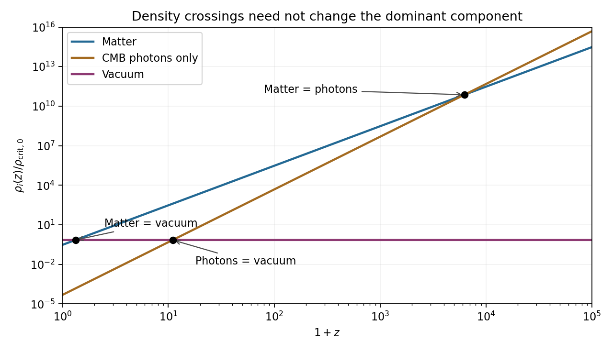

<h1 id="2/solution">Solution</h1>

↑ **Parent:** [2](../2.md)

Here $R(t)$ is the cosmological [scale factor](../../../../scale-factor-cosmology.md), $t$ is [cosmic time](../../../../cosmic-time.md) and $H=\dot R/R$ is the [Hubble parameter](../../../../hubble-parameter.md). With $R$ a length, $k=+1,0,-1$ labels positively curved, flat and negatively curved spatial sections. This $k$ is unrelated to Question 1's specific orbital [energy](../../../../energy-split.md). The density $\rho$ is mass-equivalent [energy density](../../../../energy-density.md): $\rho c^2$ has energy-per-volume units. In the displayed [Friedmann equation](../../../../friedmann-equations.md) $\Lambda$ has units $\mathrm{s^{-2}}$; the geometric [cosmological constant](../../../../cosmological-constant.md) is $\Lambda_{\rm geom}=\Lambda/c^2$. For a separately conserved fluid of constant [equation of state](../../../../equation-of-state.md) $p=w\rho c^2$, the [cosmological perfect-fluid continuity equation](../../../../cosmological-perfect-fluid-continuity-equation.md) gives $\rho\propto R^{-3(1+w)}$, so $\epsilon=3w$: zero for [pressureless matter](../../../../pressureless-matter.md) and one for radiation. With several fluids, sum their densities in the expansion equation and evolve each separately.

Setting [cosmological spatial curvature](../../../../spatial-curvature-of-an-flrw-universe.md) and the [cosmological constant](../../../../cosmological-constant.md) to zero gives the [mass-equivalent cosmological critical density](../../../../mass-equivalent-cosmological-critical-density.md),

$$
\boxed{\rho_{\rm crit}(t)=\frac{3H(t)^2}{8\pi G}}.
$$

Its energy-density version is $\rho_{\rm crit}c^2$; keeping this distinction is necessary when dividing a [radiation energy density](../../../../radiation-energy-density.md) by $c^2$ below.

In an [Einstein-de Sitter universe](../../../../einstein-de-sitter-universe.md), $H^2\propto R^{-3}$ integrates to $R\propto t^{2/3}$ and $H=2/(3t)$. With $1+z=R_0/R$,

$$
t(z)=\frac{2}{3H_0}(1+z)^{-3/2},\qquad
\boxed{t_2-t_1=\frac{2}{3H_0}\left[(1+z_2)^{-3/2}-(1+z_1)^{-3/2}\right]}.
$$

Here $z_1>z_2$ are the two epoch redshifts relative to today. This is elapsed [cosmic time](../../../../cosmic-time.md), not [comoving distance](../../../../comoving-radial-distance.md) divided by $c$.

For [collisionless preservation of a Planck spectrum](../../../../collisionless-preservation-of-a-planck-spectrum.md), use [frequency](../../../../frequency.md) redshift as well as photon-number conservation. Let $f=R/R_i$, so a [frequency](../../../../frequency.md) bin $d\nu$ now corresponds to $d\nu_i=f\,d\nu$ and $\nu_i=f\nu$ initially. Collisionless propagation conserves [photon](../../../../photon.md) number in the corresponding comoving bin:

$$
R^3n_\nu(t)\,d\nu=R_i^3n_{f\nu}(t_i)\,f\,d\nu,
\qquad n_\nu(t)=f^{-2}n_{f\nu}(t_i).
$$

For an initial [blackbody spectrum](../../../../blackbody-spectrum.md), insert its [Planck distribution](../../../../planck-photon-distribution.md) to obtain

$$
n_\nu(t)=\frac{8\pi\nu^2}{c^3\left[\exp\{h\nu/(k_B T_i/f)\}-1\right]},
\qquad\boxed{T_{\rm rad}=T_i/f=T_0(1+z)}.
$$

The factors $f^2$ from the numerator cancel the spectral dilution factor, while the exponent changes only the [temperature](../../../../temperature-split.md). Integrating gives [photon number density](../../../../photon-number-density.md) proportional to $T^3\propto R^{-3}$ and [radiation energy density](../../../../radiation-energy-density.md) proportional to $T^4\propto R^{-4}$. Conservation of total [photon](../../../../photon.md) number alone would not guarantee a [blackbody spectrum](../../../../blackbody-spectrum.md) shape; the frequency-bin mapping and absence of injection or spectral redistribution are essential.

For the numerical density comparisons, the supplied [Hubble constant](../../../../hubble-constant.md) is $H_0=2.33312\times10^{-18}\,\mathrm{s^{-1}}$. Taking $G=6.67430\times10^{-11}\,\mathrm{m^3\,kg^{-1}\,s^{-2}}$ and $c=2.99792458\times10^8\,\mathrm{m\,s^{-1}}$ gives

$$
\rho_{\rm crit,0}=9.7353\times10^{-27}\,\mathrm{kg\,m^{-3}},\quad
\rho_{\gamma0}=\frac{aT_0^4}{c^2}=4.6760\times10^{-31}\,\mathrm{kg\,m^{-3}},\quad
\Omega_{\gamma0}=4.8032\times10^{-5}.
$$

The radiation specified here is [cosmic microwave background](../../../../cosmic-microwave-background-split.md) [photons](../../../../photon.md) only. Adding a relic [neutrino](../../../../neutrino.md) density would change the [photon-only matter-radiation equality](../../../../photon-only-matter-radiation-equality.md) result. The rounded present matter and vacuum fractions sum to one without this small [photon](../../../../photon.md) contribution; the requested pairwise density comparisons do not require silently renormalizing them.

For the final unlabelled flight-time request, insert the case-(c) value $1+z_c=(0.7/\Omega_{\gamma0})^{1/4}=10.98735$ into the stipulated Einstein-de Sitter formula:

$$
\Delta t=\frac{2}{3H_0}\left[10.98735^{-3/2}-1101^{-3/2}\right]
=7.838\times10^{15}\,\mathrm s\simeq\boxed{2.48\times10^8\,\mathrm{yr}}.
$$

The two model ages are approximately $2.486\times10^8$ and $2.478\times10^5$ years. This uses exactly the instructed matter-only model with the same $H_0$. It is not an exact age difference in the matter-plus-vacuum cosmology; a high-redshift matter-era normalization using $H_0\sqrt{\Omega_{m0}}$ would be a different approximation.

**[Figure 2](#2/image-matter-photon-and-vacuum-density-crossings). Matter, photon and vacuum density crossings**.

## ↑ Ancestors (13)

1. [2](../2.md)
2. [Paper 1](../../paper-1-split.md)
3. [2012](../../split.md)
4. [Past exam of the relativistic Astrophysics and Cosmology course of the University of Cambridge](../../../split.md)
5. [Relativistic Astrophysics and Cosmology course of the University of Cambridge](../../../../relativistic-astrophysics-and-cosmology-course-of-the-university-of-cambridge.md)
6. [Physics course of the year 4 of the natural sciences course of the University of Cambridge](../../../../physics-course-of-the-year-4-of-the-natural-sciences-course-of-the-university-of-cambridge.md)
7. [Year 4 of the natural sciences course of the University of Cambridge](../../../../year-4-of-the-natural-sciences-course-of-the-university-of-cambridge.md)
8. [Year of the natural sciences course of the University of Cambridge](../../../../year-of-the-natural-sciences-course-of-the-university-of-cambridge.md)
9. [Natural sciences course of the University of Cambridge](../../../../natural-sciences-course-of-the-university-of-cambridge.md)
10. [Course of the University of Cambridge](../../../../course-of-the-university-of-cambridge.md)
11. [University of Cambridge](../../../../university-of-cambridge-split.md)
12. [List of universities](../../../../list-of-universities.md)
13. [Codex Wiki](../../../../split.md)
