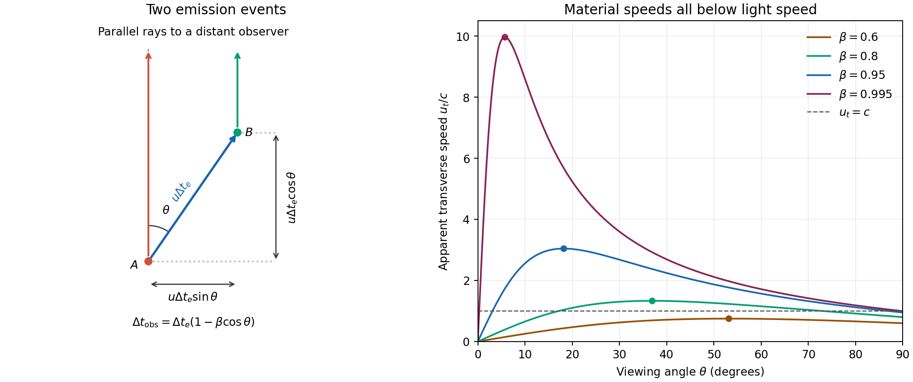

# Paper 1

↑ **Parent:** [2013](../2013.md)

[Original public PDF, physical pages 563–566; dated 15 January 2013](https://www.whatdotheyknow.com/request/natural_science_tripos_physics_e_2/response/2340776/attach/2/FOI%202023%20399%20Zahid%20materials.pdf?cookie_passthrough=1)

**Table of contents**

- [1](#1)
  - [Solution](#1/solution)
- [2](#2)
  - [Solution](#2/solution)
- [3](#3)
  - [a](#3/a)
    - [Solution](#3/a/solution)
  - [b](#3/b)
    - [Solution](#3/b/solution)
  - [c](#3/c)
    - [Solution](#3/c/solution)
  - [d](#3/d)
    - [Solution](#3/d/solution)
  - [e](#3/e)
    - [Solution](#3/e/solution)

## 1

↑ **Parent:** [Paper 1](paper-1.md)

<h3 id="1/solution">Solution</h3>

↑ **Parent:** [1](#1)

For a blob in a [relativistic jet](../../astrophysics.md#relativistic-jet), take two emission events separated by time $\Delta t_e$ in the galaxy frame. The blob moves transversely by $u\Delta t_e\sin\theta$, while its second [photon](../../quantum-mechanics.md#photon) has $u\Delta t_e\cos\theta$ less distance to travel to the distant observer. Therefore the arrival interval is $\Delta t_{\rm obs}=\Delta t_e(1-\beta\cos\theta)$ and

$$
\boxed{\beta_{\rm app}\equiv\frac{u_t}{c}=\frac{\beta\sin\theta}{1-\beta\cos\theta}}.
$$

Differentiating with respect to viewing angle gives $d\beta_{\rm app}/d\theta=\beta(\cos\theta-\beta)/(1-\beta\cos\theta)^2$. The maximum occurs at $\cos\theta=\beta$ and equals $\beta\gamma$. Hence [apparent superluminal motion](../../astrophysics.md#apparent-superluminal-motion) is possible precisely when $\beta\gamma>1$, or **$\beta>1/\sqrt2$**. This is an arrival-time effect; the material and every local signal still travel slower than [light](../../optics.md#light).

**[Figure 1](#1/image-original-arrival-time-geometry-and-apparent-transverse-speeds-for-subluminal-jet-velocities). Original arrival-time geometry and apparent transverse speeds for subluminal jet velocities**.

For $\gamma\gg1$, $1-\beta\simeq1/(2\gamma^2)$ and $1-\beta\cos\theta\simeq(\gamma^{-2}+\theta^2)/2$. Thus the [Doppler factor](../../special-relativity.md#doppler-factor) is

$$
D\simeq\frac{2\gamma}{1+\gamma^2\theta^2}\longrightarrow\boxed{2\gamma}\quad(\theta\ll\gamma^{-1}).
$$

The [Lorentz-invariant specific intensity](../../special-relativity.md#lorentz-invariant-specific-intensity) gives $I_\nu/\nu^3=I'_{\nu'}/\nu'^3$. Since $\nu=D\nu'$, a [power-law spectrum](../../electromagnetic-radiation.md#power-law-spectrum) with $I'_{\nu'}\propto\nu'^{-\alpha}$ gives $I_\nu(\nu)=D^3I'_{\nu'}(\nu/D)\propto D^{3+\alpha}$. This is [Doppler boosting of a moving blob](../../special-relativity.md#doppler-boosting-of-a-moving-blob): the [spectral flux density](../../astrophysics.md#spectral-flux-density) of an unresolved, intrinsically isotropic blob has the same boost. Comparing identical approaching and receding blobs, with no differential absorption,

$$
\frac{S_1}{S_2}=\left(\frac{D_1}{D_2}\right)^{3+\alpha}
=\boxed{\left(\frac{1+\beta\cos\theta}{1-\beta\cos\theta}\right)^4}\quad(\alpha=1).
$$

A spatially steady continuous jet can have a different boost exponent because the emitting material contributing at one arrival time differs; it must not silently replace the specified blob model.

Using the stipulated peak of the [photon-photon pair production](../../perturbative-quantum-field-theory.md#photon-photon-pair-production) [cross section](../../physics.md#cross-section-physics), not the exact head-on threshold, gives

$$
\epsilon_{20}=\frac{2(m_ec^2)^2}{\epsilon_1}
=\frac{2(5.11\times10^5)^2}{5\times10^{11}}\,\mathrm{eV}
=\boxed{1.04\,\mathrm{eV}}.
$$

The relevant [photons](../../quantum-mechanics.md#photon) are near [infrared](../../optics.md#infrared). Interpret the quoted $F_2$ as target-band [energy](../../energy.md) flux, or [energy](../../energy.md) flux per logarithmic [frequency](../../wave.md#frequency) interval, consistent with its units $\mathrm{W\,m^{-2}}$; it is not a [spectral flux density](../../astrophysics.md#spectral-flux-density) per hertz. For isotropic emission $L_2=4\pi d^2F_2$. In a stationary source of radius $R$, the order-of-magnitude [photon](../../quantum-mechanics.md#photon) [energy density](../../statistical-physics.md#energy-density) is $L_2/(4\pi R^2c)$, so

$$
n\sim\frac{F_2d^2}{R^2c\epsilon_{20}},\qquad
\tau\sim\frac{F_2d^2\sigma_T}{5Rc\epsilon_{20}}.
$$

The [luminosity variability size bound](../../astrophysics.md#luminosity-variability-size-bound) gives $R\lesssim c\Delta t$. Taking the largest allowed radius gives the smallest stationary-source [optical depth](../../astrophysics.md#optical-depth) in this estimate:

$$
\boxed{\tau_0\sim\frac{F_2d^2\sigma_T}{5\epsilon_{20}c^2\Delta t}}.
$$

This assumes the [gamma rays](../../quantum-mechanics.md#gamma-ray) and target [photons](../../quantum-mechanics.md#photon) occupy the same region, with an approximately isotropic target field and an order-unity geometric escape factor. A smaller region makes the [gamma-ray compactness problem](../../astrophysics.md#gamma-ray-compactness-problem) worse.

Here $d=3\times10^{25}\,\mathrm m$, $R\sim3\times10^{11}\,\mathrm m$, and $\epsilon_{20}=1.67\times10^{-19}\,\mathrm J$. Consequently

$$
\boxed{\tau_0\simeq3.2\times10^7\gg1}.
$$

Such a stationary co-spatial source would absorb almost all of its high-energy [photons](../../quantum-mechanics.md#photon).

Let primes denote the blob [rest frame](../../mathematical-physics.md#rest-frame) and continue to ignore [cosmological redshift](../../cosmology.md#cosmological-redshift). For fixed observed gamma-ray [energy](../../energy.md), $\epsilon'_1=\epsilon_1/D$. The co-moving target [energy](../../energy.md) at the assumed cross-section peak is therefore $\epsilon'_2=D\epsilon_{20}$. The [internal pair-production target energy in a relativistic blob](../../astrophysics.md#internal-pair-production-target-energy-in-a-relativistic-blob) acquires a second [Doppler shift](../../wave.md#doppler-effect) when this same target population is observed along our [line of sight](../../astrophysics.md#line-of-sight):

$$
\boxed{\epsilon_{2,\rm obs}=D\epsilon'_2=D^2\epsilon_{20}}.
$$

It would be incorrect to transform only the [gamma ray](../../quantum-mechanics.md#gamma-ray) while treating the internal target [radiation](../../physics.md#radiation) as a stationary external field. The target [photons](../../quantum-mechanics.md#photon) responsible for collisions span directions in the blob frame; the observed [energy](../../energy.md) here labels the corresponding part of the internally emitted [radiation spectrum](../../electromagnetic-radiation.md#radiation-spectrum).

[relativistic beaming](../../special-relativity.md#relativistic-beaming) both increases the allowed rest-frame source radius, $R'\lesssim Dc\Delta t$, and lowers the inferred rest-frame [luminosity](../../astrophysics.md#luminosity), $L'_{\log}\sim L_{{\rm iso},\log}/D^4$. The [beamed gamma-ray optical depth](../../astrophysics.md#beamed-gamma-ray-optical-depth) then follows from $\epsilon'_2=D\epsilon_{20}$:

$$
\tau'(D)\sim\tau_0D^{-6}
\frac{F_{\log}(D^2\epsilon_{20})}{F_{\log}(\epsilon_{20})}.
$$

For an unbroken [power-law spectrum](../../electromagnetic-radiation.md#power-law-spectrum) $F_\nu\propto\nu^{-\alpha}$, $F_{\log}=\nu F_\nu\propto\nu^{1-\alpha}$, so $\tau'\propto D^{-(4+2\alpha)}$. In particular, $\alpha=1$ gives the stated $D^{-6}$. Spectral breaks, an external target field or non-coincident emission regions change this inference. Under the requested scaling, transparency requires

$$
D\gtrsim\tau_0^{1/6}\simeq17.8,\qquad
\boxed{\gamma_{\min}\simeq8.9}.
$$

This minimum uses the most favourable nearly axial view, $D\simeq2\gamma$. The exact axial relation gives $\gamma_{\min}=(D_{\min}+D_{\min}^{-1})/2\simeq8.94$; a less favourable viewing angle requires a larger [Lorentz factor](../../special-relativity.md#lorentz-factor). The numerical bound is conditional on the stipulated opacity scaling and internal-source geometry.

## 2

↑ **Parent:** [Paper 1](paper-1.md)

<h3 id="2/solution">Solution</h3>

↑ **Parent:** [2](#2)

The [Friedmann-Lemaître-Robertson-Walker metric](../../cosmology.md#friedmann-lemaitre-robertson-walker-metric) describes homogeneous, isotropic spatial slices. Here $t$ is [cosmic time](../../cosmology.md#cosmic-time), equal to the [proper time](../../special-relativity.md#proper-time) of a [comoving observer](../../cosmology.md#comoving-observer); $R(t)$ is the length-valued [scale factor](../../cosmology.md#scale-factor-cosmology); and $\chi,\theta,\phi$ are dimensionless comoving radial, polar and azimuthal coordinates. The [speed of light](../../special-relativity.md#speed-of-light) is $c$, and

$$
S(\chi)=\begin{cases}\sin\chi&k=+1,\\\chi&k=0,\\\sinh\chi&k=-1,\end{cases}
$$

for positive, zero and negative [cosmological spatial curvature](../../cosmology.md#spatial-curvature-of-an-flrw-universe). The convention used makes $ds^2$ a squared time interval, with signature $(+---)$; multiplying the metric by $c^2$ gives the more usual squared-length convention. At fixed $t$, radial proper length is $R(t)d\chi$, while a sphere has area $4\pi R^2(t)S^2(\chi)$.

[luminosity distance](../../cosmology.md#luminosity-distance) is defined by $F=L/(4\pi d_L^2)$ for bolometric [radiative flux](../../astrophysics.md#radiative-flux) $F$ and intrinsic [luminosity](../../astrophysics.md#luminosity) $L$. Radial null propagation gives $d\chi=\pm c\,dt/R(t)$. Applying the same path integral to two successive wave crests gives $\Delta t_0/R_0=\Delta t_e/R_e$, hence $1+z=R_0/R_e$. Each [photon](../../quantum-mechanics.md#photon) loses an [energy](../../energy.md) factor $1+z$, and their arrival rate loses another. For transparent propagation and isotropic emission,

$$
F=\frac{L}{4\pi R_0^2S^2(\chi)(1+z)^2},\qquad
\boxed{d_L=R_0S(\chi)(1+z)}.
$$

The two [redshift](../../optics.md#redshift) factors have distinct physical origins; geometrical dilution alone is insufficient.

With $H=\dot R/R$, differentiating $1+z=R_0/R$ yields $dt/dz=-[(1+z)H(z)]^{-1}$. Therefore the radial [comoving coordinate](../../cosmology.md#comoving-coordinate) is

$$
\chi=\int_{t_e}^{t_0}\frac{c\,dt}{R(t)}
=\boxed{\frac c{R_0}\int_0^z\frac{dz'}{H(z')}}.
$$

This is independent of any particular matter model; the [transverse comoving distance](../../cosmology.md#transverse-comoving-distance) is $R_0S(\chi)$, which equals $R_0\chi$ only for flat space.

For [pressureless matter](../../cosmology.md#pressureless-matter), the [continuity equation](../../mathematical-physics.md#continuity-equation) $\dot\rho_m+3H\rho_m=0$ integrates to $\rho_m=\rho_{m0}(R_0/R)^3=\rho_{m0}(1+z)^3$. The [cosmological constant](../../cosmology.md#cosmological-constant) is kept separately from this matter density. In the flat [Friedmann equation](../../cosmology.md#friedmann-equations), define

$$
\Omega_{\Lambda0}=\frac{\Lambda}{3H_0^2},\qquad
\Omega_{m0}=\frac{8\pi G\rho_{m0}}{3H_0^2}=1-\Omega_{\Lambda0}.
$$

The [flat dust-vacuum Hubble parameter](../../cosmology.md#flat-dust-vacuum-hubble-parameter) is therefore

$$
\boxed{H(z)=H_0\sqrt{(1-\Omega_{\Lambda0})(1+z)^3+\Omega_{\Lambda0}}}.
$$

In the equation's convention $\rho_m$ is mass-equivalent [energy density](../../statistical-physics.md#energy-density) and $\Lambda$ has units $\mathrm{s^{-2}}$; the geometrical [cosmological constant](../../cosmology.md#cosmological-constant) convention instead writes $c^2\Lambda_{\rm geom}$. The model contains dust and [vacuum energy](../../perturbative-quantum-field-theory.md#vacuum-energy) with negligible [radiation](../../physics.md#radiation) over the relevant late epochs: “matter-dominated” here does not require matter to exceed [vacuum energy](../../perturbative-quantum-field-theory.md#vacuum-energy) today.

The [cosmic microwave background](../../cosmic-microwave-background.md) supplies a standard ruler through its acoustic scale: the angular positions of the [Cosmic microwave background acoustic peaks](../../cosmic-microwave-background-anisotropy.md#cosmic-microwave-background-acoustic-peak) constrain [cosmological spatial curvature](../../cosmology.md#spatial-curvature-of-an-flrw-universe), while their relative heights constrain matter and [baryon](../../physics.md#baryon) densities. Together with independent distance information, these favour a nearly flat [Lambda-CDM model](../../cosmology.md#lambda-cdm-model) containing substantial [cold dark matter](../../cosmology.md#cold-dark-matter) and [vacuum energy](../../perturbative-quantum-field-theory.md#vacuum-energy). The [cosmic microwave background](../../cosmic-microwave-background.md) alone has a geometrical degeneracy between parameters affecting distance to last scattering; its analysis also includes early [radiation](../../physics.md#radiation), which the late-time formula above omits. The nine-year [WMAP](../../cosmic-microwave-background.md#wilkinson-microwave-anisotropy-probe) results were already available as a December 2012 preprint.[Version 1 abstract: combined-data curvature constraint and consistency with the six-parameter Lambda-CDM model](../../physics-bibliography.md#nine-year-wilkinson-microwave-anisotropy-probe-wmap-observations-final-maps-and-results-by-c-l-bennett-and-others)

A standardized [Type Ia supernova](../../stellar-astrophysics.md#type-ia-supernova) at appreciable [redshift](../../optics.md#redshift) is fainter, hence farther in [luminosity distance](../../cosmology.md#luminosity-distance), than in a matter-only [Einstein-de Sitter universe](../../large-scale-structure-of-the-universe.md#einstein-de-sitter-universe) with the same local expansion scale. Fitting the supernova [Hubble diagram](../../cosmology.md#hubble-diagram) supports late acceleration; in flat dust plus vacuum, $q_0=\Omega_{m0}/2-\Omega_{\Lambda0}$ is negative for $\Omega_{\Lambda0}>1/3$. Light-curve and colour corrections, extinction, calibration, selection bias and possible population evolution must be controlled. The supernova evidence and [cosmic microwave background](../../cosmic-microwave-background.md) constraints are complementary; together they favour this model without proving that every alternative dark-energy model is impossible.[Abstract and cosmological fits of the supernova distance-redshift relation](../../physics-bibliography.md#observational-evidence-from-supernovae-for-an-accelerating-universe-and-a-cosmological-constant-by-adam-riess-and-others)[Abstract and joint matter-density/cosmological-constant fits](../../physics-bibliography.md#measurements-of-omega-and-lambda-from-42-high-redshift-supernovae-by-saul-perlmutter-and-others)

For the final comparison, assume $z>0$, a common $H_0$ and $0<\Omega_{\Lambda0}<1$ in model (a). Then

$$
H_c=H_0,\qquad H_a=H_0\sqrt{(1-\Omega_{\Lambda0})(1+z)^3+\Omega_{\Lambda0}},\qquad
H_b=H_0(1+z)^{3/2}.
$$

Thus $H_c<H_a<H_b$ and the integrands obey $1/H_b<1/H_a<1/H_c$. Because all three models are flat, compare the normalization-independent distance $R_0\chi=c\int dz'/H(z')$, rather than separately normalized coordinates. The [luminosity-distance ordering of flat dust-vacuum universes](../../cosmology.md#luminosity-distance-ordering-of-flat-dust-vacuum-universes) is $d_{L,b}<d_{L,a}<d_{L,c}$, hence

$$
\boxed{F_b>F_a>F_c}.
$$

Model (b) gives the largest received flux, model (c) the smallest. Equalities replace the strict ordering at the endpoint values of the vacuum fraction; all have the same leading local [Hubble law](../../cosmology.md#hubble-s-law) as $z\to0$.

## 3

↑ **Parent:** [Paper 1](paper-1.md)

<h3 id="3/a">a</h3>

↑ **Parent:** [3](#3)

<h4 id="3/a/solution">Solution</h4>

↑ **Parent:** [A](#3/a)

In a close [binary star](../../stellar-astrophysics.md#binary-star), the rotating effective gravitational potential defines two [Roche lobes](../../stellar-astrophysics.md#roche-lobe) meeting at the [inner Lagrange point](../../celestial-mechanics.md#inner-lagrange-point). Stellar expansion or orbital shrinkage can bring the donor into [Roche-lobe overflow](../../stellar-astrophysics.md#roche-lobe-overflow). Gas then flows through the [inner Lagrange point](../../celestial-mechanics.md#inner-lagrange-point); its [angular momentum](../../momentum.md#angular-momentum) can form an [accretion disk](../../astrophysical-disk.md#accretion-disk) around the companion. [wind mass transfer in a binary star](../../stellar-astrophysics.md#wind-mass-transfer-in-a-binary-star) is also possible without Roche-lobe filling. For a circular, synchronized binary, the [Eggleton Roche-lobe radius approximation](../../stellar-astrophysics.md#eggleton-roche-lobe-radius-approximation) is

$$
\frac{R_L}{a}\simeq\frac{0.49q^{2/3}}{0.6q^{2/3}+\ln(1+q^{1/3})},\qquad q=\frac{M_d}{M_a}.
$$

This describes the lobe geometry, not the donor's dynamical response.[Printed p. 368, equation 2](../../physics-bibliography.md#approximations-to-the-radii-of-roche-lobes-by-peter-p-eggleton)

[conservative binary mass transfer](../../stellar-astrophysics.md#conservative-binary-mass-transfer) has fixed total [mass](../../classical-mechanics.md#mass) and [orbital angular momentum](../../quantum-mechanics.md#orbital-angular-momentum), neglecting stellar spin. Using $J=M_dM_a\sqrt{Ga/(M_d+M_a)}$ gives

$$
\frac{\dot a}{a}=-2\dot M_d\left(\frac1{M_d}-\frac1{M_a}\right).
$$

Since $\dot M_d<0$, transfer from the more massive donor initially shrinks the orbit; after [binary mass ratio](../../stellar-astrophysics.md#binary-mass-ratio) reversal it expands. Stability depends on both stars and their changing lobes. Let $\zeta_*=d\ln R_d/d\ln M_d$ and $\zeta_L=d\ln R_L/d\ln M_d$. A small [mass](../../classical-mechanics.md#mass) loss reduces the relative overfill if **$\zeta_*>\zeta_L$**. Use the adiabatic donor response for dynamical stability, and its thermal response for slower adjustment; an equilibrium mass-radius law alone cannot decide both.

Stable transfer can proceed on nuclear or thermal timescales, while dynamically unstable overflow may create a [common envelope](../../stellar-astrophysics.md#common-envelope), orbital spiral-in and either envelope ejection or a merger. Escaping gas, [gravitational radiation](../../gravitational-wave.md) and [magnetic braking](../../electromagnetism.md#magnetic-braking) make evolution nonconservative by changing [orbital angular momentum](../../quantum-mechanics.md#orbital-angular-momentum). [accretion](../../astrophysics.md#accretion) onto a [compact stellar object](../../stellar-astrophysics.md#compact-stellar-object) releases [power](../../energy.md#power) of order $GM_a\dot M/R_a$, producing bright [X-ray binaries](../../stellar-astrophysics.md#x-ray-binary); radiation-driven outflows can limit retained [mass](../../classical-mechanics.md#mass). Eclipses, [radial velocities](../../euler-equations-for-an-inviscid-fluid.md#radial-velocity) and disk emission constrain the geometry and [masses](../../classical-mechanics.md#mass), but inclination, irradiation and assumptions about [mass](../../classical-mechanics.md#mass) or angular-momentum loss affect the inference. **The essential feedback is the donor's radius relative to its evolving [Roche lobe](../../stellar-astrophysics.md#roche-lobe).**

<h3 id="3/b">b</h3>

↑ **Parent:** [3](#3)

<h4 id="3/b/solution">Solution</h4>

↑ **Parent:** [B](#3/b)

A [galaxy cluster](../../large-scale-structure-of-the-universe.md#galaxy-cluster) deflects background [light](../../optics.md#light) through its projected gravitational field. In the [thin-lens approximation for gravitational lensing](../../gravitational-lensing.md#thin-lens-approximation-for-gravitational-lensing), $\boldsymbol\beta=\boldsymbol\theta-\boldsymbol\alpha(\boldsymbol\theta)$ maps image to source angle. Its [surface mass density](../../fluid-mechanics.md#projected-surface-mass-density) enters through

$$
\kappa=\frac{\Sigma}{\Sigma_{\rm crit}},\qquad
\Sigma_{\rm crit}=\frac{c^2D_s}{4\pi GD_lD_{ls}},\qquad
\mu=\frac1{(1-\kappa)^2-|\gamma_s|^2}.
$$

Here $\mu$ is signed [lensing magnification](../../gravitational-lensing.md#lensing-magnification); observed brightness uses $|\mu|$. The $D$'s are [angular diameter distances](../../cosmology.md#angular-diameter-distance) to lens, source and between them; $\gamma_s$ denotes [lensing shear](../../gravitational-lensing.md#lensing-shear), not a [Lorentz factor](../../special-relativity.md#lorentz-factor). [strong gravitational lensing](../../gravitational-lensing.md#strong-gravitational-lensing) creates arcs and multiple images near critical curves. For an axisymmetric lens, a tangential [Einstein ring](../../gravitational-lensing.md#einstein-ring) satisfies mean enclosed convergence one, giving

$$
\boxed{M_{\rm proj}(<D_l\theta_E)=\pi(D_l\theta_E)^2\Sigma_{\rm crit}}.
$$

This is projected enclosed [mass](../../classical-mechanics.md#mass), not a general three-dimensional [mass](../../classical-mechanics.md#mass) profile inferred from a single arc.

[weak gravitational lensing](../../gravitational-lensing.md#weak-gravitational-lensing) uses coherent distortions of many background galaxies. Their intrinsic orientations average approximately to zero, allowing an estimate of [reduced shear](../../gravitational-lensing.md#reduced-shear) $g=\gamma_s/(1-\kappa)$ and a projected [mass](../../classical-mechanics.md#mass) map. The method traces all gravitating material without assuming [hydrostatic equilibrium](../../statistical-physics.md#hydrostatic-equilibrium), which is valuable in merging clusters. Accurate work requires correction of the [point spread function](../../point-spread-function.md), calibrated shape measurement, source [redshifts](../../optics.md#redshift), foreground-member rejection and selection effects. Intrinsic shape noise, unrelated line-of-sight structures and lens-model degeneracies remain. The [mass-sheet degeneracy](../../gravitational-lensing.md#mass-sheet-degeneracy) leaves [reduced shear](../../gravitational-lensing.md#reduced-shear) unchanged under $\kappa\mapsto\lambda\kappa+(1-\lambda)$ and $\gamma_s\mapsto\lambda\gamma_s$, so absolute [mass](../../classical-mechanics.md#mass) normalization needs additional information.

In the [Bullet Cluster](../../large-scale-structure-of-the-universe.md#bullet-cluster), [weak gravitational lensing](../../gravitational-lensing.md#weak-gravitational-lensing) places the main projected [mass](../../classical-mechanics.md#mass) peaks near the collisionless galaxies, displaced from the X-ray-emitting gas that contains most observed [baryon](../../physics.md#baryon) [mass](../../classical-mechanics.md#mass). Comparing the lensing, optical and [X-ray](../../electromagnetic-radiation.md#x-ray) maps supports a dominant weakly collisional dark component under the usual gravity model; lensing alone does not identify its particle species. **Cluster lensing measures projected gravitational [mass](../../classical-mechanics.md#mass) independently of gas [temperature](../../temperature.md) or dynamical equilibrium.**[Abstract and spatial comparison of weak-lensing mass, galaxies and X-ray gas](../../physics-bibliography.md#a-direct-empirical-proof-of-the-existence-of-dark-matter-by-douglas-clowe-and-others)

<h3 id="3/c">c</h3>

↑ **Parent:** [3](#3)

<h4 id="3/c/solution">Solution</h4>

↑ **Parent:** [C](#3/c)

[cosmic inflation](../../cosmic-inflation.md) is an expanding epoch with $\ddot a>0$, equivalently a shrinking [comoving Hubble radius](../../cosmology.md#comoving-hubble-radius) $(aH)^{-1}=1/\dot a$. In [general relativity](../../general-relativity.md) it requires $\rho+3P/c^2<0$ for the total effective fluid. A [scalar field](../../classical-field-theory.md#scalar-field) whose [potential energy](../../energy.md#potential-energy) dominates its [kinetic energy](../../energy.md#kinetic-energy) has $P\simeq-\rho c^2$ and can produce approximately exponential expansion. [slow-roll inflation](../../cosmic-inflation.md#slow-roll-approximation) is one realization; rapid expansion alone without acceleration does not have the required effect.

The [horizon problem](../../cosmology.md#horizon-problem) is that widely separated regions of the [cosmic microwave background](../../cosmic-microwave-background.md) have nearly the same [temperature](../../temperature.md) despite lying outside one another's causal domains in a purely decelerating hot [Big Bang](../../cosmology.md#big-bang) extrapolation. Sufficient inflation stretches a previously small causally connected region across our observable universe; relevant perturbation [wavelengths](../../wave-equation.md#wavelength) can begin inside the [Hubble radius](../../cosmology.md#hubble-radius), leave it during inflation and re-enter later. This does not require local signals to outrun [light](../../optics.md#light). Inflation supplies a possible earlier causal history, not a proof that every possible initial state becomes homogeneous.

For the [flatness problem](../../cosmology.md#flatness-problem), the [Friedmann equation](../../cosmology.md#friedmann-equations) gives $\Omega_{\rm tot}-1=kc^2/(aH)^2$ when $a$ is length-valued. Since $aH$ grows during inflation,

$$
\boxed{|\Omega_{\rm tot}-1|\ \hbox{decreases during inflation}}.
$$

Pre-existing unwanted massive relics such as [magnetic monopoles](../../mathematical-physics.md#magnetic-monopole) are also diluted: conserved [number density](../../statistical-physics.md#number-density) falls as $a^{-3}$. Enough inflation, followed by [reheating](../../cosmic-inflation.md#reheating) that does not recreate the relic problem, can make their abundance negligible. These were central motivations of the original proposal, whose first phase-transition implementation also faced a graceful-exit problem.[Abstract: horizon, flatness, monopole suppression and limitations of the original scenario](../../physics-bibliography.md#inflationary-universe-a-possible-solution-to-the-horizon-and-flatness-problems-by-alan-h-guth)

[quantum fluctuations](../../quantum-theory.md#quantum-fluctuation) of the inflating field and metric supply seeds for [linear cosmological density perturbations](../../linear-cosmological-density-perturbation.md). Simple single-field slow-roll models predict a dominant [adiabatic mode](../../linear-cosmological-perturbation-theory.md#adiabatic-mode) with nearly Gaussian, nearly scale-invariant [scalar cosmological perturbations](../../linear-cosmological-perturbation-theory.md#scalar-cosmological-perturbation), consistent with the [cosmic microwave background](../../cosmic-microwave-background.md); [tensor cosmological perturbations](../../linear-cosmological-perturbation-theory.md#tensor-cosmological-perturbation) are another possible test. These predictions are model-dependent, and consistency is not unique proof of inflation. [reheating](../../cosmic-inflation.md#reheating) must connect the accelerated phase to the hot expanding universe. **Inflation addresses causal reach, small [cosmological spatial curvature](../../cosmology.md#spatial-curvature-of-an-flrw-universe) and unwanted relic abundance, while providing a mechanism for primordial structure.**

<h3 id="3/d">d</h3>

↑ **Parent:** [3](#3)

<h4 id="3/d/solution">Solution</h4>

↑ **Parent:** [D](#3/d)

[accretion](../../astrophysics.md#accretion) onto a massive [black hole](../../black-hole.md) releases [luminosity](../../astrophysics.md#luminosity) $L\simeq\eta\dot M c^2$. Even a small coupling of this [energy](../../energy.md) to surrounding gas can matter because a galactic binding [energy](../../energy.md) is only of order $M_{\rm gas}\sigma^2$, with stellar [velocity](../../classical-mechanics.md#velocity) dispersion $\sigma\ll c$. [active-galactic-nucleus feedback](../../astrophysical-black-hole.md#active-galactic-nucleus-feedback) means that the [energy](../../energy.md) or [momentum](../../momentum.md) changes the gas supply, cooling or star formation, potentially regulating further [accretion](../../astrophysics.md#accretion). Large [energy](../../energy.md) availability alone does not establish efficient coupling.

In a radiatively efficient bright nucleus, [radiation pressure](../../pressure.md#radiation-pressure) and winds can push on dusty or ionized gas. Outflows can remove fuel or shock-heat it; the outcome depends on cooling, covering factor, clumping and whether the flow escapes. In a mechanically dominated state, [relativistic jets](../../astrophysics.md#relativistic-jet) inflate radio cavities in a hot halo or [galaxy cluster](../../large-scale-structure-of-the-universe.md#galaxy-cluster). Their expansion, shocks, [sound waves](../../fluid-mechanics.md#acoustic-wave) and subsequent motions can distribute [energy](../../energy.md) and suppress a [cooling flow](../../large-scale-structure-of-the-universe.md#cooling-flow). The two descriptions identify useful channels rather than a universal sharp division between all nuclei.

An approximately pressure-balanced cavity containing a relativistic fluid has [enthalpy](../../enthalpy.md)

$$
E_{\rm cav}=\frac{\Gamma}{\Gamma-1}pV\simeq4pV\quad(\Gamma=4/3),\qquad
P_{\rm cav}\sim\frac{4pV}{t_{\rm age}}.
$$

[X-ray](../../electromagnetic-radiation.md#x-ray) [pressure](../../pressure.md) estimates, cavity volume and buoyant or sound-crossing ages permit comparison with radiative cooling losses. Radio images check the jet association; [X-ray](../../electromagnetic-radiation.md#x-ray) fronts and ripples help locate transferred [energy](../../energy.md). Deep Chandra observations of Perseus reveal such structures and motivate mechanical heating of the cooling atmosphere.[Abstract and discussion of radio-bubble-associated fronts, ripples and heating](../../physics-bibliography.md#a-deep-chandra-observation-of-the-perseus-cluster-shocks-and-ripples-by-a-c-fabian-and-others)

Projection, nonrelativistic cavity contents, [pressure](../../pressure.md) gradients, uncertain ages and intermittent duty cycles affect the [power](../../energy.md#power) estimate. Injected cavity [energy](../../energy.md) need not all dissipate where cooling occurs. A successful negative feedback loop requires that falling gas increases [accretion](../../astrophysics.md#accretion), heating then reduces cooling or inflow, and the delay does not destroy regulation. This can explain reduced cooling and the shortage of excessively massive star-forming galaxies; correlations between black-hole [mass](../../classical-mechanics.md#mass) and bulge properties are supporting context rather than standalone proof of causation. **The key comparison is coupled heating versus local cooling and binding, including where and when [energy](../../energy.md) is deposited.**

<h3 id="3/e">e</h3>

↑ **Parent:** [3](#3)

<h4 id="3/e/solution">Solution</h4>

↑ **Parent:** [E](#3/e)

The [age of the universe](../../cosmology.md#age-of-the-universe) is a model-dependent elapsed [cosmic time](../../cosmology.md#cosmic-time), not simply the inverse present [Hubble constant](../../cosmology.md#hubble-constant). For a model with a hot [Big Bang](../../cosmology.md#big-bang) origin,

$$
\boxed{t_0=\int_0^\infty\frac{dz}{(1+z)H(z)}}.
$$

An [Einstein-de Sitter universe](../../large-scale-structure-of-the-universe.md#einstein-de-sitter-universe) gives $t_0=2/(3H_0)$. The [age of a flat matter-Lambda universe](../../cosmology.md#age-of-a-flat-matter-lambda-universe), neglecting early [radiation](../../physics.md#radiation), is

$$
t_0=\frac{2}{3H_0\sqrt{\Omega_{\Lambda0}}}
\operatorname{arsinh}\sqrt{\frac{\Omega_{\Lambda0}}{\Omega_{m0}}},\qquad
\Omega_{m0}=1-\Omega_{\Lambda0}.
$$

This follows by integrating $dt=da/(aH)$ and substituting $x=\sqrt{\Omega_{\Lambda0}/\Omega_{m0}}\,(a/a_0)^{3/2}$. It tends to $2/(3H_0)$ as the vacuum fraction tends to zero. Pure [de Sitter spacetime](../../general-relativity.md#de-sitter-spacetime) instead has constant $H$ and no finite dust [Big Bang](../../cosmology.md#big-bang) age obtained from this integral. [cosmic microwave background](../../cosmic-microwave-background.md) ages therefore depend on the assumed expansion model and fitted parameters; the [WMAP](../../cosmic-microwave-background.md#wilkinson-microwave-anisotropy-probe) nine-year combined-data [Lambda-CDM model](../../cosmology.md#lambda-cdm-model) inference was approximately 13.8 billion years, not a direct clock reading.[Version 1 abstract, inferred cosmic age](../../physics-bibliography.md#nine-year-wilkinson-microwave-anisotropy-probe-wmap-observations-final-maps-and-results-by-c-l-bennett-and-others)

Old [globular clusters](../../galaxy.md#globular-cluster) provide an independent lower bound. Their [main-sequence turnoff](../../stellar-astrophysics.md#main-sequence-turnoff) identifies stars just exhausting core hydrogen; the nuclear fuel divided by [luminosity](../../astrophysics.md#luminosity) sets a mass-dependent lifetime, so a fitted [colour-magnitude diagram](../../stellar-astrophysics.md#colour-magnitude-diagram) constrains the common [stellar age](../../stellar-astrophysics.md#stellar-age). Distance, extinction, [metallicity](../../stellar-astrophysics.md#metallicity), helium abundance, diffusion and stellar-model physics introduce uncertainties. The elapsed time before cluster formation must be added when comparing with the cosmic age.[Abstract and joint stellar-age/cosmological interpretation](../../physics-bibliography.md#new-globular-cluster-age-estimates-and-constraints-on-the-cosmic-equation-of-state-and-the-matter-density-of-the-universe-by-lawrence-m-krauss-and-brian-chaboyer)

[white-dwarf cooling ages](../../stellar-astrophysics.md#white-dwarf-cooling-age) offer another clock: faint remnants have lost more stored thermal [energy](../../energy.md), but progenitor lifetimes must be added and [crystallization](../../critical-phenomenon.md#crystallization), envelope properties and sample completeness affect the inference. [nucleocosmochronology](../../stellar-astrophysics.md#nucleocosmochronology) uses long-lived radioactive abundance ratios, with $Q/Q_0=e^{-(\lambda_1-\lambda_2)t}$ for two radioactive species, or a stable reference with $\lambda_2=0$. Uncertain initial production ratios and subsequent enrichment limit precision. **Every reliably dated object must be younger than the universe by at least its formation delay**; consistency among distinct clocks tests both cosmology and their astrophysical calibrations.

## ↑ Ancestors (11)

1. [2013](../2013.md)
2. [Past exam of the relativistic Astrophysics and Cosmology course of the University of Cambridge](../../past-exam-of-the-relativistic-astrophysics-and-cosmology-course-of-the-university-of-cambridge.md)
3. [Relativistic Astrophysics and Cosmology course of the University of Cambridge](../../university-of-cambridge.md#relativistic-astrophysics-and-cosmology-course-of-the-university-of-cambridge)
4. [Physics course of the year 4 of the natural sciences course of the University of Cambridge](../../university-of-cambridge.md#physics-course-of-the-year-4-of-the-natural-sciences-course-of-the-university-of-cambridge)
5. [Year 4 of the natural sciences course of the University of Cambridge](../../university-of-cambridge.md#year-4-of-the-natural-sciences-course-of-the-university-of-cambridge)
6. [Year of the natural sciences course of the University of Cambridge](../../university-of-cambridge.md#year-of-the-natural-sciences-course-of-the-university-of-cambridge)
7. [Natural sciences course of the University of Cambridge](../../university-of-cambridge.md#natural-sciences-course-of-the-university-of-cambridge)
8. [Course of the University of Cambridge](../../university-of-cambridge.md#course-of-the-university-of-cambridge)
9. [University of Cambridge](../../university-of-cambridge.md)
10. [List of universities](../../README.md#list-of-universities)
11. [Codex Wiki](../../README.md)
