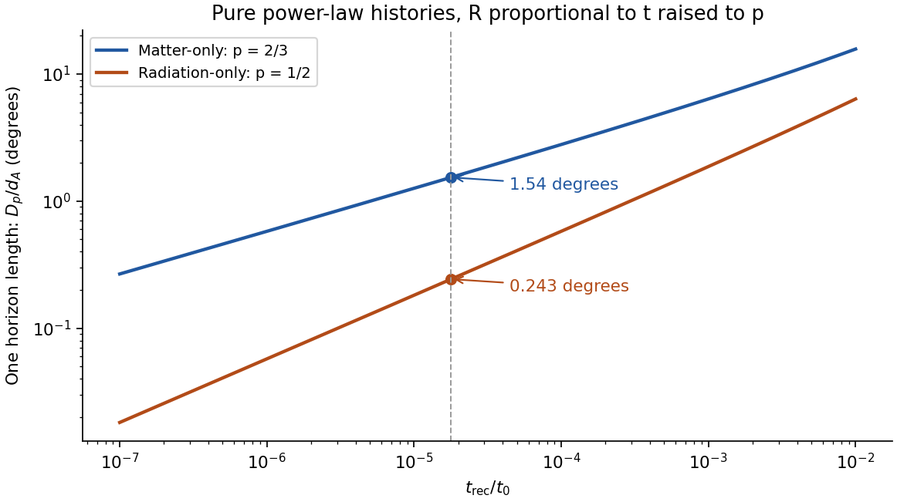

# Paper 1

↑ **Parent:** [2014](../2014.md)

Original solutions covering all questions and all five note alternatives. [Original public PDF, physical pages 654–657; dated 14 January 2014](https://www.whatdotheyknow.com/request/natural_science_tripos_physics_e_2/response/2340776/attach/2/FOI%202023%20399%20Zahid%20materials.pdf?cookie_passthrough=1#page=654)

**Table of contents**

- [1](#1)
  - [Solution](#1/solution)
- [2](#2)
  - [Solution](#2/solution)
- [3](#3)
  - [a](#3/a)
    - [Solution](#3/a/solution)
  - [b](#3/b)
    - [Solution](#3/b/solution)
  - [c](#3/c)
    - [Solution](#3/c/solution)
  - [d](#3/d)
    - [Solution](#3/d/solution)
  - [e](#3/e)
    - [Solution](#3/e/solution)

## 1

↑ **Parent:** [Paper 1](paper-1.md)

<h3 id="1/solution">Solution</h3>

↑ **Parent:** [1](#1)

Corotation reaches the [speed of light](../../special-relativity.md#speed-of-light) at $R_c=c/\Omega$. Extrapolating a dipole field gives $B_c\sim B_*(R_*/R_c)^3$ and [magnetic energy](../../electromagnetic-wave.md#magnetic-energy) density $\epsilon_c\sim B_c^2/\mu_0$, suppressing order-one factors. An outward [electromagnetic energy](../../electromagnetic-wave.md#electromagnetic-energy) flux of scale $\epsilon_c c$ through area of scale $R_c^2$ therefore gives

$$
\boxed{P\sim\frac{B_*^2R_*^6c}{\mu_0R_c^4}
=\frac{B_*^2R_*^6\Omega^4}{\mu_0c^3}.}
$$

This assumes a dipole-dominated field tied to the rotating star and an effective outgoing [Poynting flux](../../electromagnetic-wave.md#poynting-flux) near the [light cylinder](../../stellar-astrophysics.md#light-cylinder). The dipole extrapolation, angular pattern and surface-field convention affect the coefficient. A strictly aligned vacuum dipole would not radiate, whereas an oblique vacuum dipole does. A plasma-filled magnetosphere opens field lines and can [spin](../../angular-momentum-operator.md#spin) down even an aligned rotator, so the light-cylinder estimate is a scaling argument, not an exact vacuum emission calculation or literal rigid motion at $c$. Force-free calculations explicitly demonstrate this distinction.[abstract and spin-down luminosity versus inclination](../../physics-bibliography.md#time-dependent-force-free-pulsar-magnetospheres-axisymmetric-and-oblique-rotators-by-anatoly-spitkovsky)

The [energy](../../energy.md) comes primarily from [stellar rotation](../../stellar-astrophysics.md#stellar-rotation). With constant [moment of inertia](../../rigid-body-dynamics.md#moment-of-inertia) $I$, $E_{\rm rot}=I\Omega^2/2$, and conservation of [energy](../../energy.md) gives $I\Omega\dot\Omega=-P$. Thus

$$
\boxed{\dot\Omega\simeq-K\Omega^3,\qquad
K=\frac{B_*^2R_*^6}{I\mu_0c^3}.}
$$

For constant $K$, differentiating gives $\ddot\Omega=-3K\Omega^2\dot\Omega$, hence $n=\Omega\ddot\Omega/\dot\Omega^2=3$. Evolving field strength, inclination, [moment of inertia](../../rigid-body-dynamics.md#moment-of-inertia) or additional [torques](../../momentum.md#torque) invalidate the constant-$K$ prediction; generally $n=3+(\Omega/\dot\Omega)(\dot K/K)$ in this parametrization.

For radial inflow onto [mass](../../classical-mechanics.md#mass) $M$, take $v_{\rm ff}\sim(GM/r)^{1/2}$ and $\rho\sim\dot M/(4\pi r^2v_{\rm ff})$. [magnetic pressure](../../magnetohydrodynamics.md#magnetic-pressure) decreases as $B_*^2R_*^6/(\mu_0r^6)$, while [ram pressure](../../fluid-mechanics.md#ram-pressure) scales as $\rho v_{\rm ff}^2\propto\dot M(GM)^{1/2}r^{-5/2}$. Balancing them yields

$$
\boxed{R_M\sim\left(\frac{B_*^4R_*^{12}}{\mu_0^2GM\dot M^2}\right)^{1/7}
\propto B_*^{4/7}R_*^{12/7}\dot M^{-2/7}.}
$$

Numerical factors and disc geometry are not determined by this spherical estimate. The displayed proportionality holds $M$ fixed and requires a magnetospheric boundary outside the stellar surface.

In a disc, inflowing matter near $R_M$ has specific [angular momentum](../../momentum.md#angular-momentum) approximately $\sqrt{GMR_M}$. If it is transferred to a slower star, the material [torque](../../momentum.md#torque) is $N\sim\dot M\sqrt{GMR_M}$ and $I\dot\Omega\sim N>0$. The [corotation radius](../../astrophysical-disk.md#corotation-radius) is $R_{\rm co}=(GM/\Omega^2)^{1/3}$, distinct from the light-cylinder radius. As stellar [spin](../../angular-momentum-operator.md#spin) approaches the inner disc's Keplerian [frequency](../../wave.md#frequency), net spin-up weakens. If $R_M$ lies outside corotation, the field rotates faster than the disc and can centrifugally expel matter in the propeller regime. A characteristic equilibrium is

$$
\Omega_{\rm eq}\sim\sqrt{GM/R_M^3},\qquad
T_{\rm eq}\sim2\pi\sqrt{R_M^3/(GM)}
\propto B_*^{6/7}R_*^{18/7}\dot M^{-3/7}
$$

for fixed [mass](../../classical-mechanics.md#mass) and magnetic-coupling convention. A complete [magnetic torque](../../astrophysical-disk.md#surface-magnetic-torque-on-an-accretion-disk) model can change the coefficient; a star also cannot rotate past its [mass-shedding limit](../../stellar-astrophysics.md#mass-shedding-limit), of order $\sqrt{GM/R_*^3}$.

For [opacity](../../stellar-structure.md#opacity) per unit [mass](../../classical-mechanics.md#mass) $\kappa$, an isotropic radiative force balances gravity at $L_E=4\pi GMc/\kappa$. Efficient release of surface gravitational binding [energy](../../energy.md) gives $L_{\rm acc}\sim GM\dot M/R_*$ and therefore the [surface accretion Eddington rate](../../astrophysical-black-hole.md#surface-accretion-eddington-rate)

$$
\dot M_{\max}\sim\frac{4\pi cR_*}{\kappa}\propto R_*.
$$

The radius dependence matters: it uses efficiency $\eta\sim GM/(R_*c^2)$, not an arbitrarily fixed reference efficiency. Substituting this maximal rate into the equilibrium period gives

$$
\boxed{T_{\min}\propto B_*^{6/7}R_*^{18/7}(R_*)^{-3/7}
=B_*^{6/7}R_*^{15/7}.}
$$

[mass](../../classical-mechanics.md#mass), [opacity](../../stellar-structure.md#opacity) and geometry factors are held fixed. This is the classical radiatively efficient Eddington-limited scaling, not a universal upper bound on every [mass](../../classical-mechanics.md#mass) supply rate: beaming, advection, outflows and [opacity](../../stellar-structure.md#opacity) changes can alter it. For sufficiently small field, $R_M\lesssim R_*$ and the magnetic scaling must be replaced by surface-disc and mass-shedding physics.

## 2

↑ **Parent:** [Paper 1](paper-1.md)

<h3 id="2/solution">Solution</h3>

↑ **Parent:** [2](#2)

The metric uses signature $(+---)$ and a time-valued interval $ds$: a comoving clock has $ds=dt$. Here $t$ is cosmic [proper time](../../special-relativity.md#proper-time), $R(t)$ a [scale factor](../../cosmology.md#scale-factor-cosmology) with dimensions of [length](../../physics.md#length), $c$ the [speed of light](../../special-relativity.md#speed-of-light), $\chi$ a [dimensionless](../../physics.md#dimensionless-quantity) comoving radial coordinate, and $\theta,\phi$ the usual polar and azimuthal angles. With curvature normalized to $k=+1,0,-1$, $S(\chi)=\sin\chi,\chi,\sinh\chi$, respectively. Homogeneity and [isotropy](../../continuum-mechanics.md#isotropy) apply to each constant-$t$ spatial slice. A comoving object's fixed coordinates do not imply a constant proper separation: spatial [lengths](../../physics.md#length) scale with $R$.

Radial null propagation obeys $d\chi=c\,dt/R(t)$ in magnitude. Two neighbouring wave crests between the same comoving emitter and observer have the same radial integral, giving $\delta t_0/R_0=\delta t_e/R_e$. The [wavelength](../../wave-equation.md#wavelength) [redshift](../../optics.md#redshift) is consequently

$$
\boxed{1+z=\frac{\lambda_0}{\lambda_e}=\frac{\delta t_0}{\delta t_e}=\frac{R_0}{R_e}.}
$$

Peculiar Doppler shifts are excluded by the comoving assumption. Define [angular diameter distance](../../cosmology.md#angular-diameter-distance) by $d_\theta=\ell_\perp/\delta\theta$, where $\ell_\perp$ is proper transverse size at emission. The transverse metric gives $\ell_\perp=R_eS(\chi)\delta\theta$, hence

$$
\boxed{d_\theta=R_eS(\chi)=\frac{R_0S(\chi)}{1+z}.}
$$

This distance is neither the [photon](../../quantum-mechanics.md#photon) travel [time](../../classical-mechanics.md#time-in-physics) [times](../../classical-mechanics.md#time-in-physics) $c$ nor the object's present proper distance.

The [comoving particle horizon](../../cosmology.md#comoving-particle-horizon) at $t_1$, with the initial boundary at the [Big Bang](../../cosmology.md#big-bang), is $\chi_p(t_1)=\int_0^{t_1}c\,dt/R(t)$. Its proper radial distance is $D_p=R(t_1)\chi_p$; for a power-law [scale factor](../../cosmology.md#scale-factor-cosmology) $R=At^p$, $0<p<1$,

$$
\boxed{\chi_p=\frac{c\,t_1^{1-p}}{A(1-p)},\qquad D_p=\frac{ct_1}{1-p}.}
$$

Thus a matter-only flat [Einstein-de Sitter universe](../../large-scale-structure-of-the-universe.md#einstein-de-sitter-universe), $p=2/3$, has $D_p=3ct_1$, and the flat radiation-only case, $p=1/2$, has $D_p=2ct_1$. Strictly, Einstein-de Sitter denotes the [pressureless matter](../../cosmology.md#pressureless-matter) model; the radiation calculation uses the flat zero-$\Lambda$ radiation analogue requested here.

For the source seen at [time](../../classical-mechanics.md#time-in-physics) $t_1=t_{\rm rec}$, the radial coordinate is the integral from [recombination](../../cosmology.md#recombination-cosmology) to today, not the earlier horizon integral. In these flat models,

$$
\chi_s=\frac{c}{A(1-p)}(t_0^{1-p}-t_1^{1-p}),\qquad
 d_\theta=\frac{ct_1^p}{1-p}(t_0^{1-p}-t_1^{1-p}).
$$

Taking the linear horizon scale in the question to be $D_p$, its small angular extent is

$$
\boxed{\theta_p=\frac{D_p}{d_\theta}
=\frac{(t_1/t_0)^{1-p}}{1-(t_1/t_0)^{1-p}}.}
$$

Therefore

$$
\boxed{\theta_{p,m}=\frac{(t_{\rm rec}/t_0)^{1/3}}{1-(t_{\rm rec}/t_0)^{1/3}},\qquad
\theta_{p,r}=\frac{(t_{\rm rec}/t_0)^{1/2}}{1-(t_{\rm rec}/t_0)^{1/2}}.}
$$

Using the supplied [times](../../classical-mechanics.md#time-in-physics) gives $\theta_{p,m}=0.02684\,\mathrm{rad}=1.54^\circ$ and $\theta_{p,r}=0.004244\,\mathrm{rad}=0.243^\circ$. There is a genuine radius/diameter convention to state: the supplied $3ct_1$ is a radial horizon distance. If angular diameter [means](../../expected-value.md) the full diameter of a spherical horizon patch of radius $D_p$, the two answers are instead **$2\theta_{p,m}=3.08^\circ$ and $2\theta_{p,r}=0.486^\circ$**. Both conventions follow from the same distance calculation; a factor of two should not be hidden in the word horizon.

Matter-only evolution is the better of these two approximations because the universe is already matter dominated around [recombination](../../cosmology.md#recombination-cosmology) and evolves mostly through a subsequent matter era, rather than remaining radiation dominated to the present. Neither is exact: pre-recombination radiation changes the [particle horizon](../../cosmology.md#particle-horizon), and late-time [dark energy](../../cosmology.md#dark-energy) changes the distance to the last-scattering surface. No supplied ages have been replaced by later best-fit values.

The [cosmic microwave background](../../cosmic-microwave-background.md) originates near last scattering and samples many horizon-sized regions. In an always-decelerating hot-Big-Bang model, widely separated last-scattering patches lack overlapping early causal histories, motivating the [horizon problem](../../cosmology.md#horizon-problem). The measured acoustic angular scale uses the smaller [sound horizon](../../cosmic-microwave-background-anisotropy.md#sound-horizon), not automatically this light-travel [particle horizon](../../cosmology.md#particle-horizon); baryon-photon pressure changes the propagation speed. Inflation supplies an earlier accelerated expansion during which the [comoving Hubble radius](../../cosmology.md#comoving-hubble-radius) shrinks, allowing a patch with a common earlier causal history to expand to the size of the observable universe. Quantum perturbations can then seed later acoustic and density fluctuations. This does not require local [signals](../../electrical-engineering.md#signal) to propagate faster than light, and the [Hubble radius](../../cosmology.md#hubble-radius) must not be equated indiscriminately with the [particle horizon](../../cosmology.md#particle-horizon). CMB [temperature](../../temperature.md) and lensing spectra test the resulting perturbation and expansion model.[abstract; temperature/lensing spectra and the spatially flat standard cosmological model](../../physics-bibliography.md#planck-2013-results-xvi-cosmological-parameters-by-planck-collaboration)

**[Figure 1](#2/image-original-horizon-length-angular-extents-in-the-two-stated-power-law-cosmologies-full-patch-diameters-are-twice-the-plotted-values). Original horizon-length angular extents in the two stated power-law cosmologies; full patch diameters are twice the plotted values**.

## 3

↑ **Parent:** [Paper 1](paper-1.md)

<h3 id="3/a">a</h3>

↑ **Parent:** [3](#3)

<h4 id="3/a/solution">Solution</h4>

↑ **Parent:** [A](#3/a)

An [active galactic nucleus](../../astrophysical-black-hole.md#active-galactic-nucleus) is powered by [accretion](../../astrophysics.md#accretion) onto a central [supermassive black hole](../../astrophysical-black-hole.md#supermassive-black-hole). Binding-energy release gives $L\sim\eta\dot Mc^2$, so a compact source can outshine its host without converting its entire [mass](../../classical-mechanics.md#mass) into radiation. A disc produces a thermal continuum, a hot corona can Comptonize disc [photons](../../quantum-mechanics.md#photon) into X-rays, and surrounding gas produces broad and narrow [emission lines](../../stellar-astrophysics.md#emission-line). Dust can obscure and reradiate the central emission. Orientation explains part of the diversity between unobscured and obscured nuclei, but [accretion](../../astrophysics.md#accretion) state and intrinsic variability also matter.

[relativistic jets](../../astrophysics.md#relativistic-jet) channel [energy](../../energy.md) and [momentum](../../momentum.md) into collimated magnetized outflows. Disc [rotation](../../riemannian-geometry.md#rotation-mathematics) and, in some models, black-hole [rotation](../../riemannian-geometry.md#rotation-mathematics) supply the [energy](../../energy.md); magnetic stresses accelerate the plasma and connect the engine to the outflow. [synchrotron radiation](../../electromagnetic-radiation.md#synchrotron-radiation) [traces](../../linear-algebra.md#matrix-trace) relativistic [electrons](../../physics.md#electron) and [magnetic fields](../../magnetic-field.md), while [inverse Compton scattering](../../mathematical-physics.md#inverse-compton-scattering) can produce higher-energy emission. Bright knots, terminal hotspots and large radio lobes show that the deposited [energy](../../energy.md) is not confined to the unresolved nucleus.

For bulk speed $\beta c$ at viewing angle $i$, the [Doppler factor](../../special-relativity.md#doppler-factor) is $\mathcal D=[\Gamma(1-\beta\cos i)]^{-1}$, and an approaching feature has

$$
\boxed{\beta_{\rm app}=\frac{\beta\sin i}{1-\beta\cos i}.}
$$

Light-travel delay can therefore give [apparent superluminal motion](../../astrophysics.md#apparent-superluminal-motion) without any material or [signal](../../electrical-engineering.md#signal) travelling locally faster than light. Beaming also makes approaching jets appear brighter and more rapidly variable; a one-sided image is not proof of a physically one-sided outflow. Spectral, [polarization](../../wave.md#polarization-waves) and resolved-motion measurements constrain the geometry and emission mechanisms. Jets can inflate cavities and heat surrounding gas, linking [black-hole accretion](../../astrophysical-black-hole.md#black-hole-accretion) to galaxy and cluster feedback.

<h3 id="3/b">b</h3>

↑ **Parent:** [3](#3)

<h4 id="3/b/solution">Solution</h4>

↑ **Parent:** [B](#3/b)

Write the [dimensionless](../../physics.md#dimensionless-quantity) [scale factor](../../cosmology.md#scale-factor-cosmology) as $a=R/R_0$ and the [density contrast](../../linear-cosmological-density-perturbation.md#density-contrast) as $\delta=(\rho-\bar\rho)/\bar\rho$. Gravity amplifies overdensities while expansion and pressure oppose growth. In a sub-Hubble Newtonian single-fluid approximation, a comoving Fourier mode obeys

$$
\ddot\delta_k+2H\dot\delta_k+
\left(\frac{c_s^2k^2}{a^2}-4\pi G\bar\rho\right)\delta_k=0.
$$

For [pressureless matter](../../cosmology.md#pressureless-matter) in an Einstein-de Sitter background, the growing solution is $\delta\propto t^{2/3}\propto a$ and the decaying solution is $t^{-1}$. Jeans support suppresses growth when the pressure term dominates. The equation is not a substitute for relativistic perturbation theory on horizon-sized scales.

[cold dark matter](../../cosmology.md#cold-dark-matter) clusters without baryonic pressure support. Sub-horizon growth is much weaker during [radiation domination](../../linear-cosmological-density-perturbation.md#radiation-domination), and [baryons](../../physics.md#baryon) are initially tied to the [photon](../../quantum-mechanics.md#photon) fluid, producing acoustic oscillations rather than unrestricted collapse. Horizon entry, radiation-matter equality, acoustic evolution and [diffusion](../../thermodynamics.md#diffusion) therefore give a scale-dependent [transfer function](../../control-theory.md#transfer-function). The primordial curvature spectrum and the later matter-density spectrum are not the same function: evolution and the gravitational constraints relate them. Late dark-energy domination reduces the growth rate.

When $|\delta|$ approaches unity, linear theory fails. Collapse, [virialization](../../classical-mechanics.md#virialization), mergers and tidal interactions form a hierarchy of haloes. Gas must cool and lose [angular momentum](../../momentum.md#angular-momentum) to make dense stellar systems; feedback then changes its supply and [distribution](../../distribution-theory.md#distribution-mathematical-analysis). Simulations combine collisionless gravitational dynamics with increasingly complex gas physics rather than extending the linear growing mode indefinitely. Galaxy clustering measures biased tracers of matter; [gravitational lensing](../../gravitational-lensing.md) and CMB constraints provide complementary tests. Approximately adiabatic, nearly scale-invariant initial perturbations explain the coherent acoustic pattern and supply seeds for this later growth.[abstract and standard-model temperature/lensing analysis](../../physics-bibliography.md#planck-2013-results-xvi-cosmological-parameters-by-planck-collaboration)

<h3 id="3/c">c</h3>

↑ **Parent:** [3](#3)

<h4 id="3/c/solution">Solution</h4>

↑ **Parent:** [C](#3/c)

Without feedback, efficiently cooling gas would turn into stars too readily. Young stars return radiation, winds and [supernova](../../stellar-astrophysics.md#supernova) [energy](../../energy.md) and [momentum](../../momentum.md) to their surroundings. This can heat gas, disrupt dense clouds and drive outflows, with the strongest fractional effect in shallow potential wells. The outflow [mass-loading factor](../../galaxy.md#mass-loading-factor) $\eta_w=\dot M_{\rm out}/\dot M_*$ is useful, but its dependence on escape speed differs between energy-limited and momentum-limited models. Some expelled gas later recycles; feedback also transports metals and changes subsequent cooling.

[active-galactic-nucleus feedback](../../astrophysical-black-hole.md#active-galactic-nucleus-feedback) is important in massive galaxies and hot haloes. Radiative or mechanical power from [black-hole accretion](../../astrophysical-black-hole.md#black-hole-accretion) can suppress the supply of cold gas. Collimated jets inflate radio/X-ray cavities, while broader winds can carry significant [momentum](../../momentum.md) and kinetic [energy](../../energy.md). For a relativistic cavity fluid with adiabatic index $4/3$, its [enthalpy](../../enthalpy.md) is approximately $4pV$, so $4pV/t_{\rm age}$ estimates mechanical power. Comparing it with the gas cooling luminosity tests whether that [energy](../../energy.md) budget is sufficient, rather than merely showing that a radio source is present.

Deep Chandra observations of Perseus resolved bubbles, a density jump and weak surface-brightness ripples consistent with repeated mechanical disturbance of the intracluster gas. Their interpretation as heating requires a dissipation mechanism and a coupling history, not just a large instantaneous power.[abstract; density front, radio bubbles and the proposed heating/cooling balance](../../physics-bibliography.md#a-deep-chandra-observation-of-the-perseus-cluster-shocks-and-ripples-by-a-c-fabian-and-others)

Observed outflow geometry, filling factors, cavity ages and cooling corrections create substantial uncertainties. Feedback can also compress gas and locally promote [star formation](../../stellar-astrophysics.md#star-formation). Simulations must track radiative losses and the scale on which [energy](../../energy.md) or [momentum](../../momentum.md) couples: depositing unresolved thermal [energy](../../energy.md) is not automatically equivalent to driving a resolved wind. A successful model should explain stellar [masses](../../classical-mechanics.md#mass), gas fractions, [metallicity](../../stellar-astrophysics.md#metallicity) and circumgalactic or intracluster thermodynamics together.

<h3 id="3/d">d</h3>

↑ **Parent:** [3](#3)

<h4 id="3/d/solution">Solution</h4>

↑ **Parent:** [D](#3/d)

The [weak equivalence principle](../../general-relativity.md#weak-equivalence-principle) is universality of [free fall](../../newton-s-law-of-universal-gravitation.md#free-fall) for sufficiently small test bodies, independent of composition, when non-gravitational forces and self-gravity are negligible. Equality of inertial and passive gravitational [mass](../../classical-mechanics.md#mass) makes this possible in the Newtonian limit. The [Einstein equivalence principle](../../general-relativity.md#einstein-equivalence-principle) adds [local Lorentz invariance](../../general-relativity.md#local-lorentz-invariance) and [local position invariance](../../general-relativity.md#local-position-invariance) for nongravitational experiments: a small freely falling laboratory has the local physics of [special relativity](../../special-relativity.md).

This motivates a universal [spacetime metric](../../general-relativity.md#spacetime-metric). Freely falling unforced test particles follow [geodesics](../../riemannian-geometry.md#geodesic), $u^\nu\nabla_\nu u^\mu=0$. At a point one can choose local inertial coordinates with vanishing connection, but curvature and tidal relative acceleration remain measurable over a finite region. Gravity cannot be transformed away globally. A uniformly accelerating small laboratory and a local gravitational field can have the same nongravitational experimental behaviour without having identical global geometry.

Clock comparisons predict a fractional rate difference of order $g\Delta h/c^2$ in a weak static field. The [Pound-Rebka experiment](../../general-relativity.md#pound-rebka-experiment) tested the associated [photon](../../quantum-mechanics.md#photon) [redshift](../../optics.md#redshift) through resonant gamma-ray emission and absorption at different heights, using controlled Doppler shifts to match the tiny [energy](../../energy.md) displacement. Such a result tests the metric [redshift](../../optics.md#redshift) prediction, not uniquely every component of the gravitational field equations.[1960 laboratory gravitational-redshift measurement](../../physics-bibliography.md#apparent-weight-of-photons-by-robert-vivian-pound-and-glen-rebka)

[general relativity](../../general-relativity.md) adds the dynamical [Einstein field equations](../../einstein-field-equations.md),

$$
G_{\mu\nu}+\Lambda g_{\mu\nu}=\frac{8\pi G}{c^4}T_{\mu\nu}.
$$

The [equivalence principle](../../general-relativity.md#equivalence-principle) alone does not derive this unique equation; assumptions about covariance, dynamics and the Newtonian limit are also needed. The [strong equivalence principle](../../general-relativity.md#strong-equivalence-principle) extends the universality claim to self-gravitating systems and gravitational experiments. Alternative metric theories can satisfy the weaker local principles while differing in gravitational dynamics, so composition tests, clock/[redshift](../../optics.md#redshift) tests and self-gravity tests probe distinct claims.

<h3 id="3/e">e</h3>

↑ **Parent:** [3](#3)

<h4 id="3/e/solution">Solution</h4>

↑ **Parent:** [E](#3/e)

[core-collapse supernovae](../../stellar-astrophysics.md#core-collapse-supernova) follow loss of pressure support in the evolved core of a massive star. [electron](../../physics.md#electron) capture and nuclear dissociation contribute to collapse; formation of a hot compact object launches a [shock](../../transport-equation.md#shock-wave) that can stall as dissociation and [neutrino](../../standard-model.md#neutrino) losses drain it. [neutrino](../../standard-model.md#neutrino) heating and multidimensional fluid motions can revive the [shock](../../transport-equation.md#shock-wave), but some collapses fail to produce a normal bright explosion. The remnant may be a [neutron star](../../stellar-astrophysics.md#neutron-star) or [black hole](../../black-hole.md). The [neutrino](../../standard-model.md#neutrino) burst detected from [SN 1987A](../../stellar-astrophysics.md#sn-1987a) provides direct evidence for the core-collapse [energy](../../energy.md) channel: the water-Cherenkov [signal](../../electrical-engineering.md#signal) is a particle-interaction measurement, requiring detector-response and accidental-background checks rather than an optical light-curve inference.[pp.1490–1493, burst observation and detector interpretation](../../physics-bibliography.md#observation-of-a-neutrino-burst-from-the-supernova-sn1987a-by-k-hirata-and-others)

[Type Ia supernovae](../../stellar-astrophysics.md#type-ia-supernova) instead involve thermonuclear destruction of a degenerate [carbon-oxygen white dwarf](../../stellar-astrophysics.md#carbon-oxygen-white-dwarf). They leave expanding ejecta without an ordinary surviving neutron-star core. The ignition channel need not have a unique total [mass](../../classical-mechanics.md#mass) or binary history. Radioactive nickel/cobalt decay powers much of the later luminosity, and empirical light-curve corrections make these events useful distance indicators. Spectral type is not identical to explosion mechanism: hydrogen-rich Type II events are core collapse, but stripped-envelope Ib/c events can also be core collapse despite lacking conspicuous [hydrogen](../../chemical-substance.md#hydrogen).

The ejecta first expand nearly freely while swept-up [mass](../../classical-mechanics.md#mass) is small. A strong [shock](../../transport-equation.md#shock-wave) heats ambient gas, and once swept-up material dominates, an approximately adiabatic remnant approaches the Sedov-Taylor scaling

$$
\boxed{R_s\propto\left(\frac{Et^2}{\rho_0}\right)^{1/5}.}
$$

Subsequent [radiative cooling](../../heat.md#radiative-cooling) makes a dense shell and ends that energy-conserving approximation. Thermal X-ray lines probe shocked gas and nucleosynthetic ejecta; radio and nonthermal X-rays [trace](../../linear-algebra.md#matrix-trace) [relativistic particles](../../special-relativity.md#relativistic-particle) and [magnetic fields](../../magnetic-field.md). [shock](../../transport-equation.md#shock-wave) acceleration makes remnants plausible contributors to Galactic [cosmic rays](../../galaxy.md#cosmic-ray). Expansion, ambient-density structure, cooling and cosmic-ray [energy](../../energy.md) losses complicate [energy](../../energy.md) estimates; a bright synchrotron shell alone is not proof of a specific accelerated-particle composition. Supernovae return metals and mechanical [energy](../../energy.md) to the [interstellar medium](../../galaxy.md#interstellar-medium) and therefore connect stellar death to the feedback cycle.

## ↑ Ancestors (11)

1. [2014](../2014.md)
2. [Past exam of the relativistic Astrophysics and Cosmology course of the University of Cambridge](../../past-exam-of-the-relativistic-astrophysics-and-cosmology-course-of-the-university-of-cambridge.md)
3. [Relativistic Astrophysics and Cosmology course of the University of Cambridge](../../university-of-cambridge.md#relativistic-astrophysics-and-cosmology-course-of-the-university-of-cambridge)
4. [Physics course of the year 4 of the natural sciences course of the University of Cambridge](../../university-of-cambridge.md#physics-course-of-the-year-4-of-the-natural-sciences-course-of-the-university-of-cambridge)
5. [Year 4 of the natural sciences course of the University of Cambridge](../../university-of-cambridge.md#year-4-of-the-natural-sciences-course-of-the-university-of-cambridge)
6. [Year of the natural sciences course of the University of Cambridge](../../university-of-cambridge.md#year-of-the-natural-sciences-course-of-the-university-of-cambridge)
7. [Natural sciences course of the University of Cambridge](../../university-of-cambridge.md#natural-sciences-course-of-the-university-of-cambridge)
8. [Course of the University of Cambridge](../../university-of-cambridge.md#course-of-the-university-of-cambridge)
9. [University of Cambridge](../../university-of-cambridge.md)
10. [List of universities](../../README.md#list-of-universities)
11. [Codex Wiki](../../README.md)
