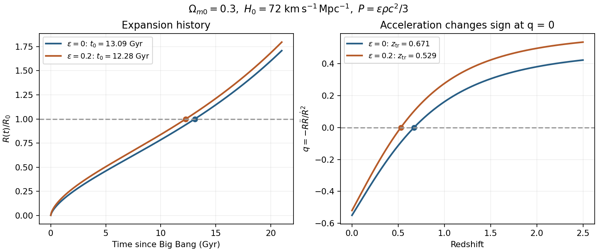

# Paper 1

↑ **Parent:** [2015](../2015.md)

Original solutions for the Physics and MASt Physics paper. [Original examination PDF, physical pages 728–731](https://www.whatdotheyknow.com/request/natural_science_tripos_physics_e_2/response/2340776/attach/2/FOI%202023%20399%20Zahid%20materials.pdf?cookie_passthrough=1)

**Table of contents**

- [1](#1)
  - [Solution](#1/solution)
- [2](#2)
  - [Solution](#2/solution)
- [3](#3)
  - [a](#3/a)
    - [Solution](#3/a/solution)
  - [b](#3/b)
    - [Solution](#3/b/solution)
  - [c](#3/c)
    - [Solution](#3/c/solution)
  - [d](#3/d)
    - [Solution](#3/d/solution)
  - [e](#3/e)
    - [Solution](#3/e/solution)

## 1

↑ **Parent:** [Paper 1](paper-1.md)

<h3 id="1/solution">Solution</h3>

↑ **Parent:** [1](#1)

**[photon](../../quantum-mechanics.md#photon) orbit and the Newtonian limit.** Write $r_g=GM/c^2$ and $e=E/(mc^2)$. For a [timelike circular Schwarzschild geodesic](../../schwarzschild-spacetime.md#timelike-circular-schwarzschild-geodesic),

$$
e(r)=\frac{1-2r_g/r}{\sqrt{1-3r_g/r}}.
$$

The denominator tends to zero at $r=3r_g$, so the [energy](../../energy.md) per unit [rest mass](../../special-relativity.md#invariant-mass) diverges as a massive circular orbit approaches that [radius](../../topology.md#radius). The corresponding local [orbital speed](../../celestial-mechanics.md#orbital-speed) measured by a static observer satisfies $v_{\rm loc}^2/c^2=r_g/(r-2r_g)$ and tends to one. This suggests a null circular orbit, but one must not simply insert $m=0$ into a massive-particle formula. For a [photon](../../quantum-mechanics.md#photon), the radial [effective potential](../../mathematical-physics.md#effective-potential) is proportional to $(1-2r_g/r)/r^2$; its [derivative](../../calculus.md#derivative) vanishes at $r=3r_g$ and its second [derivative](../../calculus.md#derivative) there is negative. Thus **the [photon sphere](../../schwarzschild-spacetime.md#photon-sphere) is at $3GM/c^2$, and its circular null orbits are unstable**.

At $r\gg r_g$, expansion gives

$$
e=1-\frac{r_g}{2r}+O\left(\frac{r_g^2}{r^2}\right),\qquad
\boxed{E=mc^2-\frac{GMm}{2r}+\cdots}.
$$

The second term is the total Newtonian circular-orbit [energy](../../energy.md), kinetic plus potential; the relativistic [energy](../../energy.md) also includes [rest energy](../../special-relativity.md#rest-energy). Here $E$ is the conserved [energy](../../energy.md) referred to a stationary observer at infinity, not the local [kinetic energy](../../energy.md#kinetic-energy).

**The stable inner edge.** At fixed [angular momentum](../../momentum.md#angular-momentum), write $\ell=L/(mc)$. The timelike radial [geodesic](../../riemannian-geometry.md#geodesic) equation can be written

$$
\left(\frac{1}{c}\frac{dr}{d\tau}\right)^2+V_{\rm eff}(r)=e^2,\qquad
V_{\rm eff}=\left(1-\frac{2r_g}{r}\right)\left(1+\frac{\ell^2}{r^2}\right).
$$

The circular condition $V_{\rm eff}'=0$ gives $\ell^2=r_g r^2/(r-3r_g)$. Substituting into the second [derivative](../../calculus.md#derivative) taken at fixed $\ell$ gives

$$
V_{\rm eff}''=\frac{2r_g(r-6r_g)}{r^3(r-3r_g)}.
$$

Timelike circular orbits exist for $r>3r_g$; they are stable against radial perturbations for $r>6r_g$ and unstable for $3r_g<r<6r_g$. Therefore

$$
\boxed{r_{\rm ISCO}=6r_g,\qquad e_{\rm ISCO}=\sqrt{\frac89}=0.942809.}
$$

The boundary orbit is marginally stable. Differentiating $e(r)$ also gives a minimum there, consistently with this fixed-angular-momentum stability calculation.

**[accretion](../../astrophysics.md#accretion) efficiency and [black-hole spin](../../astrophysical-black-hole.md#black-hole-spin).** Matter supplied slowly from far away initially brings [rest energy](../../special-relativity.md#rest-energy) $dm_0c^2$. A radiatively efficient, zero-inner-torque [thin disk](../../astrophysical-disk.md#thin-disk) releases the [binding energy](../../energy.md#binding-energy) down to the [innermost stable circular orbit](../../astrophysical-black-hole.md#innermost-stable-circular-orbit); the remaining [energy](../../energy.md) $e_{\rm ISCO}dm_0c^2$ is carried into the hole during the plunge. Thus

$$
\boxed{\eta=1-e_{\rm ISCO}=1-\sqrt{\frac89}=0.05719}.
$$

Here $\eta$ denotes the efficiency called $\epsilon$ in this question. The ideal relation assumes negligible additional dissipation during plunge and neglects [photon](../../quantum-mechanics.md#photon) capture and [advection](../../fluid-mechanics.md#advection). A hot radiatively inefficient flow need not have this efficiency.

For a [Kerr black hole](../../black-hole.md#kerr-black-hole), an equatorial prograde disk has a smaller [innermost stable circular orbit](../../astrophysical-black-hole.md#innermost-stable-circular-orbit) and greater binding-energy efficiency than the Schwarzschild value; a retrograde disk has the opposite trend. The formal extremal prograde limits are $r_{\rm ISCO}\to r_g$ and $\eta\to1-1/\sqrt3\simeq0.423$. These are ideal limiting values, not a universal realized efficiency. [photon](../../quantum-mechanics.md#photon) capture and the [accretion](../../astrophysics.md#accretion) geometry affect the achievable [black-hole spin](../../astrophysical-black-hole.md#black-hole-spin) and escaping [radiation](../../physics.md#radiation).

**[radiation](../../physics.md#radiation) [force](../../force.md) and the limiting [luminosity](../../astrophysics.md#luminosity).** For isotropic [luminosity](../../astrophysics.md#luminosity) $L$, the outward [radiation](../../physics.md#radiation) [momentum flux](../../mathematical-physics.md#momentum-flux) at [radius](../../topology.md#radius) $r$ is $L/(4\pi r^2c)$. In fully ionized [hydrogen](../../chemical-substance.md#hydrogen), [Thomson scattering](../../cosmic-microwave-background-anisotropy.md#thomson-scattering) acts mainly on the [electron](../../physics.md#electron), while electrostatic coupling makes the [electron](../../physics.md#electron) and [proton](../../physics.md#proton) move together. Neglecting the [electron](../../physics.md#electron) [mass](../../classical-mechanics.md#mass), one [electron](../../physics.md#electron)–[proton](../../physics.md#proton) pair experiences

$$
F_{\rm rad}=\frac{\sigma_T L}{4\pi r^2c},\qquad
F_{\rm grav}=\frac{GMm_p}{r^2}.
$$

Equating them yields

$$
\boxed{L_{\rm Edd}=\frac{4\pi GMm_pc}{\sigma_T}}.
$$

This [Eddington luminosity](../../stellar-structure.md#eddington-luminosity) uses [electron-scattering opacity](../../stellar-structure.md#electron-scattering-opacity), spherical or isotropic [force](../../force.md) balance and negligible relativistic corrections at the force-comparison [radius](../../topology.md#radius). Composition, other [opacity](../../stellar-structure.md#opacity), anisotropy and [photon](../../quantum-mechanics.md#photon) trapping can change the relevant limit.

**Exponential growth and doubling.** Distinguish rest-mass supply $\dot m_0$ from black-hole [mass](../../classical-mechanics.md#mass) growth $\dot M$:

$$
L=\eta\dot m_0c^2,\qquad
\dot M=(1-\eta)\dot m_0.
$$

At the Eddington limit,

$$
\dot M=\frac{1-\eta}{\eta}\frac{M}{t_E},\qquad
t_E=\frac{\sigma_Tc}{4\pi Gm_p},\qquad
M(t)=M_i\exp\left(\frac{t-t_i}{t_S}\right),
\quad
t_S=\frac{\eta}{1-\eta}t_E.
$$

Using the printed scattering cross section gives $t_E\simeq4.50\times10^8\ \mathrm{yr}$. The [Salpeter time](../../astrophysical-black-hole.md#salpeter-time) $t_S$ is an e-folding time; the [Eddington-limited doubling time](../../astrophysical-black-hole.md#eddington-limited-doubling-time) is

$$
\boxed{t_2=\frac{\eta}{1-\eta}\frac{\sigma_Tc}{4\pi Gm_p}\log2
\simeq1.89\times10^7\ \mathrm{yr}}
$$

for the Schwarzschild thin-disk efficiency. If one approximates $\dot M\simeq\dot m_0$, the factor $1/(1-\eta)$ is dropped and the estimate is about $1.79\times10^7\ \mathrm{yr}$. The retained-energy version is the mass-conserving expression.

**The efficiency bound.** A growth factor $10^8$ requires $N=\log(10^8)=18.4207$ e-folds. Eddington-limited [accretion](../../astrophysics.md#accretion) is the fastest growth allowed by the adopted [luminosity](../../astrophysics.md#luminosity) bound at fixed efficiency, so growth within a time $\Delta t$ requires

$$
N\frac{\eta}{1-\eta}t_E\leq\Delta t,\qquad
\boxed{\eta\leq\frac{\Delta t}{\Delta t+N t_E}\simeq0.108}.
$$

This [efficiency upper bound from Eddington-limited growth](../../astrophysical-black-hole.md#efficiency-upper-bound-from-eddington-limited-growth) is an **upper bound**: higher efficiency radiates more of each supplied [rest mass](../../special-relativity.md#invariant-mass), and the [luminosity](../../astrophysics.md#luminosity) ceiling therefore allows less [mass](../../classical-mechanics.md#mass) to enter per unit time. A duty cycle below unity or sub-Eddington [luminosity](../../astrophysics.md#luminosity) tightens it. The approximate convention $\dot M=\dot m_0$ would instead give $\eta\lesssim0.121$; both figures refer to the same effect, with different treatment of the radiated [mass](../../classical-mechanics.md#mass) deficit. Mergers, super-Eddington growth or a different seed history would change the premises.

Coherent prograde [accretion](../../astrophysics.md#accretion) [spins](../../angular-momentum-operator.md#spin) up the hole, moves the inner edge inward and increases $\eta$. For fixed $L/L_{\rm Edd}$ the mass-growth e-folding time then grows, so the logarithmic growth curve becomes less steep; one cannot simply retain the initial Schwarzschild efficiency throughout. Episodic misaligned [accretion](../../astrophysics.md#accretion) can have a different [black-hole spin](../../astrophysical-black-hole.md#black-hole-spin) history. In general,

$$
\log\frac{M_f}{M_i}
=\frac1{t_E}\int_{t_i}^{t_f} f_{\rm Edd}(t)\frac{1-\eta(t)}{\eta(t)}\,dt.
$$

**[energy](../../energy.md) available to affect the [galaxy](../../galaxy.md).** Let $M_g$ denote [galaxy](../../galaxy.md) [mass](../../classical-mechanics.md#mass), keeping it distinct from black-hole [mass](../../classical-mechanics.md#mass). At constant efficiency, negligible seed [mass](../../classical-mechanics.md#mass) and no merger contribution, the emitted [energy](../../energy.md) in building $M_{\rm BH}=0.002M_g$ is

$$
E_{\rm rad}=\frac{\eta}{1-\eta}M_{\rm BH}c^2,\qquad
\boxed{\frac{E_{\rm rad}}{E_{\rm bind}}\sim
0.002\frac{\eta}{1-\eta}\left(\frac{c}{v}\right)^2}.
$$

For $v=300\ \mathrm{km\,s^{-1}}$ and the nonspinning efficiency this is **approximately $121$**. The common small-efficiency approximation gives $2000\eta\simeq114$, and a fiducial $\eta=0.1$ would give about $222$ with retained [mass](../../classical-mechanics.md#mass) included. These differences do not alter the conclusion: the available [accretion](../../astrophysics.md#accretion) [energy](../../energy.md) substantially exceeds the stated galactic binding-energy estimate.

Only a coupling fraction of order one percent would then be energetically sufficient to affect the gas strongly. [radiation](../../physics.md#radiation), winds or jets can heat gas, drive outflows and suppress further cooling and [star formation](../../stellar-astrophysics.md#star-formation), providing [active-galactic-nucleus feedback](../../astrophysical-black-hole.md#active-galactic-nucleus-feedback) and possible self-regulation of black-hole growth. [energy](../../energy.md) availability alone does not prove that the whole [galaxy](../../galaxy.md) is expelled: most [radiation](../../physics.md#radiation) can escape, jets can be collimated, heated gas can cool, and collisionless [stars](../../stellar-astrophysics.md#star) couple differently from gas.

**[Figure 1](#1/image-original-comparison-of-eddington-limited-growth-at-fixed-efficiencies-including-the-radiated-mass-deficit). Original comparison of Eddington-limited growth at fixed efficiencies, including the radiated mass deficit**.

## 2

↑ **Parent:** [Paper 1](paper-1.md)

<h3 id="2/solution">Solution</h3>

↑ **Parent:** [2](#2)

**Definitions and [pressure](../../pressure.md) convention.** $R(t)$ is the [scale factor](../../cosmology.md#scale-factor-cosmology), $t$ [cosmic time](../../cosmology.md#cosmic-time) and dots [time derivatives](../../multivariable-calculus.md#time-derivative). $G$ is the [gravitational constant](../../newton-s-law-of-universal-gravitation.md#gravitational-constant), $c$ the [speed of light](../../special-relativity.md#speed-of-light), $\rho$ the mass-equivalent [density](../../fluid-mechanics.md#density) of the material fluid and $k=+1,0,-1$ the spatial-curvature sign in this normalization. $\Lambda$ here has units of inverse time squared, rather than inverse length squared. Comparison of the acceleration equation with $\ddot R/R=\Lambda/3-4\pi G(\rho+3P/c^2)/3$ fixes

$$
\boxed{\epsilon=\frac{3P}{\rho c^2}=3w}.
$$

This $\epsilon$ is a [pressure](../../pressure.md) parameter, unrelated to Question 1's radiative efficiency. [pressureless matter](../../cosmology.md#pressureless-matter) has $P=0$ and $\epsilon=0$. When solving the generalized model below, $\epsilon$ is assumed constant.

**Evidence for a positive vacuum component.** Standardized [Type Ia supernovae](../../stellar-astrophysics.md#type-ia-supernova) measure the luminosity-distance–[redshift](../../optics.md#redshift) relation. Their corrected apparent magnitudes at cosmological distances imply greater distances than a decelerating matter-dominated model of comparable parameters, favoring late accelerated expansion. Light-curve standardization, [interstellar extinction](../../galaxy.md#interstellar-extinction), selection bias and possible population evolution must be controlled rather than treating every supernova as an identical candle.[Abstract and distance–redshift analysis](../../physics-bibliography.md#observational-evidence-from-supernovae-for-an-accelerating-universe-and-a-cosmological-constant-by-adam-riess-and-others)[Abstract and cosmological likelihood analysis](../../physics-bibliography.md#measurements-of-omega-and-lambda-from-42-high-redshift-supernovae-by-saul-perlmutter-and-others)

The [cosmic microwave background](../../cosmic-microwave-background.md) and [baryon acoustic oscillation](../../cosmology.md#baryon-acoustic-oscillation) measurements constrain geometry and matter [density](../../fluid-mechanics.md#density) in combination. Near spatial flatness together with a subcritical matter [density](../../fluid-mechanics.md#density) leaves room for an additional smooth component; cosmic ages and structure growth supply consistency tests. A positive [cosmological constant](../../cosmology.md#cosmological-constant) fits these observations within the standard framework. They do not establish that every allowed dark-energy theory must be a strictly constant vacuum [energy](../../energy.md); the inference depends on the cosmological and gravitational model.

**[pressureless matter](../../cosmology.md#pressureless-matter) evolution.** Set $k=0$ and $\epsilon=0$. Since $\dot H=\ddot R/R-H^2$, eliminating $\rho$ gives

$$
\dot H=-\frac32\left(H^2-\frac{\Lambda}{3}\right),\qquad
\boxed{\frac23\dot H+H^2=\frac{\Lambda}{3}}.
$$

For $H=b\coth(at)$, $\dot H=-ab\,\mathrm{csch}^2(at)$ and $\coth^2x=1+\mathrm{csch}^2x$. Therefore

$$
b^2+\left(b^2-\frac23ab\right)\mathrm{csch}^2(at)=\frac{\Lambda}{3}.
$$

On the expanding Big-Bang branch with positive $\Lambda$, choose

$$
\boxed{b=\sqrt{\frac{\Lambda}{3}},\qquad
a=\frac32b=\frac{\sqrt{3\Lambda}}2,\qquad
H(t)=\sqrt{\frac{\Lambda}{3}}
\coth\left(\frac{\sqrt{3\Lambda}}2t\right)}.
$$

The origin $t=0$ is the [Big Bang](../../cosmology.md#big-bang); an arbitrary time translation would shift this origin. Integrating gives $R\propto\sinh^{2/3}(at)$. At early times $H\sim2/(3t)$, while at late times $H\to\sqrt{\Lambda/3}$.

**Age and the [density](../../fluid-mechanics.md#density) fractions.** Dividing the flat constraint by $H^2$, with $\rho_{\rm crit}=3H^2/(8\pi G)$, gives

$$
\boxed{\Omega_m+\Omega_\Lambda=1,\qquad
\Omega_\Lambda=\frac{\Lambda}{3H^2}}.
$$

The solution implies $\sqrt{\Omega_\Lambda}=\tanh(at)$, so

$$
\boxed{t_0=\frac{2}{3H_0\sqrt{1-\Omega_{m0}}}
\operatorname{artanh}\sqrt{1-\Omega_{m0}}}.
$$

Here $H_0=2.3331\times10^{-18}\ \mathrm{s^{-1}}$, using the printed megaparsec conversion. Taking one year as $365.25$ days gives

$$
\boxed{t_0\simeq1.309\times10^{10}\ \mathrm{yr}=13.09\ \mathrm{Gyr}.}
$$

For the same $H_0$, an [Einstein-de Sitter universe](../../large-scale-structure-of-the-universe.md#einstein-de-sitter-universe) has

$$
\boxed{t_{\rm EdS}=\frac{2}{3H_0}\simeq9.05\ \mathrm{Gyr}.}
$$

A cosmic model must be older than its oldest objects, with additional time allowed for their formation. Old stellar populations are dated through stellar-evolution fitting, particularly the [globular cluster](../../galaxy.md#globular-cluster) [main-sequence turnoff](../../stellar-astrophysics.md#main-sequence-turnoff), with uncertainties from distances, composition and input stellar physics. A pre-examination [globular-cluster age constraint on cosmology](../../stellar-astrophysics.md#globular-cluster-age-constraint-on-cosmology) obtained a $95\%$ lower cosmic-age limit of $11\ \mathrm{Gyr}$ after allowing for formation time. This conflicts with the $9.05\ \mathrm{Gyr}$ model but is compatible with the $13.09\ \mathrm{Gyr}$ calculation.[Abstract and stellar-age/formation-time analysis](../../physics-bibliography.md#new-globular-cluster-age-estimates-and-constraints-on-the-cosmic-equation-of-state-and-the-matter-density-of-the-universe-by-lawrence-m-krauss-and-brian-chaboyer) Individual [stellar age](../../stellar-astrophysics.md#stellar-age) estimates are not exact clocks, and the numerical $13.09\ \mathrm{Gyr}$ is the result for the specified $H_0$ and matter fraction, not a claim to be a contemporary best-fit age.

**Constant nonzero [pressure](../../pressure.md) parameter.** Eliminating $\rho$ before setting the [pressure](../../pressure.md) to zero instead gives

$$
\begin{aligned}
\dot H
&=\frac{\Lambda}{3}-H^2-\frac{1+\epsilon}{2}
\left(H^2-\frac{\Lambda}{3}\right)\\
&=-\frac{3+\epsilon}{2}
\left(H^2-\frac{\Lambda}{3}\right).
\end{aligned}
$$

Hence

$$
\boxed{\frac{2}{3+\epsilon}\dot H+H^2-\frac{\Lambda}{3}=0}.
$$

For constant $\epsilon>-3$, the positive-density expanding Big-Bang branch is

$$
\boxed{H(t)=H_\Lambda\coth\left(\frac{3+\epsilon}{2}H_\Lambda t\right),
\qquad H_\Lambda=\sqrt{\frac{\Lambda}{3}}}.
$$

Equivalently use $t'=(3+\epsilon)t/3$ in the [pressureless matter](../../cosmology.md#pressureless-matter) solution. The [scale factor](../../cosmology.md#scale-factor-cosmology) obeys $R\propto\sinh^{2/(3+\epsilon)}[(3+\epsilon)H_\Lambda t/2]$, and the early limit is $H\simeq2/[(3+\epsilon)t]$. The [age of a flat barotropic matter-vacuum universe](../../cosmology.md#age-of-a-flat-barotropic-matter-vacuum-universe) with the same present [density](../../fluid-mechanics.md#density) fractions and $H_0$ is

$$
t_0(\epsilon)=\frac{2\,\operatorname{artanh}\sqrt{\Omega_{\Lambda0}}}
{(3+\epsilon)H_0\sqrt{\Omega_{\Lambda0}}}
=\frac{3}{3+\epsilon}t_0(0).
$$

Thus

$$
\boxed{t_0(0.2)\simeq12.28\ \mathrm{Gyr}.}
$$

The small positive [pressure](../../pressure.md) makes the early universe expand with a smaller age at the same late expansion parameters.

**The acceleration transition.** Normalize the present [scale factor](../../cosmology.md#scale-factor-cosmology) to one. Constant $\epsilon$ and the continuity equation give $\rho=\rho_0(1+z)^{3+\epsilon}$. Dividing the acceleration equation by $H_0^2$ gives

$$
\frac{\ddot R}{R H_0^2}
=\Omega_{\Lambda0}-\frac{1+\epsilon}{2}
\Omega_{m0}(1+z)^{3+\epsilon}.
$$

At the [barotropic matter-vacuum acceleration transition](../../cosmology.md#barotropic-matter-vacuum-acceleration-transition) its right-hand side vanishes. For the parameters here, $1+\epsilon>0$, so the past transition is

$$
\boxed{z_{\rm tr}=
\left[\frac{2(1-\Omega_{m0})}{(1+\epsilon)\Omega_{m0}}\right]^{1/(3+\epsilon)}-1
\simeq0.529}.
$$

At greater [redshift](../../optics.md#redshift) the material term dominates and expansion decelerates; at smaller [redshift](../../optics.md#redshift) vacuum [energy](../../energy.md) dominates and expansion accelerates. The [pressure](../../pressure.md) factor $1+\epsilon$ belongs in the numerator of the gravitating material term; omitting it would confuse this model with [pressureless matter](../../cosmology.md#pressureless-matter).

**[Figure 2](#2/image-original-constant-pressure-parameter-expansion-histories-and-acceleration-transitions). Original constant-pressure-parameter expansion histories and acceleration transitions**.

## 3

↑ **Parent:** [Paper 1](paper-1.md)

<h3 id="3/a">a</h3>

↑ **Parent:** [3](#3)

<h4 id="3/a/solution">Solution</h4>

↑ **Parent:** [A](#3/a)

Three tracers give complementary estimates of a cluster's gravitating [mass](../../classical-mechanics.md#mass). First, [galaxy](../../galaxy.md) [redshifts](../../optics.md#redshift) measure a line-of-sight [velocity dispersion](../../galaxy.md#velocity-dispersion) $\sigma_{\rm los}$. For a roughly stationary bound cluster, the [virial theorem](../../classical-mechanics.md#virial-theorem) gives a [cluster velocity-dispersion mass estimate](../../large-scale-structure-of-the-universe.md#cluster-velocity-dispersion-mass-estimate)

$$
M(<r)\sim\frac{3\sigma_{\rm los}^2r}{G},
$$

with a coefficient depending on the [density](../../fluid-mechanics.md#density) profile and orbital anisotropy. The [galaxy](../../galaxy.md) [luminosity](../../astrophysics.md#luminosity) and plausible stellar [mass-to-light ratio](../../galaxy.md#mass-to-light-ratio) supply too little [mass](../../classical-mechanics.md#mass) to bind typical rich clusters. Foreground interlopers, substructure, velocity anisotropy and a recent merger can bias the dynamical estimate; a large dispersion is not by itself proof of equilibrium.

Second, diffuse X-ray emission measures a hot intracluster [plasma](../../physics.md#plasma-physics), not merely unresolved starlight. Spectral continuum and lines constrain its [temperature](../../temperature.md), while surface-brightness profiles constrain its [density](../../fluid-mechanics.md#density) after [line-of-sight projection](../../astronomy.md#line-of-sight-projection) and emissivity modeling. If the gas has constant composition and is approximately spherical and in [hydrostatic equilibrium](../../statistical-physics.md#hydrostatic-equilibrium),

$$
\frac{dP_g}{dr}=-\rho_g\frac{GM(<r)}{r^2}
\quad\Longrightarrow\quad
\boxed{M(<r)=-\frac{k_BT(r)r}{G\mu m_p}
\left(\frac{d\log\rho_g}{d\log r}+\frac{d\log T}{d\log r}\right)}.
$$

This [cluster hydrostatic mass estimator](../../large-scale-structure-of-the-universe.md#cluster-hydrostatic-mass-estimator) uses $\mu m_p$ as the mean [mass](../../classical-mechanics.md#mass) per pressure-supporting particle. The inferred potential requires substantially more [mass](../../classical-mechanics.md#mass) than the [stars](../../stellar-astrophysics.md#star) plus measured gas, although the gas contains much of the visible baryonic [mass](../../classical-mechanics.md#mass). Turbulence, bulk motion, [temperature](../../temperature.md) structure and departures from [hydrostatic equilibrium](../../statistical-physics.md#hydrostatic-equilibrium) are important [systematic errors](../../physics.md#systematic-error).

Third, strong-lensing arcs and multiple images, together with coherent weak-lensing shear of background [galaxies](../../galaxy.md), measure projected gravitational deflection. In [general relativity](../../general-relativity.md),

$$
\kappa=\frac{\Sigma}{\Sigma_{\rm crit}},\qquad
\Sigma_{\rm crit}=\frac{c^2}{4\pi G}\frac{D_s}{D_lD_{ls}}.
$$

This [cluster gravitational-lensing mass estimate](../../large-scale-structure-of-the-universe.md#cluster-gravitational-lensing-mass-estimate) does not require the cluster [galaxies](../../galaxy.md) or gas to be in dynamical equilibrium. It does require source-distance information, a lens model and control of point-spread-function-induced shapes, [line-of-sight projection](../../astronomy.md#line-of-sight-projection), unrelated line-of-sight structure and the [mass-sheet degeneracy](../../gravitational-lensing.md#mass-sheet-degeneracy).

**The convergence of dynamical, hydrostatic and lensing [masses](../../classical-mechanics.md#mass), exceeding the baryonic inventory, is the principal evidence.** The Bullet Cluster adds a spatial test: collisional X-ray gas lags behind the [galaxies](../../galaxy.md) during the merger, while the inferred lensing concentrations lie nearer the collisionless [galaxy](../../galaxy.md) component. An additional weakly collisional gravitating [mass](../../classical-mechanics.md#mass) accounts naturally for that separation.[L109–L113, optical/X-ray/lensing comparison](../../physics-bibliography.md#a-direct-empirical-proof-of-the-existence-of-dark-matter-by-douglas-clowe-and-others) The conclusion assumes a gravitational framework and does not identify the microscopic dark-matter particle; the different tracer systematics should be evaluated rather than treating three [mass](../../classical-mechanics.md#mass) estimates as completely assumption free.

<h3 id="3/b">b</h3>

↑ **Parent:** [3](#3)

<h4 id="3/b/solution">Solution</h4>

↑ **Parent:** [B](#3/b)

[cosmic inflation](../../cosmic-inflation.md) is an early interval of accelerated expansion, $\ddot R>0$. For expansion this means a shrinking [comoving Hubble radius](../../cosmology.md#comoving-hubble-radius), $d[(RH)^{-1}]/dt<0$. A nearly constant positive [scalar potential](../../classical-field-theory.md#scalar-potential) can supply it: in $c=1$ units,

$$
\rho_\phi=\frac{\dot\phi^2}{2}+V(\phi),\qquad
P_\phi=\frac{\dot\phi^2}{2}-V(\phi).
$$

Potential domination gives $\rho_\phi+3P_\phi<0$ and approximately exponential expansion. Sustaining the interval requires sufficiently slow evolution, not just setting the initial field velocity to zero on a steep potential.

The [horizon problem](../../cosmology.md#horizon-problem) is the near equality of conditions in widely separated microwave-background regions that could not equilibrate in the standard decelerating hot [Big Bang](../../cosmology.md#big-bang) history. [cosmic inflation](../../cosmic-inflation.md) permits the currently observed patch to descend from an earlier region small enough to have been causally connected, before that patch is stretched to enormous size. The claim concerns a causal history extended before the conventional hot phase; merely accelerating a collection of already disconnected regions would not explain their common [temperature](../../temperature.md).

For the [flatness problem](../../cosmology.md#flatness-problem), the Friedmann constraint gives

$$
|\Omega_{\rm tot}-1|=\frac{|k|c^2}{R^2H^2}.
$$

A growing $RH$ drives this curvature fraction toward zero, whereas ordinary matter- or radiation-dominated deceleration makes it grow. [cosmic inflation](../../cosmic-inflation.md) therefore suppresses observable curvature without requiring an equally extreme initial tuning within the later hot evolution.

Pre-existing monopoles and other unwanted relics are also diluted by the volume increase: a conserved particle number [density](../../fluid-mechanics.md#density) falls as $e^{-3N}$ over $N$ e-folds. The transition to the hot universe must reheat efficiently, and its [temperature](../../temperature.md) must not regenerate an excluded relic population. The required number of e-folds is model and [reheating](../../cosmic-inflation.md#reheating) dependent; “about sixty” is a useful scale for many scenarios rather than a universal exact requirement.

[cosmic inflation](../../cosmic-inflation.md) also supplies a mechanism for perturbations. [quantum fluctuations](../../quantum-theory.md#quantum-fluctuation) are stretched beyond the Hubble [radius](../../topology.md#radius), and nearly scale-invariant [comoving curvature perturbations](../../cosmic-inflation.md#comoving-curvature-perturbation) can later seed cosmic structure. Simple single-field slow-roll models commonly predict approximately adiabatic, nearly Gaussian fluctuations, with a small spectral tilt; tensor perturbations would provide an additional test. Acoustic coherence and the observed scalar spectrum are compatible with this account, but they do not single out one [inflaton](../../cosmic-inflation.md#inflaton) potential. **[cosmic inflation](../../cosmic-inflation.md) addresses causal homogeneity, curvature and relic dilution while motivating the initial perturbations; it does not automatically solve the [cosmological constant](../../cosmology.md#cosmological-constant) problem or determine [reheating](../../cosmic-inflation.md#reheating).**

<h3 id="3/c">c</h3>

↑ **Parent:** [3](#3)

<h4 id="3/c/solution">Solution</h4>

↑ **Parent:** [C](#3/c)

A [radio pulsar](../../stellar-astrophysics.md#pulsar) is a rapidly rotating, magnetized [neutron star](../../stellar-astrophysics.md#neutron-star) whose emission beam periodically crosses the line of sight. Collapse of a massive stellar core can leave such a compact remnant. Angular-momentum conservation during contraction helps explain rapid [rotation](../../riemannian-geometry.md#rotation-mathematics), while amplified [magnetic fields](../../magnetic-field.md) and a plasma-filled magnetosphere enable particle acceleration and beamed emission. The pulses are not repeated stellar contractions. Not every newborn [neutron star](../../stellar-astrophysics.md#neutron-star) is seen as a [radio pulsar](../../stellar-astrophysics.md#pulsar), because emission, beaming and observational selection matter.

[rotation](../../riemannian-geometry.md#rotation-mathematics) supplies [energy](../../energy.md) to [radiation](../../physics.md#radiation) and the magnetized wind. With approximately constant [moment of inertia](../../rigid-body-dynamics.md#moment-of-inertia) $I$,

$$
E_{\rm rot}=\frac12I\Omega^2,\qquad
\boxed{L_{\rm sd}=4\pi^2I\frac{\dot P}{P^3}}.
$$

An ideal fixed magnetic-dipole torque has $\dot\Omega=-K\Omega^3$. Its integration gives

$$
t=\frac{P}{2\dot P}\left[1-\left(\frac{P_{\rm birth}}P\right)^2\right],
$$

so the [pulsar characteristic age](../../stellar-astrophysics.md#pulsar-characteristic-age) $\tau_c=P/(2\dot P)$ approximates the true age only for a short birth period, constant torque coefficient and [braking index](../../stellar-astrophysics.md#braking-index) three. Real magnetospheres, field evolution and kinematic contributions to observed $\dot P$ complicate both age and inferred [magnetic field](../../magnetic-field.md).

As the [star](../../stellar-astrophysics.md#star) [spins](../../angular-momentum-operator.md#spin) down, the available accelerating potential falls. If particle acceleration and [pair production](../../perturbative-quantum-field-theory.md#pair-production) can no longer sustain the radio-emitting magnetosphere, the object crosses a model-dependent [pulsar death line](../../stellar-astrophysics.md#pulsar-death-line) and ceases to be detectable as an ordinary [radio pulsar](../../stellar-astrophysics.md#pulsar). It still exists as a cooling [neutron star](../../stellar-astrophysics.md#neutron-star); “death” refers to the emission state, not disappearance of the [star](../../stellar-astrophysics.md#star). The death boundary is not a precisely universal spin period.

In a surviving binary, later [Roche-lobe overflow](../../stellar-astrophysics.md#roche-lobe-overflow) from a companion can create an [accretion disc](../../astrophysical-disk.md#accretion-disk). Transferred [angular momentum](../../momentum.md#angular-momentum) [spins](../../angular-momentum-operator.md#spin) the old [neutron star](../../stellar-astrophysics.md#neutron-star) up, and the [accretion](../../astrophysics.md#accretion) [luminosity](../../astrophysics.md#luminosity) can produce an [X-ray binary](../../stellar-astrophysics.md#x-ray-binary). Long [accretion](../../astrophysics.md#accretion) episodes can produce millisecond [rotation](../../riemannian-geometry.md#rotation-mathematics), commonly accompanied by a smaller inferred external [magnetic field](../../magnetic-field.md). After [mass](../../classical-mechanics.md#mass) transfer declines, the [radio pulsar](../../stellar-astrophysics.md#pulsar) can switch on again as a [recycled pulsar](../../stellar-astrophysics.md#recycled-pulsar), often with a [white dwarf](../../stellar-astrophysics.md#white-dwarf) companion. Other binary histories can leave a second [neutron star](../../stellar-astrophysics.md#neutron-star), an ablated companion or an isolated recycled object; there is no single obligatory evolutionary sequence.

A direct observational bridge is the coherent approximately $2.49\ \mathrm{ms}$ X-ray pulsation discovered with RXTE in SAX J1808.4-3658, an accretion-powered binary. It demonstrated an accreting [neutron star](../../stellar-astrophysics.md#neutron-star) rotating at a rate appropriate to recycled millisecond [radio pulsars](../../stellar-astrophysics.md#pulsar).[Abstract, coherent pulsations and interpretation](../../physics-bibliography.md#discovery-of-the-first-accretion-powered-millisecond-x-ray-pulsar-by-rudy-wijnands-and-michiel-van-der-klis) Timing analysis must correct orbital [Doppler shifts](../../wave.md#doppler-effect), telescope and solar-system timing, and instrumental aliases. Radio dispersion, sky coverage and beaming selection affect demographic inferences. **The sequence is rotational [pulsar spin-down](../../stellar-astrophysics.md#pulsar-spin-down), possible loss of radio activity, and possible accretion-driven recycling—not a necessary path for every [neutron star](../../stellar-astrophysics.md#neutron-star).**

**[Figure 3](#3/c/image-original-schematic-of-ordinary-pulsar-spin-down-and-the-conditional-binary-recycling-route). Original schematic of ordinary pulsar spin-down and the conditional binary-recycling route**.

<h3 id="3/d">d</h3>

↑ **Parent:** [3](#3)

<h4 id="3/d/solution">Solution</h4>

↑ **Parent:** [D](#3/d)

The [cosmic microwave background](../../cosmic-microwave-background.md) has an almost perfect [blackbody spectrum](../../statistical-physics.md#blackbody-spectrum) at about $2.725\ \mathrm{K}$. This is strong evidence for an earlier hot, dense phase in which [radiation](../../physics.md#radiation) thermalized, followed by expansion that redshifted the [photon](../../quantum-mechanics.md#photon) spectrum while preserving its Planck form. [COBE](../../cosmic-microwave-background.md#cosmic-background-explorer) [FIRAS](../../cosmic-microwave-background.md#far-infrared-absolute-spectrophotometer) compared the sky with a precision reference [blackbody](../../astrophysics.md#blackbody); instrument [temperature](../../temperature.md), gain, foregrounds and calibrator emissivity were crucial controls. Agreement with a [blackbody](../../astrophysics.md#blackbody) constrains substantial late [energy](../../energy.md) injection or photon-production distortions.[FIRAS measurement and external-blackbody calibration account](../../physics-bibliography.md#nobel-lecture-from-the-big-bang-to-the-nobel-prize-and-beyond-by-john-c-mather)

After subtracting the dominant dipole associated mainly with observer motion, anisotropies at the level of roughly $10^{-5}$ reveal primordial structure. [COBE](../../cosmic-microwave-background.md#cosmic-background-explorer) DMR established large-angular-scale anisotropy; multifrequency measurements and independent maps were needed to distinguish it from Galactic emission and instrumental artifacts.[L1–L5, statistical and systematic checks](../../physics-bibliography.md#structure-in-the-cobe-differential-microwave-radiometer-first-year-maps-by-george-f-smoot-and-others) Approximate isotropy supports a homogeneous background model under the usual cosmological assumptions, but isotropy at one observing position is not alone a proof of spatial homogeneity everywhere.

The [temperature](../../temperature.md) [CMB angular power spectrum](../../cosmic-microwave-background-anisotropy.md#cosmic-microwave-background-power-spectrum) has multiple acoustic peaks. Their coherent pattern follows oscillations in the pre-recombination [photon-baryon fluid](../../cosmic-microwave-background-anisotropy.md#photon-baryon-fluid). Peak positions compare the [sound horizon](../../cosmic-microwave-background-anisotropy.md#sound-horizon) with [angular diameter distance](../../cosmology.md#angular-diameter-distance) and hence constrain geometry together with expansion parameters. Relative peak heights test [baryon](../../physics.md#baryon) inertia, matter–[radiation](../../physics.md#radiation) equality and gravitational-potential evolution, motivating both baryonic and nonbaryonic matter. [Cosmic microwave background diffusion damping](../../cosmic-microwave-background-anisotropy.md#cosmic-microwave-background-diffusion-damping) suppresses small-scale power. [Cosmic microwave background polarization](../../cosmic-microwave-background-anisotropy.md#cosmic-microwave-background-polarization) and [temperature](../../temperature.md)–polarization correlations provide further tests of scattering, acoustic phase and [reionization](../../cosmic-microwave-background.md#reionization); [gravitational lensing](../../gravitational-lensing.md) remaps the observed pattern and probes intervening structure.

By the time of this examination, the Planck 2013 [temperature](../../temperature.md) and lensing analysis supported a spatially flat six-parameter model with [cold dark matter](../../cosmology.md#cold-dark-matter) and a [cosmological constant](../../cosmology.md#cosmological-constant). This is a joint fit within an explicit model, not an inference that each peak uniquely measures one parameter.[Abstract and cosmological parameter/extension analysis](../../physics-bibliography.md#planck-2013-results-xvi-cosmological-parameters-by-planck-collaboration) Foreground separation requires frequency coverage, sky masks, beam and noise characterization, and consistency across instruments. The primary microwave background has geometric and other parameter degeneracies, so acoustic-ruler, supernova and structure observations are valuable complements. **The spectrum establishes a thermal hot-universe history; anisotropy and polarization constrain its geometry, contents and [primordial perturbations](../../cosmic-inflation.md#primordial-perturbation).** None of these observations by itself demonstrates a unique [cosmic inflation](../../cosmic-inflation.md) mechanism.

<h3 id="3/e">e</h3>

↑ **Parent:** [3](#3)

<h4 id="3/e/solution">Solution</h4>

↑ **Parent:** [E](#3/e)

**[mass](../../classical-mechanics.md#mass) from motion.** A resolved [Keplerian orbit](../../celestial-mechanics.md#kepler-orbit) gives $M=4\pi^2a^3/(GP_{\rm orb}^2)$ when the orbiting object has negligible [mass](../../classical-mechanics.md#mass). At the Galactic centre, repeated infrared [astrometry](../../astronomy.md#astrometry) and [spectroscopy](../../physics.md#spectroscopy) measure sky motion, acceleration and line-of-sight velocity of [stars](../../stellar-astrophysics.md#star) around [Sagittarius A\*](../../astrophysical-black-hole.md#sagittarius-a). Resolving a compact enclosed [mass](../../classical-mechanics.md#mass) and fitting complete orbits avoids reliance on a single projected velocity. Source confusion, reference-frame stability, distance, inclination and possible extended [mass](../../classical-mechanics.md#mass) must be included in the fit.[Abstract and orbital-model/systematic-error discussion](../../physics-bibliography.md#measuring-distance-and-properties-of-the-milky-way-s-central-supermassive-black-hole-with-stellar-orbits-by-andrea-m-ghez-and-others)

For an unresolved stellar-mass binary in a circular orbit, the donor's velocity semiamplitude $K_2$ and [orbital period](../../celestial-mechanics.md#orbital-period) give the [binary mass function](../../stellar-astrophysics.md#binary-mass-function)

$$
f(M_{\rm BH})=\frac{P_{\rm orb}K_2^3}{2\pi G}
=\frac{M_{\rm BH}^3\sin^3i}{(M_{\rm BH}+M_2)^2}.
$$

It provides a lower [mass](../../classical-mechanics.md#mass) bound; donor [mass](../../classical-mechanics.md#mass) and [orbital inclination](../../celestial-mechanics.md#orbital-inclination) are needed for an actual [mass](../../classical-mechanics.md#mass) estimate. For an eccentric orbit, multiply the observational combination $P_{\rm orb}K_2^3/(2\pi G)$ by $(1-e^2)^{3/2}$ when evaluating the [binary mass function](../../stellar-astrophysics.md#binary-mass-function). Resolved gas or maser [rotation](../../riemannian-geometry.md#rotation-mathematics) and stellar-dynamical models also measure [masses](../../classical-mechanics.md#mass), provided [pressure](../../pressure.md) support, noncircular motion and [line-of-sight projection](../../astronomy.md#line-of-sight-projection) are modeled. Resolving the [black-hole sphere of influence](../../astrophysical-black-hole.md#black-hole-sphere-of-influence) improves separation of central [mass](../../classical-mechanics.md#mass) from the host [galaxy](../../galaxy.md).

For active nuclei, [reverberation mapping](../../astrophysical-black-hole.md#reverberation-mapping) measures a lag $\tau$ between variable continuum and broad-line response. With a line velocity scale $\Delta v$,

$$
M_{\rm BH}=f_{\rm geom}\frac{c\tau\,\Delta v^2}{G}.
$$

The factor $f_{\rm geom}$ accounts for geometry and kinematics and is not known simply from the lag. Cadence, line responsivity, inclination and winds require control. Rapid variability demonstrates compactness but is not by itself a unique [mass](../../classical-mechanics.md#mass) measurement.

**[black-hole spin](../../astrophysical-black-hole.md#black-hole-spin) from strong-field emission.** Define $a_*=cJ/(GM^2)$. Large-radius Keplerian motion is principally a [mass](../../classical-mechanics.md#mass) probe and usually insensitive to [black-hole spin](../../astrophysical-black-hole.md#black-hole-spin). In the Kerr model, the [radius](../../topology.md#radius) and [binding energy](../../energy.md#binding-energy) of the [innermost stable circular orbit](../../astrophysical-black-hole.md#innermost-stable-circular-orbit) vary with $a_*$ and orbital orientation, making inner-disk [radiation](../../physics.md#radiation) useful.

[black-hole continuum fitting](../../astrophysical-black-hole.md#black-hole-continuum-fitting) infers an inner emitting [radius](../../topology.md#radius) from the disk's thermal spectrum and flux normalization, then identifies it with the [innermost stable circular orbit](../../astrophysical-black-hole.md#innermost-stable-circular-orbit) in a relativistic thin-disk model. Independent [mass](../../classical-mechanics.md#mass), distance and inclination, together with atmospheric spectral hardening, [absorption](../../radiometry.md#absorption-electromagnetic-radiation) and contamination, are needed. Spectra should be selected in a disk-dominated regime where truncation and strong [advection](../../fluid-mechanics.md#advection) are limited. A 2011 Cygnus X-1 analysis combined such spectra with independently constrained binary parameters and reported a near-extreme [black-hole spin](../../astrophysical-black-hole.md#black-hole-spin) conditional on [black-hole spin](../../astrophysical-black-hole.md#black-hole-spin)–orbit alignment and its disk model.[Abstract, thermal-continuum fit and dominant mass/distance/inclination/flux-calibration uncertainties](../../physics-bibliography.md#the-extreme-spin-of-the-black-hole-in-cygnus-x-1-by-lijun-gou-and-others)

[black-hole reflection spectroscopy](../../astrophysical-black-hole.md#black-hole-reflection-spectroscopy) instead models a relativistically broadened iron-line and reflection continuum: orbital [Doppler shifts](../../wave.md#doppler-effect) and beaming broaden the profile, while [gravitational redshift](../../general-relativity.md#gravitational-redshift) contributes to the extended red wing. Its innermost emitting [radius](../../topology.md#radius) can constrain [black-hole spin](../../astrophysical-black-hole.md#black-hole-spin) if reflection extends to the stable inner edge. Ionization, abundance, [absorption](../../radiometry.md#absorption-electromagnetic-radiation), coronal illumination, disk thickness and possible truncation are competing parameters; a broad line is not a direct [black-hole spin](../../astrophysical-black-hole.md#black-hole-spin) reading independent of these assumptions. Timing or precession models can add information but introduce their own dynamical identification.

**[mass](../../classical-mechanics.md#mass) is principally inferred from gravitating dynamics; [black-hole spin](../../astrophysical-black-hole.md#black-hole-spin) is inferred from strong-field effects with a specified spacetime and [accretion](../../astrophysics.md#accretion) model.** Agreement between independent methods is especially valuable because disk inner [radius](../../topology.md#radius), inclination and radiation-transfer assumptions can otherwise mimic a change of [black-hole spin](../../astrophysical-black-hole.md#black-hole-spin).

## ↑ Ancestors (11)

1. [2015](../2015.md)
2. [Past exam of the relativistic Astrophysics and Cosmology course of the University of Cambridge](../../past-exam-of-the-relativistic-astrophysics-and-cosmology-course-of-the-university-of-cambridge.md)
3. [Relativistic Astrophysics and Cosmology course of the University of Cambridge](../../university-of-cambridge.md#relativistic-astrophysics-and-cosmology-course-of-the-university-of-cambridge)
4. [Physics course of the year 4 of the natural sciences course of the University of Cambridge](../../university-of-cambridge.md#physics-course-of-the-year-4-of-the-natural-sciences-course-of-the-university-of-cambridge)
5. [Year 4 of the natural sciences course of the University of Cambridge](../../university-of-cambridge.md#year-4-of-the-natural-sciences-course-of-the-university-of-cambridge)
6. [Year of the natural sciences course of the University of Cambridge](../../university-of-cambridge.md#year-of-the-natural-sciences-course-of-the-university-of-cambridge)
7. [Natural sciences course of the University of Cambridge](../../university-of-cambridge.md#natural-sciences-course-of-the-university-of-cambridge)
8. [Course of the University of Cambridge](../../university-of-cambridge.md#course-of-the-university-of-cambridge)
9. [University of Cambridge](../../university-of-cambridge.md)
10. [List of universities](../../README.md#list-of-universities)
11. [Codex Wiki](../../README.md)
