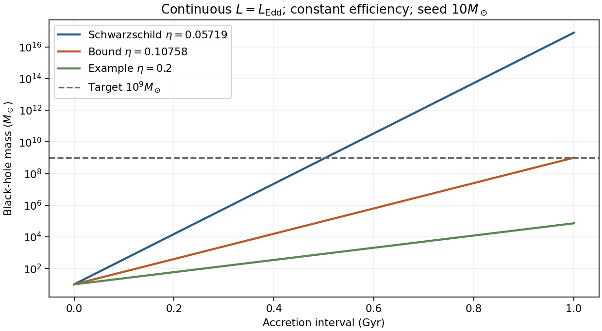

<h1 id="1/solution">Solution</h1>

↑ **Parent:** [1](../1.md)

**[photon](../../../../photon.md) orbit and the Newtonian limit.** Write $r_g=GM/c^2$ and $e=E/(mc^2)$. For a [timelike circular Schwarzschild geodesic](../../../../timelike-circular-schwarzschild-geodesic.md),

$$
e(r)=\frac{1-2r_g/r}{\sqrt{1-3r_g/r}}.
$$

The denominator tends to zero at $r=3r_g$, so the [energy](../../../../energy-split.md) per unit [rest mass](../../../../invariant-mass.md) diverges as a massive circular orbit approaches that [radius](../../../../radius.md). The corresponding local [orbital speed](../../../../orbital-speed.md) measured by a static observer satisfies $v_{\rm loc}^2/c^2=r_g/(r-2r_g)$ and tends to one. This suggests a null circular orbit, but one must not simply insert $m=0$ into a massive-particle formula. For a [photon](../../../../photon.md), the radial [effective potential](../../../../effective-potential.md) is proportional to $(1-2r_g/r)/r^2$; its [derivative](../../../../derivative.md) vanishes at $r=3r_g$ and its second [derivative](../../../../derivative.md) there is negative. Thus **the [photon sphere](../../../../photon-sphere.md) is at $3GM/c^2$, and its circular null orbits are unstable**.

At $r\gg r_g$, expansion gives

$$
e=1-\frac{r_g}{2r}+O\left(\frac{r_g^2}{r^2}\right),\qquad
\boxed{E=mc^2-\frac{GMm}{2r}+\cdots}.
$$

The second term is the total Newtonian circular-orbit [energy](../../../../energy-split.md), kinetic plus potential; the relativistic [energy](../../../../energy-split.md) also includes [rest energy](../../../../rest-energy.md). Here $E$ is the conserved [energy](../../../../energy-split.md) referred to a stationary observer at infinity, not the local [kinetic energy](../../../../kinetic-energy.md).

**The stable inner edge.** At fixed [angular momentum](../../../../angular-momentum.md), write $\ell=L/(mc)$. The timelike radial [geodesic](../../../../geodesic.md) equation can be written

$$
\left(\frac{1}{c}\frac{dr}{d\tau}\right)^2+V_{\rm eff}(r)=e^2,\qquad
V_{\rm eff}=\left(1-\frac{2r_g}{r}\right)\left(1+\frac{\ell^2}{r^2}\right).
$$

The circular condition $V_{\rm eff}'=0$ gives $\ell^2=r_g r^2/(r-3r_g)$. Substituting into the second [derivative](../../../../derivative.md) taken at fixed $\ell$ gives

$$
V_{\rm eff}''=\frac{2r_g(r-6r_g)}{r^3(r-3r_g)}.
$$

Timelike circular orbits exist for $r>3r_g$; they are stable against radial perturbations for $r>6r_g$ and unstable for $3r_g<r<6r_g$. Therefore

$$
\boxed{r_{\rm ISCO}=6r_g,\qquad e_{\rm ISCO}=\sqrt{\frac89}=0.942809.}
$$

The boundary orbit is marginally stable. Differentiating $e(r)$ also gives a minimum there, consistently with this fixed-angular-momentum stability calculation.

**[accretion](../../../../accretion.md) efficiency and [black-hole spin](../../../../black-hole-spin.md).** Matter supplied slowly from far away initially brings [rest energy](../../../../rest-energy.md) $dm_0c^2$. A radiatively efficient, zero-inner-torque [thin disk](../../../../thin-disk.md) releases the [binding energy](../../../../binding-energy.md) down to the [innermost stable circular orbit](../../../../innermost-stable-circular-orbit.md); the remaining [energy](../../../../energy-split.md) $e_{\rm ISCO}dm_0c^2$ is carried into the hole during the plunge. Thus

$$
\boxed{\eta=1-e_{\rm ISCO}=1-\sqrt{\frac89}=0.05719}.
$$

Here $\eta$ denotes the efficiency called $\epsilon$ in this question. The ideal relation assumes negligible additional dissipation during plunge and neglects [photon](../../../../photon.md) capture and [advection](../../../../advection.md). A hot radiatively inefficient flow need not have this efficiency.

For a [Kerr black hole](../../../../kerr-black-hole.md), an equatorial prograde disk has a smaller [innermost stable circular orbit](../../../../innermost-stable-circular-orbit.md) and greater binding-energy efficiency than the Schwarzschild value; a retrograde disk has the opposite trend. The formal extremal prograde limits are $r_{\rm ISCO}\to r_g$ and $\eta\to1-1/\sqrt3\simeq0.423$. These are ideal limiting values, not a universal realized efficiency. [photon](../../../../photon.md) capture and the [accretion](../../../../accretion.md) geometry affect the achievable [black-hole spin](../../../../black-hole-spin.md) and escaping [radiation](../../../../radiation.md).

**[radiation](../../../../radiation.md) [force](../../../../force-split.md) and the limiting [luminosity](../../../../luminosity.md).** For isotropic [luminosity](../../../../luminosity.md) $L$, the outward [radiation](../../../../radiation.md) [momentum flux](../../../../momentum-flux.md) at [radius](../../../../radius.md) $r$ is $L/(4\pi r^2c)$. In fully ionized [hydrogen](../../../../hydrogen.md), [Thomson scattering](../../../../thomson-scattering.md) acts mainly on the [electron](../../../../electron.md), while electrostatic coupling makes the [electron](../../../../electron.md) and [proton](../../../../proton.md) move together. Neglecting the [electron](../../../../electron.md) [mass](../../../../mass.md), one [electron](../../../../electron.md)–[proton](../../../../proton.md) pair experiences

$$
F_{\rm rad}=\frac{\sigma_T L}{4\pi r^2c},\qquad
F_{\rm grav}=\frac{GMm_p}{r^2}.
$$

Equating them yields

$$
\boxed{L_{\rm Edd}=\frac{4\pi GMm_pc}{\sigma_T}}.
$$

This [Eddington luminosity](../../../../eddington-luminosity.md) uses [electron-scattering opacity](../../../../electron-scattering-opacity.md), spherical or isotropic [force](../../../../force-split.md) balance and negligible relativistic corrections at the force-comparison [radius](../../../../radius.md). Composition, other [opacity](../../../../opacity.md), anisotropy and [photon](../../../../photon.md) trapping can change the relevant limit.

**Exponential growth and doubling.** Distinguish rest-mass supply $\dot m_0$ from black-hole [mass](../../../../mass.md) growth $\dot M$:

$$
L=\eta\dot m_0c^2,\qquad
\dot M=(1-\eta)\dot m_0.
$$

At the Eddington limit,

$$
\dot M=\frac{1-\eta}{\eta}\frac{M}{t_E},\qquad
t_E=\frac{\sigma_Tc}{4\pi Gm_p},\qquad
M(t)=M_i\exp\left(\frac{t-t_i}{t_S}\right),
\quad
t_S=\frac{\eta}{1-\eta}t_E.
$$

Using the printed scattering cross section gives $t_E\simeq4.50\times10^8\ \mathrm{yr}$. The [Salpeter time](../../../../salpeter-time.md) $t_S$ is an e-folding time; the [Eddington-limited doubling time](../../../../eddington-limited-doubling-time.md) is

$$
\boxed{t_2=\frac{\eta}{1-\eta}\frac{\sigma_Tc}{4\pi Gm_p}\log2
\simeq1.89\times10^7\ \mathrm{yr}}
$$

for the Schwarzschild thin-disk efficiency. If one approximates $\dot M\simeq\dot m_0$, the factor $1/(1-\eta)$ is dropped and the estimate is about $1.79\times10^7\ \mathrm{yr}$. The retained-energy version is the mass-conserving expression.

**The efficiency bound.** A growth factor $10^8$ requires $N=\log(10^8)=18.4207$ e-folds. Eddington-limited [accretion](../../../../accretion.md) is the fastest growth allowed by the adopted [luminosity](../../../../luminosity.md) bound at fixed efficiency, so growth within a time $\Delta t$ requires

$$
N\frac{\eta}{1-\eta}t_E\leq\Delta t,\qquad
\boxed{\eta\leq\frac{\Delta t}{\Delta t+N t_E}\simeq0.108}.
$$

This [efficiency upper bound from Eddington-limited growth](../../../../efficiency-upper-bound-from-eddington-limited-growth.md) is an **upper bound**: higher efficiency radiates more of each supplied [rest mass](../../../../invariant-mass.md), and the [luminosity](../../../../luminosity.md) ceiling therefore allows less [mass](../../../../mass.md) to enter per unit time. A duty cycle below unity or sub-Eddington [luminosity](../../../../luminosity.md) tightens it. The approximate convention $\dot M=\dot m_0$ would instead give $\eta\lesssim0.121$; both figures refer to the same effect, with different treatment of the radiated [mass](../../../../mass.md) deficit. Mergers, super-Eddington growth or a different seed history would change the premises.

Coherent prograde [accretion](../../../../accretion.md) [spins](../../../../spin.md) up the hole, moves the inner edge inward and increases $\eta$. For fixed $L/L_{\rm Edd}$ the mass-growth e-folding time then grows, so the logarithmic growth curve becomes less steep; one cannot simply retain the initial Schwarzschild efficiency throughout. Episodic misaligned [accretion](../../../../accretion.md) can have a different [black-hole spin](../../../../black-hole-spin.md) history. In general,

$$
\log\frac{M_f}{M_i}
=\frac1{t_E}\int_{t_i}^{t_f} f_{\rm Edd}(t)\frac{1-\eta(t)}{\eta(t)}\,dt.
$$

**[energy](../../../../energy-split.md) available to affect the [galaxy](../../../../galaxy-split.md).** Let $M_g$ denote [galaxy](../../../../galaxy-split.md) [mass](../../../../mass.md), keeping it distinct from black-hole [mass](../../../../mass.md). At constant efficiency, negligible seed [mass](../../../../mass.md) and no merger contribution, the emitted [energy](../../../../energy-split.md) in building $M_{\rm BH}=0.002M_g$ is

$$
E_{\rm rad}=\frac{\eta}{1-\eta}M_{\rm BH}c^2,\qquad
\boxed{\frac{E_{\rm rad}}{E_{\rm bind}}\sim
0.002\frac{\eta}{1-\eta}\left(\frac{c}{v}\right)^2}.
$$

For $v=300\ \mathrm{km\,s^{-1}}$ and the nonspinning efficiency this is **approximately $121$**. The common small-efficiency approximation gives $2000\eta\simeq114$, and a fiducial $\eta=0.1$ would give about $222$ with retained [mass](../../../../mass.md) included. These differences do not alter the conclusion: the available [accretion](../../../../accretion.md) [energy](../../../../energy-split.md) substantially exceeds the stated galactic binding-energy estimate.

Only a coupling fraction of order one percent would then be energetically sufficient to affect the gas strongly. [radiation](../../../../radiation.md), winds or jets can heat gas, drive outflows and suppress further cooling and [star formation](../../../../star-formation.md), providing [active-galactic-nucleus feedback](../../../../active-galactic-nucleus-feedback.md) and possible self-regulation of black-hole growth. [energy](../../../../energy-split.md) availability alone does not prove that the whole [galaxy](../../../../galaxy-split.md) is expelled: most [radiation](../../../../radiation.md) can escape, jets can be collimated, heated gas can cool, and collisionless [stars](../../../../star.md) couple differently from gas.

**[Figure 1](#1/image-original-comparison-of-eddington-limited-growth-at-fixed-efficiencies-including-the-radiated-mass-deficit). Original comparison of Eddington-limited growth at fixed efficiencies, including the radiated mass deficit**.

## ↑ Ancestors (13)

1. [1](../1.md)
2. [Paper 1](../../paper-1-split.md)
3. [2015](../../split.md)
4. [Past exam of the relativistic Astrophysics and Cosmology course of the University of Cambridge](../../../split.md)
5. [Relativistic Astrophysics and Cosmology course of the University of Cambridge](../../../../relativistic-astrophysics-and-cosmology-course-of-the-university-of-cambridge.md)
6. [Physics course of the year 4 of the natural sciences course of the University of Cambridge](../../../../physics-course-of-the-year-4-of-the-natural-sciences-course-of-the-university-of-cambridge.md)
7. [Year 4 of the natural sciences course of the University of Cambridge](../../../../year-4-of-the-natural-sciences-course-of-the-university-of-cambridge.md)
8. [Year of the natural sciences course of the University of Cambridge](../../../../year-of-the-natural-sciences-course-of-the-university-of-cambridge.md)
9. [Natural sciences course of the University of Cambridge](../../../../natural-sciences-course-of-the-university-of-cambridge.md)
10. [Course of the University of Cambridge](../../../../course-of-the-university-of-cambridge.md)
11. [University of Cambridge](../../../../university-of-cambridge-split.md)
12. [List of universities](../../../../list-of-universities.md)
13. [Codex Wiki](../../../../split.md)
