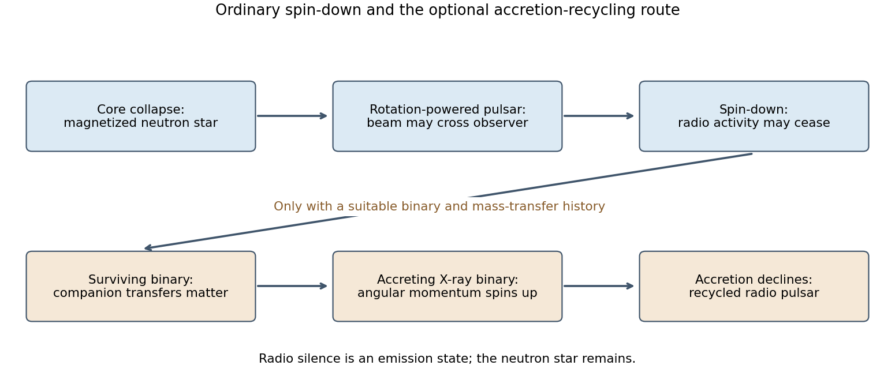

<h1 id="3/c/solution">Solution</h1>

↑ **Parent:** [C](../c.md)

A [radio pulsar](../../../../../pulsar.md) is a rapidly rotating, magnetized [neutron star](../../../../../neutron-star.md) whose emission beam periodically crosses the line of sight. Collapse of a massive stellar core can leave such a compact remnant. Angular-momentum conservation during contraction helps explain rapid [rotation](../../../../../rotation-mathematics.md), while amplified [magnetic fields](../../../../../magnetic-field-split.md) and a plasma-filled magnetosphere enable particle acceleration and beamed emission. The pulses are not repeated stellar contractions. Not every newborn [neutron star](../../../../../neutron-star.md) is seen as a [radio pulsar](../../../../../pulsar.md), because emission, beaming and observational selection matter.

[rotation](../../../../../rotation-mathematics.md) supplies [energy](../../../../../energy-split.md) to [radiation](../../../../../radiation.md) and the magnetized wind. With approximately constant [moment of inertia](../../../../../moment-of-inertia.md) $I$,

$$
E_{\rm rot}=\frac12I\Omega^2,\qquad
\boxed{L_{\rm sd}=4\pi^2I\frac{\dot P}{P^3}}.
$$

An ideal fixed magnetic-dipole torque has $\dot\Omega=-K\Omega^3$. Its integration gives

$$
t=\frac{P}{2\dot P}\left[1-\left(\frac{P_{\rm birth}}P\right)^2\right],
$$

so the [pulsar characteristic age](../../../../../pulsar-characteristic-age.md) $\tau_c=P/(2\dot P)$ approximates the true age only for a short birth period, constant torque coefficient and [braking index](../../../../../braking-index.md) three. Real magnetospheres, field evolution and kinematic contributions to observed $\dot P$ complicate both age and inferred [magnetic field](../../../../../magnetic-field-split.md).

As the [star](../../../../../star.md) [spins](../../../../../spin.md) down, the available accelerating potential falls. If particle acceleration and [pair production](../../../../../pair-production.md) can no longer sustain the radio-emitting magnetosphere, the object crosses a model-dependent [pulsar death line](../../../../../pulsar-death-line.md) and ceases to be detectable as an ordinary [radio pulsar](../../../../../pulsar.md). It still exists as a cooling [neutron star](../../../../../neutron-star.md); “death” refers to the emission state, not disappearance of the [star](../../../../../star.md). The death boundary is not a precisely universal spin period.

In a surviving binary, later [Roche-lobe overflow](../../../../../roche-lobe-overflow.md) from a companion can create an [accretion disc](../../../../../accretion-disk.md). Transferred [angular momentum](../../../../../angular-momentum.md) [spins](../../../../../spin.md) the old [neutron star](../../../../../neutron-star.md) up, and the [accretion](../../../../../accretion.md) [luminosity](../../../../../luminosity.md) can produce an [X-ray binary](../../../../../x-ray-binary.md). Long [accretion](../../../../../accretion.md) episodes can produce millisecond [rotation](../../../../../rotation-mathematics.md), commonly accompanied by a smaller inferred external [magnetic field](../../../../../magnetic-field-split.md). After [mass](../../../../../mass.md) transfer declines, the [radio pulsar](../../../../../pulsar.md) can switch on again as a [recycled pulsar](../../../../../recycled-pulsar.md), often with a [white dwarf](../../../../../white-dwarf.md) companion. Other binary histories can leave a second [neutron star](../../../../../neutron-star.md), an ablated companion or an isolated recycled object; there is no single obligatory evolutionary sequence.

A direct observational bridge is the coherent approximately $2.49\ \mathrm{ms}$ X-ray pulsation discovered with RXTE in SAX J1808.4-3658, an accretion-powered binary. It demonstrated an accreting [neutron star](../../../../../neutron-star.md) rotating at a rate appropriate to recycled millisecond [radio pulsars](../../../../../pulsar.md).[Abstract, coherent pulsations and interpretation](../../../../../discovery-of-the-first-accretion-powered-millisecond-x-ray-pulsar-by-rudy-wijnands-and-michiel-van-der-klis.md) Timing analysis must correct orbital [Doppler shifts](../../../../../doppler-effect.md), telescope and solar-system timing, and instrumental aliases. Radio dispersion, sky coverage and beaming selection affect demographic inferences. **The sequence is rotational [pulsar spin-down](../../../../../pulsar-spin-down.md), possible loss of radio activity, and possible accretion-driven recycling—not a necessary path for every [neutron star](../../../../../neutron-star.md).**

**[Figure 3](#3/c/image-original-schematic-of-ordinary-pulsar-spin-down-and-the-conditional-binary-recycling-route). Original schematic of ordinary pulsar spin-down and the conditional binary-recycling route**.

## ↑ Ancestors (14)

1. [C](../c.md)
2. [3](../../3.md)
3. [Paper 1](../../../paper-1-split.md)
4. [2015](../../../split.md)
5. [Past exam of the relativistic Astrophysics and Cosmology course of the University of Cambridge](../../../../split.md)
6. [Relativistic Astrophysics and Cosmology course of the University of Cambridge](../../../../../relativistic-astrophysics-and-cosmology-course-of-the-university-of-cambridge.md)
7. [Physics course of the year 4 of the natural sciences course of the University of Cambridge](../../../../../physics-course-of-the-year-4-of-the-natural-sciences-course-of-the-university-of-cambridge.md)
8. [Year 4 of the natural sciences course of the University of Cambridge](../../../../../year-4-of-the-natural-sciences-course-of-the-university-of-cambridge.md)
9. [Year of the natural sciences course of the University of Cambridge](../../../../../year-of-the-natural-sciences-course-of-the-university-of-cambridge.md)
10. [Natural sciences course of the University of Cambridge](../../../../../natural-sciences-course-of-the-university-of-cambridge.md)
11. [Course of the University of Cambridge](../../../../../course-of-the-university-of-cambridge.md)
12. [University of Cambridge](../../../../../university-of-cambridge-split.md)
13. [List of universities](../../../../../list-of-universities.md)
14. [Codex Wiki](../../../../../split.md)
