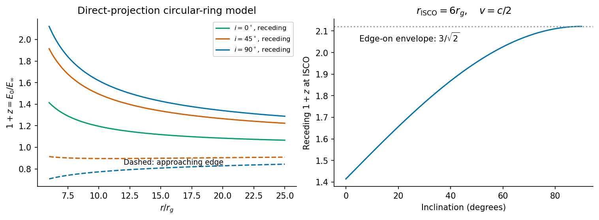
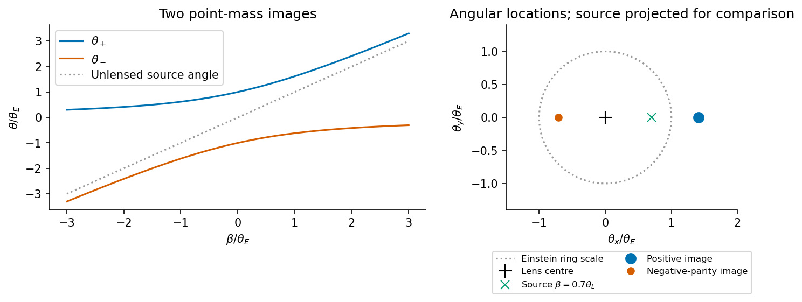

# Paper 1

↑ **Parent:** [2016](../2016.md)

Original paper: [Public original PDF, physical pages800–803; question pages801–803](https://www.whatdotheyknow.com/request/natural_science_tripos_physics_e_2/response/2340776/attach/2/FOI%202023%20399%20Zahid%20materials.pdf?cookie_passthrough=1#page=800).

**Table of contents**

- [1](#1)
  - [Solution](#1/solution)
- [2](#2)
  - [Solution](#2/solution)
  - [a](#2/a)
    - [Solution](#2/a/solution)
  - [b](#2/b)
    - [Solution](#2/b/solution)
- [3](#3)
  - [a](#3/a)
    - [Solution](#3/a/solution)
  - [b](#3/b)
    - [Solution](#3/b/solution)
  - [c](#3/c)
    - [Solution](#3/c/solution)
  - [d](#3/d)
    - [Solution](#3/d/solution)
  - [e](#3/e)
    - [Solution](#3/e/solution)

## 1

↑ **Parent:** [Paper 1](paper-1.md)

<h3 id="1/solution">Solution</h3>

↑ **Parent:** [1](#1)

An [active galactic nucleus](../../astrophysical-black-hole.md#active-galactic-nucleus) is a compact, exceptionally luminous central source powered chiefly by [black-hole accretion](../../astrophysical-black-hole.md#black-hole-accretion) rather than ordinary stellar fusion. Typical signatures include a broad spectral-energy distribution extending from radio to [X-rays](../../electromagnetic-radiation.md#x-ray), rapid variability implying a small emitting region, strong optical or ultraviolet emission lines and, in some objects, radio [jets](../../standard-model.md#jet-particle-physics) and lobes. Broad permitted lines indicate rapidly moving dense gas; narrower forbidden lines can arise farther out. Obscuration and viewing orientation can hide the broad-line region, and many active nuclei are radio quiet, so no one signature is required in every object.

For the [Schwarzschild circular-ring energy shift](../../schwarzschild-spacetime.md#schwarzschild-circular-ring-energy-shift), set $r_g=GM/c^2$ and let $E_0$ be the [photon](../../quantum-mechanics.md#photon) energy in the orbiting gas frame. A local static observer in [Schwarzschild spacetime](../../schwarzschild-spacetime.md) measures $E_{\rm stat}$. For gas receding along the line-of-sight component of its velocity, special-relativistic frequency transformation gives

$$
E_0=\gamma E_{\rm stat}(1+\beta\sin i),\qquad
\beta=v/c,\quad\gamma=(1-\beta^2)^{-1/2}.
$$

Propagation from that static frame to a distant stationary observer contributes $E_\infty=E_{\rm stat}\sqrt{1-2r_g/r}$. Hence

$$
\boxed{1+z=\frac{E_0}{E_\infty}
=(1-2r_g/r)^{-1/2}(1-\beta^2)^{-1/2}
(1+\beta\sin i).}
$$

The factors describe [gravitational redshift](../../general-relativity.md#gravitational-redshift), transverse [time dilation](../../special-relativity.md#time-dilation) and the longitudinal [Doppler shift](../../wave.md#doppler-effect). Here the emitter is on the maximally receding azimuth of a circular disc ring. A general azimuth has a smaller projected velocity, and a fully ray-traced image must use the [photon](../../quantum-mechanics.md#photon) direction at emission rather than equating that local direction with the distant inclination. The supplied expression is the direct-projection transfer model, not a complete light-bending calculation.

The [innermost stable circular orbit](../../astrophysical-black-hole.md#innermost-stable-circular-orbit) is the marginal stable timelike circular geodesic separating stable circular motion from radial instability. In [Schwarzschild spacetime](../../schwarzschild-spacetime.md),

$$
\boxed{r_{\rm ISCO}=6r_g=3r_s,\qquad r_s=2r_g.}
$$

For example, the circular-orbit [specific angular momentum](../../celestial-mechanics.md#specific-angular-momentum) satisfies $j_c^2=GMr^2/(r-3r_g)$; its radial stability changes where $\mathrm d j_c^2/\mathrm dr=0$, at $6r_g$. This is outside both the horizon at $2r_g$ and the circular [photon](../../quantum-mechanics.md#photon) orbit at $3r_g$.

The printed local orbital-speed relation gives $\beta^2=r_g/(r-2r_g)$. Combining the gravitational and transverse factors,

$$
(1-2r_g/r)^{-1/2}(1-\beta^2)^{-1/2}
=(1-3r_g/r)^{-1/2}.
$$

At the ISCO, $\beta=1/2$, so

$$
\boxed{1+z_{\rm ISCO}(i)=\sqrt2\left(1+\frac12\sin i\right).}
$$

The [Edge-on Schwarzschild ISCO redshift envelope](../../schwarzschild-spacetime.md#edge-on-schwarzschild-isco-redshift-envelope) is reached for an edge-on disc on its receding side:

$$
\boxed{1+z_{\max}=\frac3{\sqrt2},\qquad z_{\max}\simeq1.1213.}
$$

The approaching edge has $1+z=\sqrt2(1-\tfrac12\sin i)$. For a fixed inclination below $90$ degrees the maximum is smaller; the quoted number is an upper envelope, not the value for every observer. Within the stated ring model the receding factor increases inward across stable orbits, so the inner edge sets that envelope. Emission from a plunging region, occultation and returning rays are outside this ISCO-emitting model.

**[Figure 1](#1/image-original-schwarzschild-circular-ring-transfer-calculation-showing-inclination-dependence-and-the-edge-on-isco-redshift-envelope). Original Schwarzschild circular-ring transfer calculation showing inclination dependence and the edge-on ISCO redshift envelope**.

The [Kerr ISCO efficiency limits](../../astrophysical-black-hole.md#kerr-isco-efficiency-limits) follow from equatorial [circular orbits](../../classical-mechanics.md#circular-orbit) in the [Kerr metric](../../general-relativity.md#kerr-metric). Prograde motion has a smaller ISCO than the non-spinning case, while retrograde motion has a larger one. A zero-torque thin disc radiating the orbital [binding energy](../../energy.md#binding-energy) before the gas plunges has efficiency $\eta=1-E_{\rm ISCO}$, where $E_{\rm ISCO}$ is energy per unit rest-mass energy at infinity. The ideal limiting values are

$$
\begin{array}{c|c|c}
\text{orbit}&r_{\rm ISCO}/r_g&\eta\\\hline
\text{extremal retrograde}&9&1-\sqrt{25/27}\simeq0.03775\\
\text{Schwarzschild}&6&1-\sqrt{8/9}\simeq0.05719\\
\text{extremal prograde limit}&1&1-1/\sqrt3\simeq0.42265
\end{array}
$$

Thus more orbital [binding energy](../../energy.md#binding-energy) is available in the prograde inner disc. The extremal values are formal geodesic limits: [photon](../../quantum-mechanics.md#photon) capture, inner stresses, outflows and finite accretion thickness change the efficiency of real flows. An ISCO inside the ergoregion is not a claim that material or [radiation](../../physics.md#radiation) escapes from inside the horizon.

For [accretion output relative to galactic binding energy](../../astrophysical-black-hole.md#accretion-output-relative-to-galactic-binding-energy), distinguish accreted rest mass from the mass retained by the [black hole](../../black-hole.md). At constant radiative efficiency, building a hole from a negligible seed to $M_{\rm BH}=\alpha M$ emits

$$
E_{\rm rad}=\frac{\eta}{1-\eta}\alpha Mc^2.
$$

A non-negligible seed replaces $\alpha M$ by the actual mass increase. Let the first use of $\sigma_v$ mean the total three-dimensional rms random speed. For an approximately virialized [galaxy](../../galaxy.md) with negligible boundary term, $K=\tfrac12M\sigma_v^2$ and $W=-2K=-M\sigma_v^2$. The ratio to the magnitude of its [gravitational potential energy](../../energy.md#gravitational-energy) is therefore

$$
\boxed{\frac{E_{\rm rad}}{|W|}
\simeq\frac{\eta}{1-\eta}\,\alpha\frac{c^2}{\sigma_v^2}.}
$$

If “[binding energy](../../energy.md#binding-energy)” means the net energy needed to unbind the virialized system, $|K+W|=M\sigma_v^2/2$, the ratio is twice as large. The widely used order-of-magnitude estimate drops the retained-mass correction and writes $\eta\alpha(c/\sigma_v)^2$; it should not be confused with a precisely fixed structural coefficient.

For the numerical parameters given,

$$
\alpha(c/\sigma_v)^2\simeq998.6,\qquad
\frac{E_{\rm rad}}{|W|}\simeq998.6\,\frac{\eta}{1-\eta}.
$$

No efficiency is specified, so this function is the numerical result. For an explicitly chosen illustration $\eta=0.1$, it is about $111$, or $222$ relative to the net virial [binding energy](../../energy.md#binding-energy). The non-spinning zero-torque efficiency gives about $60.6$ relative to $|W|$; the ideal retrograde and prograde limits give about $39.2$ and $731$, respectively. Spin affects the ratio through the adopted efficiency and orbital orientation, not through a universal rule that a larger unsigned spin always means a larger efficiency.

Such large energy ratios make even a modest coupling of the output to galactic gas dynamically important. [Radiation](../../physics.md#radiation) and winds can heat or eject gas and reduce [star formation](../../stellar-astrophysics.md#star-formation) or later black-hole feeding. For the $\eta=0.1$ illustration a percent-level coupling is already comparable to $|W|$. Energy available is not energy necessarily deposited: cooling, escape directions, gas geometry, [photon](../../quantum-mechanics.md#photon) opacity and the duration of activity determine the actual feedback. It does not follow that the entire stellar [galaxy](../../galaxy.md) must be disrupted.

For the swept-shell calculation, the problem now explicitly redefines $\sigma_v$ as a one-dimensional line-of-sight dispersion. The specified isothermal profile has

$$
M_{\rm gal}(R)=\frac{2\sigma_v^2R}{G},\quad
M_{\rm sh}=fM_{\rm gal},\quad
M_{\rm int}=(1-f)M_{\rm gal}.
$$

Neglecting central-hole gravity and the shell's [self-gravity](../../newton-s-law-of-universal-gravitation.md#self-gravity), the inward force due to the remaining interior component is

$$
F_g=\frac{GM_{\rm int}M_{\rm sh}}{R^2}
=\frac{4f(1-f)\sigma_v^4}{G}.
$$

In a single-scattering momentum-driven model with the shell intercepting the central [luminosity](../../astrophysics.md#luminosity), $F_{\rm rad}=L/c$. At the [hydrogen](../../chemical-substance.md#hydrogen) [Eddington luminosity](../../stellar-structure.md#eddington-luminosity) this becomes $4\pi GM_{\rm BH}m_p/\sigma_T$. Sustained outward acceleration against that weight requires

$$
\frac{4\pi GM_{\rm BH}m_p}{\sigma_T}
>\frac{4f(1-f)\sigma_v^4}{G},
$$

and hence

$$
\boxed{M_{\rm BH}>
\frac{(1-f)f\sigma_v^4\sigma_T}{\pi m_pG^2}.}
$$

The radius cancels because the swept isothermal mass is proportional to $R$. This is the [isothermal-galaxy momentum-balance shell threshold](../../astrophysical-black-hole.md#isothermal-galaxy-momentum-balance-shell-threshold), with its fourth-power dispersion scaling.

The coefficient identifies the approximations. [Self-gravity in a thin spherical shell expansion](../../newton-s-law-of-universal-gravitation.md#self-gravity-in-a-thin-spherical-shell-expansion) adds the shell's inward pressure-equivalent force $GM_{\rm sh}^2/(2R^2)$ and replaces $f(1-f)$ by $f(1-f/2)$. A shell intercepting only a fraction of the [photon](../../quantum-mechanics.md#photon) [momentum](../../momentum.md) needs a larger [luminosity](../../astrophysics.md#luminosity); Thomson-thin material does not automatically receive $L/c$. Conversely, [multiple scattering](../../wave.md#multiple-scattering) or an energy-driven hot wind changes the force model. A shell already carrying sufficient outward [kinetic energy](../../energy.md#kinetic-energy) need not satisfy this instantaneous acceleration condition everywhere to escape. The printed inequality is the stated quasistatic, fully coupled momentum-balance estimate, not an assumption-free lower bound for every possible shell trajectory.

## 2

↑ **Parent:** [Paper 1](paper-1.md)

<h3 id="2/solution">Solution</h3>

↑ **Parent:** [2](#2)

Use the geodesic radial [comoving coordinate](../../cosmology.md#comoving-coordinate), in which the [Friedmann-Lemaître-Robertson-Walker metric](../../cosmology.md#friedmann-lemaitre-robertson-walker-metric) has the form

$$
\mathrm ds^2=-c^2\mathrm dt^2+
R^2(t)\left[\mathrm d\chi^2+S_k^2(\chi)\,\mathrm d\Omega^2\right].
$$

On a slice of constant [cosmic time](../../cosmology.md#cosmic-time), the radial proper-length element is $R(t)\,\mathrm d\chi$. Therefore

$$
\boxed{D(t)=\int_0^\chi R(t)\,\mathrm d\chi'=R(t)\chi.}
$$

If one starts from a curvature coordinate with radial element $R\,\mathrm dr/\sqrt{1-kr^2}$, then $\chi=\int_0^r\mathrm dr'/\sqrt{1-kr'^2}$; the curvature coordinate $r$ itself is not generally the $\chi$ used above.

For a comoving [galaxy](../../galaxy.md), $\dot\chi=0$, so $\dot D=\dot R\chi=HD$. The definitions are

$$
\boxed{H=\frac{\dot R}{R},\qquad
q=-\frac{R\ddot R}{\dot R^2}
=-1-\frac{\dot H}{H^2}.}
$$

This recession law concerns proper distances on common cosmic-time slices. It is not a local special-relativistic relative velocity measurement; a large recession rate is not a signal exceeding the local speed of light.

For a comoving volume $V=V_0R^3$, total fluid energy is $E=\rho c^2V$. Adiabatic energy conservation gives $\mathrm dE+P\,\mathrm dV=0$. Expanding,

$$
c^2V\dot\rho+(\rho c^2+P)\dot V=0,\qquad
\dot V=3HV,
$$

hence

$$
\boxed{\dot\rho=-3H(\rho+P/c^2).}
$$

Here $\rho$ is mass-equivalent energy density. [Radiation](../../physics.md#radiation) loses energy both by dilution and by pressure work; [pressureless matter](../../cosmology.md#pressureless-matter) only dilutes in this description.

In the [time-unit convention for the cosmological constant](../../cosmology.md#time-unit-convention-for-the-cosmological-constant), it represents a uniform vacuum contribution with pressure equal to minus its energy density. There is a units convention in the printed field equations: their term is $\Lambda/3$, so the symbol $\Lambda$ there has units of inverse time squared. If the geometrical constant is instead given in inverse length squared, this symbol equals $c^2\Lambda_{\rm geom}$. The curvature parameter $k$ labels constant-curvature spatial slices; with a conventional scale-factor normalization it is $+1,0,-1$ for positively curved, flat and negatively curved slices. It fixes local curvature sign, not every possible global spatial topology.

For a flat fluid-only model without a [cosmological constant](../../cosmology.md#cosmological-constant) and with $P=w\rho c^2$, the two field equations give

$$
q=\frac{\tfrac{4\pi G}{3}(\rho+3P/c^2)}
{\tfrac{8\pi G}{3}\rho}
=\frac{1+3w}{2}.
$$

The two printed cases and their scale-factor laws are worked under the literal inline labels below.

Inflation is accelerated expansion, $\ddot R>0$, equivalently a decreasing [comoving Hubble radius](../../cosmology.md#comoving-hubble-radius) $(RH)^{-1}$ on an expanding branch. An approximately constant positive vacuum-like energy can give nearly exponential expansion. Enough inflation can put regions now widely separated inside a common earlier causal patch, suppress $|k|/(RH)^2$ and dilute unwanted relics such as monopoles. These are the horizon, flatness and relic-abundance motivations. [Reheating](../../cosmic-inflation.md#reheating) is needed to populate the subsequent hot universe. [Quantum fluctuations](../../quantum-theory.md#quantum-fluctuation) can seed primordial perturbations, but inflation alone is not a universal solution to the initial singularity or a proof that all initial conditions inflate.

Now adopt the printed [natural units](../../mathematical-physics.md#natural-units) $c=\hbar=1$. For the [Homogeneous massive-scalar equation in an expanding universe](../../wave-equation.md#homogeneous-massive-scalar-equation-in-an-expanding-universe),

$$
\dot\rho=\dot\phi\,\ddot\phi+m^2\phi\dot\phi,\qquad
\rho+P=\dot\phi^2.
$$

The continuity equation gives

$$
\dot\phi\left(\ddot\phi+3H\dot\phi+m^2\phi\right)=0.
$$

Where $\dot\phi\ne0$, this implies the expanding-universe [Klein-Gordon equation](../../wave-equation.md#klein-gordon-equation)

$$
\boxed{\ddot\phi+3H\dot\phi+m^2\phi=0.}
$$

A regular canonical-field solution extends it through isolated turning points by continuity. Purely dividing the conservation equation does not determine a trajectory on an interval where $\dot\phi$ is identically zero; canonical field dynamics, or variation of its action, supplies the equation there. In particular a constant nonzero massive field is not an exact freely evolving solution.

With $\Lambda=k=0$,

$$
\frac{\ddot R}{R}
=-\frac{4\pi G}{3}(\rho+3P)
=-\frac{4\pi G}{3}(2\dot\phi^2-m^2\phi^2).
$$

Therefore

$$
\boxed{\ddot R>0\quad\Longleftrightarrow\quad
\dot\phi^2<\frac12m^2\phi^2.}
$$

This [inflation condition for a homogeneous massive scalar](../../cosmic-inflation.md#inflation-condition-for-a-homogeneous-massive-scalar) means a potential-dominated field has sufficiently negative pressure to accelerate expansion. In quadratic [chaotic inflation](../../cosmic-inflation.md#chaotic-inflation), a large initial field with $V=m^2\phi^2/2$ can enter slow roll, with $3H\dot\phi\simeq-m^2\phi$ and $H^2\simeq4\pi Gm^2\phi^2/3$. The [potential slow-roll parameter](../../cosmic-inflation.md#potential-slow-roll-parameter) is $\epsilon_V=1/(4\pi G\phi^2)$, so a large field relative to the gravitational scale can support many e-folds. The field eventually rolls far enough that this regime ends and oscillation and [reheating](../../cosmic-inflation.md#reheating) become relevant. Large [potential energy](../../energy.md#potential-energy) with arbitrary initial [kinetic energy](../../energy.md#kinetic-energy) does not by itself guarantee an inflationary interval.

Differentiating the flat [Friedmann equation](../../cosmology.md#friedmann-equations) and then using the scalar equation,

$$
2H\dot H=\frac{8\pi G}{3}\dot\phi(\ddot\phi+m^2\phi)
=-8\pi GH\dot\phi^2.
$$

For the expanding branch,

$$
\boxed{\dot H=-4\pi G\dot\phi^2\leq0.}
$$

This [Nonincreasing Hubble rate for a canonical inflaton](../../cosmic-inflation.md#nonincreasing-hubble-rate-for-a-canonical-inflaton) decreases strictly where the field rolls and can be momentarily stationary at a turning point; the statement “always decreasing” means nonincreasing. This does not conflict with acceleration, because $\ddot R/R=H^2+\dot H$ remains positive when $\epsilon_H=-\dot H/H^2<1$.

At horizon exit, larger comoving wavelengths leave earlier, when $H$ is larger. For a canonical field in slow roll, with [reduced Planck mass](../../mathematical-physics.md#reduced-planck-mass) $\overline M_{\rm Pl}=(8\pi G)^{-1/2}$,

$$
\mathcal P_T\simeq\frac{2H^2}{\pi^2\overline M_{\rm Pl}^{\,2}},
\qquad
n_T\simeq-2\epsilon_H\leq0.
$$

The decreasing expansion rate gives a red tensor tilt at this order. The scalar curvature spectrum also contains the conversion from field fluctuations to curvature:

$$
\mathcal P_{\mathcal R}\simeq
\frac{H^2}{8\pi^2\epsilon_H\overline M_{\rm Pl}^{\,2}},
\qquad
\boxed{n_s-1\simeq-2\epsilon_H-
\frac{\mathrm d\ln\epsilon_H}{\mathrm dN}.}
$$

Here $N=\ln R$ counts elapsed e-folds. Thus the [Decreasing Hubble rate does not alone fix scalar tilt](../../cosmic-inflation.md#decreasing-hubble-rate-does-not-alone-fix-scalar-tilt). Evolution of $\epsilon_H$ matters. For the quadratic [slow-roll](../../cosmic-inflation.md#slow-roll-approximation) model, $\eta_V=\epsilon_V$ and $n_s-1\simeq-6\epsilon_V+2\eta_V=-4\epsilon_V<0$. If $N_{\rm rem}$ e-folds remain until the end, leading estimates give $n_s\simeq1-2/N_{\rm rem}$ and [tensor-to-scalar ratio](../../cosmic-inflation.md#tensor-to-scalar-ratio) $r_{\rm TS}\simeq8/N_{\rm rem}$, with small end-of-inflation corrections.

The relevant contemporary comparison is a nearly scale-invariant but red scalar spectrum. The February2015 Planck analysis reported $n_s=0.968\pm0.006$ for its temperature, low-polarization and lensing combination, and an upper limit $r_{0.002}<0.11$ at95percent confidence. The scalar tilt is qualitatively consistent with a slowly evolving [inflaton](../../cosmic-inflation.md#inflaton), but that result does not establish the quadratic potential; its relatively large tensor prediction was already disfavored against lower-tensor alternatives in that analysis.[February2015 original version, abstract; dataset combination, spectral index and tensor bound](../../physics-bibliography.md#planck-2015-inflation-constraints-by-planck-collaboration)

**[Figure 2](#2/image-original-slow-roll-illustration-distinguishing-a-red-tensor-spectrum-from-the-additional-epsilon-evolution-controlling-scalar-tilt). Original slow-roll illustration distinguishing a red tensor spectrum from the additional epsilon evolution controlling scalar tilt**.

<h3 id="2/a">a</h3>

↑ **Parent:** [2](#2)

<h4 id="2/a/solution">Solution</h4>

↑ **Parent:** [A](#2/a)

For dust, $P=0$ and $w=0$. The continuity equation gives $\rho\propto R^{-3}$, and the flat, zero-$\Lambda$ [Friedmann equation](../../cosmology.md#friedmann-equations) integrates to $R\propto t^{2/3}$. Thus

$$
\boxed{q=\frac12.}
$$

Directly, a power-law [scale factor](../../cosmology.md#scale-factor-cosmology) $R\propto t^p$ has $q=(1-p)/p$, which gives the same constant. This is the usual pressureless Einstein-de Sitter model.

<h3 id="2/b">b</h3>

↑ **Parent:** [2](#2)

<h4 id="2/b/solution">Solution</h4>

↑ **Parent:** [B](#2/b)

For [radiation](../../physics.md#radiation), $P=\rho c^2/3$ and $w=1/3$. The continuity equation gives $\rho\propto R^{-4}$, so the flat, zero-$\Lambda$ background expands as $R\propto t^{1/2}$. Hence

$$
\boxed{q=1.}
$$

[Radiation pressure](../../pressure.md#radiation-pressure) doubles the [deceleration parameter](../../cosmology.md#deceleration-parameter) relative to dust at the same density parameter. The printed radiation-filled Einstein-de Sitter wording is interpreted as a flat radiation-only model; the conventional name Einstein-de Sitter normally refers to the dust case.

## 3

↑ **Parent:** [Paper 1](paper-1.md)

<h3 id="3/a">a</h3>

↑ **Parent:** [3](#3)

<h4 id="3/a/solution">Solution</h4>

↑ **Parent:** [A](#3/a)

**[Astrophysical jets](../../astrophysics.md#astrophysical-jet) are directed [plasma](../../physics.md#plasma-physics) outflows whose bulk energy and [momentum](../../momentum.md) remain concentrated near an axis over distances much larger than the launch region.** They occur around accreting [black holes](../../black-hole.md) and [neutron stars](../../stellar-astrophysics.md#neutron-star) and in forming stellar systems, with very different characteristic speeds and scales. An accretion reservoir supplies [binding energy](../../energy.md#binding-energy); a rotating [black hole](../../black-hole.md) can additionally provide spin energy through electromagnetic stresses. An observed [jet](../../standard-model.md#jet-particle-physics) therefore does not uniquely identify either a [black hole](../../black-hole.md) or a particular launch mechanism.

[Magnetic fields](../../magnetic-field.md) couple the rotating engine to the outflow. Gas tied to suitable open field lines can be accelerated centrifugally from a disc; a large-scale poloidal field threading a rotating hole can support outward electromagnetic energy flux. Farther out, magnetic stresses, hoop stresses and external pressure can aid collimation. Pressure-driven acceleration, magnetic-to-kinetic conversion and entrainment depend on loading and environment. A simple stationary axisymmetric picture does not guarantee stability against kinks, mixing or disruption.

The emission commonly contains [synchrotron radiation](../../electromagnetic-radiation.md#synchrotron-radiation) from relativistic [electrons](../../physics.md#electron) spiraling in [magnetic fields](../../magnetic-field.md). Its broad continuum and [linear polarization](../../electromagnetic-wave.md#linear-polarization) constrain the particles and ordered field component; [inverse Compton scattering](../../mathematical-physics.md#inverse-compton-scattering) can extend [radiation](../../physics.md#radiation) to higher [photon](../../quantum-mechanics.md#photon) energies. Compact knots can be [shocks](../../transport-equation.md#shock-wave) or moving patterns rather than individual material parcels. Interaction with the surroundings creates [shocks](../../transport-equation.md#shock-wave), hotspots, cocoons and radio lobes, transporting energy far beyond the central emission region.

Relativistic viewing effects are crucial. If a feature moves at speed $\beta c$ at angle $\theta$ toward the observer, its [Doppler factor](../../special-relativity.md#doppler-factor) is

$$
\delta_D=\frac1{\Gamma(1-\beta\cos\theta)},\qquad
\Gamma=(1-\beta^2)^{-1/2}.
$$

A comoving emission frequency is observed at $\nu_{\rm obs}=\delta_D\nu'/(1+z_{\rm cos})$. For a discrete isotropically emitting moving feature with spectral index $F_\nu'\propto\nu'^{-s}$, the flux enhancement scales as $\delta_D^{3+s}$ in the usual unresolved-blob approximation. Continuous-jet conventions give a different exponent, so apparent brightness is not a direct orientation-free jet-power measurement.

Light-travel delays also produce [apparent superluminal motion](../../astrophysics.md#apparent-superluminal-motion). In a source time interval $\Delta t$, the transverse displacement is $\beta c\Delta t\sin\theta$, but the observer receives the two signals separated by $\Delta t(1-\beta\cos\theta)$. Therefore

$$
\boxed{\beta_{\rm app}=\frac{\beta\sin\theta}{1-\beta\cos\theta}.}
$$

The maximum is $\Gamma\beta$, at $\cos\theta=\beta$. An apparent speed above $c$ violates no local speed limit. The receding [jet](../../standard-model.md#jet-particle-physics) is deboosted, so an intrinsically two-sided source may look one-sided; absorption and environmental differences can also contribute.

[Jets](../../standard-model.md#jet-particle-physics) feed back on their host systems by depositing [mechanical energy](../../energy.md#mechanical-energy), inflating cavities, accelerating particles and modifying surrounding gas. Radio [luminosity](../../astrophysics.md#luminosity) measures only part of that budget; unseen ions, [magnetic fields](../../magnetic-field.md), radiative losses and work on the environment all matter. Connecting the compact engine to a large lobe therefore requires both relativistic emission physics and the dynamics of its surroundings.

<h3 id="3/b">b</h3>

↑ **Parent:** [3](#3)

<h4 id="3/b/solution">Solution</h4>

↑ **Parent:** [B](#3/b)

**[Gravitational lensing](../../gravitational-lensing.md) maps source directions into observed image directions because spacetime curvature deflects [null geodesics](../../special-relativity.md#null-geodesic).** In the weak-field limit the deflection by a point mass at impact parameter $b$ is

$$
\widehat\alpha=\frac{4GM}{c^2b}.
$$

For a thin lens, [angular diameter distances](../../cosmology.md#angular-diameter-distance) $D_l,D_s,D_{ls}$ relate the angles through

$$
\boldsymbol\beta=\boldsymbol\theta-
\frac{D_{ls}}{D_s}\widehat{\boldsymbol\alpha}(D_l\boldsymbol\theta).
$$

A point lens has Einstein angle

$$
\boxed{\theta_E^2=\frac{4GM}{c^2}\frac{D_{ls}}{D_lD_s},}
$$

and in a one-dimensional source alignment its two images satisfy

$$
\theta_\pm=\frac12\left(\beta\pm\sqrt{\beta^2+4\theta_E^2}\right).
$$

Exact alignment gives an [Einstein ring](../../gravitational-lensing.md#einstein-ring) for an ideal circular lens; finite source size and departures from symmetry alter the ideal image.

The mapping's Jacobian determines area magnification and parity. Its determinant can vanish on critical curves, whose source-plane images are caustics; a source near a caustic can produce highly stretched arcs or changing image multiplicity. In [geometric optics](../../geometrical-optics.md), gravity is achromatic and preserves [surface brightness](../../astrophysics.md#surface-brightness) after the usual [redshift](../../optics.md#redshift) factors, while changing the apparent solid angle and total flux. Frequency-dependent source size, extinction and [plasma](../../physics.md#plasma-physics) propagation can modify an observed broadband image without changing this basic gravitational law.

Strong lensing produces multiple images, arcs and relative time delays. In angular variables the delay surface is proportional to

$$
\Delta t(\boldsymbol\theta)=
\frac{1+z_l}{c}\frac{D_lD_s}{D_{ls}}
\left[\frac12|\boldsymbol\theta-\boldsymbol\beta|^2-
\psi(\boldsymbol\theta)\right],
$$

up to an irrelevant additive constant. The geometrical path and [gravitational potential](../../newton-s-law-of-universal-gravitation.md#newtonian-potential-of-a-point-mass) delay both contribute. Monitoring a variable multiply imaged source can constrain the [time-delay distance](../../gravitational-lensing.md#time-delay-distance), provided the lens mass distribution and external convergence are modeled.

Weak lensing produces small coherent distortions in background [galaxy](../../galaxy.md) shapes. Convergence describes isotropic focusing and shear describes anisotropic stretching. In a thin-lens convention,

$$
\kappa=\frac{\Sigma}{\Sigma_{\rm crit}},\qquad
\Sigma_{\rm crit}=\frac{c^2}{4\pi G}\frac{D_s}{D_lD_{ls}}.
$$

Statistical shear correlations probe projected matter structure and cosmological growth; intrinsic alignments, shape noise and selection require control. Compact masses can instead produce microlensing magnification changes when individual image separations are unresolved.

Lensing weighs both luminous and dark gravitating matter and can reveal mass concentrations without requiring hydrostatic equilibrium. It is nevertheless a projected and model-dependent inference: the [mass-sheet degeneracy](../../gravitational-lensing.md#mass-sheet-degeneracy), line-of-sight structure and uncertain source [redshifts](../../optics.md#redshift) can mimic changes in inferred mass or distance. Strong, weak and microlensing therefore constrain different scales and complement dynamical, photometric and cosmological measurements rather than automatically recovering a unique three-dimensional mass map.

**[Figure 3](#3/b/image-original-dimensionless-point-mass-lens-equation-and-both-image-positions-as-the-source-moves-away-from-alignment). Original dimensionless point-mass lens equation and both image positions as the source moves away from alignment**.

<h3 id="3/c">c</h3>

↑ **Parent:** [3](#3)

<h4 id="3/c/solution">Solution</h4>

↑ **Parent:** [C](#3/c)

**The [age of the universe](../../cosmology.md#age-of-the-universe) is a proper time along comoving cosmological observers, inferred within an expansion model; [stellar ages](../../stellar-astrophysics.md#stellar-age) provide partly independent consistency checks.** In an expanding FLRW model with a big-bang origin,

$$
t_0=\int_0^1\frac{\mathrm da}{aH(a)}
=\int_0^\infty\frac{\mathrm dz}{(1+z)H(z)},
$$

where $a_0=1$. The [Hubble time](../../cosmology.md#hubble-time) $H_0^{-1}$ is a characteristic scale, not generally the age. For flat [radiation](../../physics.md#radiation) and dust universes, $t_0=1/(2H_0)$ and $2/(3H_0)$, respectively.

For a flat matter-plus-vacuum model neglecting [radiation](../../physics.md#radiation) in the age integral,

$$
\boxed{t_0=
\frac{2}{3H_0\sqrt{\Omega_\Lambda}}
\operatorname{arsinh}\sqrt{\frac{\Omega_\Lambda}{\Omega_m}},
\qquad\Omega_m+\Omega_\Lambda=1.}
$$

As an explicitly illustrative contemporary model, the Planck2015 temperature-plus-lensing estimates $H_0\simeq67.8\ {\rm km\,s^{-1}\,Mpc^{-1}}$ and $\Omega_m\simeq0.308$ give about $13.8\ {\rm Gyr}$. This is an inference under the assumed flat cosmology, not a model-independent clock reading or a numerical constant supplied in the examination.[February2015 original-version abstract, temperature/lensing flat-LambdaCDM parameter values](../../physics-bibliography.md#planck-2015-cosmological-parameters-by-planck-collaboration)

The lookback time to an object observed at [redshift](../../optics.md#redshift) $z$ is

$$
t_L(z)=\int_0^z\frac{\mathrm dz'}{(1+z')H(z')},\qquad
t_{\rm universe}(z)=t_0-t_L(z).
$$

The object's age at emission cannot exceed this [cosmic time](../../cosmology.md#cosmic-time), and its formation occurs later than the big bang. A stellar population observed at large [redshift](../../optics.md#redshift) therefore constrains both [stellar evolution](../../stellar-astrophysics.md#stellar-evolution) and the cosmological time available, rather than simply carrying today's cosmic age.

A star cluster's [main-sequence turnoff](../../stellar-astrophysics.md#main-sequence-turnoff) traces the most massive stars still burning core [hydrogen](../../chemical-substance.md#hydrogen). More massive stars generally consume their usable fuel faster; fitting a color-magnitude diagram with stellar-evolution tracks can infer the population's formation time. The estimate depends on distance, reddening, composition, helium abundance, mixing and the binary population. Old [globular clusters](../../galaxy.md#globular-cluster) give lower limits on the cosmic age, with a formation delay between the big bang and the cluster.

White-dwarf cooling sequences provide another clock: thermal energy and crystallization physics determine how [luminosity](../../astrophysics.md#luminosity) decreases after the remnant forms. The faint-end population must be combined with progenitor lifetimes and the star-formation history. Radioactive abundance ratios supply [nucleocosmochronology](../../stellar-astrophysics.md#nucleocosmochronology). If two isotopes with decay constants $\lambda_1,\lambda_2$ start at ratio $\mathcal Q_0$, their measured ratio satisfies

$$
\mathcal Q(t)=\mathcal Q_0e^{-(\lambda_1-\lambda_2)t}.
$$

The initial production ratio and subsequent chemical mixing can dominate the uncertainty; a measured abundance ratio alone is not an exact formation date.

Kinematic expansion ages $R/v$ can estimate young remnants but require a dynamical model because deceleration changes the relation between present speed and elapsed time. Agreement among cosmological, stellar, cooling and radioactive estimates is powerful precisely because their systematic errors differ. An apparently over-age object calls for examining both the astrophysical clock and the cosmological assumptions before claiming a contradiction.

<h3 id="3/d">d</h3>

↑ **Parent:** [3](#3)

<h4 id="3/d/solution">Solution</h4>

↑ **Parent:** [D](#3/d)

**Supernovae are explosive stellar events with different energy sources and progenitors; a remnant is the expanding ejecta and shocked environment left afterward.** Their spectra classify the observed event, while explosion mechanisms give a related but distinct physical classification. Lack of [hydrogen](../../chemical-substance.md#hydrogen) absorption defines TypeI spectroscopically; TypeII shows [hydrogen](../../chemical-substance.md#hydrogen). TypeIa typically shows silicon features, while stripped-envelope core-collapse events can be TypeIb or Ic.

In core collapse, an evolved massive star's central core loses support as nuclear processing ceases to supply stable pressure support, [electron captures](../../physics.md#electron-capture) reduce [electron](../../physics.md#electron) pressure and [photodisintegration](../../physics.md#nuclear-photodisintegration) consumes energy. Collapse can form a [neutron star](../../stellar-astrophysics.md#neutron-star) or [black hole](../../black-hole.md). A [shock](../../transport-equation.md#shock-wave) launched near core bounce loses energy, so a successful explosion requires additional processes, often modeled through [neutrino](../../standard-model.md#neutrino) heating aided by multidimensional flow; some collapses fail to eject a bright ordinary [supernova](../../stellar-astrophysics.md#supernova). The compact remnant and [neutrino](../../standard-model.md#neutrino) emission distinguish this channel physically from a thermonuclear disruption.

TypeIa explosions involve thermonuclear burning of a [carbon-oxygen white dwarf](../../stellar-astrophysics.md#carbon-oxygen-white-dwarf) in a binary-related evolutionary channel. Both near-Chandrasekhar and sub-Chandrasekhar routes are studied; no single progenitor path is forced by the spectral classification alone. Radioactive nickel and cobalt decay can power much of the later optical emission. Empirical light-curve standardization makes these events useful distance indicators, but dust, population differences and calibration must be controlled; they are not intrinsically identical candles.

Initially ejecta may expand nearly freely, with radius $R_s\sim v_{\rm ej}t$, until swept-up external mass becomes dynamically important. The [shock](../../transport-equation.md#shock-wave) heats the surrounding gas and a reverse [shock](../../transport-equation.md#shock-wave) heats ejecta. For an approximately spherical, adiabatic explosion of fixed energy $E$ into a uniform density $\rho_0$, dimensional analysis gives the Sedov-Taylor stage:

$$
\boxed{R_s=\xi\left(\frac{Et^2}{\rho_0}\right)^{1/5},
\qquad v_s=\frac25\frac{R_s}{t}.}
$$

The dimensionless coefficient $\xi$ depends on the equation of state; no value is needed without specifying that model. For a strong nonrelativistic [shock](../../transport-equation.md#shock-wave) in a monatomic gas, an equilibrated post-shock temperature scale is $k_BT\simeq3\mu m_pv_s^2/16$. Collisionless [electron](../../physics.md#electron) and ion temperatures may differ.

Later radiative losses can produce a dense cooled shell. Idealized pressure-driven and momentum-conserving snowplough models then have different expansion exponents; the environment and continuing interior pressure determine which description applies. For uniform ambient density and conserved shell [momentum](../../momentum.md), $M_{\rm swept}\dot R_s\propto R_s^3\dot R_s$ gives $R_s\propto t^{1/4}$. Real remnants can be asymmetric and encounter nonuniform winds or clouds.

Thermal [X-ray](../../electromagnetic-radiation.md#x-ray) emission traces shocked [plasma](../../physics.md#plasma-physics), optical lines trace cooling gas, and radio synchrotron emission traces relativistic [electrons](../../physics.md#electron) and [magnetic fields](../../magnetic-field.md). [Shocks](../../transport-equation.md#shock-wave) can accelerate [cosmic rays](../../galaxy.md#cosmic-ray) and alter the energy budget. Ejecta abundances, a surviving compact object, pulsar-powered nebulae and the remnant's dynamics help reconstruct the explosion, but present morphology alone does not uniquely identify the progenitor.

Supernovae enrich the interstellar medium, stir and heat galactic gas and can drive outflows or trigger local compression. Their feedback couples small stellar scales to [galaxy evolution](../../galaxy.md#galaxy-evolution). Quantifying that effect requires accounting for cooling and the collective environment rather than assigning all explosion energy to a permanently retained galactic reservoir.

<h3 id="3/e">e</h3>

↑ **Parent:** [3](#3)

<h4 id="3/e/solution">Solution</h4>

↑ **Parent:** [E](#3/e)

**The [equivalence principle](../../general-relativity.md#equivalence-principle) connects the universality of freely falling motion to the local description of gravity.** In Newtonian language a test body's response to a given field is proportional to $m_g/m_i$. Equality of that ratio for different non-gravitating test bodies gives the [weak equivalence principle](../../general-relativity.md#weak-equivalence-principle): identical initial conditions yield identical free-fall trajectories, independent of composition. Negligible nongravitational forces and negligible disturbance of the background are part of the test-body limit.

The [Einstein equivalence principle](../../general-relativity.md#einstein-equivalence-principle) adds [local Lorentz invariance](../../general-relativity.md#local-lorentz-invariance) and [local position invariance](../../general-relativity.md#local-position-invariance) for nongravitational experiments. A sufficiently small freely falling laboratory obeys the local laws of [special relativity](../../special-relativity.md) independently of its spacetime location and freely falling velocity. Uniform acceleration of a small laboratory can imitate the leading local effects attributed to a gravitational field. An observer held at rest in a gravitational field generally needs [proper acceleration](../../special-relativity.md#proper-acceleration); a freely falling observer does not.

Mathematically, local inertial coordinates can set the metric to Minkowski form and the [Christoffel symbols](../../riemannian-geometry.md#christoffel-symbol) to zero at an event. The [geodesic equation](../../riemannian-geometry.md#geodesic-equation) there has no connection term at that point:

$$
\frac{\mathrm d^2x^\mu}{\mathrm d\tau^2}
+\Gamma^\mu_{\alpha\beta}
\frac{\mathrm dx^\alpha}{\mathrm d\tau}
\frac{\mathrm dx^\beta}{\mathrm d\tau}=0.
$$

This coordinate choice does not remove curvature. With a standard curvature convention, nearby free-fall trajectories have relative acceleration

$$
\frac{D^2\xi^\mu}{\mathrm d\tau^2}
=-R^\mu{}_{\nu\alpha\beta}u^\nu\xi^\alpha u^\beta.
$$

The tidal signal survives in an extended laboratory. Thus the principle is local and does not identify every gravitational field with acceleration globally. Finite-size spin and tidal couplings also qualify the ideal point-test-body statement.

The [strong equivalence principle](../../general-relativity.md#strong-equivalence-principle) extends the universality to gravitational experiments and bodies whose gravitational self-energy is important. It is stronger than the Einstein principle and need not hold in every metric theory that satisfies local nongravitational equivalence. Comparing the [Earth](../../planetary-science.md#earth) and [Moon](../../planetary-science.md#moon) as they fall toward the [Sun](../../stellar-astrophysics.md#sun) probes this distinction as well as composition effects. Lunar laser-ranging analyses test differential acceleration by fitting the lunar orbit and measured ranges; an interpretation in terms of self-energy requires separating ordinary composition-dependent violations.[2012 abstract, differential Earth-Moon free fall and dependence on composition and gravitational self-energy](../../physics-bibliography.md#lunar-laser-ranging-tests-of-the-equivalence-principle-by-james-g-williams-and-others)

[Redshift](../../optics.md#redshift) and clock comparisons test [local position invariance](../../general-relativity.md#local-position-invariance); laboratory Lorentz tests and universality-of-free-fall experiments test other components. These are complementary tests, not deductions from a single numerical equality of inertial and [gravitational mass](../../classical-mechanics.md#gravitational-mass). The principle motivates geometric gravity and minimal coupling, but does not by itself derive the complete Einstein field equations or determine the value of the [gravitational constant](../../newton-s-law-of-universal-gravitation.md#gravitational-constant).

## ↑ Ancestors (11)

1. [2016](../2016.md)
2. [Past exam of the relativistic Astrophysics and Cosmology course of the University of Cambridge](../../past-exam-of-the-relativistic-astrophysics-and-cosmology-course-of-the-university-of-cambridge.md)
3. [Relativistic Astrophysics and Cosmology course of the University of Cambridge](../../university-of-cambridge.md#relativistic-astrophysics-and-cosmology-course-of-the-university-of-cambridge)
4. [Physics course of the year 4 of the natural sciences course of the University of Cambridge](../../university-of-cambridge.md#physics-course-of-the-year-4-of-the-natural-sciences-course-of-the-university-of-cambridge)
5. [Year 4 of the natural sciences course of the University of Cambridge](../../university-of-cambridge.md#year-4-of-the-natural-sciences-course-of-the-university-of-cambridge)
6. [Year of the natural sciences course of the University of Cambridge](../../university-of-cambridge.md#year-of-the-natural-sciences-course-of-the-university-of-cambridge)
7. [Natural sciences course of the University of Cambridge](../../university-of-cambridge.md#natural-sciences-course-of-the-university-of-cambridge)
8. [Course of the University of Cambridge](../../university-of-cambridge.md#course-of-the-university-of-cambridge)
9. [University of Cambridge](../../university-of-cambridge.md)
10. [List of universities](../../README.md#list-of-universities)
11. [Codex Wiki](../../README.md)
