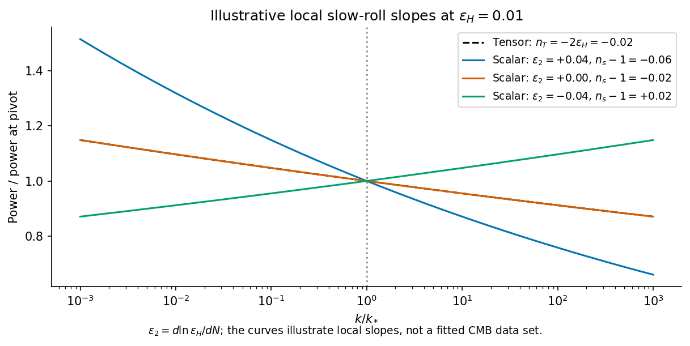

<h1 id="2/solution">Solution</h1>

↑ **Parent:** [2](../2.md)

Use the geodesic radial [comoving coordinate](../../../../comoving-coordinate.md), in which the [Friedmann-Lemaître-Robertson-Walker metric](../../../../friedmann-lemaitre-robertson-walker-metric.md) has the form

$$
\mathrm ds^2=-c^2\mathrm dt^2+
R^2(t)\left[\mathrm d\chi^2+S_k^2(\chi)\,\mathrm d\Omega^2\right].
$$

On a slice of constant [cosmic time](../../../../cosmic-time.md), the radial proper-length element is $R(t)\,\mathrm d\chi$. Therefore

$$
\boxed{D(t)=\int_0^\chi R(t)\,\mathrm d\chi'=R(t)\chi.}
$$

If one starts from a curvature coordinate with radial element $R\,\mathrm dr/\sqrt{1-kr^2}$, then $\chi=\int_0^r\mathrm dr'/\sqrt{1-kr'^2}$; the curvature coordinate $r$ itself is not generally the $\chi$ used above.

For a comoving [galaxy](../../../../galaxy-split.md), $\dot\chi=0$, so $\dot D=\dot R\chi=HD$. The definitions are

$$
\boxed{H=\frac{\dot R}{R},\qquad
q=-\frac{R\ddot R}{\dot R^2}
=-1-\frac{\dot H}{H^2}.}
$$

This recession law concerns proper distances on common cosmic-time slices. It is not a local special-relativistic relative velocity measurement; a large recession rate is not a signal exceeding the local speed of light.

For a comoving volume $V=V_0R^3$, total fluid energy is $E=\rho c^2V$. Adiabatic energy conservation gives $\mathrm dE+P\,\mathrm dV=0$. Expanding,

$$
c^2V\dot\rho+(\rho c^2+P)\dot V=0,\qquad
\dot V=3HV,
$$

hence

$$
\boxed{\dot\rho=-3H(\rho+P/c^2).}
$$

Here $\rho$ is mass-equivalent energy density. [Radiation](../../../../radiation.md) loses energy both by dilution and by pressure work; [pressureless matter](../../../../pressureless-matter.md) only dilutes in this description.

In the [time-unit convention for the cosmological constant](../../../../time-unit-convention-for-the-cosmological-constant.md), it represents a uniform vacuum contribution with pressure equal to minus its energy density. There is a units convention in the printed field equations: their term is $\Lambda/3$, so the symbol $\Lambda$ there has units of inverse time squared. If the geometrical constant is instead given in inverse length squared, this symbol equals $c^2\Lambda_{\rm geom}$. The curvature parameter $k$ labels constant-curvature spatial slices; with a conventional scale-factor normalization it is $+1,0,-1$ for positively curved, flat and negatively curved slices. It fixes local curvature sign, not every possible global spatial topology.

For a flat fluid-only model without a [cosmological constant](../../../../cosmological-constant.md) and with $P=w\rho c^2$, the two field equations give

$$
q=\frac{\tfrac{4\pi G}{3}(\rho+3P/c^2)}
{\tfrac{8\pi G}{3}\rho}
=\frac{1+3w}{2}.
$$

The two printed cases and their scale-factor laws are worked under the literal inline labels below.

Inflation is accelerated expansion, $\ddot R>0$, equivalently a decreasing [comoving Hubble radius](../../../../comoving-hubble-radius.md) $(RH)^{-1}$ on an expanding branch. An approximately constant positive vacuum-like energy can give nearly exponential expansion. Enough inflation can put regions now widely separated inside a common earlier causal patch, suppress $|k|/(RH)^2$ and dilute unwanted relics such as monopoles. These are the horizon, flatness and relic-abundance motivations. [Reheating](../../../../reheating.md) is needed to populate the subsequent hot universe. [Quantum fluctuations](../../../../quantum-fluctuation.md) can seed primordial perturbations, but inflation alone is not a universal solution to the initial singularity or a proof that all initial conditions inflate.

Now adopt the printed [natural units](../../../../natural-units.md) $c=\hbar=1$. For the [Homogeneous massive-scalar equation in an expanding universe](../../../../homogeneous-massive-scalar-equation-in-an-expanding-universe.md),

$$
\dot\rho=\dot\phi\,\ddot\phi+m^2\phi\dot\phi,\qquad
\rho+P=\dot\phi^2.
$$

The continuity equation gives

$$
\dot\phi\left(\ddot\phi+3H\dot\phi+m^2\phi\right)=0.
$$

Where $\dot\phi\ne0$, this implies the expanding-universe [Klein-Gordon equation](../../../../klein-gordon-equation.md)

$$
\boxed{\ddot\phi+3H\dot\phi+m^2\phi=0.}
$$

A regular canonical-field solution extends it through isolated turning points by continuity. Purely dividing the conservation equation does not determine a trajectory on an interval where $\dot\phi$ is identically zero; canonical field dynamics, or variation of its action, supplies the equation there. In particular a constant nonzero massive field is not an exact freely evolving solution.

With $\Lambda=k=0$,

$$
\frac{\ddot R}{R}
=-\frac{4\pi G}{3}(\rho+3P)
=-\frac{4\pi G}{3}(2\dot\phi^2-m^2\phi^2).
$$

Therefore

$$
\boxed{\ddot R>0\quad\Longleftrightarrow\quad
\dot\phi^2<\frac12m^2\phi^2.}
$$

This [inflation condition for a homogeneous massive scalar](../../../../inflation-condition-for-a-homogeneous-massive-scalar.md) means a potential-dominated field has sufficiently negative pressure to accelerate expansion. In quadratic [chaotic inflation](../../../../chaotic-inflation.md), a large initial field with $V=m^2\phi^2/2$ can enter slow roll, with $3H\dot\phi\simeq-m^2\phi$ and $H^2\simeq4\pi Gm^2\phi^2/3$. The [potential slow-roll parameter](../../../../potential-slow-roll-parameter.md) is $\epsilon_V=1/(4\pi G\phi^2)$, so a large field relative to the gravitational scale can support many e-folds. The field eventually rolls far enough that this regime ends and oscillation and [reheating](../../../../reheating.md) become relevant. Large [potential energy](../../../../potential-energy.md) with arbitrary initial [kinetic energy](../../../../kinetic-energy.md) does not by itself guarantee an inflationary interval.

Differentiating the flat [Friedmann equation](../../../../friedmann-equations.md) and then using the scalar equation,

$$
2H\dot H=\frac{8\pi G}{3}\dot\phi(\ddot\phi+m^2\phi)
=-8\pi GH\dot\phi^2.
$$

For the expanding branch,

$$
\boxed{\dot H=-4\pi G\dot\phi^2\leq0.}
$$

This [Nonincreasing Hubble rate for a canonical inflaton](../../../../nonincreasing-hubble-rate-for-a-canonical-inflaton.md) decreases strictly where the field rolls and can be momentarily stationary at a turning point; the statement “always decreasing” means nonincreasing. This does not conflict with acceleration, because $\ddot R/R=H^2+\dot H$ remains positive when $\epsilon_H=-\dot H/H^2<1$.

At horizon exit, larger comoving wavelengths leave earlier, when $H$ is larger. For a canonical field in slow roll, with [reduced Planck mass](../../../../reduced-planck-mass.md) $\overline M_{\rm Pl}=(8\pi G)^{-1/2}$,

$$
\mathcal P_T\simeq\frac{2H^2}{\pi^2\overline M_{\rm Pl}^{\,2}},
\qquad
n_T\simeq-2\epsilon_H\leq0.
$$

The decreasing expansion rate gives a red tensor tilt at this order. The scalar curvature spectrum also contains the conversion from field fluctuations to curvature:

$$
\mathcal P_{\mathcal R}\simeq
\frac{H^2}{8\pi^2\epsilon_H\overline M_{\rm Pl}^{\,2}},
\qquad
\boxed{n_s-1\simeq-2\epsilon_H-
\frac{\mathrm d\ln\epsilon_H}{\mathrm dN}.}
$$

Here $N=\ln R$ counts elapsed e-folds. Thus the [Decreasing Hubble rate does not alone fix scalar tilt](../../../../decreasing-hubble-rate-does-not-alone-fix-scalar-tilt.md). Evolution of $\epsilon_H$ matters. For the quadratic [slow-roll](../../../../slow-roll-approximation.md) model, $\eta_V=\epsilon_V$ and $n_s-1\simeq-6\epsilon_V+2\eta_V=-4\epsilon_V<0$. If $N_{\rm rem}$ e-folds remain until the end, leading estimates give $n_s\simeq1-2/N_{\rm rem}$ and [tensor-to-scalar ratio](../../../../tensor-to-scalar-ratio.md) $r_{\rm TS}\simeq8/N_{\rm rem}$, with small end-of-inflation corrections.

The relevant contemporary comparison is a nearly scale-invariant but red scalar spectrum. The February2015 Planck analysis reported $n_s=0.968\pm0.006$ for its temperature, low-polarization and lensing combination, and an upper limit $r_{0.002}<0.11$ at95percent confidence. The scalar tilt is qualitatively consistent with a slowly evolving [inflaton](../../../../inflaton.md), but that result does not establish the quadratic potential; its relatively large tensor prediction was already disfavored against lower-tensor alternatives in that analysis.[February2015 original version, abstract; dataset combination, spectral index and tensor bound](../../../../planck-2015-inflation-constraints-by-planck-collaboration.md)

**[Figure 2](#2/image-original-slow-roll-illustration-distinguishing-a-red-tensor-spectrum-from-the-additional-epsilon-evolution-controlling-scalar-tilt). Original slow-roll illustration distinguishing a red tensor spectrum from the additional epsilon evolution controlling scalar tilt**.

## ↑ Ancestors (13)

1. [2](../2.md)
2. [Paper 1](../../paper-1-split.md)
3. [2016](../../split.md)
4. [Past exam of the relativistic Astrophysics and Cosmology course of the University of Cambridge](../../../split.md)
5. [Relativistic Astrophysics and Cosmology course of the University of Cambridge](../../../../relativistic-astrophysics-and-cosmology-course-of-the-university-of-cambridge.md)
6. [Physics course of the year 4 of the natural sciences course of the University of Cambridge](../../../../physics-course-of-the-year-4-of-the-natural-sciences-course-of-the-university-of-cambridge.md)
7. [Year 4 of the natural sciences course of the University of Cambridge](../../../../year-4-of-the-natural-sciences-course-of-the-university-of-cambridge.md)
8. [Year of the natural sciences course of the University of Cambridge](../../../../year-of-the-natural-sciences-course-of-the-university-of-cambridge.md)
9. [Natural sciences course of the University of Cambridge](../../../../natural-sciences-course-of-the-university-of-cambridge.md)
10. [Course of the University of Cambridge](../../../../course-of-the-university-of-cambridge.md)
11. [University of Cambridge](../../../../university-of-cambridge-split.md)
12. [List of universities](../../../../list-of-universities.md)
13. [Codex Wiki](../../../../split.md)
