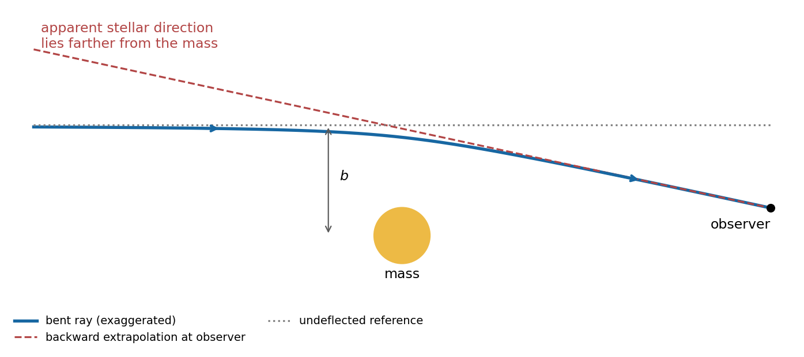
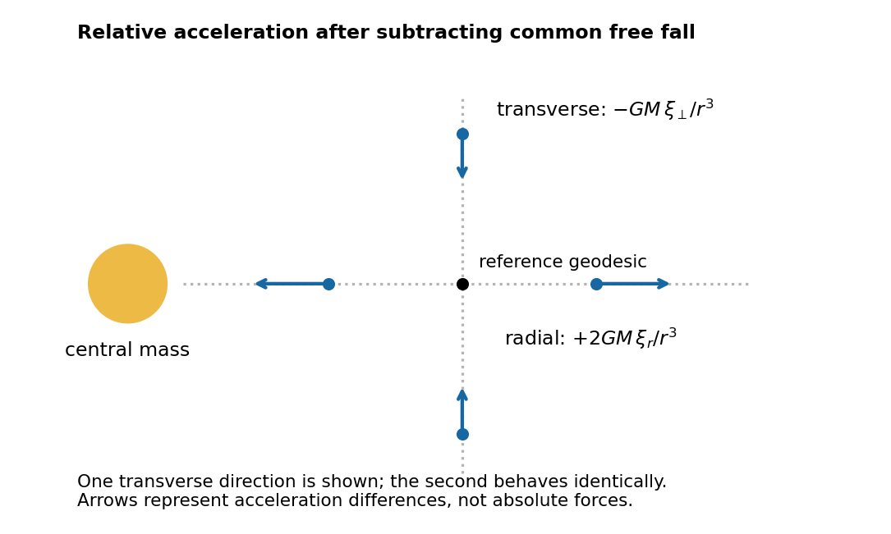
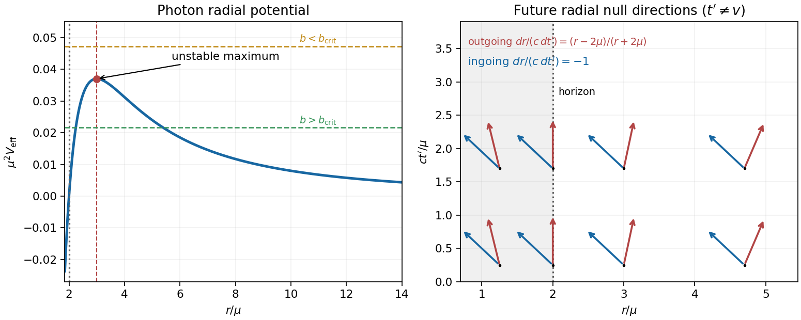

# Paper 1

↑ **Parent:** [2012](../2012.md)

Original source: [physical PDF pages 203–206; paper pages 1–4](https://www.whatdotheyknow.com/request/natural_science_tripos_physics_e_2/response/2340776/attach/2/FOI%202023%20399%20Zahid%20materials.pdf?cookie_passthrough=1). All three optional notes and both longer alternatives are answered below. The [metric signature](../../topological-manifold.md#metric-signature) is $+---$; Question 3 uses $c=1$.

**Table of contents**

- [1](#1)
  - [a](#1/a)
    - [Solution](#1/a/solution)
  - [b](#1/b)
    - [Solution](#1/b/solution)
  - [c](#1/c)
    - [Solution](#1/c/solution)
- [2](#2)
  - [a](#2/a)
    - [Solution](#2/a/solution)
  - [b](#2/b)
    - [Solution](#2/b/solution)
  - [c](#2/c)
    - [Solution](#2/c/solution)
- [3](#3)
  - [Solution](#3/solution)
- [4](#4)
  - [Solution](#4/solution)

## 1

↑ **Parent:** [Paper 1](paper-1.md)

<h3 id="1/a">a</h3>

↑ **Parent:** [1](#1)

<h4 id="1/a/solution">Solution</h4>

↑ **Parent:** [A](#1/a)

In the [rest frame](../../mathematical-physics.md#rest-frame), [conservation of energy](../../mathematical-physics.md#conservation-of-energy) would require $E_\gamma=mc^2$, whereas [conservation of momentum](../../momentum.md#momentum-conservation) would require the [photon](../../quantum-mechanics.md#photon) [momentum](../../momentum.md) to vanish. These contradict $|\mathbf p_\gamma|=E_\gamma/c$. More generally, [four-momentum](../../special-relativity.md#four-momentum) conservation would equate the initial massive [four-momentum](../../special-relativity.md#four-momentum) to a null [four-momentum](../../special-relativity.md#four-momentum), although their [Minkowski norms](../../special-relativity.md#minkowski-norm) differ:

$$
P_\mu P^\mu=m^2c^2>0,\qquad p_{\gamma\mu}p_\gamma^\mu=0.
$$

**An isolated massive particle cannot decay into one [photon](../../quantum-mechanics.md#photon) in any [inertial frame](../../mathematical-physics.md#inertial-frame).** Directly, a laboratory [speed](../../classical-mechanics.md#speed) $u<c$ gives $E=\gamma mc^2$ and $|\mathbf p|=\gamma mu$; matching a [photon](../../quantum-mechanics.md#photon) would require $E=c|\mathbf p|$, hence $u=c$. Recoil against another object could change the kinematics, but would introduce an additional participant.

<h3 id="1/b">b</h3>

↑ **Parent:** [1](#1)

<h4 id="1/b/solution">Solution</h4>

↑ **Parent:** [B](#1/b)

Write the [four-velocity](../../special-relativity.md#four-velocity) $U^\mu=\gamma(c,\mathbf v)$ and [four-acceleration](../../special-relativity.md#four-acceleration) $A^\mu=dU^\mu/d\tau$. Since $U_\mu A^\mu=0$, spatial [orthogonality](../../inner-product.md#orthogonal-vectors) $\mathbf U\cdot\mathbf A=0$ implies $U^0A^0=0$. Thus $A^0=c\,d\gamma/d\tau=0$ and **the [speed](../../classical-mechanics.md#speed) is constant**. If “[acceleration](../../classical-mechanics.md#acceleration)” is read as the laboratory three-acceleration instead, $\gamma\mathbf v\cdot d\mathbf v/dt=0$ immediately gives the same conclusion.

For [four-acceleration in uniform circular motion](../../special-relativity.md#four-acceleration-in-uniform-circular-motion), the [speed](../../classical-mechanics.md#speed) is $r|\omega|<c$, so $\gamma=(1-r^2\omega^2/c^2)^{-1/2}$ is constant. Differentiating the [four-velocity](../../special-relativity.md#four-velocity) using $d/d\tau=\gamma\,d/dt$ gives

$$
\boxed{A^\mu=\left(0,-\gamma^2r\omega^2\cos\omega t,
-\gamma^2r\omega^2\sin\omega t,0\right).}
$$

The [proper acceleration](../../special-relativity.md#proper-acceleration) is $\sqrt{-A_\mu A^\mu}=\gamma^2r\omega^2$. The vanishing time component reflects constant [energy](../../energy.md); the spatial components describe the changing [momentum](../../momentum.md) direction.

<h3 id="1/c">c</h3>

↑ **Parent:** [1](#1)

<h4 id="1/c/solution">Solution</h4>

↑ **Parent:** [C](#1/c)

The [geodesics of the product-weighted diagonal plane metric](../../riemannian-geometry.md#geodesics-of-the-product-weighted-diagonal-plane-metric) follow from the [geodesic Lagrangian](../../riemannian-geometry.md#geodesic-lagrangian) $L=(y^2\dot x^2+x^2\dot y^2)/2$. With dots denoting an [affine parameter](../../riemannian-geometry.md#affine-parameter) [derivative](../../calculus.md#derivative), its [Euler-Lagrange equations](../../analysis.md#euler-lagrange-equation) give

$$
\boxed{\begin{aligned}
y^2\ddot x+2y\dot y\dot x-x\dot y^2&=0,\\
x^2\ddot y+2x\dot x\dot y-y\dot x^2&=0.
\end{aligned}}
$$

Substituting $y=mx$ with constant nonzero $m$ reduces both equations to $x\ddot x+\dot x^2=0$. Thus $x\dot x$ is constant, and a suitable affine parametrization exists; explicitly, $x^2=C_1\lambda+C_2$ on a segment of fixed sign.

**These straight rays are [geodesics](../../riemannian-geometry.md#geodesic) only in the regular domain $xy\ne0$.** The [metric tensor](../../general-relativity.md#metric-tensor) [determinant](../../multilinear-algebra.md#determinant) is $x^2y^2$. On the axes, including the origin, this is a [degenerate metric tensor](../../general-relativity.md#degenerate-metric-tensor): the calculation does not establish a regular [geodesic](../../riemannian-geometry.md#geodesic) continuing through the origin. The slope-zero ray is outside the regular domain. Geometrically, on each quadrant the change $\rho=|xy|/\sqrt2$, $\vartheta=\log|y/x|$ gives $ds^2=d\rho^2+\rho^2d\vartheta^2$. A fixed slope has constant $\vartheta$ and is therefore locally a radial [geodesic](../../riemannian-geometry.md#geodesic) of a flat [metric tensor](../../general-relativity.md#metric-tensor).

## 2

↑ **Parent:** [Paper 1](paper-1.md)

<h3 id="2/a">a</h3>

↑ **Parent:** [2](#2)

<h4 id="2/a/solution">Solution</h4>

↑ **Parent:** [A](#2/a)

In [general relativity](../../general-relativity.md), [light](../../optics.md#light) follows [null geodesics](../../special-relativity.md#null-geodesic). A weak [gravitational field](../../physics.md#gravitational-field) outside an isolated spherical [mass](../../classical-mechanics.md#mass) gives the [Schwarzschild light deflection](../../schwarzschild-spacetime.md#schwarzschild-light-deflection)

$$
\boxed{\alpha=\frac{4GM}{bc^2}}
$$

for [impact parameter](../../classical-mechanics.md#impact-parameter) $b\gg GM/c^2$. At the solar limb this is approximately $1.75$ arcseconds. A Newtonian corpuscular calculation gives half this value; the full result depends on spatial [curvature](../../differential-geometry.md#curvature) as well as the [gravitational time dilation](../../general-relativity.md#gravitational-time-dilation). The [parametrized post-Newtonian formalism](../../general-relativity.md#parametrized-post-newtonian-formalism) predicts $\alpha=2(1+\gamma_{\rm PPN})GM/(bc^2)$, with $\gamma_{\rm PPN}=1$ in [general relativity](../../general-relativity.md).

**[Figure 1](#2/a/image-weak-field-light-deflection). Weak-field light deflection**.

The [Eddington experiment](../../schwarzschild-spacetime.md#eddington-experiment) compared photographic star positions near the eclipsed [Sun](../../stellar-astrophysics.md#sun) with reference exposures taken without the [Sun](../../stellar-astrophysics.md#sun) in that field. Rays bend toward the [Sun](../../stellar-astrophysics.md#sun), but their backward extrapolations place the apparent stellar images farther from it. Plate scale, focus changes, [atmospheric refraction](../../optics.md#atmospheric-refraction) and comparison-field alignment must be separated from a radial displacement proportional to $1/b$. The original report discusses the instruments, plate reductions and competing predicted deflections; the test is a quantitative comparison with uncertainty, not a unique proof of a gravitational theory.[1920, pp. 291–333: eclipse observations, instruments and plate reductions](../../physics-bibliography.md#a-determination-of-the-deflection-of-light-by-the-sun-s-gravitational-field-by-frank-watson-dyson-and-others)

[radio interferometry](../../astrophysics.md#radio-interferometry) permits an independent test without an eclipse. A 2005 [Very Long Baseline Array](../../astrophysics.md#very-long-baseline-array) experiment observed four compact sources at 43, 23 and 15 GHz. Differential [astrometry](../../astronomy.md#astrometry) suppressed common antenna errors, while a fit $\mathbf p(\nu)=\mathbf p_0+\mathbf I\nu^{-2}$ separated [refraction](../../optics.md#refraction) in the [solar corona](../../stellar-astrophysics.md#solar-corona) from achromatic gravitational deflection. Tropospheric errors and radio-source structure also required calibration. The reported $\gamma_{\rm PPN}=0.9998\pm0.0003$ was consistent with [general relativity](../../general-relativity.md).[2009, §§II–III on observations, calibration and coronal subtraction; §V on the reported result](../../physics-bibliography.md#progress-in-measurements-of-the-gravitational-bending-of-radio-waves-using-the-vlba-by-edward-fomalont-and-others)

<h3 id="2/b">b</h3>

↑ **Parent:** [2](#2)

<h4 id="2/b/solution">Solution</h4>

↑ **Parent:** [B](#2/b)

[tidal forces](../../newton-s-law-of-universal-gravitation.md#tidal-force) measure differences in [gravitational acceleration](../../newton-s-law-of-universal-gravitation.md#gravitational-acceleration) across an extended region. Neighboring freely falling particles each have zero [four-acceleration](../../special-relativity.md#four-acceleration), but their separation need not accelerate uniformly. Let $u^\mu$ be the tangent to a reference [timelike geodesic](../../general-relativity.md#timelike-geodesic) and $\xi^\mu$ its infinitesimal separation from a neighboring one, chosen from an affinely parametrized [geodesic congruence](../../geodesic-congruence.md). Using the [Riemann curvature tensor](../../riemann-curvature-tensor.md) convention specified in Solution 3,

$$
\frac{D^2\xi^\alpha}{D\tau^2}
=-R^\alpha{}_{\beta\gamma\delta}
u^\beta u^\gamma\xi^\delta .
$$

Changing the overall [curvature](../../differential-geometry.md#curvature) convention changes this displayed sign. The [covariant derivatives](../../general-relativity.md#covariant-derivative) compare [vectors](../../vector-space.md#vector) by [parallel transport](../../vector-bundle.md#parallel-transport), avoiding a coordinate-dependent subtraction of [accelerations](../../classical-mechanics.md#acceleration).

In the [Newtonian limit](../../linearized-gravity.md#newtonian-limit), expand the force field at two nearby points:

$$
\ddot\xi_i=-\partial_i\partial_j\Phi\,\xi_j.
$$

For $\Phi=-GM/r$, a local [orthonormal frame](../../general-relativity.md#orthonormal-frame-in-spacetime) aligned with the radius gives

$$
\boxed{\ddot{\boldsymbol\xi}
=\frac{GM}{r^3}\operatorname{diag}(2,-1,-1)\boldsymbol\xi.}
$$

There is radial stretching and transverse compression; the trace vanishes outside the [mass](../../classical-mechanics.md#mass). Two freely falling test [masses](../../classical-mechanics.md#mass) and a measurement of their changing separation implement [gravity gradiometry](../../newton-s-law-of-universal-gravitation.md#gravity-gradiometry). Their common [acceleration](../../classical-mechanics.md#acceleration) drops out, while a relative [acceleration](../../classical-mechanics.md#acceleration) proportional to separation remains. A [local inertial frame](../../mathematical-physics.md#local-inertial-frame) removes [Christoffel symbols](../../riemannian-geometry.md#christoffel-symbol) at a point, but cannot remove nonzero [curvature](../../differential-geometry.md#curvature) over a finite region.

**[Figure 2](#2/b/image-point-mass-tidal-deviation). Point-mass tidal deviation**.

<h3 id="2/c">c</h3>

↑ **Parent:** [2](#2)

<h4 id="2/c/solution">Solution</h4>

↑ **Parent:** [C](#2/c)

With Cartesian [Minkowski spacetime](../../special-relativity.md#minkowski-spacetime) coordinates $x^\mu=(ct,x,y,z)$, introduce the [four-current](../../electric-charge.md#four-current) $J^\mu=(c\rho,\mathbf J)$ and [electromagnetic four-potential](../../relativistic-electromagnetism.md#electromagnetic-four-potential) $\mathcal A^\mu=(\phi/c,\mathbf A)$. The antisymmetric [electromagnetic field tensor](../../relativistic-electromagnetism.md#electromagnetic-field-tensor) $F^{\mu\nu}=\partial^\mu\mathcal A^\nu-\partial^\nu\mathcal A^\mu$ has components $F^{0i}=-E_i/c$ and $F^{ij}=-\epsilon^{ijk}B_k$. [Maxwell equations](../../maxwell-equations.md) become

$$
\boxed{\partial_\mu F^{\mu\nu}=\mu_0J^\nu,\qquad
\partial_\mu\widetilde F^{\mu\nu}=0,}
\qquad
\widetilde F^{\mu\nu}=\frac12\epsilon^{\mu\nu\rho\sigma}F_{\rho\sigma},
\quad \epsilon^{0123}=+1.
$$

The time and space components reproduce [Gauss's law](../../maxwell-equations.md#gauss-s-law) and the [Ampère-Maxwell equation](../../maxwell-equations.md#ampere-s-circuital-law); the dual equation gives absence of [magnetic monopoles](../../mathematical-physics.md#magnetic-monopole) and [Faraday's law of induction](../../maxwell-equations.md#faraday-s-law-of-induction). Antisymmetry gives [charge conservation](../../electric-charge.md#charge-conservation) $\partial_\nu J^\nu=0$. The [relativistic Lorentz force](../../electromagnetism.md#relativistic-lorentz-force) is $dp^\mu/d\tau=qF^{\mu\nu}u_\nu$. Every displayed equation transforms tensorially under a [Lorentz transformation](../../special-relativity.md#lorentz-transformation); the [electric field](../../electric-field.md) and [magnetic field](../../magnetic-field.md) are different components of the same object.

Two independent algebraic [electromagnetic field invariants](../../relativistic-electromagnetism.md#electromagnetic-field-invariants) are

$$
\boxed{F_{\mu\nu}F^{\mu\nu}=2(B^2-E^2/c^2),\qquad
F_{\mu\nu}\widetilde F^{\mu\nu}=-4\mathbf E\cdot\mathbf B/c.}
$$

The second is a [pseudoscalar](../../quantum-mechanics.md#pseudoscalar): it is invariant under proper [Lorentz transformations](../../special-relativity.md#lorentz-transformation) but changes sign under [spatial reflection](../../quantum-mechanics.md#spatial-reflection). For perpendicular fields, the sign of the first distinguishes a frame with purely [magnetic field](../../magnetic-field.md) from one with purely [electric field](../../electric-field.md). Both invariants vanish for a [plane electromagnetic wave](../../electromagnetic-wave.md#plane-electromagnetic-wave) with $\mathbf E\perp\mathbf B$ and $E=cB$, although the field itself is nonzero.

## 3

↑ **Parent:** [Paper 1](paper-1.md)

<h3 id="3/solution">Solution</h3>

↑ **Parent:** [3](#3)

The [Einstein tensor](../../riemann-curvature-tensor.md#einstein-tensor) and its contractions are

$$
G_{\mu\nu}=R_{\mu\nu}-\frac12g_{\mu\nu}R,\qquad
R_{\mu\nu}=R^\alpha{}_{\mu\alpha\nu},\qquad
R=g^{\mu\nu}R_{\mu\nu}.
$$

To match the supplied [Ricci tensor](../../riemann-curvature-tensor.md#ricci-tensor) components, use the [Riemann curvature tensor](../../riemann-curvature-tensor.md) convention

$$
R^\rho{}_{\sigma\mu\nu}
=\partial_\nu\Gamma^\rho_{\mu\sigma}
-\partial_\mu\Gamma^\rho_{\nu\sigma}
+\Gamma^\rho_{\nu\lambda}\Gamma^\lambda_{\mu\sigma}
-\Gamma^\rho_{\mu\lambda}\Gamma^\lambda_{\nu\sigma}.
$$

This convention also fixes the sign used for [geodesic deviation](../../riemann-curvature-tensor.md#geodesic-deviation) above. In [vacuum](../../physics.md#vacuum), tracing the [Einstein field equations](../../einstein-field-equations.md) gives $-R+4\Lambda=0$. Substitution therefore yields **$R_{\mu\nu}=\Lambda g_{\mu\nu}$**.

Differentiate the angular field equation to obtain

$$
-2A'-rA''=2\Lambda r,\qquad
\frac{A'}r+\frac{A''}2=-\Lambda.
$$

Consequently $R_{00}=\Lambda A=\Lambda g_{00}$ and $R_{11}=-\Lambda/A=\Lambda g_{11}$. The other angular component follows from $R_{33}=\sin^2\theta\,R_{22}$. Thus the single angular equation implies all the displayed [vacuum](../../physics.md#vacuum) equations wherever this coordinate chart is regular.

Integrating $(rA)'=1-\Lambda r^2$ gives $A=1+C/r-\Lambda r^2/3$. Match $g_{tt}\simeq1+2\Phi$ with the [Newtonian gravitational potential](../../newton-s-law-of-universal-gravitation.md#newtonian-gravitational-potential) $\Phi=-GM/r$ in the weak-field overlap region to identify $C=-2GM$. Hence the [Schwarzschild-de Sitter spacetime](../../schwarzschild-spacetime.md#schwarzschild-de-sitter-spacetime) has

$$
\boxed{A(r)=1-\frac{2GM}{r}-\frac{\Lambda r^2}{3}\quad(c=1).}
$$

Negative $\Lambda$ instead gives the [Schwarzschild--anti-de Sitter black hole](../../black-hole.md#schwarzschild-anti-de-sitter-black-hole) case. This matching fixes the normalization locally; a spacetime with nonzero $\Lambda$ is not asymptotically flat.

For [timelike geodesics](../../general-relativity.md#timelike-geodesic) in the [orbital plane](../../celestial-mechanics.md#orbital-plane), take [proper time](../../special-relativity.md#proper-time) as parameter and use $L=(A\dot t^2-\dot r^2/A-r^2\dot\phi^2)/2$. The [cyclic coordinates](../../lagrangian-mechanics.md#cyclic-coordinate) give $A\dot t=k$ and $r^2\dot\phi=h$; the angular [canonical momentum](../../hamiltonian-mechanics.md#canonical-momentum) is $-h$ in this signature. The [four-velocity](../../special-relativity.md#four-velocity) normalization $2L=1$ then gives

$$
\boxed{\dot r^2=k^2-A(r)\left(1+\frac{h^2}{r^2}\right).}
$$

Here $k$ is conserved [Killing energy](../../killing-vector-field.md#killing-energy) per unit rest [mass](../../classical-mechanics.md#mass) in the chosen time normalization, and $h$ is conserved [angular momentum](../../momentum.md#angular-momentum) per unit rest [mass](../../classical-mechanics.md#mass). There is no general interpretation of $k$ as [energy](../../energy.md) measured at an asymptotically flat infinity when $\Lambda\ne0$.

For radial motion $h=0$, differentiation gives $2\dot r\ddot r=-A'\dot r$. The radial [Euler-Lagrange equation](../../analysis.md#euler-lagrange-equation) extends the resulting expression through a [turning point](../../energy.md#turning-point) where division by $\dot r$ would fail. Thus

$$
\boxed{\ddot r=-\frac{A'}2=-\frac{GM}{r^2}+\frac{\Lambda r}{3}\quad(c=1).}
$$

This is the proper-time second [derivative](../../calculus.md#derivative) of the [areal radius](../../general-relativity.md#areal-radius), not a nonzero [four-acceleration](../../special-relativity.md#four-acceleration) of the freely falling particle. Positive $\Lambda$ contributes an outward term; negative $\Lambda$ reinforces inward attraction. Restoring units in the slow-motion, weak-field [Newtonian limit](../../linearized-gravity.md#newtonian-limit) gives

$$
\boxed{\frac{d^2r}{dt^2}\simeq-\frac{GM}{r^2}+\frac{\Lambda c^2r}{3},\qquad
\Phi=-\frac{GM}{r}-\frac{\Lambda c^2r^2}{6}.}
$$

The extra term describes the gravitational effect of a [cosmological constant](../../cosmology.md#cosmological-constant), not drag or a contact force. The approximation requires $GM/(rc^2)\ll1$, $|\Lambda|r^2\ll1$ and [speed](../../classical-mechanics.md#speed) much less than $c$.

## 4

↑ **Parent:** [Paper 1](paper-1.md)

<h3 id="4/solution">Solution</h3>

↑ **Parent:** [4](#4)

Put $f=1-2\mu/r$ and let dots now denote an [affine parameter](../../riemannian-geometry.md#affine-parameter) [derivative](../../calculus.md#derivative). The [null geodesic](../../special-relativity.md#null-geodesic) [lagrangian](../../calculus-of-variations.md#lagrangian) in the [orbital plane](../../celestial-mechanics.md#orbital-plane) is $L=(fc^2\dot t^2-\dot r^2/f-r^2\dot\phi^2)/2$. The time and azimuthal [Euler-Lagrange equations](../../analysis.md#euler-lagrange-equation) integrate once; the null normalization gives

$$
f\dot t=k,\qquad r^2\dot\phi=h,\qquad
fc^2\dot t^2-\dot r^2/f-r^2\dot\phi^2=0.
$$

For completeness, the differential radial [geodesic equation](../../riemannian-geometry.md#geodesic-equation) is

$$
\ddot r+\frac{c^2ff'}2\dot t^2-\frac{f'}{2f}\dot r^2
-fr\dot\phi^2=0;
$$

the remaining differential equations are $\ddot t+(f'/f)\dot t\dot r=0$ and $\ddot\phi+2\dot r\dot\phi/r=0$. Spherical symmetry permits the equatorial choice.

Eliminating $\dot t,\dot\phi$ yields $\dot r^2+h^2f/r^2=c^2k^2$. For $h\ne0$, divide by $h^2$:

$$
\boxed{\frac{\dot r^2}{h^2}+V_{\rm eff}(r)=\frac1{b^2},\qquad
V_{\rm eff}=\frac1{r^2}-\frac{2\mu}{r^3},\qquad
b=\frac{|h|}{c|k|}.}
$$

The [impact parameter](../../classical-mechanics.md#impact-parameter) is unchanged by a common rescaling of the [affine parameter](../../riemannian-geometry.md#affine-parameter). At infinity it is $c$ times [angular momentum](../../momentum.md#angular-momentum) divided by [energy](../../energy.md). Radial [photons](../../quantum-mechanics.md#photon) have $h=0$ and obey the undivided equation $\dot r^2=c^2k^2$.

The [effective potential](../../mathematical-physics.md#effective-potential) is zero at $r=2\mu$, positive outside, and tends to zero as $r\to\infty$. Its [derivative](../../calculus.md#derivative) is $V'_{\rm eff}=2(3\mu-r)/r^4$. Thus

$$
\boxed{r_{\rm circ}=3\mu,\quad
V_{\rm eff}(3\mu)=\frac1{27\mu^2},\quad
b_{\rm crit}=3\sqrt3\,\mu.}
$$

The [circular null geodesic](../../schwarzschild-spacetime.md#circular-null-geodesic) lies at a maximum, since $V''_{\rm eff}(3\mu)=-2/(81\mu^4)<0$. It is **unstable**: a small radial displacement away from the maximum permits motion away from the orbit. For incoming [photons](../../quantum-mechanics.md#photon) from infinity in the exterior of a [black hole](../../black-hole.md), an outer [turning point](../../energy.md#turning-point) exists when $b>b_{\rm crit}$; for $b<b_{\rm crit}$ the [photon](../../quantum-mechanics.md#photon) can cross the [event horizon](../../black-hole.md#event-horizon). For a material central body, the [vacuum](../../physics.md#vacuum) circular orbit is relevant only if $3\mu$ lies outside its surface.

**[Figure 3](#4/image-photon-potential-and-horizon-penetrating-light-cones). Photon potential and horizon-penetrating light cones**.

For the new coordinates, set $q=2\mu/r$, so $f=1-q$. The [geodesic Lagrangian](../../riemannian-geometry.md#geodesic-lagrangian) is $L'=[fc^2\dot t'^2-2qc\dot t'\dot r-(1+q)\dot r^2-r^2\dot\phi^2]/2$. Cyclic-coordinate conservation and the null condition give the required analogous equations:

$$
\boxed{\begin{aligned}
f\dot t'-\frac q c\dot r&=k,& r^2\dot\phi&=h,\\
fc^2\dot t'^2-2qc\dot t'\dot r
-(1+q)\dot r^2-r^2\dot\phi^2&=0.
\end{aligned}}
$$

Here $k$ denotes the same conserved time-translation quantity as before. The transformation is $t'=t+(2\mu/c)\log|r/(2\mu)-1|$. In particular, the displayed time coordinate belongs to [Ingoing Kerr-Schild coordinates for Schwarzschild spacetime](../../general-relativity.md#ingoing-kerr-schild-coordinates-for-schwarzschild-spacetime); the usual advanced null coordinate of [ingoing Eddington-Finkelstein coordinates](../../schwarzschild-spacetime.md#ingoing-eddington-finkelstein-coordinates) is $v=t'+r/c$. Using a [metric tensor](../../general-relativity.md#metric-tensor) with a vanishing $dr^2$ coefficient while retaining the name $t'$ would therefore solve a different coordinate representation.

An elimination that stays finite at the horizon is especially simple:

$$
\begin{aligned}
c^2k^2-\dot r^2
&=(fc\dot t'-q\dot r)^2-\dot r^2\\
&=f\left[fc^2\dot t'^2-2qc\dot t'\dot r
-(1+q)\dot r^2\right]\\
&=f r^2\dot\phi^2=\frac{fh^2}{r^2}.
\end{aligned}
$$

The middle equality uses $q^2+f(1+q)=1$. Hence **the radial [energy](../../energy.md) equation and $V_{\rm eff}(r)$ are unchanged**, including the horizon limit. The radial [metric tensor](../../general-relativity.md#metric-tensor) block has [determinant](../../multilinear-algebra.md#determinant) $-c^2$ and is regular at $r=2\mu$. Its radial null directions are $dr/(c\,dt')=-1$ and $dr/(c\,dt')=f/(1+q)$, as shown in the original schematic.

This [coordinate invariance of the Schwarzschild photon radial potential](../../schwarzschild-spacetime.md#coordinate-invariance-of-the-schwarzschild-photon-radial-potential) follows because the transformation changes the time slicing but preserves the [areal radius](../../general-relativity.md#areal-radius) and the stationary [Killing vector field](../../killing-vector-field.md) $\partial_{t'}=\partial_t$. Consequently the conserved [Killing energy](../../killing-vector-field.md#killing-energy), [angular momentum](../../momentum.md#angular-momentum) and [impact parameter](../../classical-mechanics.md#impact-parameter) are the same. [photon](../../quantum-mechanics.md#photon) capture, the circular orbit and the radial [turning points](../../energy.md#turning-point) cannot depend on coordinate labels; coordinate velocities can.

## ↑ Ancestors (11)

1. [2012](../2012.md)
2. [Past exam of the relativity course of the University of Cambridge](../../past-exam-of-the-relativity-course-of-the-university-of-cambridge.md)
3. [Relativity course of the University of Cambridge](../../university-of-cambridge.md#relativity-course-of-the-university-of-cambridge)
4. [Physics course of the year 3 of the natural sciences course of the University of Cambridge](../../university-of-cambridge.md#physics-course-of-the-year-3-of-the-natural-sciences-course-of-the-university-of-cambridge)
5. [Year 3 of the natural sciences course of the University of Cambridge](../../university-of-cambridge.md#year-3-of-the-natural-sciences-course-of-the-university-of-cambridge)
6. [Year of the natural sciences course of the University of Cambridge](../../university-of-cambridge.md#year-of-the-natural-sciences-course-of-the-university-of-cambridge)
7. [Natural sciences course of the University of Cambridge](../../university-of-cambridge.md#natural-sciences-course-of-the-university-of-cambridge)
8. [Course of the University of Cambridge](../../university-of-cambridge.md#course-of-the-university-of-cambridge)
9. [University of Cambridge](../../university-of-cambridge.md)
10. [List of universities](../../README.md#list-of-universities)
11. [Codex Wiki](../../README.md)
