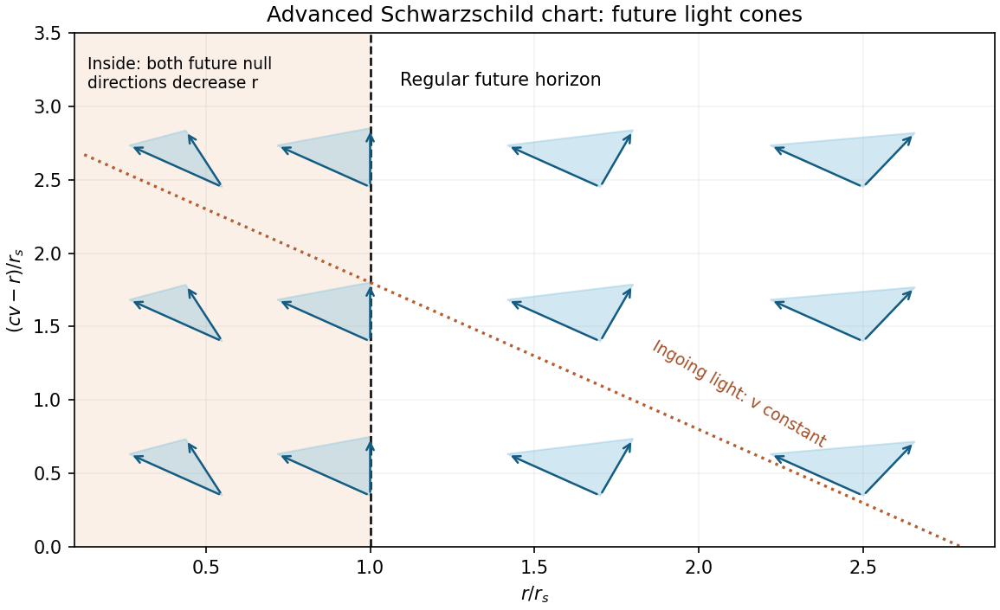
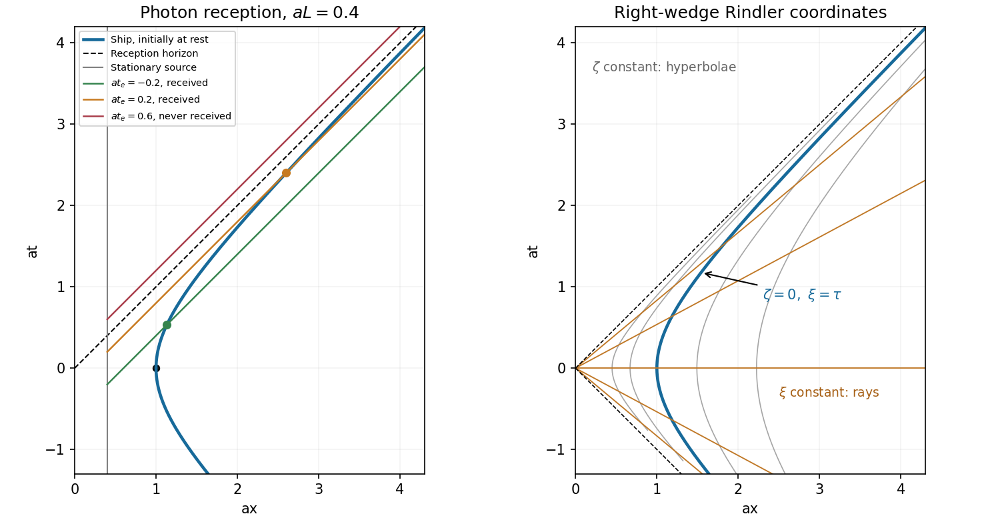
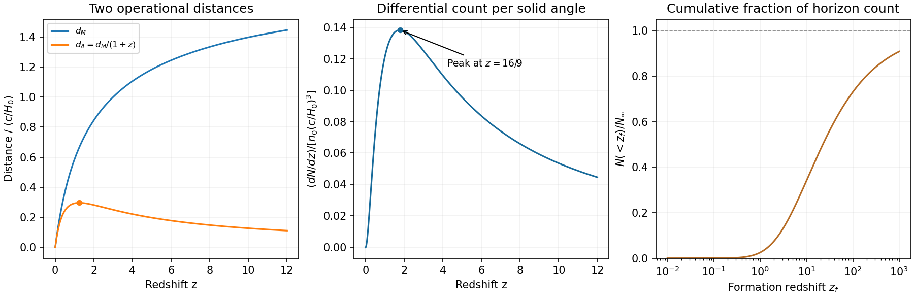

# Paper 1

↑ **Parent:** [2013](../2013.md)

[Original public PDF, physical pages 246–249](https://www.whatdotheyknow.com/request/natural_science_tripos_physics_e_2/response/2340776/attach/2/FOI%202023%20399%20Zahid%20materials.pdf?cookie_passthrough=1)

**Table of contents**

- [1](#1)
  - [a](#1/a)
    - [Solution](#1/a/solution)
  - [b](#1/b)
    - [Solution](#1/b/solution)
  - [c](#1/c)
    - [Solution](#1/c/solution)
- [2](#2)
  - [a](#2/a)
    - [Solution](#2/a/solution)
  - [b](#2/b)
    - [Solution](#2/b/solution)
  - [c](#2/c)
    - [Solution](#2/c/solution)
- [3](#3)
  - [Solution](#3/solution)
- [4](#4)
  - [Solution](#4/solution)

## 1

↑ **Parent:** [Paper 1](paper-1.md)

<h3 id="1/a">a</h3>

↑ **Parent:** [1](#1)

<h4 id="1/a/solution">Solution</h4>

↑ **Parent:** [A](#1/a)

Use the [angular-diameter ratio under a collinear boost](../../mathematical-physics.md#angular-diameter-ratio-under-a-collinear-boost), with motion along the common sightline and small angular radius $\vartheta$. For a boost toward the source, [relativistic aberration](../../mathematical-physics.md#relativistic-aberration) of the incoming light gives $\tan(\vartheta'/2)=e^{-\eta}\tan(\vartheta/2)$, where $\eta$ is the relative [rapidity](../../special-relativity.md#rapidity). Thus the observer seeing the smaller disk has [angular diameter](../../geometry-and-topology.md#angular-diameter) reduced by $e^{-\eta}$. The ratio two implies $e^\eta=2$, so

$$
\boxed{\frac{v_{\rm rel}}c=\tanh(\ln2)=\frac{2^2-1}{2^2+1}=\frac35}.
$$

The answer is **$0.60c$**. Both observations occur at one event, so this is a [relativistic aberration](../../mathematical-physics.md#relativistic-aberration) comparison rather than a change of geometrical distance during observation. Arbitrary transverse relative motion would require additional directional information; the stated motion toward the same distant target selects the collinear interpretation.

<h3 id="1/b">b</h3>

↑ **Parent:** [1](#1)

<h4 id="1/b/solution">Solution</h4>

↑ **Parent:** [B](#1/b)

For [geodesic motion of uncharged dust](../../stress-energy-tensor.md#geodesic-motion-of-uncharged-dust), use the pressureless stress-energy form, $T^{\mu\nu}=\rho u^\mu u^\nu$ and $u_\nu u^\nu=c^2$. [stress-energy conservation](../../stress-energy-tensor.md#stress-energy-conservation) expands to

$$
0=\nabla_\mu T^{\mu\nu}
=u^\nu\nabla_\mu(\rho u^\mu)+\rho u^\mu\nabla_\mu u^\nu.
$$

Contracting with $u_\nu$ kills the second term, since $u_\nu\nabla_\mu u^\nu=\tfrac12\nabla_\mu(c^2)=0$. Hence $\nabla_\mu(\rho u^\mu)=0$, and wherever $\rho>0$,

$$
\boxed{u^\mu\nabla_\mu u^\nu=0}.
$$

On a flow line $u^\mu=dx^\mu/d\tau$, so this becomes $d^2x^\nu/d\tau^2+\Gamma^\nu{}_{\alpha\beta}(dx^\alpha/d\tau)(dx^\beta/d\tau)=0$. Each [relativistic dust](../../stress-energy-tensor.md#relativistic-dust) element therefore follows a [timelike geodesic](../../general-relativity.md#timelike-geodesic) with [proper time](../../special-relativity.md#proper-time) as an [affine parameter](../../riemannian-geometry.md#affine-parameter). [pressure](../../pressure.md) gradients or external nongravitational [forces](../../force.md) would add an [acceleration](../../classical-mechanics.md#acceleration) term.

<h3 id="1/c">c</h3>

↑ **Parent:** [1](#1)

<h4 id="1/c/solution">Solution</h4>

↑ **Parent:** [C](#1/c)

The [Christoffel symbols of a spatially flat FLRW metric](../../cosmology.md#christoffel-symbols-of-a-spatially-flat-flrw-metric) depend on the time-coordinate convention. Here $x^0$ is $t$, not $ct$. For an [affine parameter](../../riemannian-geometry.md#affine-parameter) $\lambda$, take $\mathcal L=\tfrac12[c^2\dot t^2-a^2(t)\delta_{ij}\dot x^i\dot x^j]$. Its [Euler-Lagrange equations](../../analysis.md#euler-lagrange-equation) are

$$
\ddot t+\frac{aa'}{c^2}\delta_{ij}\dot x^i\dot x^j=0,\qquad
\ddot x^i+2\frac{a'}a\dot t\dot x^i=0.
$$

Comparison with the [geodesic equation](../../riemannian-geometry.md#geodesic-equation) gives

$$
\boxed{\Gamma^0{}_{ij}=\frac{aa'}{c^2}\delta_{ij},\qquad
\Gamma^i{}_{0j}=\Gamma^i{}_{j0}=\frac{a'}a\delta^i{}_j}.
$$

All others vanish because $g_{00}$ is constant and there are no spatial [metric tensor](../../general-relativity.md#metric-tensor) [derivatives](../../calculus.md#derivative). The lower-index interchange is essential: the printed list specifies one member of each symmetric mixed pair. The factor of two in the spatial [geodesic equation](../../riemannian-geometry.md#geodesic-equation) comes from those two members.

## 2

↑ **Parent:** [Paper 1](paper-1.md)

<h3 id="2/a">a</h3>

↑ **Parent:** [2](#2)

<h4 id="2/a/solution">Solution</h4>

↑ **Parent:** [A](#2/a)

Universality of [free fall](../../newton-s-law-of-universal-gravitation.md#free-fall) equates the passive gravitational response to [inertial mass](../../classical-mechanics.md#inertial-mass) up to a universal choice of units. The [Einstein equivalence principle](../../general-relativity.md#einstein-equivalence-principle) further states that local nongravitational experiments in a freely falling laboratory obey [special relativity](../../special-relativity.md) independently of the laboratory's location and [velocity](../../classical-mechanics.md#velocity). A supported laboratory instead has [proper acceleration](../../special-relativity.md#proper-acceleration), just as an accelerating laboratory in flat spacetime does.

Around an event, freely falling coordinates can be chosen so that $g_{\mu\nu}=\eta_{\mu\nu}$ and $\Gamma^\alpha{}_{\mu\nu}=0$ there. The first [metric tensor](../../general-relativity.md#metric-tensor) [derivatives](../../calculus.md#derivative) vanish at that event, and nearby corrections begin at order curvature times squared separation. The [metric tensor](../../general-relativity.md#metric-tensor)'s second [derivatives](../../calculus.md#derivative) retain the [Riemann tensor](../../riemann-curvature-tensor.md). Thus **a [local inertial frame](../../mathematical-physics.md#local-inertial-frame) removes [Christoffel symbols](../../riemannian-geometry.md#christoffel-symbol) at an event, while tidal gravity remains measurable over a finite region**. Relative motion of separated freely falling test particles detects this curvature through [geodesic deviation](../../riemann-curvature-tensor.md#geodesic-deviation). Freely falling axes carried along an observer's [world line](../../special-relativity.md#world-line) extend the local construction, but do not make an extended curved region globally Minkowskian.

<h3 id="2/b">b</h3>

↑ **Parent:** [2](#2)

<h4 id="2/b/solution">Solution</h4>

↑ **Parent:** [B](#2/b)

[accretion-disk tests of strong-field gravity](../../astrophysical-disk.md#accretion-disk-tests-of-strong-field-gravity) put radiating matter in a strong gravitational field at relativistic orbital speeds. [general relativity](../../general-relativity.md) predicts an [innermost stable circular orbit](../../astrophysical-black-hole.md#innermost-stable-circular-orbit), $r_{\rm ISCO}=6GM/c^2$ for a nonrotating [black hole](../../black-hole.md), with a spin-dependent radius in the [Kerr metric](../../general-relativity.md#kerr-metric). If the radiating inner edge tracks that orbit, its fitted radius and binding-energy release probe the geometry. For a thin disk with negligible inner-edge torque, $L\simeq\eta\dot Mc^2$; the Schwarzschild efficiency is $\eta=1-\sqrt{8/9}\simeq0.057$.

In [relativistic iron-line spectroscopy](../../astrophysical-disk.md#relativistic-iron-line-spectroscopy), a fluorescent iron line supplies a rest-energy reference. The [relativistic Doppler effect](../../wave.md#relativistic-doppler-effect) from orbital motion, [relativistic beaming](../../special-relativity.md#relativistic-beaming), [gravitational redshift](../../general-relativity.md#gravitational-redshift) and ray bending produce an asymmetric broadened profile, including a red wing from the deepest emitting radii. The ASCA observation of MCG-6-30-15 showed a broad asymmetric iron feature relative to the approximately $6.4\ \mathrm{keV}$ neutral-iron [energy](../../energy.md), interpreted through relativistic disk-line models.[Mission result description: broad iron line, low-energy asymmetry and relativistic interpretation](../../physics-bibliography.md#asca-mcg-6-30-15-by-nasa-heasarc) The observed line must be separated from the illuminating continuum, [absorption](../../radiometry.md#absorption-electromagnetic-radiation) and other [reflection](../../linear-algebra.md#reflection-mathematics) features; inclination, ionization and the radial illumination law affect the inferred radius.

[thermal-continuum fitting of an accretion disk](../../astrophysical-disk.md#thermal-continuum-fitting-of-an-accretion-disk) provides an independent method for a geometrically thin, optically thick disk. Its spectrum and normalization constrain a characteristic inner area, provided [mass](../../classical-mechanics.md#mass), distance, inclination and atmospheric spectral hardening are controlled. A pre-2013 application selected thermal-state observations of GRS 1915+105 at relatively low disk [luminosity](../../astrophysics.md#luminosity) to make the thin-disk approximation appropriate.[Abstract: relativistic continuum fit, thermal-state selection, luminosity cut and inner-edge assumptions](../../physics-bibliography.md#the-spin-of-the-near-extreme-kerr-black-hole-grs-1915-plus-105-by-jeffrey-e-mcclintock-and-others)

**Consistency among inner radius, line transfer and thermal emission tests the strong-field disk picture.** A [black-hole spin](../../astrophysical-black-hole.md#black-hole-spin) estimate obtained by assuming a [Kerr metric](../../general-relativity.md#kerr-metric) is not by itself a model-independent verification of [general relativity](../../general-relativity.md). Stress across the nominal inner edge, finite disk thickness, coronal geometry, calibration and competing [absorption](../../radiometry.md#absorption-electromagnetic-radiation) models must be constrained; a gravity test compares alternative geometries while allowing for those astrophysical uncertainties. An emitting material surface or boundary layer can further complicate disks around [neutron stars](../../stellar-astrophysics.md#neutron-star).

<h3 id="2/c">c</h3>

↑ **Parent:** [2](#2)

<h4 id="2/c/solution">Solution</h4>

↑ **Parent:** [C](#2/c)

Write $r_s=2GM/c^2$, $f=1-r_s/r$ and $r_*=r+r_s\ln|r/r_s-1|$, so $dr_*/dr=f^{-1}$. The [ingoing Eddington-Finkelstein coordinates](../../schwarzschild-spacetime.md#ingoing-eddington-finkelstein-coordinates) use $v=t+r_*/c$ to label ingoing radial light fronts. Substituting $dt=dv-dr/(cf)$ into the [Schwarzschild metric](../../schwarzschild-spacetime.md) gives

$$
\boxed{ds^2=fc^2dv^2-2c\,dv\,dr-r^2d\Omega^2}.
$$

The radial block has [determinant](../../multilinear-algebra.md#determinant) $-c^2$ even at $r=r_s$; its coefficients have no horizon divergence. The apparent singularity of Schwarzschild time at the future horizon is therefore a coordinate failure. The physical [curvature singularity](../../general-relativity.md#curvature-singularity) at $r=0$ remains.

The [radial null trajectories in ingoing Eddington-Finkelstein coordinates](../../schwarzschild-spacetime.md#radial-null-trajectories-in-ingoing-eddington-finkelstein-coordinates) have

$$
\boxed{v=\text{constant}\quad\text{(ingoing)},\qquad
\frac{dr}{dv}=\frac c2\left(1-\frac{r_s}r\right)\quad\text{(outgoing)}}.
$$

The ingoing family crosses the future horizon smoothly. The outgoing family has zero outward radial coordinate speed at the horizon and decreasing radius inside it; both future null directions then lead toward smaller radius. These advanced coordinates cover the exterior and future black-hole horizon, rather than simultaneously regularizing the past white-hole horizon. Their null time coordinate is not a clock reading of a stationary observer.

**[Figure 1](#2/c/image-original-future-light-cone-schematic-in-regular-advanced-schwarzschild-coordinates-using-vertical-coordinate-cv-minus-r). Original future light-cone schematic in regular advanced Schwarzschild coordinates, using vertical coordinate cv minus r**.

## 3

↑ **Parent:** [Paper 1](paper-1.md)

<h3 id="3/solution">Solution</h3>

↑ **Parent:** [3](#3)

Throughout this solution $c=1$ and $a>0$.

**Null [metric tensor](../../general-relativity.md#metric-tensor) and boost.** Inverting the coordinate definitions gives $t=(p+q)/2$, $x=(q-p)/2$, and hence

$$
\boxed{ds^2=dp\,dq,\qquad
(g_{AB})_{p,q}=\begin{pmatrix}0&1/2\\1/2&0\end{pmatrix}}.
$$

For a frame moving at speed $v$ along positive $x$, use $t'=\gamma(t-vx)$, $x'=\gamma(x-vt)$. Their difference and sum give

$$
\boxed{p'=\alpha p,\qquad q'=q/\alpha,\qquad
\alpha=\gamma(1+v)=\sqrt{\frac{1+v}{1-v}}}.
$$

The reciprocal [scale factors](../../cosmology.md#scale-factor-cosmology) preserve $dp\,dq$. They are $e^{\pm\eta_v}$ in [rapidity](../../special-relativity.md#rapidity) notation.

**[acceleration](../../classical-mechanics.md#acceleration) invariants.** Proper-time normalization gives $\dot t^2-\dot x^2=1$, so $\dot p\dot q=1$. The [four-acceleration](../../special-relativity.md#four-acceleration) has squared norm $\ddot t^2-\ddot x^2=-a^2$; therefore

$$
\boxed{\dot p\dot q=1,\qquad\ddot p\ddot q=-a^2}.
$$

For future motion write $\dot p=e^{-\eta}$ and $\dot q=e^\eta$. Then the second equation is $-(\dot\eta)^2=-a^2$. [acceleration](../../classical-mechanics.md#acceleration) toward positive $x$ selects $\eta=\eta_0+a\tau$.

**[hyperbolic motion from an initial event and rapidity](../../special-relativity.md#hyperbolic-motion-from-an-initial-event-and-rapidity).** The stated initial event fixes $p(0)=-1/a$, $q(0)=1/a$, but not the initial [rapidity](../../special-relativity.md#rapidity) $\eta_0$. Integrating with positive signed [acceleration](../../classical-mechanics.md#acceleration) gives the general family

$$
p=-\frac1a+\frac{e^{-\eta_0}}a(1-e^{-a\tau}),\qquad
q=\frac1a+\frac{e^{\eta_0}}a(e^{a\tau}-1).
$$

The initial event alone does not fix the initial [velocity](../../classical-mechanics.md#velocity) or signed [acceleration](../../classical-mechanics.md#acceleration). The trajectory explicitly requested in the next paragraph selects the additional conditions $\eta_0=0$ and positive-$x$ [acceleration](../../classical-mechanics.md#acceleration). With that convention,

$$
\boxed{p(\tau)=-\frac1ae^{-a\tau},\qquad
q(\tau)=\frac1ae^{a\tau}},
$$

and consequently

$$
\boxed{t(\tau)=\frac1a\sinh a\tau,\qquad
x(\tau)=\frac1a\cosh a\tau}.
$$

With arbitrary $\eta_0$ the equivalent expressions are $t=[\sinh(\eta_0+a\tau)-\sinh\eta_0]/a$ and $x=1/a+[\cosh(\eta_0+a\tau)-\cosh\eta_0]/a$. Thus position data alone do not select the displayed special [hyperbola](../../euclidean-geometry.md#hyperbola). The following calculations use that intended [hyperbola](../../euclidean-geometry.md#hyperbola), which is also explicitly given by the paper.

**Diagram and horizon.** The selected [world line](../../special-relativity.md#world-line) is the right-hand branch $x^2-t^2=a^{-2}$. Its future asymptote $x=t$ is a reception horizon: rightmoving signals have constant $p=t-x$, whereas the observer has $p<0$ and approaches zero only as $\tau\to\infty$. Events with $p\geq0$ cannot send a future signal to this observer if the [acceleration](../../classical-mechanics.md#acceleration) continues indefinitely. This is an observer-dependent causal restriction in flat spacetime, not a [curvature singularity](../../general-relativity.md#curvature-singularity).

**[photon reception by a uniformly accelerated observer](../../special-relativity.md#photon-reception-by-a-uniformly-accelerated-observer).** A rightmoving [photon](../../quantum-mechanics.md#photon) from the stationary source has [four-momentum](../../special-relativity.md#four-momentum) $P^\mu=h\nu_0(1,1)$. Contracting with the observer's [four-velocity](../../special-relativity.md#four-velocity) gives

$$
\boxed{\nu(\tau)=\nu_0(\dot t-\dot x)=\nu_0\dot p=\nu_0e^{-a\tau}}.
$$

The same result follows by differentiating its emission-time relation. A [photon](../../quantum-mechanics.md#photon) emitted at $x=L$ and time $t_e$ has $p=t_e-L$, so intersection requires

$$
\boxed{t_e=L-\frac1ae^{-a\tau}<L}.
$$

Thus **$t_e=L$ is the supremum of receivable emission times**, reached only in the limit of infinite receiver [proper time](../../special-relativity.md#proper-time). A [photon](../../quantum-mechanics.md#photon) emitted exactly then lies on the horizon and is never received at finite time; later [photons](../../quantum-mechanics.md#photon) cannot catch the ship. Restoring dimensions gives the limiting emission time $L/c$ for this chosen origin and trajectory.

**[Rindler coordinates](../../special-relativity.md#rindler-coordinates).** Substitution of the selected trajectory into the [coordinate transformation](../../differential-geometry.md#smooth-transition-map) gives

$$
\boxed{\xi(\tau)=\tau,\qquad\zeta(\tau)=0}.
$$

Differentiating the transformation also gives $ds^2=e^{2a\zeta}(d\xi^2-d\zeta^2)$. Curves of fixed $\zeta$ are hyperbolae, while curves of fixed $\xi$ are straight rays $t/x=\tanh(a\xi)$ within the right wedge. The coordinate $\xi$ is the selected ship's proper clock; at another fixed $\zeta$, [proper time](../../special-relativity.md#proper-time) obeys $d\tau_\zeta=e^{a\zeta}d\xi$. The spatial coordinate is logarithmic in $\rho=\sqrt{x^2-t^2}=e^{a\zeta}/a$, rather than being proper distance itself. Fixed-$\zeta$ observers have [proper acceleration](../../special-relativity.md#proper-acceleration) $a e^{-a\zeta}$.

**[Figure 2](#3/image-original-accelerated-worldline-reception-horizon-and-stellar-photon-rays-with-a-separate-rindler-coordinate-grid). Original accelerated worldline, reception horizon and stellar photon rays, with a separate Rindler coordinate grid**.

## 4

↑ **Parent:** [Paper 1](paper-1.md)

<h3 id="4/solution">Solution</h3>

↑ **Parent:** [4](#4)

**[redshift](../../optics.md#redshift).** An incoming radial null ray satisfies $d\chi=-c\,dt/R(t)$. Consecutive wave crests follow the same comoving path, so the endpoint changes in the fixed path [integral](../../integral.md) obey $dt_0/R_0=dt_e/R_e$. Comoving clocks read [cosmic time](../../cosmology.md#cosmic-time); hence their measured periods and frequencies satisfy

$$
\boxed{1+z=\frac{\lambda_0}{\lambda_e}=\frac{dt_0}{dt_e}=\frac{R_0}{R_e}}.
$$

The physical [wavelength](../../wave-equation.md#wavelength) stretches with the [scale factor](../../cosmology.md#scale-factor-cosmology) during propagation. It is not necessary to assign a unique global inertial-frame recession [velocity](../../classical-mechanics.md#velocity) to a distant source.

**Radial coordinate and [cosmological look-back time](../../cosmology.md#cosmological-look-back-time).** Differentiating $1+z=R_0/R(t)$ gives $dz/dt=-(1+z)H(z)$. Combining this with the null-ray [integral](../../integral.md) yields

$$
\boxed{\chi(z)=\frac c{R_0}\int_0^z\frac{d\bar z}{H(\bar z)},\qquad
t_0-t_e=\int_0^z\frac{d\bar z}{(1+\bar z)H(\bar z)}}.
$$

The extra factor $1+z$ in the second denominator records the conversion from scale-factor change to elapsed [cosmic time](../../cosmology.md#cosmic-time).

**[proper-motion distance](../../cosmology.md#proper-motion-distance).** A small transverse displacement at emission has proper length $d\ell=R_eS(\chi)d\theta$. Define its source-frame transverse speed as $v=d\ell/dt_e$; [cosmological time dilation](../../cosmology.md#cosmological-time-dilation) makes $dt_0=(1+z)dt_e$. Therefore

$$
\dot\theta_0=\frac{v}{(1+z)R_eS(\chi)},\qquad
\boxed{d_M=\frac v{\dot\theta_0}=R_0S(\chi(z))}.
$$

Equivalently, $d_M=(1+z)d_A$, where the [angular diameter distance](../../cosmology.md#angular-diameter-distance) is $d_A=R_eS(\chi)$. The observer-time versus source-time distinction is essential. This calculation uses the stated transverse speed convention and the homogeneous background, without additional peculiar radial [relativistic Doppler effect](../../wave.md#relativistic-doppler-effect) or [gravitational lensing](../../gravitational-lensing.md).

**[redshift shell volume at the present epoch](../../cosmology.md#redshift-shell-volume-at-the-present-epoch).** The induced spatial [metric tensor](../../general-relativity.md#metric-tensor) on the present slice gives $dV_0=R_0^3S^2(\chi)d\chi\,d\Omega$. Since $d\chi/dz=c/(R_0H)$,

$$
\boxed{dV_0=\frac{cR_0^2S^2(\chi(z))}{H(z)}\,dz\,d\Omega
=\frac{cd_M^2(z)}{H(z)}\,dz\,d\Omega}.
$$

This is the volume at the present epoch of the comoving shell intersected by the past [light cone](../../special-relativity.md#light-cone). Its proper volume at emission is smaller by $(1+z)^3$; a conserved population's proper [number density](../../statistical-physics.md#number-density) is larger by the same factor, preserving its count.

**[Einstein-de Sitter cumulative number counts](../../cosmology.md#einstein-de-sitter-cumulative-number-counts).** In flat geometry $S(\chi)=\chi$. Inserting the stated [Hubble parameter](../../cosmology.md#hubble-parameter) into the radial [integral](../../integral.md) gives

$$
d_M(z)=\frac{2c}{H_0}\left[1-(1+z)^{-1/2}\right].
$$

The constant present-volume [number density](../../statistical-physics.md#number-density) makes $dN=n_0dV_0$. With no members of the population before its formation epoch,

$$
\boxed{N=\frac{4c^3n_0}{H_0^3}\int_0^{z_f}
\frac{[1-(1+z)^{-1/2}]^2}{(1+z)^{3/2}}\,dz}.
$$

As an independent check, substitution $u=(1+z)^{-1/2}$ evaluates this to

$$
\boxed{N=\frac{8c^3n_0}{3H_0^3}\left[1-(1+z_f)^{-1/2}\right]^3
=\frac{n_0d_M^3(z_f)}3}.
$$

This is exactly the Euclidean [comoving volume](../../cosmology.md#comoving-volume) per unit [solid angle](../../euclidean-geometry.md#solid-angle) in the flat model. It assumes a complete count with the specified fixed population; [luminosity](../../astrophysics.md#luminosity) selection, mergers or subsequent number-density evolution would require additional factors.

**[Figure 3](#4/image-original-einstein-de-sitter-proper-motion-and-angular-diameter-distances-differential-counts-and-cumulative-fraction). Original Einstein-de Sitter proper-motion and angular diameter distances, differential counts and cumulative fraction**.

## ↑ Ancestors (11)

1. [2013](../2013.md)
2. [Past exam of the relativity course of the University of Cambridge](../../past-exam-of-the-relativity-course-of-the-university-of-cambridge.md)
3. [Relativity course of the University of Cambridge](../../university-of-cambridge.md#relativity-course-of-the-university-of-cambridge)
4. [Physics course of the year 3 of the natural sciences course of the University of Cambridge](../../university-of-cambridge.md#physics-course-of-the-year-3-of-the-natural-sciences-course-of-the-university-of-cambridge)
5. [Year 3 of the natural sciences course of the University of Cambridge](../../university-of-cambridge.md#year-3-of-the-natural-sciences-course-of-the-university-of-cambridge)
6. [Year of the natural sciences course of the University of Cambridge](../../university-of-cambridge.md#year-of-the-natural-sciences-course-of-the-university-of-cambridge)
7. [Natural sciences course of the University of Cambridge](../../university-of-cambridge.md#natural-sciences-course-of-the-university-of-cambridge)
8. [Course of the University of Cambridge](../../university-of-cambridge.md#course-of-the-university-of-cambridge)
9. [University of Cambridge](../../university-of-cambridge.md)
10. [List of universities](../../README.md#list-of-universities)
11. [Codex Wiki](../../README.md)
