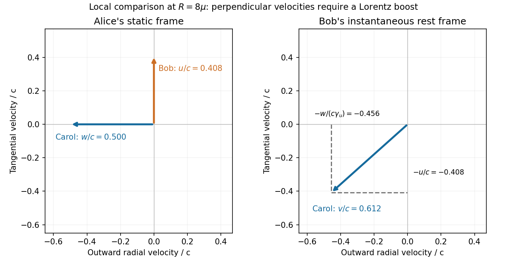

# Paper 1

↑ **Parent:** [2014](../2014.md)

[Original public PDF, physical pages 291–294](https://www.whatdotheyknow.com/request/natural_science_tripos_physics_e_2/response/2340776/attach/2/FOI%202023%20399%20Zahid%20materials.pdf?cookie_passthrough=1)

**Table of contents**

- [1](#1)
  - [a](#1/a)
    - [Solution](#1/a/solution)
  - [b](#1/b)
    - [Solution](#1/b/solution)
  - [c](#1/c)
    - [Solution](#1/c/solution)
- [2](#2)
  - [a](#2/a)
    - [Solution](#2/a/solution)
  - [b](#2/b)
    - [Solution](#2/b/solution)
  - [c](#2/c)
    - [Solution](#2/c/solution)
- [3](#3)
  - [Solution](#3/solution)
- [4](#4)
  - [Solution](#4/solution)

## 1

↑ **Parent:** [Paper 1](paper-1.md)

<h3 id="1/a">a</h3>

↑ **Parent:** [1](#1)

<h4 id="1/a/solution">Solution</h4>

↑ **Parent:** [A](#1/a)

With $\gamma=(1-v^2/c^2)^{-1/2}$, [four-momentum conservation](../../special-relativity.md#four-momentum-conservation) gives total [energy](../../energy.md) $E=(\gamma m_1+m_2)c^2$ and [momentum](../../momentum.md) $\mathbf p=\gamma m_1\mathbf v$. The compound system therefore has

$$
\boxed{M=\sqrt{m_1^2+m_2^2+2\gamma m_1m_2},\qquad
\mathbf V=\frac{\gamma m_1}{\gamma m_1+m_2}\mathbf v}.
$$

Here $M^2c^4=E^2-c^2p^2$. The excess over $m_1+m_2$ is retained [internal energy](../../internal-energy.md), assuming [absorption](../../radiometry.md#absorption-electromagnetic-radiation) without escaping [radiation](../../physics.md#radiation).

<h3 id="1/b">b</h3>

↑ **Parent:** [1](#1)

<h4 id="1/b/solution">Solution</h4>

↑ **Parent:** [B](#1/b)

On a coordinate patch with $f\ne0$, $g_{xx}=1$, $g_{yy}=f^2$ and the only nonzero [metric tensor](../../general-relativity.md#metric-tensor) [derivative](../../calculus.md#derivative) is $\partial_xg_{yy}=2ff'$. Thus

$$
\boxed{\Gamma^x{}_{yy}=-ff',\qquad
\Gamma^y{}_{xy}=\Gamma^y{}_{yx}=\frac{f'}f}.
$$

All remaining [Christoffel symbols](../../riemannian-geometry.md#christoffel-symbol) vanish. In the supplied [Riemann tensor](../../riemann-curvature-tensor.md) convention,

$$
R^x{}_{yxy}=\partial_x(-ff')-\Gamma^y{}_{yx}\Gamma^x{}_{yy}
=-(f'^2+ff'')+f'^2,
\qquad
\boxed{R^x{}_{yxy}=-ff''}.
$$

For example, $f=x$ is flat away from the polar-coordinate origin, while $f=\sin x$ gives positive [Gaussian curvature](../../second-fundamental-form.md#gaussian-curvature) $-f''/f=1$.

<h3 id="1/c">c</h3>

↑ **Parent:** [1](#1)

<h4 id="1/c/solution">Solution</h4>

↑ **Parent:** [C](#1/c)

Use the largest Newtonian tidal-tensor [eigenvalue](../../linear-operator-theory.md#eigenvalue), the radial [gravity](../../physics.md#gravity) gradient $2GM/r^3$. Imposing the supplied gradient threshold gives

$$
\boxed{r_{\min}\simeq\left(\frac{2GM}{100\ \mathrm{s^{-2}}}\right)^{1/3}
=1.59\times10^6\ \mathrm m}.
$$

This is **about $1590\ \mathrm{km}$ from the centre**, or $1580\ \mathrm{km}$ above the stated surface. The tangential [eigenvalues](../../linear-operator-theory.md#eigenvalue) have half the radial magnitude. Since $GM/(r_{\min}c^2)\simeq1.4\times10^{-3}$, the Newtonian tidal estimate is adequate; this calculation uses the given threshold without inferring any additional material-response model.

## 2

↑ **Parent:** [Paper 1](paper-1.md)

<h3 id="2/a">a</h3>

↑ **Parent:** [2](#2)

<h4 id="2/a/solution">Solution</h4>

↑ **Parent:** [A](#2/a)

[inertial mass](../../classical-mechanics.md#inertial-mass) sets the response to [force](../../force.md), $\mathbf F=m_i\mathbf a$. Passive [gravitational mass](../../classical-mechanics.md#gravitational-mass) sets the response to a given [gravitational potential](../../newton-s-law-of-universal-gravitation.md#newtonian-potential-of-a-point-mass), $\mathbf F_g=-m_g\nabla\Phi$; active [gravitational mass](../../classical-mechanics.md#gravitational-mass) describes a body's gravitational sourcing. Universality of the passive-to-inertial mass ratio makes freely falling trajectories independent of composition. [torsion balance](../../classical-mechanics.md#torsion-balance) comparisons and differential free-fall experiments test this [weak equivalence principle](../../general-relativity.md#weak-equivalence-principle) by searching for composition-dependent acceleration, with environmental [forces](../../force.md) and instrumental asymmetries controlled.

The [Einstein equivalence principle](../../general-relativity.md#einstein-equivalence-principle) further says that local nongravitational experiments in a freely falling laboratory obey [special relativity](../../special-relativity.md), independent of the laboratory's location and [velocity](../../classical-mechanics.md#velocity). A local inertial coordinate system can remove [Christoffel symbols](../../riemannian-geometry.md#christoffel-symbol) at one event, but cannot remove a nonzero [Riemann tensor](../../riemann-curvature-tensor.md) throughout a finite region. Relative acceleration of separated freely falling particles reveals tidal [gravity](../../physics.md#gravity). Thus a uniformly accelerating laboratory in flat [spacetime](../../special-relativity.md#spacetime) can mimic a local gravitational field, while extended tidal measurements distinguish genuine curvature. Equality of the measured mass responses does not make every gravitational field globally equivalent to acceleration.

<h3 id="2/b">b</h3>

↑ **Parent:** [2](#2)

<h4 id="2/b/solution">Solution</h4>

↑ **Parent:** [B](#2/b)

Use coordinates $x^\mu=(ct,\mathbf x)$, signature $(+---)$, and the convention $F^{0i}=-E_i/c$, $F^{ij}=-\epsilon_{ijk}B_k$. The antisymmetric [electromagnetic field tensor](../../relativistic-electromagnetism.md#electromagnetic-field-tensor) combines six field components:

$$
F^{\mu\nu}=
\begin{pmatrix}
0&-E_x/c&-E_y/c&-E_z/c\\
E_x/c&0&-B_z&B_y\\
E_y/c&B_z&0&-B_x\\
E_z/c&-B_y&B_x&0
\end{pmatrix}.
$$

It transforms as $F'^{\mu\nu}=\Lambda^\mu{}_\alpha\Lambda^\nu{}_\beta F^{\alpha\beta}$. Lowering indices changes the time–space signs: $F_{0i}=E_i/c$, while $F_{ij}=F^{ij}$. The [covariant tensor](../../multilinear-algebra.md#covariant-tensor) instead uses the inverse coordinate Jacobian on each lower index.

For a frame moving with [velocity](../../classical-mechanics.md#velocity) $\mathbf v$ relative to the original one,

$$
\boxed{\mathbf E'_\parallel=\mathbf E_\parallel,\quad
\mathbf E'_\perp=\gamma(\mathbf E+\mathbf v\times\mathbf B)_\perp},
$$

$$
\boxed{\mathbf B'_\parallel=\mathbf B_\parallel,\quad
\mathbf B'_\perp=\gamma\left(\mathbf B-\frac{\mathbf v\times\mathbf E}{c^2}\right)_\perp}.
$$

Electric and [magnetic fields](../../magnetic-field.md) therefore mix under a boost; they are frame-dependent parts of one tensor. For example, a purely transverse [electric field](../../electric-field.md) acquires a [magnetic field](../../magnetic-field.md) in a boosted frame. The [electromagnetic field invariants](../../relativistic-electromagnetism.md#electromagnetic-field-invariants) $B^2-E^2/c^2$ and $\mathbf E\cdot\mathbf B$ restrict which fields can be eliminated by a frame change. The covariant [force](../../force.md) law $dp^\mu/d\tau=qF^\mu{}_\nu U^\nu$ guarantees consistent particle dynamics in all [inertial frames](../../mathematical-physics.md#inertial-frame).

<h3 id="2/c">c</h3>

↑ **Parent:** [2](#2)

<h4 id="2/c/solution">Solution</h4>

↑ **Parent:** [C](#2/c)

The strongest pre-2014 evidence combines large gravitating mass with extreme compactness. In an [X-ray binary](../../stellar-astrophysics.md#x-ray-binary), companion-star radial velocities determine a [binary mass function](../../stellar-astrophysics.md#binary-mass-function); [orbital inclination](../../celestial-mechanics.md#orbital-inclination), donor properties and distance complete the mass inference. An unseen component above conventional neutron-star [masses](../../classical-mechanics.md#mass) is a black-hole candidate. For example, a 2011 Cygnus X-1 analysis combined optical photometry, spectroscopy and distance information to infer a compact-object mass about $14.8M_\odot$, with model and observational uncertainties.[Abstract and dynamical-model analysis](../../physics-bibliography.md#the-mass-of-the-black-hole-in-cygnus-x-1-by-jerome-a-orosz-and-others)

Near [Sagittarius A\*](../../astrophysical-black-hole.md#sagittarius-a), infrared stellar [astrometry](../../astronomy.md#astrometry) and radial velocities trace nearly [Keplerian orbits](../../celestial-mechanics.md#kepler-orbit) around a dark compact mass. The concentration of several million solar [masses](../../classical-mechanics.md#mass) in a small volume strongly challenges an extended cluster of ordinary remnants; source confusion, reference-frame errors, distance and possible extended mass must be fitted.[Abstract and orbital-fit/systematic-error discussion](../../physics-bibliography.md#measuring-distance-and-properties-of-the-milky-way-s-central-supermassive-black-hole-with-stellar-orbits-by-andrea-m-ghez-and-others) Gas and [maser](../../maser.md) dynamics provide related compact-mass tests in other nuclei.

[accretion](../../astrophysics.md#accretion) explains luminous X-rays, rapid variability and broad relativistic disk features. These constrain size and the strong-field environment, but emission alone is not unique to an [event horizon](../../black-hole.md#event-horizon). Lack of surface-like signatures is supporting, model-dependent evidence. **Mass, compactness and consistent [accretion](../../astrophysics.md#accretion) phenomenology together support the black-hole interpretation**; large-radius mass measurements alone do not directly demonstrate a horizon.

## 3

↑ **Parent:** [Paper 1](paper-1.md)

<h3 id="3/solution">Solution</h3>

↑ **Parent:** [3](#3)

**Boost and [velocity](../../classical-mechanics.md#velocity) transformation.** For the moving frame,

$$
t'=\gamma_v\left(t-\frac{vx}{c^2}\right),\quad
x'=\gamma_v(x-vt),\quad y'=y,\quad z'=z.
$$

The inverse has $v\mapsto-v$. Taking differentials of that inverse and dividing by $dt$ gives

$$
\boxed{u_x=\frac{u_x'+v}{1+vu_x'/c^2},\quad
u_y=\frac{u_y'}{\gamma_v(1+vu_x'/c^2)},\quad
u_z=\frac{u_z'}{\gamma_v(1+vu_x'/c^2)}}.
$$

**Constant [proper acceleration](../../special-relativity.md#proper-acceleration).** For collinear motion, the instantaneous rest-frame acceleration is $a=\gamma^3dv/dt$. Since $dt/d\tau=\gamma$,

$$
\boxed{\frac{dv}{d\tau}=a\gamma^{-2}
=a\left(1-\frac{v^2}{c^2}\right)}.
$$

Write $v=c\tanh\eta$; then $d\eta/d\tau=a/c$. Starting from rest gives $\eta=a\tau/c$, $dt/d\tau=\cosh\eta$ and $dx/d\tau=c\sinh\eta$. [integration](../../integral.md) with the stated initial origin yields

$$
\boxed{v=c\tanh(a\tau/c),\quad
t=\frac ca\sinh(a\tau/c),\quad
x=\frac{c^2}a[\cosh(a\tau/c)-1]}.
$$

**[photon rocket](../../momentum.md#photon-rocket) mass ratio.** In the instantaneous [rest frame](../../mathematical-physics.md#rest-frame), ejecting backward [photon](../../quantum-mechanics.md#photon) [energy](../../energy.md) $dE_\gamma$ gives, to first order, $c^2dM=-dE_\gamma$ and $Mc\,d\eta=dE_\gamma/c$. Hence $dM/M=-d\eta$, and

$$
\boxed{\frac M{M_i}=e^{-\eta}
=\sqrt{\frac{1-\beta}{1+\beta}}}.
$$

Here $M$ includes all stored fuel and [energy](../../energy.md). This assumes complete conversion into a perfectly collimated [photon](../../quantum-mechanics.md#photon) exhaust without other losses.

**[photon-rocket fuel for acceleration and braking](../../momentum.md#photon-rocket-fuel-for-acceleration-and-braking).** With effectively instantaneous changes of speed, the cruise [proper time](../../special-relativity.md#proper-time) is $D/(\gamma v)=10\ \mathrm{yr}$, giving

$$
\gamma\beta=10,\qquad
\gamma=\sqrt{101},\quad\beta=\frac{10}{\sqrt{101}},\quad
\eta=\operatorname{arsinh}10=2.99822.
$$

Braking to rest costs another factor $e^{-\eta}$, so $M_f/M_i=e^{-2\eta}=(\sqrt{101}-10)^2=0.00248758$. If equal rest [masses](../../classical-mechanics.md#mass) of matter and [antimatter](../../relativistic-quantum-field.md#antimatter) annihilate, the consumed [antimatter](../../relativistic-quantum-field.md#antimatter) is half the total consumed fuel:

$$
\boxed{\frac{M_{\bar m}}{M_i}=\frac12(1-e^{-2\eta})=0.498756
\quad\text{(about $49.88\%$)}}.
$$

This is the fraction of initial total mass, not the [antimatter](../../relativistic-quantum-field.md#antimatter) fraction of the consumed matter–[antimatter](../../relativistic-quantum-field.md#antimatter) fuel, which is one half.

**[finite-acceleration correction to a relativistic cruise](../../special-relativity.md#finite-acceleration-correction-to-a-relativistic-cruise).** Each constant-proper-acceleration leg has proper duration $\tau_a=c\eta/a$ and Earth-frame length $x_a=(c^2/a)(\gamma-1)$. Thus

$$
\tau_{\rm new}=2\frac{c\eta}{a}+
\frac{D-2x_a}{\gamma v}.
$$

Subtracting the original $D/(\gamma v)$ gives

$$
\boxed{\Delta\tau=\frac{2c}{a}
\left[\eta-\frac{\gamma-1}{\gamma\beta}\right]
\simeq3.98\ \mathrm{yr}}.
$$

For $a=10\ \mathrm{m\,s^{-2}}$, each accelerating leg takes about $2.85$ proper years and covers $8.60$ light years in the Earth frame, leaving positive cruise distance. The new total is about **13.98 proper years**. Adding $2\tau_a$ to ten years would overcount the cruise segment replaced by acceleration and braking.

**[Figure 1](#3/image-original-photon-drive-journey-with-instantaneous-and-finite-acceleration-separating-earth-time-from-traveller-time). Original photon-drive journey with instantaneous and finite acceleration, separating Earth time from traveller time**.

## 4

↑ **Parent:** [Paper 1](paper-1.md)

<h3 id="4/solution">Solution</h3>

↑ **Parent:** [4](#4)

**[geodesic](../../riemannian-geometry.md#geodesic) integrals and affine normalization.** Put $F(r)=1-2\mu/r$. Choose the [affine parameter](../../riemannian-geometry.md#affine-parameter) to be [proper time](../../special-relativity.md#proper-time), so $g_{ab}\dot x^a\dot x^b=c^2$. Cyclic $t$ and $\phi$ in the [geodesic Lagrangian](../../riemannian-geometry.md#geodesic-lagrangian) give $F\dot t=k$ and $r^2\dot\phi=h$. Substituting into the [four-velocity](../../special-relativity.md#four-velocity) normalization gives

$$
c^2=\frac{c^2k^2}{F}-\frac{\dot r^2}{F}-\frac{h^2}{r^2},
$$

hence

$$
\boxed{\dot r^2-\frac{2\mu h^2}{r^3}
+\frac{h^2}{r^2}-\frac{2\mu c^2}{r}
=(k^2-1)c^2}.
$$

An arbitrary constant rescaling of [affine parameter](../../riemannian-geometry.md#affine-parameter) changes its normalization; the displayed unit constant assumes the proper-time choice.

**[circular orbit](../../classical-mechanics.md#circular-orbit).** Define $V(r)=h^2/r^2-2\mu h^2/r^3-2\mu c^2/r$. The radial [geodesic equation](../../riemannian-geometry.md#geodesic-equation) is $\ddot r=-V'/2$. A circular [geodesic](../../riemannian-geometry.md#geodesic) therefore needs $V'(R)=0$, not merely $\dot r=0$ at an instant. Solving and substituting into the radial first integral gives

$$
\boxed{h^2=\frac{\mu c^2R^2}{R-3\mu},\qquad
k^2=\frac{(R-2\mu)^2}{R(R-3\mu)}}.
$$

Existence requires $R>3\mu$. [circular orbits](../../classical-mechanics.md#circular-orbit) below $6\mu$ are radially unstable, although they still define the instantaneous comparison here.

**[orthogonal local velocities in Schwarzschild spacetime](../../special-relativity.md#orthogonal-local-velocities-in-schwarzschild-spacetime).** Use Alice's static [orthonormal frame](../../general-relativity.md#orthonormal-frame-in-spacetime) at the meeting event. Her proper clock is $d\tau_A=\sqrt F\,dt$ and tangential proper distance is $R\,d\phi$. Bob's local tangential speed is

$$
v_{\rm AB}=\frac{R\,d\phi}{\sqrt F\,dt}
=\frac{h\sqrt F}{Rk},
\qquad
\boxed{v_{\rm AB}=c\sqrt{\frac{\mu}{R-2\mu}}}.
$$

Carol has $h_C=0$ and $k_C=1$, because she starts from rest at infinity. The radial integral gives $\dot r_C=-c\sqrt{2\mu/R}$. Her static-frame radial speed is $(dr/\sqrt F)/(\sqrt F\,dt)=dr/(Fdt)$, and $F\dot t_C=1$, so

$$
\boxed{v_{\rm AC}=c\sqrt{\frac{2\mu}{R}}}.
$$

This is inward radial motion, perpendicular to Bob's tangential motion in Alice's frame.

Their [Lorentz factors](../../special-relativity.md#lorentz-factor) relative to Alice are $\gamma_{\rm AB}=\sqrt{(R-2\mu)/(R-3\mu)}$ and $\gamma_{\rm AC}=\sqrt{R/(R-2\mu)}$. The [four-velocity](../../special-relativity.md#four-velocity) contraction therefore gives

$$
\gamma_{\rm BC}=\gamma_{\rm AB}\gamma_{\rm AC}
=\sqrt{\frac{R}{R-3\mu}},\qquad
\boxed{v_{\rm BC}=c\sqrt{\frac{3\mu}{R}}}.
$$

**Special-relativistic consistency.** Let Bob's tangential [velocity](../../classical-mechanics.md#velocity) in Alice's local frame be $u$ and Carol's inward radial speed be $w$. A boost to Bob's frame gives Carol components $v'_{\rm tang}=-u$ and $v'_{\rm rad}=-w/\gamma_u$. Consequently

$$
\frac{v_{\rm BC}^2}{c^2}
=\frac{u^2}{c^2}+\frac{w^2}{c^2}
-\frac{u^2w^2}{c^4}
=\frac{\mu}{R-2\mu}+\frac{2\mu}{R}
-\frac{2\mu^2}{R(R-2\mu)}
=\frac{3\mu}{R}.
$$

Thus the three measured relative speeds agree with local Lorentz [velocity](../../classical-mechanics.md#velocity) addition. Ordinary Euclidean subtraction of the two [velocity](../../classical-mechanics.md#velocity) vectors would omit the transverse-velocity transformation.

**[Figure 2](#4/image-original-local-frame-velocity-comparison-for-static-circular-and-infalling-observers). Original local-frame velocity comparison for static, circular and infalling observers**.

## ↑ Ancestors (11)

1. [2014](../2014.md)
2. [Past exam of the relativity course of the University of Cambridge](../../past-exam-of-the-relativity-course-of-the-university-of-cambridge.md)
3. [Relativity course of the University of Cambridge](../../university-of-cambridge.md#relativity-course-of-the-university-of-cambridge)
4. [Physics course of the year 3 of the natural sciences course of the University of Cambridge](../../university-of-cambridge.md#physics-course-of-the-year-3-of-the-natural-sciences-course-of-the-university-of-cambridge)
5. [Year 3 of the natural sciences course of the University of Cambridge](../../university-of-cambridge.md#year-3-of-the-natural-sciences-course-of-the-university-of-cambridge)
6. [Year of the natural sciences course of the University of Cambridge](../../university-of-cambridge.md#year-of-the-natural-sciences-course-of-the-university-of-cambridge)
7. [Natural sciences course of the University of Cambridge](../../university-of-cambridge.md#natural-sciences-course-of-the-university-of-cambridge)
8. [Course of the University of Cambridge](../../university-of-cambridge.md#course-of-the-university-of-cambridge)
9. [University of Cambridge](../../university-of-cambridge.md)
10. [List of universities](../../README.md#list-of-universities)
11. [Codex Wiki](../../README.md)
