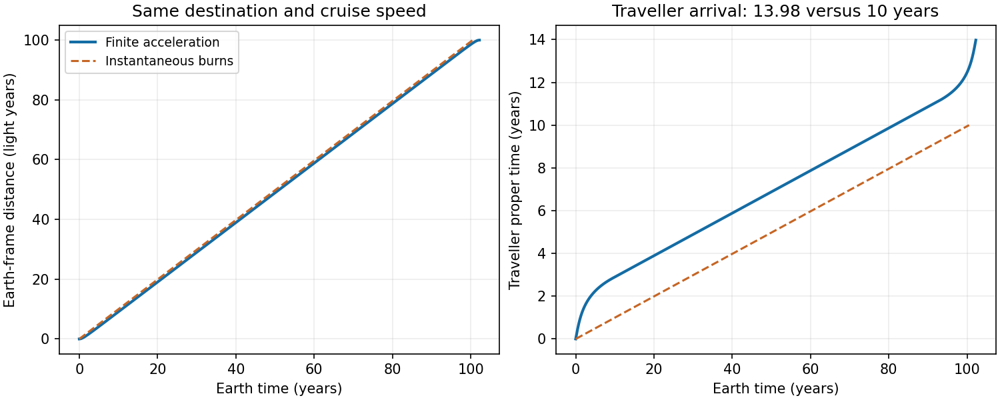

<h1 id="3/solution">Solution</h1>

↑ **Parent:** [3](../3.md)

**Boost and [velocity](../../../../velocity.md) transformation.** For the moving frame,

$$
t'=\gamma_v\left(t-\frac{vx}{c^2}\right),\quad
x'=\gamma_v(x-vt),\quad y'=y,\quad z'=z.
$$

The inverse has $v\mapsto-v$. Taking differentials of that inverse and dividing by $dt$ gives

$$
\boxed{u_x=\frac{u_x'+v}{1+vu_x'/c^2},\quad
u_y=\frac{u_y'}{\gamma_v(1+vu_x'/c^2)},\quad
u_z=\frac{u_z'}{\gamma_v(1+vu_x'/c^2)}}.
$$

**Constant [proper acceleration](../../../../proper-acceleration.md).** For collinear motion, the instantaneous rest-frame acceleration is $a=\gamma^3dv/dt$. Since $dt/d\tau=\gamma$,

$$
\boxed{\frac{dv}{d\tau}=a\gamma^{-2}
=a\left(1-\frac{v^2}{c^2}\right)}.
$$

Write $v=c\tanh\eta$; then $d\eta/d\tau=a/c$. Starting from rest gives $\eta=a\tau/c$, $dt/d\tau=\cosh\eta$ and $dx/d\tau=c\sinh\eta$. [integration](../../../../integral-split.md) with the stated initial origin yields

$$
\boxed{v=c\tanh(a\tau/c),\quad
t=\frac ca\sinh(a\tau/c),\quad
x=\frac{c^2}a[\cosh(a\tau/c)-1]}.
$$

**[photon rocket](../../../../photon-rocket.md) mass ratio.** In the instantaneous [rest frame](../../../../rest-frame.md), ejecting backward [photon](../../../../photon.md) [energy](../../../../energy-split.md) $dE_\gamma$ gives, to first order, $c^2dM=-dE_\gamma$ and $Mc\,d\eta=dE_\gamma/c$. Hence $dM/M=-d\eta$, and

$$
\boxed{\frac M{M_i}=e^{-\eta}
=\sqrt{\frac{1-\beta}{1+\beta}}}.
$$

Here $M$ includes all stored fuel and [energy](../../../../energy-split.md). This assumes complete conversion into a perfectly collimated [photon](../../../../photon.md) exhaust without other losses.

**[photon-rocket fuel for acceleration and braking](../../../../photon-rocket-fuel-for-acceleration-and-braking.md).** With effectively instantaneous changes of speed, the cruise [proper time](../../../../proper-time.md) is $D/(\gamma v)=10\ \mathrm{yr}$, giving

$$
\gamma\beta=10,\qquad
\gamma=\sqrt{101},\quad\beta=\frac{10}{\sqrt{101}},\quad
\eta=\operatorname{arsinh}10=2.99822.
$$

Braking to rest costs another factor $e^{-\eta}$, so $M_f/M_i=e^{-2\eta}=(\sqrt{101}-10)^2=0.00248758$. If equal rest [masses](../../../../mass.md) of matter and [antimatter](../../../../antimatter.md) annihilate, the consumed [antimatter](../../../../antimatter.md) is half the total consumed fuel:

$$
\boxed{\frac{M_{\bar m}}{M_i}=\frac12(1-e^{-2\eta})=0.498756
\quad\text{(about $49.88\%$)}}.
$$

This is the fraction of initial total mass, not the [antimatter](../../../../antimatter.md) fraction of the consumed matter–[antimatter](../../../../antimatter.md) fuel, which is one half.

**[finite-acceleration correction to a relativistic cruise](../../../../finite-acceleration-correction-to-a-relativistic-cruise.md).** Each constant-proper-acceleration leg has proper duration $\tau_a=c\eta/a$ and Earth-frame length $x_a=(c^2/a)(\gamma-1)$. Thus

$$
\tau_{\rm new}=2\frac{c\eta}{a}+
\frac{D-2x_a}{\gamma v}.
$$

Subtracting the original $D/(\gamma v)$ gives

$$
\boxed{\Delta\tau=\frac{2c}{a}
\left[\eta-\frac{\gamma-1}{\gamma\beta}\right]
\simeq3.98\ \mathrm{yr}}.
$$

For $a=10\ \mathrm{m\,s^{-2}}$, each accelerating leg takes about $2.85$ proper years and covers $8.60$ light years in the Earth frame, leaving positive cruise distance. The new total is about **13.98 proper years**. Adding $2\tau_a$ to ten years would overcount the cruise segment replaced by acceleration and braking.

**[Figure 1](#3/image-original-photon-drive-journey-with-instantaneous-and-finite-acceleration-separating-earth-time-from-traveller-time). Original photon-drive journey with instantaneous and finite acceleration, separating Earth time from traveller time**.

## ↑ Ancestors (13)

1. [3](../3.md)
2. [Paper 1](../../paper-1-split.md)
3. [2014](../../split.md)
4. [Past exam of the relativity course of the University of Cambridge](../../../split.md)
5. [Relativity course of the University of Cambridge](../../../../relativity-course-of-the-university-of-cambridge.md)
6. [Physics course of the year 3 of the natural sciences course of the University of Cambridge](../../../../physics-course-of-the-year-3-of-the-natural-sciences-course-of-the-university-of-cambridge.md)
7. [Year 3 of the natural sciences course of the University of Cambridge](../../../../year-3-of-the-natural-sciences-course-of-the-university-of-cambridge.md)
8. [Year of the natural sciences course of the University of Cambridge](../../../../year-of-the-natural-sciences-course-of-the-university-of-cambridge.md)
9. [Natural sciences course of the University of Cambridge](../../../../natural-sciences-course-of-the-university-of-cambridge.md)
10. [Course of the University of Cambridge](../../../../course-of-the-university-of-cambridge.md)
11. [University of Cambridge](../../../../university-of-cambridge-split.md)
12. [List of universities](../../../../list-of-universities.md)
13. [Codex Wiki](../../../../split.md)
