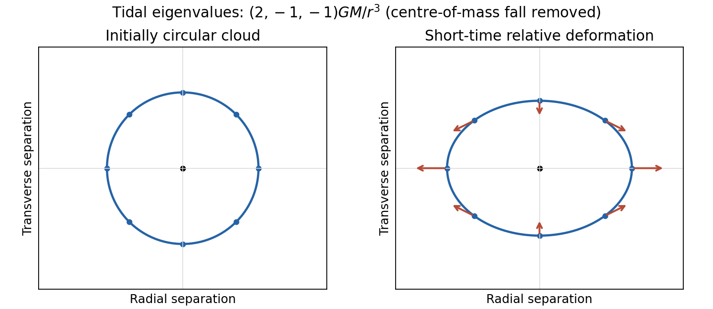

<h1 id="2/a/solution">Solution</h1>

↑ **Parent:** [A](../a.md)

**A [tidal force](../../../../../tidal-force.md) is a difference of [gravitational acceleration](../../../../../gravitational-acceleration.md) across an extended region.** In [Newtonian gravity](../../../../../gravitational-acceleration.md), $g_i=-\partial_i\Phi$. Two neighboring freely falling particles separated by $\xi^j$ have, to first order,

$$
\ddot\xi^i=\frac{\partial g_i}{\partial x^j}\xi^j
=-\frac{\partial^2\Phi}{\partial x^i\partial x^j}\xi^j.
$$

For a [point mass](../../../../../point-mass.md), $\Phi=-GM/r$. In a local orthonormal radial/transverse frame,

$$
\boxed{\ddot\xi_r=\frac{2GM}{r^3}\xi_r,\qquad
\ddot\xi_{\perp1}=-\frac{GM}{r^3}\xi_{\perp1},\qquad
\ddot\xi_{\perp2}=-\frac{GM}{r^3}\xi_{\perp2}.}
$$

A small freely falling cloud stretches radially and compresses transversely. Outside the source the three eigenvalues sum to zero, consistently with $\nabla^2\Phi=0$; within matter the trace is $-4\pi G\rho$. These are accelerations of separations, not the much larger common acceleration of the cloud's centre.

**[Figure 1](#2/a/image-original-local-tidal-map-a-freely-falling-cloud-stretches-along-the-radial-direction-and-contracts-in-both-transverse-directions). Original local tidal map: a freely falling cloud stretches along the radial direction and contracts in both transverse directions**.

In [general relativity](../../../../../general-relativity-split.md), freely falling test particles follow [timelike geodesics](../../../../../timelike-geodesic.md). A freely falling frame can eliminate the connection at one event, but not the [Riemann curvature tensor](../../../../../riemann-curvature-tensor-split.md) throughout a finite laboratory. Let $u$ be the [geodesic](../../../../../geodesic.md) tangent and $\xi$ a connecting [vector](../../../../../vector.md) for neighboring [geodesics](../../../../../geodesic.md) with $[u,\xi]=0$. In the explicitly chosen [curvature](../../../../../curvature.md) convention

$$
R(X,Y)Z=\nabla_X\nabla_YZ-\nabla_Y\nabla_XZ-\nabla_{[X,Y]}Z,
$$

the [geodesic deviation](../../../../../geodesic-deviation.md) equation is

$$
\boxed{\frac{D^2\xi}{d\tau^2}=R(u,\xi)u.}
$$

It follows by commuting $\nabla_u\nabla_\xi u$, using $\nabla_u u=0$ and zero torsion. In a [parallel-propagated orthonormal frame](../../../../../parallel-propagated-orthonormal-frame.md), its spatial components directly describe measured relative acceleration. The weak-field, slow-motion limit recovers the Newtonian Hessian above. Reversing the [curvature sign convention](../../../../../curvature-sign-convention.md) reverses the displayed [curvature](../../../../../curvature.md) side, without changing the physical stretching. The [equivalence principle](../../../../../equivalence-principle.md) removes locally uniform gravity, while [geodesic deviation](../../../../../geodesic-deviation.md) measures the residual tidal field. The connection between [parallel transport](../../../../../parallel-transport.md), [curvature](../../../../../curvature.md) and neighboring [geodesics](../../../../../geodesic.md) is developed systematically in the standard geometric construction.[Section 3, Curvature: parallel transport and geodesic deviation; translate the chosen curvature sign consistently](../../../../../lecture-notes-on-general-relativity-by-sean-m-carroll.md)

## ↑ Ancestors (14)

1. [A](../a.md)
2. [2](../../2.md)
3. [Paper 1](../../../paper-1-split.md)
4. [2015](../../../split.md)
5. [Past exam of the relativity course of the University of Cambridge](../../../../split.md)
6. [Relativity course of the University of Cambridge](../../../../../relativity-course-of-the-university-of-cambridge.md)
7. [Physics course of the year 3 of the natural sciences course of the University of Cambridge](../../../../../physics-course-of-the-year-3-of-the-natural-sciences-course-of-the-university-of-cambridge.md)
8. [Year 3 of the natural sciences course of the University of Cambridge](../../../../../year-3-of-the-natural-sciences-course-of-the-university-of-cambridge.md)
9. [Year of the natural sciences course of the University of Cambridge](../../../../../year-of-the-natural-sciences-course-of-the-university-of-cambridge.md)
10. [Natural sciences course of the University of Cambridge](../../../../../natural-sciences-course-of-the-university-of-cambridge.md)
11. [Course of the University of Cambridge](../../../../../course-of-the-university-of-cambridge.md)
12. [University of Cambridge](../../../../../university-of-cambridge-split.md)
13. [List of universities](../../../../../list-of-universities.md)
14. [Codex Wiki](../../../../../split.md)
