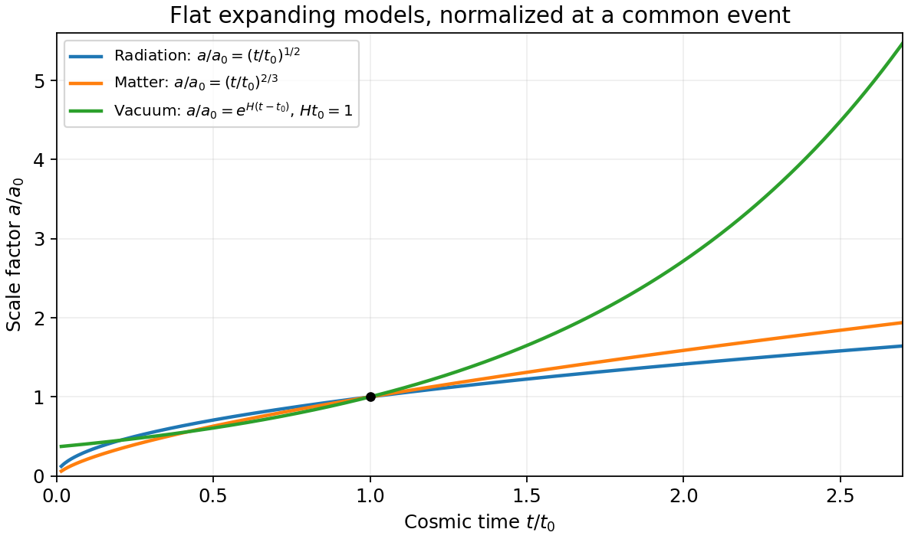

<h1 id="2/b/solution">Solution</h1>

↑ **Parent:** [B](../b.md)

The [cosmological principle](../../../../../cosmological-principle.md) idealizes spatial slices as homogeneous and isotropic. The corresponding [Friedmann-Lemaître-Robertson-Walker metric](../../../../../friedmann-lemaitre-robertson-walker-metric.md) can be written

$$
ds^2=c^2dt^2-a(t)^2\left[\frac{d\chi^2}{1-K\chi^2}
+\chi^2(d\theta^2+\sin^2\theta\,d\phi^2)\right],\qquad K=+1,0,-1.
$$

Here $t$ is [cosmic time](../../../../../cosmic-time.md), $a(t)$ has dimensions of length in this convention, and $\chi$ is a dimensionless [comoving coordinate](../../../../../comoving-coordinate.md). The sign of $K$ gives positive, zero or negative spatial [curvature](../../../../../curvature.md). It does not alone determine global topology. A comoving pair at fixed radial coordinates has proper separation scaling with $a(t)$, so the [Hubble parameter](../../../../../hubble-parameter.md) is $H=\dot a/a$, and [cosmological redshift](../../../../../cosmological-redshift.md) satisfies $1+z=a(t_{\rm obs})/a(t_{\rm em})$.

For a [perfect fluid](../../../../../perfect-fluid.md) of mass-equivalent [energy density](../../../../../energy-density.md) $\rho$ and [pressure](../../../../../pressure-split.md) $p$, Einstein's equations give

$$
\boxed{H^2=\frac{8\pi G\rho}{3}-\frac{Kc^2}{a^2}+\frac{\Lambda c^2}{3},}
$$

$$
\boxed{\frac{\ddot a}{a}=-\frac{4\pi G}{3}\left(\rho+\frac{3p}{c^2}\right)
+\frac{\Lambda c^2}{3},\qquad
\dot\rho+3H\left(\rho+\frac p{c^2}\right)=0.}
$$

The last equation is local [energy](../../../../../energy-split.md) conservation for constant $\Lambda$, with [vacuum energy](../../../../../vacuum-energy.md) kept separate from $\rho,p$. A component with $p=w\rho c^2$ has $\rho\propto a^{-3(1+w)}$: [pressureless matter](../../../../../pressureless-matter.md) dilutes as $a^{-3}$ and [radiation](../../../../../radiation.md) as $a^{-4}$, the additional [radiation](../../../../../radiation.md) factor being [photon](../../../../../photon.md) [redshift](../../../../../redshift.md). With $K=\Lambda=0$, matter domination gives $a\propto t^{2/3}$ and [radiation](../../../../../radiation.md) domination gives $a\propto t^{1/2}$. Positive [vacuum energy](../../../../../vacuum-energy.md) alone gives exponential expansion, $a\propto e^{Ht}$ with $H=c\sqrt{\Lambda/3}$.

**[Figure 2](#2/b/image-original-comparison-of-normalized-scale-factors-in-flat-radiation-matter-and-positive-vacuum-models-the-vacuum-model-has-no-finite-time-big-bang-origin-in-this-chart). Original comparison of normalized scale factors in flat radiation, matter and positive-vacuum models; the vacuum model has no finite-time big-bang origin in this chart**.

**Geometry, contents and initial conditions together determine the expansion history.** A closed matter-only model recollapses; an open matter-only model expands indefinitely. With a [cosmological constant](../../../../../cosmological-constant.md), positive spatial [curvature](../../../../../curvature.md) no longer by itself implies recollapse. Present [critical density](../../../../../critical-density.md) is $\rho_c=3H_0^2/(8\pi G)$ and the density parameters obey $\Omega_m+\Omega_r+\Omega_\Lambda+\Omega_K=1$, where $\Omega_K=-Kc^2/(a_0^2H_0^2)$. These models describe the large-scale background, while local structure and inhomogeneities require perturbations or more general metrics.

## ↑ Ancestors (14)

1. [B](../b.md)
2. [2](../../2.md)
3. [Paper 1](../../../paper-1-split.md)
4. [2015](../../../split.md)
5. [Past exam of the relativity course of the University of Cambridge](../../../../split.md)
6. [Relativity course of the University of Cambridge](../../../../../relativity-course-of-the-university-of-cambridge.md)
7. [Physics course of the year 3 of the natural sciences course of the University of Cambridge](../../../../../physics-course-of-the-year-3-of-the-natural-sciences-course-of-the-university-of-cambridge.md)
8. [Year 3 of the natural sciences course of the University of Cambridge](../../../../../year-3-of-the-natural-sciences-course-of-the-university-of-cambridge.md)
9. [Year of the natural sciences course of the University of Cambridge](../../../../../year-of-the-natural-sciences-course-of-the-university-of-cambridge.md)
10. [Natural sciences course of the University of Cambridge](../../../../../natural-sciences-course-of-the-university-of-cambridge.md)
11. [Course of the University of Cambridge](../../../../../course-of-the-university-of-cambridge.md)
12. [University of Cambridge](../../../../../university-of-cambridge-split.md)
13. [List of universities](../../../../../list-of-universities.md)
14. [Codex Wiki](../../../../../split.md)
