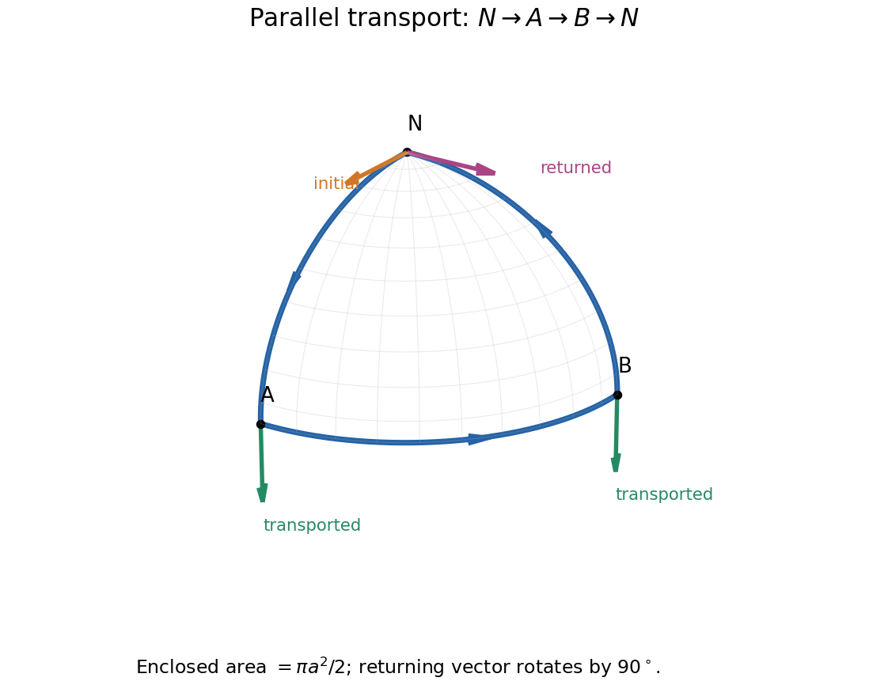

<h1 id="2/c/solution">Solution</h1>

↑ **Parent:** [C](../c.md)

Ordinary component differences at neighboring points depend on how the local bases vary. The [covariant derivative](../../../../../covariant-derivative.md) corrects for that variation:

$$
\boxed{\nabla_b V^a=\partial_bV^a+\Gamma^a_{bc}V^c,
\qquad \nabla_bW_a=\partial_bW_a-\Gamma^c_{ba}W_c.}
$$

Each upper [tensor](../../../../../tensor.md) index adds a connection term and each lower index subtracts one. A [scalar](../../../../../scalar.md) has $\nabla_a f=\partial_a f$, while the derivative of a [tensor](../../../../../tensor.md) transforms as a [tensor](../../../../../tensor.md) with one additional covariant index. The [Christoffel symbols](../../../../../christoffel-symbol.md) themselves are not [tensor](../../../../../tensor.md) components; their inhomogeneous transformation cancels that of the ordinary derivative.

For the [Levi-Civita connection](../../../../../levi-civita-connection.md),

$$
\Gamma^a_{bc}=\frac12g^{ad}
(\partial_b g_{dc}+\partial_c g_{bd}-\partial_d g_{bc}),
\qquad \nabla_cg_{ab}=0,\qquad\Gamma^a_{bc}=\Gamma^a_{cb}.
$$

These express [metric compatibility](../../../../../metric-compatibility.md) and zero torsion. Along $x^a(\lambda)$, [parallel transport](../../../../../parallel-transport.md) is the [initial value problem](../../../../../initial-value-problem.md)

$$
\boxed{\frac{DV^a}{d\lambda}
=\frac{dV^a}{d\lambda}
+\Gamma^a_{bc}\frac{dx^b}{d\lambda}V^c=0.}
$$

It preserves [inner products](../../../../../inner-product-split.md) for the [Levi-Civita connection](../../../../../levi-civita-connection.md). [Parallel transport](../../../../../parallel-transport.md) of the tangent itself gives the affinely parametrized [geodesic equation](../../../../../geodesic-equation.md), $\ddot x^a+\Gamma^a_{bc}\dot x^b\dot x^c=0$.

Transport generally depends on the path. On a round [sphere](../../../../../sphere.md), transport a [tangent vector](../../../../../tangent-vector-split.md) around the triangle bounded by two meridians $90$ degrees apart and the intervening equatorial arc. All three sides are [geodesics](../../../../../geodesic.md); the enclosed spherical area is $\pi a^2/2$. The returning [vector](../../../../../vector.md) is rotated by $90$ degrees, with sign set by traversal orientation. Locally this [holonomy](../../../../../holonomy.md) is controlled by [curvature](../../../../../curvature.md), even though the connection can be made zero at a single point. A [vector](../../../../../vector.md) can therefore have changing coordinate components while remaining parallel, and constant components do not generally mean [parallel transport](../../../../../parallel-transport.md).

**[Figure 3](#2/c/image-original-spherical-triangle-transport-a-tangent-initially-pointing-along-the-first-meridian-returns-rotated-by-ninety-degrees). Original spherical-triangle transport: a tangent initially pointing along the first meridian returns rotated by ninety degrees**.

This construction compares directions at separate points through a chosen connection, rather than assuming that a curved manifold supplies a path-independent comparison.[Section 3, Curvature: the covariant derivative, Levi-Civita connection and parallel transport](../../../../../lecture-notes-on-general-relativity-by-sean-m-carroll.md)

## ↑ Ancestors (14)

1. [C](../c.md)
2. [2](../../2.md)
3. [Paper 1](../../../paper-1-split.md)
4. [2015](../../../split.md)
5. [Past exam of the relativity course of the University of Cambridge](../../../../split.md)
6. [Relativity course of the University of Cambridge](../../../../../relativity-course-of-the-university-of-cambridge.md)
7. [Physics course of the year 3 of the natural sciences course of the University of Cambridge](../../../../../physics-course-of-the-year-3-of-the-natural-sciences-course-of-the-university-of-cambridge.md)
8. [Year 3 of the natural sciences course of the University of Cambridge](../../../../../year-3-of-the-natural-sciences-course-of-the-university-of-cambridge.md)
9. [Year of the natural sciences course of the University of Cambridge](../../../../../year-of-the-natural-sciences-course-of-the-university-of-cambridge.md)
10. [Natural sciences course of the University of Cambridge](../../../../../natural-sciences-course-of-the-university-of-cambridge.md)
11. [Course of the University of Cambridge](../../../../../course-of-the-university-of-cambridge.md)
12. [University of Cambridge](../../../../../university-of-cambridge-split.md)
13. [List of universities](../../../../../list-of-universities.md)
14. [Codex Wiki](../../../../../split.md)
