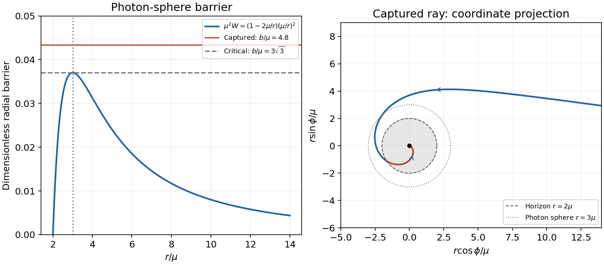

<h1 id="4/solution">Solution</h1>

↑ **Parent:** [4](../4.md)

Put $f(r)=1-2\mu/r$, where $\mu=GM/c^2$, and work in the orbital plane. A dot denotes an affine-parameter derivative; for a material particle choose that parameter to be [proper time](../../../../proper-time.md).

**First integrals and normalization.** The [geodesic Lagrangian](../../../../geodesic-lagrangian.md) is

$$
L=\frac12\left(fc^2\dot t^2-f^{-1}\dot r^2-r^2\dot\phi^2\right).
$$

Time translation and axial rotation make $t$ and $\phi$ cyclic, giving

$$
\boxed{f\dot t=k,\qquad r^2\dot\phi=h.}
$$

The tangent norm is constant along an affine [geodesic](../../../../geodesic.md) because the [Levi-Civita connection](../../../../levi-civita-connection.md) preserves the metric. Therefore

$$
fc^2\dot t^2-f^{-1}\dot r^2-r^2\dot\phi^2=\mathcal E.
$$

For proper-time parametrization of a timelike [worldline](../../../../world-line.md) this norm is $c^2$. For a [null geodesic](../../../../null-geodesic.md) it is zero, for every affine normalization. Thus **$\mathcal E=c^2$ for the chosen material-particle normalization and $\mathcal E=0$ for light**. [Proper time](../../../../proper-time.md) cannot itself parametrize a null ray, despite the same printed symbol $\tau$ being used for its [affine parameter](../../../../affine-parameter.md).

**Null normalization and [impact parameter](../../../../impact-parameter.md).** Under $\tau\mapsto A\tau+B$ with $A>0$, both $k$ and $h$ scale as $1/A$, while the null path is unchanged. Their ratio is invariant. At large radius the spatial speed with respect to asymptotic time is $c$, and orbital [angular momentum](../../../../angular-momentum.md) per affine tangent gives

$$
\boxed{b=\frac{|h|}{kc};\qquad k=1\ \Longrightarrow\ |h|=bc.}
$$

For an orientation chosen with $h>0$, this is $h=bc$. Setting $k=1$ is a choice of affine scale, not a claim that all [photons](../../../../photon.md) have equal measured [energy](../../../../energy-split.md). Once a tangent is identified with a physically normalized [four-momentum](../../../../four-momentum.md), its [energy](../../../../energy-split.md) fixes that scale.

**Orbit shape.** Substituting the constants in the norm and multiplying by $f$ gives

$$
\dot r^2=k^2c^2-f\left(\mathcal E+\frac{h^2}{r^2}\right).
$$

For $u=1/r$ and $h\ne0$, $du/d\phi=-\dot r/h$. Hence

$$
\boxed{(u')^2+u^2=\frac{k^2c^2}{h^2}+2\mu u^3
-\frac{\mathcal E}{h^2}(1-2\mu u),\qquad u'=\frac{du}{d\phi}.}
$$

The $h=0$ radial orbit must be treated with the radial equation, because azimuth is then constant.

**Circular [photons](../../../../photon.md) and stability.** For a null ray define $W(r)=f(r)/r^2$. Its radial equation becomes

$$
\dot r^2+h^2W(r)=k^2c^2,\qquad
W'(r)=-\frac2{r^3}+\frac{6\mu}{r^4}.
$$

The circular orbit requires $\dot r=0$ and $W'=0$, so

$$
\boxed{r_{\rm ph}=3\mu,\qquad W''(3\mu)=-\frac2{81\mu^4}<0.}
$$

It is at a maximum of the null [effective potential](../../../../effective-potential.md) and is unstable. Equivalently the [Binet equation](../../../../binet-equation.md) $u''+u=3\mu u^2$ linearizes about $u_0=1/(3\mu)$ to $\delta u''=\delta u$, admitting exponentially growing radial deviations in azimuth.

**Capture from infinity.** Divide the null radial equation by $k^2c^2$. The quantity opposing inward motion is $b^2W(r)$, whose exterior maximum is $b^2/(27\mu^2)$. There is no outer radial [turning point](../../../../turning-point.md) precisely when

$$
\boxed{b<3\sqrt3\,\mu.}
$$

At equality an exactly critical ray from infinity asymptotes to the [photon sphere](../../../../photon-sphere.md); it does not cross the horizon at a finite [affine parameter](../../../../affine-parameter.md). Above the threshold an initially inward ray from infinity reaches an outer [turning point](../../../../turning-point.md) and scatters. The radial case $b=0$ is also captured. These statements refer to inward rays launched from the asymptotically flat exterior, not arbitrary initial data inside the angular-momentum barrier.

**[Figure 4](#4/image-original-schwarzschild-capture-calculation-the-null-potential-barrier-and-a-captured-equatorial-ray-crossing-the-horizon-and-ending-at-finite-azimuth). Original Schwarzschild capture calculation: the null-potential barrier and a captured equatorial ray crossing the horizon and ending at finite azimuth**.

**Approach to the singularity.** A captured nonradial ray bends inward, crosses $r=3\mu$ and then the [event horizon](../../../../event-horizon.md) $r=2\mu$, and continues toward the [curvature singularity](../../../../curvature-singularity.md). A plot in $(r\cos\phi,r\sin\phi)$ is only a coordinate projection, not a Euclidean spatial slice inside the horizon. For large $u$ the cubic term in the shape equation dominates:

$$
\frac{du}{d\phi}\simeq\sqrt{2\mu}\,u^{3/2}
$$

for the inward branch with $h>0$. Its integral is

$$
\phi_*-\phi\simeq\sqrt{\frac2\mu}\,u^{-1/2},\qquad
\boxed{r\simeq\frac\mu2(\phi_*-\phi)^2.}
$$

Thus the azimuth tends to a finite limit at the singularity, rather than winding infinitely often there. Near-critical rays can accumulate many turns near $3\mu$ before capture, which is a separate phenomenon. A strictly radial ray has constant azimuth and does not admit this azimuthal asymptotic form. The radial equation also gives $r\propto(\tau_*-\tau)^{2/5}$ for a nonradial null ray, confirming finite remaining [affine parameter](../../../../affine-parameter.md).

**Material capture and the condition at infinity.** To recover the quoted threshold, take the usual marginally bound orbit, initially at rest at infinity: $k=1$. With $\mathcal E=c^2$,

$$
\dot r^2=\frac{2\mu c^2}{r}-\frac{h^2}{r^2}+\frac{2\mu h^2}{r^3}
=\frac{2\mu c^2r^2-h^2r+2\mu h^2}{r^3}.
$$

The turning-point quadratic has [discriminant](../../../../discriminant.md) $h^2(h^2-16\mu^2c^2)$. It is positive for large $r$ and has no real positive root when $0<|h|<4\mu c$, while the radial case also falls in. Therefore

$$
\boxed{|h|<4\mu c\quad\Longrightarrow\quad\text{capture from rest at infinity}.}
$$

At equality the quadratic is proportional to $(r-4\mu)^2$ and the orbit asymptotes to the unstable marginally bound circular orbit at $r=4\mu$. For larger $|h|$, an incoming marginally bound particle encounters the outer [turning point](../../../../turning-point.md) and scatters.

The source says only “from infinity”, without explicitly fixing the asymptotic speed. For a general incoming speed $v_\infty$, $k=(1-v_\infty^2/c^2)^{-1/2}\ge1$ and

$$
\dot r^2=c^2(k^2-1)+\frac{2\mu c^2}{r}
-\frac{h^2}{r^2}+\frac{2\mu h^2}{r^3}.
$$

The same bound $|h|<4\mu c$ remains sufficient for capture, since the added constant is nonnegative. It is **the exact threshold only for $k=1$**. At fixed $k>1$, the critical unstable orbit satisfies

$$
k^2=\frac{(r_c-2\mu)^2}{r_c(r_c-3\mu)},\qquad
h_c^2=\frac{\mu c^2r_c^2}{r_c-3\mu},\qquad3\mu<r_c<4\mu.
$$

Then $h_c>4\mu c$. This states both the printed sufficient condition and the additional assumption needed to call it a sharp capture boundary.

## ↑ Ancestors (13)

1. [4](../4.md)
2. [Paper 1](../../paper-1-split.md)
3. [2015](../../split.md)
4. [Past exam of the relativity course of the University of Cambridge](../../../split.md)
5. [Relativity course of the University of Cambridge](../../../../relativity-course-of-the-university-of-cambridge.md)
6. [Physics course of the year 3 of the natural sciences course of the University of Cambridge](../../../../physics-course-of-the-year-3-of-the-natural-sciences-course-of-the-university-of-cambridge.md)
7. [Year 3 of the natural sciences course of the University of Cambridge](../../../../year-3-of-the-natural-sciences-course-of-the-university-of-cambridge.md)
8. [Year of the natural sciences course of the University of Cambridge](../../../../year-of-the-natural-sciences-course-of-the-university-of-cambridge.md)
9. [Natural sciences course of the University of Cambridge](../../../../natural-sciences-course-of-the-university-of-cambridge.md)
10. [Course of the University of Cambridge](../../../../course-of-the-university-of-cambridge.md)
11. [University of Cambridge](../../../../university-of-cambridge-split.md)
12. [List of universities](../../../../list-of-universities.md)
13. [Codex Wiki](../../../../split.md)
