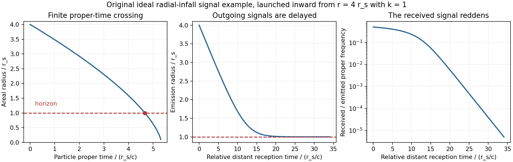
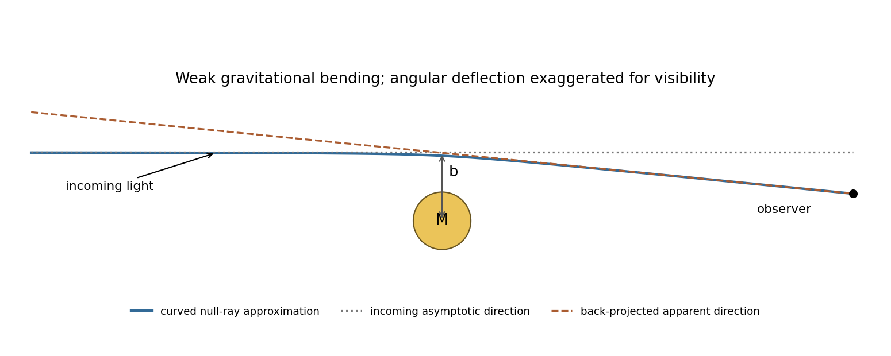

# Paper 1

↑ **Parent:** [2016](../2016.md)

Original solutions to the released 2016 paper. [Original public PDF, physical pages 386–389; questions on pages 387–389](https://www.whatdotheyknow.com/request/natural_science_tripos_physics_e_2/response/2340776/attach/2/FOI%202023%20399%20Zahid%20materials.pdf?cookie_passthrough=1#page=386)

**Table of contents**

- [1](#1)
  - [a](#1/a)
    - [Solution](#1/a/solution)
  - [b](#1/b)
    - [Solution](#1/b/solution)
  - [c](#1/c)
    - [Solution](#1/c/solution)
- [2](#2)
  - [a](#2/a)
    - [Solution](#2/a/solution)
  - [b](#2/b)
    - [Solution](#2/b/solution)
  - [c](#2/c)
    - [Solution](#2/c/solution)
- [3](#3)
  - [Solution](#3/solution)
- [4](#4)
  - [Solution](#4/solution)

## 1

↑ **Parent:** [Paper 1](paper-1.md)

<h3 id="1/a">a</h3>

↑ **Parent:** [1](#1)

<h4 id="1/a/solution">Solution</h4>

↑ **Parent:** [A](#1/a)

Use an [affine parameter](../../riemannian-geometry.md#affine-parameter) $\lambda$, with dots denoting its derivatives, and take $\alpha\ne0$ so the metric is nondegenerate for $r>0$. The [geodesic Lagrangian](../../riemannian-geometry.md#geodesic-lagrangian) is $\mathcal L=(\dot r^2+\alpha^2r^4\dot\phi^2)/2$. The [Euler-Lagrange equations](../../analysis.md#euler-lagrange-equation) give

$$
\boxed{\ddot r-2\alpha^2r^3\dot\phi^2=0,\qquad \frac{d}{d\lambda}(\alpha^2r^4\dot\phi)=0,}
$$

or $\ddot\phi+4\dot r\dot\phi/r=0$. The conserved cyclic [angular momentum](../../momentum.md#angular-momentum) is

$$
\boxed{J=\frac{\partial\mathcal L}{\partial\dot\phi}=\alpha^2r^4\dot\phi.}
$$

This is the [cyclic angular momentum in a rotational metric](../../riemannian-metric.md#cyclic-angular-momentum-in-a-rotational-metric), associated with the rotational [Killing vector](../../killing-vector-field.md) $\partial_\phi$. Explicitly, $\dot J=\alpha^2(4r^3\dot r\dot\phi+r^4\ddot\phi)=0$ by the angular equation.

Differentiating the [Lagrangian](../../calculus-of-variations.md#lagrangian) and substituting both equations gives

$$
\frac{d\mathcal L}{d\lambda}=\dot r\ddot r+2\alpha^2r^3\dot r\dot\phi^2+\alpha^2r^4\dot\phi\ddot\phi=(2+2-4)\alpha^2r^3\dot r\dot\phi^2=0.
$$

Thus **the squared tangent norm $2\mathcal L$ is constant**. If $\lambda$ is [arc length](../../riemannian-geometry.md#arc-length), it equals one; its numerical value otherwise depends on affine normalization. An arbitrary nonaffine parametrization would not preserve this constant-speed statement.

<h3 id="1/b">b</h3>

↑ **Parent:** [1](#1)

<h4 id="1/b/solution">Solution</h4>

↑ **Parent:** [B](#1/b)

Denote the parent [rest mass](../../special-relativity.md#invariant-mass) by $M$, the daughter [rest masses](../../special-relativity.md#invariant-mass) by $m_i$, and their total energies in any [inertial frame](../../mathematical-physics.md#inertial-frame) by $E_{\rm before}$ and $E_{\rm after}$. For an isolated disintegration with all products included, [energy](../../energy.md) conservation gives $E_{\rm after}=E_{\rm before}$. The corresponding [kinetic energies](../../energy.md#kinetic-energy) are $K_{\rm before}=E_{\rm before}-Mc^2$ and $K_{\rm after}=E_{\rm after}-\sum_i m_ic^2$. Consequently

$$
\boxed{\Delta K=K_{\rm after}-K_{\rm before}=\left(M-\sum_i m_i\right)c^2.}
$$

Every [mass](../../classical-mechanics.md#mass) on the right is a [rest mass](../../special-relativity.md#invariant-mass), hence invariant under a [Lorentz transformation](../../special-relativity.md#lorentz-transformation). This proves the [kinetic energy](../../energy.md#kinetic-energy) released by relativistic decay is frame independent even though either total [kinetic energy](../../energy.md#kinetic-energy) separately is not. In the parent [rest frame](../../mathematical-physics.md#rest-frame) the initial [kinetic energy](../../energy.md#kinetic-energy) vanishes and the final [kinetic energy](../../energy.md#kinetic-energy) equals the [energy](../../energy.md) associated with this [mass defect](../../atomic-nucleus.md#mass-defect). External [energy](../../energy.md) input or omission of radiation would invalidate the energy-cancellation step; if [photons](../../quantum-mechanics.md#photon) are products, include their energies with zero rest-mass subtraction.

<h3 id="1/c">c</h3>

↑ **Parent:** [1](#1)

<h4 id="1/c/solution">Solution</h4>

↑ **Parent:** [C](#1/c)

Put $v=r\omega$, $\beta=v/c<1$ and $\gamma=(1-\beta^2)^{-1/2}$. For a [photon](../../quantum-mechanics.md#photon) emitted in laboratory direction $\mathbf n$ toward the stationary receiver, its [frequency](../../wave.md#frequency) there is

$$
\nu=\frac{\nu_0}{\gamma(1-\mathbf n\cdot\mathbf v_e/c)}.
$$

Since the receiver lies outside the circle, two emission points have a line of sight tangent to the circle. At those points the source [velocity](../../classical-mechanics.md#velocity) is directly toward or away from the receiver, so $\mathbf n\cdot\mathbf v_e=\pm v$. Thus the [doppler extrema for a circularly moving source](../../wave.md#doppler-extrema-for-a-circularly-moving-source) are

$$
\boxed{\nu_{\max}=\nu_0\sqrt{\frac{1+\beta}{1-\beta}},\qquad \nu_{\min}=\nu_0\sqrt{\frac{1-\beta}{1+\beta}}.}
$$

They do not depend on $d$, provided $d>r$; changing $d$ changes the emission and reception phases of the extrema. Closest and farthest source positions instead have transverse [velocity](../../classical-mechanics.md#velocity) relative to that ray, and are not the extrema.

**[Figure 1](#1/c/image-original-tangent-ray-geometry-for-the-largest-approaching-and-receding-shifts-of-a-circular-source). Original tangent-ray geometry for the largest approaching and receding shifts of a circular source**.

For the corotating receiver, [velocities](../../classical-mechanics.md#velocity) must be evaluated at the actual emission and reception events. An unobstructed [vacuum](../../physics.md#vacuum) ray satisfies $\mathbf x_r-\mathbf x_e=c\Delta t\,\mathbf n$, while rigid steady rotation gives $\mathbf v_r-\mathbf v_e=\boldsymbol\omega\times(\mathbf x_r-\mathbf x_e)$. Therefore $\mathbf n\cdot\mathbf v_r=\mathbf n\cdot\mathbf v_e$. The emitter and receiver have equal [speed](../../classical-mechanics.md#speed) magnitudes, hence equal [Lorentz factors](../../special-relativity.md#lorentz-factor). The [frequency ratio of corotating clocks](../../wave.md#frequency-ratio-of-corotating-clocks) is consequently

$$
\frac{\nu_r}{\nu_0}=\frac{\gamma_r(1-\mathbf n\cdot\mathbf v_r/c)}{\gamma_e(1-\mathbf n\cdot\mathbf v_e/c)}=\boxed{1}.
$$

Thus **the rim receiver measures $\nu_0$**, independently of its angular separation. Different transit times or a [Sagnac effect](../../special-relativity.md#sagnac-effect) do not by themselves imply a [frequency](../../wave.md#frequency) change between these identical-radius clocks. The model treats $\nu_0$ as a fixed proper clock [frequency](../../wave.md#frequency) and assumes a signal path is available; it does not specify the disc's electromagnetic opacity.

## 2

↑ **Parent:** [Paper 1](paper-1.md)

<h3 id="2/a">a</h3>

↑ **Parent:** [2](#2)

<h4 id="2/a/solution">Solution</h4>

↑ **Parent:** [A](#2/a)

The [weak equivalence principle](../../general-relativity.md#weak-equivalence-principle) states that freely falling, sufficiently small test bodies have the same motion in a given gravitational field irrespective of composition or [mass](../../classical-mechanics.md#mass), neglecting their own gravity and nongravitational [forces](../../force.md). In the Newtonian limit, $m_i\mathbf a=m_g\mathbf g$ makes this universality equivalent to a universal gravitational-to-inertial [mass](../../classical-mechanics.md#mass) ratio, conventionally set to one.

The [Einstein equivalence principle](../../general-relativity.md#einstein-equivalence-principle) adds that local nongravitational experiments in a freely falling, nonrotating laboratory have the laws of [special relativity](../../special-relativity.md), independent of the laboratory's position and [velocity](../../classical-mechanics.md#velocity). At an event one can choose a [local inertial frame](../../mathematical-physics.md#local-inertial-frame) with $g_{\mu\nu}=\eta_{\mu\nu}$ and $\partial_\alpha g_{\mu\nu}=0$. A freely falling observer feels no supporting [force](../../force.md), while a supported observer can model a locally uniform gravitational field by an accelerated laboratory. This explains why freely moving particles follow [timelike geodesics](../../general-relativity.md#timelike-geodesic) and [light](../../optics.md#light) follows [null geodesics](../../special-relativity.md#null-geodesic) when other interactions are negligible.

The locality qualification is essential. The [Riemann curvature tensor](../../riemann-curvature-tensor.md) generally remains nonzero; separated freely falling bodies have tidal relative acceleration, measured by [geodesic deviation](../../riemann-curvature-tensor.md#geodesic-deviation). A finite-size experiment can therefore distinguish a curved gravitational field from a merely accelerated coordinate description of flat [spacetime](../../special-relativity.md#spacetime). Equivalence alone also does not select the complete [Einstein field equations](../../einstein-field-equations.md).

A useful weak-field consequence is the upward [photon](../../quantum-mechanics.md#photon) shift $\Delta\nu/\nu\simeq-gH/c^2$ over laboratory height $H$. In an upward-accelerating laboratory the receiver gains recession [velocity](../../classical-mechanics.md#velocity) during the [light](../../optics.md#light) flight, giving the same leading redshift. The [Pound-Rebka experiment](../../general-relativity.md#pound-rebka-experiment) tested this with resonant absorption of 14.4-keV [gamma rays](../../quantum-mechanics.md#gamma-ray) over about 22.5 m. A controlled source [velocity](../../classical-mechanics.md#velocity) calibrated the Doppler sensitivity; interchanging source and absorber reversed the gravitational contribution while retaining an intrinsic source–absorber offset. Monitoring their [temperature](../../temperature.md) difference was essential because lattice-motion shifts could mimic the small signal.[pp. 338–340, baseline, velocity calibration, reversed source/absorber positions and temperature corrections](../../physics-bibliography.md#apparent-weight-of-photons-by-robert-vivian-pound-and-glen-rebka) This verifies a gravitational clock-shift prediction; by itself it is not a unique test selecting [general relativity](../../general-relativity.md) over every alternative metric theory.

<h3 id="2/b">b</h3>

↑ **Parent:** [2](#2)

<h4 id="2/b/solution">Solution</h4>

↑ **Parent:** [B](#2/b)

Consider an ideal spherical collapse with a [vacuum](../../physics.md#vacuum) exterior of constant [mass](../../classical-mechanics.md#mass) $M$. Once [pressure](../../pressure.md) support is insufficient, a surface can continue inward and cross the [Schwarzschild event horizon](../../schwarzschild-spacetime.md#schwarzschild-event-horizon) $r_s=2GM/c^2$ in finite comoving [proper time](../../special-relativity.md#proper-time). An [event horizon](../../black-hole.md#event-horizon) is a causal boundary: [light](../../optics.md#light) emitted from inside cannot reach distant observers. It is not a material shell or, in the classical Schwarzschild solution, a local [curvature singularity](../../general-relativity.md#curvature-singularity) at $r=r_s$.

The [distant view of gravitational collapse](../../astrophysics.md#distant-view-of-gravitational-collapse) differs from the surface clock's history. Exterior [Schwarzschild time](../../schwarzschild-spacetime.md#schwarzschild-time) has $dt/d\tau\propto(1-r_s/r)^{-1}$ for regular infall and diverges as the surface approaches the horizon. Outgoing radial [light](../../optics.md#light) also takes an increasingly long coordinate time to escape: $dt/dr=[c(1-r_s/r)]^{-1}$ has a logarithmically divergent integral at the horizon. Signals received far away are progressively delayed and redshifted; both gravity and the inward emitter's [Doppler shift](../../wave.md#doppler-effect) contribute. [photons](../../quantum-mechanics.md#photon) carry less received [energy](../../energy.md) and arrive at a lower rate, while the available escape directions also narrow.

Thus **a distant observer does not receive a [light](../../optics.md#light) signal announcing the crossing; the image fades and reddens rather than remaining a permanently bright frozen surface**. A finite-band detector with finite sensitivity loses it in finite observation time. The divergence of one coordinate chart does not prevent the material crossing in finite [proper time](../../special-relativity.md#proper-time); horizon-regular coordinates describe that continuation. The pressureless [Oppenheimer-Snyder model](../../black-hole.md#oppenheimer-snyder-model) makes this distinction explicit, without representing all the [pressure](../../pressure.md), rotation and radiation of a real stellar collapse.[abstract and pp. 455–459, finite comoving collapse time and redshifted distant description](../../physics-bibliography.md#on-continued-gravitational-contraction-by-j-robert-oppenheimer-and-hartland-snyder)

**[Figure 2](#2/b/image-original-ideal-radial-infall-example-separating-finite-proper-time-crossing-delayed-reception-and-fading-frequency). Original ideal radial-infall example separating finite proper-time crossing, delayed reception and fading frequency**.

The plotted example is a test-particle [geodesic](../../riemannian-geometry.md#geodesic) falling from rest at infinity, used to isolate the coordinate and signal effects; it is not a fitted stellar-collapse [light](../../optics.md#light) curve. No actual observer can hover on the horizon to supply a static local frame there.

<h3 id="2/c">c</h3>

↑ **Parent:** [2](#2)

<h4 id="2/c/solution">Solution</h4>

↑ **Parent:** [C](#2/c)

A [light](../../optics.md#light) ray follows a [null geodesic](../../special-relativity.md#null-geodesic). For a weak, approximately spherical field and [impact parameter](../../classical-mechanics.md#impact-parameter) $b\gg GM/c^2$, the asymptotic [Schwarzschild light deflection](../../schwarzschild-spacetime.md#schwarzschild-light-deflection) is

$$
\boxed{\Delta\theta=\frac{4GM}{bc^2}.}
$$

At the solar limb this is about $1.75$ arcseconds, whereas a simple Newtonian fast-particle calculation gives half that value. The difference tests relativistic [spacetime](../../special-relativity.md#spacetime) geometry beyond the universality of slow-body free fall. The quoted [angle](../../geometry-and-topology.md#angle) compares incoming and outgoing directions far from the deflector, not a locally measured turn at a sharp vertex.

**[Figure 3](#2/c/image-original-weak-deflection-sketch-with-incoming-direction-curved-ray-and-apparent-sky-direction-the-angle-is-exaggerated). Original weak-deflection sketch with incoming direction, curved ray and apparent sky direction; the angle is exaggerated**.

For an eclipse measurement, photograph background stars near the obscured [Sun](../../stellar-astrophysics.md#sun) and compare their apparent positions with reference plates taken when that field is away from the [Sun](../../stellar-astrophysics.md#sun). Back-projecting the deflected incoming [light](../../optics.md#light) makes a star appear displaced outward from the [Sun](../../stellar-astrophysics.md#sun)'s apparent position. Fit the radial displacement against inverse angular separation from the [Sun](../../stellar-astrophysics.md#sun), while allowing plate translation, rotation and scale. The expected pattern must be separated from [atmospheric refraction](../../optics.md#atmospheric-refraction), [optical distortion](../../geometrical-optics.md#distortion-optics) and changes of focus or scale, rather than inferred from one displaced star.

The 1919 expeditions obtained observations at Sobral and Príncipe, published by [Frank Watson Dyson](../../astronomy.md#frank-watson-dyson), [Arthur Eddington](../../astronomy.md#arthur-eddington) and [Charles Davidson](../../astronomy.md#charles-rundle-davidson) in 1920. The original report compares eclipse and reference plates and discusses instrument scale and image-quality limitations; it should not be treated as an exact modern precision measurement.[pp. 291–333, observing arrangements, reference photographs, plate reductions and final deflection comparisons](../../physics-bibliography.md#a-determination-of-the-deflection-of-light-by-the-sun-s-gravitational-field-by-frank-watson-dyson-and-others) Repeated observations with independent instruments and calibrated reference fields test whether the displacement follows the predicted geometry. [vacuum](../../physics.md#vacuum) gravitational bending is achromatic to this order, a useful distinction from dispersive propagation effects.

## 3

↑ **Parent:** [Paper 1](paper-1.md)

<h3 id="3/solution">Solution</h3>

↑ **Parent:** [3](#3)

Use signature $(+---)$, coordinates $x^0=ct$ and [four-velocity](../../special-relativity.md#four-velocity) $u^\mu=dx^\mu/d\tau$ normalized by $u_\mu u^\mu=c^2$. The derivative is the metric-compatible [Levi-Civita connection](../../general-relativity.md#levi-civita-connection). Fix the curvature sign by $[\nabla_\alpha,\nabla_\beta]V^\mu=R^\mu{}_{\nu\alpha\beta}V^\nu$. Then the required contractions are

$$
\boxed{R_{\nu\beta}=R^\mu{}_{\nu\mu\beta},\qquad R=g^{\nu\beta}R_{\nu\beta}.}
$$

With $G^{\mu\nu}=R^{\mu\nu}-g^{\mu\nu}R/2$, the [contracted Bianchi identity](../../riemann-curvature-tensor.md#contracted-bianchi-identity) gives $\nabla_\mu G^{\mu\nu}=0$. The [Einstein field equations](../../einstein-field-equations.md) $G^{\mu\nu}+\Lambda g^{\mu\nu}=(8\pi G/c^4)T^{\mu\nu}$, with constant $\Lambda$, therefore require [covariant conservation of stress-energy](../../stress-energy-tensor.md#stress-energy-conservation). This is a consistency relation between geometry and the total matter/field source. It does not mean $\partial_\mu T^{\mu\nu}=0$ in arbitrary coordinates, nor guarantee a global conserved [energy](../../energy.md) in an arbitrary curved [spacetime](../../special-relativity.md#spacetime). The geometric identity alone, without the field equations or matter dynamics, is not an equation of motion for a freely specified material source.

For [relativistic dust](../../stress-energy-tensor.md#relativistic-dust), $\rho$ is proper rest-mass [density](../../fluid-mechanics.md#density), measured in the fluid [rest frame](../../mathematical-physics.md#rest-frame), and $u^\mu$ is its timelike [four-velocity](../../special-relativity.md#four-velocity) with the $c^2$ normalization above. In a local Cartesian [inertial frame](../../mathematical-physics.md#inertial-frame) $u^\mu=\gamma(c,\mathbf v)$, so

$$
T^{00}=\rho\gamma^2c^2,\qquad \boxed{T^{0i}=\rho\gamma^2cv^i.}
$$

Accordingly $T^{0i}/c$ is [momentum density](../../stress-energy-tensor.md#momentum-density) and $cT^{0i}$ is [energy flux](../../mathematical-physics.md#energy-flux) in direction $i$. The equality of momentum-density and energy-flux components after the appropriate factors of $c$ reflects the symmetry of the [stress-energy tensor](../../stress-energy-tensor.md). In the comoving frame the spatial stress is zero, as required for pressureless matter.

Expand the dust conservation equation by the [product rule](../../calculus.md#product-rule):

$$
0=u^\nu\nabla_\mu(\rho u^\mu)+\rho u^\mu\nabla_\mu u^\nu.
$$

Contract with $u_\nu$. [metric compatibility](../../vector-bundle.md#metric-compatibility) and constant normalization give $u_\nu\nabla_\mu u^\nu=\nabla_\mu(u_\nu u^\nu)/2=0$, leaving $c^2\nabla_\mu(\rho u^\mu)=0$. Substitute this rest-mass continuity law back and divide by nonzero $\rho$:

$$
\boxed{u^\mu\nabla_\mu u^\nu=0,\qquad \frac{d^2x^\nu}{d\tau^2}+\Gamma^\nu_{\alpha\beta}\frac{dx^\alpha}{d\tau}\frac{dx^\beta}{d\tau}=0.}
$$

This proves [geodesic motion of uncharged dust](../../stress-energy-tensor.md#geodesic-motion-of-uncharged-dust) along each fluid flow line. [pressure](../../pressure.md) [forces](../../force.md) or another exchange of momentum would change the argument; at zero [density](../../fluid-mechanics.md#density) there is no dust [worldline](../../special-relativity.md#world-line) to constrain.

The [electromagnetic field tensor](../../relativistic-electromagnetism.md#electromagnetic-field-tensor) is antisymmetric and has six independent components. In the stated local inertial coordinates choose $F^{0i}=-E_i/c$ and $F^{ij}=-\epsilon_{ijk}B_k$, giving

$$
F^{\mu\nu}=\begin{pmatrix}
0&-E_x/c&-E_y/c&-E_z/c\\
E_x/c&0&-B_z&B_y\\
E_y/c&B_z&0&-B_x\\
E_z/c&-B_y&B_x&0
\end{pmatrix}.
$$

The fields are those measured by that local observer; changing observer mixes them through the [Lorentz transformation](../../special-relativity.md#lorentz-transformation) of $F$. With $\epsilon^{0123}=+1$ and $\widetilde F^{\mu\nu}=\epsilon^{\mu\nu\alpha\beta}F_{\alpha\beta}/2$, two independent quadratic contractions are

$$
\boxed{F_{\mu\nu}F^{\mu\nu}=2(B^2-E^2/c^2),\qquad F_{\mu\nu}\widetilde F^{\mu\nu}=-\frac4c\mathbf E\cdot\mathbf B.}
$$

The second is a [pseudoscalar](../../quantum-mechanics.md#pseudoscalar): it is invariant under proper [Lorentz transformations](../../special-relativity.md#lorentz-transformation) and changes sign under an [orientation](../../algebraic-topology.md#orientation-of-a-simplex) reversal. Opposite choices for the [orientation](../../algebraic-topology.md#orientation-of-a-simplex) [tensor](../../multilinear-algebra.md#tensor) change its written sign. A nonzero [null electromagnetic field](../../relativistic-electromagnetism.md#null-electromagnetic-field) can have both contractions zero, so the two numbers do not determine whether the [tensor](../../multilinear-algebra.md#tensor) itself vanishes.

For [charged relativistic dust](../../stress-energy-tensor.md#charged-relativistic-dust), insert $j^\alpha=(q/m)\rho u^\alpha$ into the force-density equation:

$$
u^\nu\nabla_\mu(\rho u^\mu)+\rho u^\mu\nabla_\mu u^\nu=\frac qm\rho F^{\nu\alpha}u_\alpha.
$$

Contraction with $u_\nu$ again gives the continuity law, because $u_\nu F^{\nu\alpha}u_\alpha=0$ by antisymmetry. After removing the continuity term,

$$
\boxed{u^\mu\nabla_\mu u^\nu=\frac qm F^{\nu\alpha}u_\alpha.}
$$

In a [local inertial frame](../../mathematical-physics.md#local-inertial-frame) the spatial components reduce to $d(\gamma m\mathbf v)/dt=q(\mathbf E+\mathbf v\times\mathbf B)$ and the temporal component gives $d(\gamma mc^2)/dt=q\mathbf E\cdot\mathbf v$. This is the relativistic [Lorentz force](../../relativistic-electromagnetism.md#lorentz-force), with gravity represented by the connection. The [force](../../force.md) is orthogonal to $u$ and preserves the rest-mass normalization. Matter alone now exchanges [energy](../../energy.md) and momentum with the electromagnetic field; adding the field [tensor](../../multilinear-algebra.md#tensor)'s stress-energy restores zero divergence of the combined source.

## 4

↑ **Parent:** [Paper 1](paper-1.md)

<h3 id="4/solution">Solution</h3>

↑ **Parent:** [4](#4)

Take $\tau$ as particle [proper time](../../special-relativity.md#proper-time), dots as $d/d\tau$, and $f(r)=1-2\mu/r$ with $\mu=GM/c^2$. In the equatorial plane the [geodesic Lagrangian](../../riemannian-geometry.md#geodesic-lagrangian) is

$$
\mathcal L=\frac12\left(c^2f\dot t^2-f^{-1}\dot r^2-r^2\dot\phi^2\right).
$$

The [cyclic coordinates](../../lagrangian-mechanics.md#cyclic-coordinate) give $d(c^2f\dot t)/d\tau=0$ and $d(-r^2\dot\phi)/d\tau=0$. Set the resulting constants to $c^2k$ and $-h$ respectively. The explicit second-order equations are

$$
\boxed{\ddot t+\frac{f'}f\dot r\dot t=0,\qquad \ddot\phi+\frac2r\dot r\dot\phi=0,}
$$

$$
\boxed{\ddot r-\frac{f'}{2f}\dot r^2+\frac{c^2ff'}2\dot t^2-rf\dot\phi^2=0,\qquad f'=\frac{2\mu}{r^2}.}
$$

The polar equation is satisfied by $\theta=\pi/2$, $\dot\theta=0$, consistently with [spherical symmetry](../../geometry-and-topology.md#spherical-symmetry). The proper-time normalization $ds^2=c^2d\tau^2$ supplies the third first integral:

$$
\boxed{f\dot t=k,\qquad r^2\dot\phi=h,\qquad c^2f\dot t^2-f^{-1}\dot r^2-r^2\dot\phi^2=c^2.}
$$

The normalization is $2\mathcal L=c^2$; it is distinct from choosing an arbitrary affine tangent's norm.

Stationarity and axial symmetry make the covariant time and azimuthal momenta constant. For physical momentum and coordinate $t$ in seconds, $P_t=mc^2f\dot t=mc^2k$ and $P_\phi=-mr^2\dot\phi=-mh$. Thus **$mc^2k$ is the conserved [energy](../../energy.md) normalized at infinity and $mh$ is the signed axial [angular momentum](../../momentum.md#angular-momentum)**. This is [Killing energy with positive time signature](../../killing-vector-field.md#killing-energy-with-positive-time-signature); a convention with negative timelike norm uses the opposite contraction sign. The supplied covariant-momentum form of the [geodesic equation](../../riemannian-geometry.md#geodesic-equation) makes these cyclic constants immediate, but its parametrization must be understood: for $p^\mu=dx^\mu/d\lambda$ it is exactly as written. For physical $P^\mu=m\,dx^\mu/d\tau$, proper-time differentiation instead gives $dP_\mu/d\tau=(\partial_\mu g_{\nu\sigma})P^\nu P^\sigma/(2m)$; equivalently, the displayed mass-free form uses $\lambda=\tau/m$. This affine momentum normalization does not change either conservation law.

Multiply the normalization equation by $f$ and substitute the two cyclic integrals. Rearrangement gives the radial [energy](../../energy.md) equation

$$
\boxed{\dot r^2+\frac{h^2}{r^2}\left(1-\frac{2\mu}r\right)-\frac{2c^2\mu}r=c^2(k^2-1).}
$$

For radial marginal escape $h=0$ and the future-directed constant is $k=1$, because the [speed](../../classical-mechanics.md#speed) at infinity vanishes. Choose the outward root:

$$
\dot r=\sqrt{\frac{2GM}{r}},\qquad \frac23(r^{3/2}-r_0^{3/2})=\sqrt{2GM}\,\tau.
$$

Hence the [marginal escape geodesic in Schwarzschild spacetime](../../schwarzschild-spacetime.md#marginal-escape-geodesic-in-schwarzschild-spacetime) has

$$
\boxed{r(\tau)=\left(r_0^{3/2}+a\tau\right)^{2/3},\qquad a=\frac32\sqrt{2GM}=\frac{3c}{2}\sqrt{2\mu}.}
$$

The constant $a$ has units of [length](../../physics.md#length) to the power $3/2$ divided by time. This radius is an areal coordinate, not accumulated local proper [distance](../../geometry-and-topology.md#distance).

A [Schwarzschild static observer](../../schwarzschild-spacetime.md#schwarzschild-static-observer) at exterior radius $r$ uses local radial rulers $d\ell=dr/\sqrt f$ and a local clock $dT=\sqrt f\,dt$. Therefore the [local radial speed of a Schwarzschild geodesic](../../schwarzschild-spacetime.md#local-radial-speed-of-a-schwarzschild-geodesic) is

$$
v_{\rm loc}=\frac{d\ell}{dT}=\frac1f\frac{dr}{dt}=\frac{\dot r}{k}.
$$

For the marginal trajectory $k=1$ this gives

$$
\boxed{v_{\rm loc}=\sqrt{\frac{2GM}{r}}.}
$$

Its equality to $\dot r$ is particular to $k=1$; the local definition, rather than that accidental equality, is the required observer measurement. The Schwarzschild-coordinate [velocity](../../classical-mechanics.md#velocity) is instead $dr/dt=f\sqrt{2GM/r}$.

For nonzero asymptotic [speed](../../classical-mechanics.md#speed) $0\le u<c$, the same [energy](../../energy.md) constant is $k=\gamma_\infty=(1-u^2/c^2)^{-1/2}$. Combining the radial equation with the local-ruler relation gives [radial Schwarzschild escape with asymptotic speed](../../schwarzschild-spacetime.md#radial-schwarzschild-escape-with-asymptotic-speed)

$$
\boxed{v_{\rm loc}(r)=c\sqrt{1-\frac{f}{k^2}}=\sqrt{u^2+\frac{2GM}{r}\left(1-\frac{u^2}{c^2}\right)}.}
$$

The positive root describes the outward particle, at radii on its trajectory with $r\ge r_0$. Independently, a static observer has [four-velocity](../../special-relativity.md#four-velocity) $U=(1/\sqrt f,0,0,0)$ in these coordinates, giving relative [Lorentz factor](../../special-relativity.md#lorentz-factor) $g(U,u_{\rm particle})/c^2=\sqrt f\dot t=k/\sqrt f$ and the same [speed](../../classical-mechanics.md#speed). As $r\to\infty$ it tends to $u$; for $u=0$ it gives the preceding result. Its limiting value approaches $c$ as $r\downarrow2GM/c^2$, but that is a limit through exterior observers: **no static timelike observer exists on or inside the horizon**.

**[Figure 4](#4/image-original-comparison-of-local-static-observer-and-schwarzschild-coordinate-radial-speeds-for-illustrative-asymptotic-speeds). Original comparison of local static-observer and Schwarzschild-coordinate radial speeds, for illustrative asymptotic speeds**.

## ↑ Ancestors (11)

1. [2016](../2016.md)
2. [Past exam of the relativity course of the University of Cambridge](../../past-exam-of-the-relativity-course-of-the-university-of-cambridge.md)
3. [Relativity course of the University of Cambridge](../../university-of-cambridge.md#relativity-course-of-the-university-of-cambridge)
4. [Physics course of the year 3 of the natural sciences course of the University of Cambridge](../../university-of-cambridge.md#physics-course-of-the-year-3-of-the-natural-sciences-course-of-the-university-of-cambridge)
5. [Year 3 of the natural sciences course of the University of Cambridge](../../university-of-cambridge.md#year-3-of-the-natural-sciences-course-of-the-university-of-cambridge)
6. [Year of the natural sciences course of the University of Cambridge](../../university-of-cambridge.md#year-of-the-natural-sciences-course-of-the-university-of-cambridge)
7. [Natural sciences course of the University of Cambridge](../../university-of-cambridge.md#natural-sciences-course-of-the-university-of-cambridge)
8. [Course of the University of Cambridge](../../university-of-cambridge.md#course-of-the-university-of-cambridge)
9. [University of Cambridge](../../university-of-cambridge.md)
10. [List of universities](../../README.md#list-of-universities)
11. [Codex Wiki](../../README.md)
