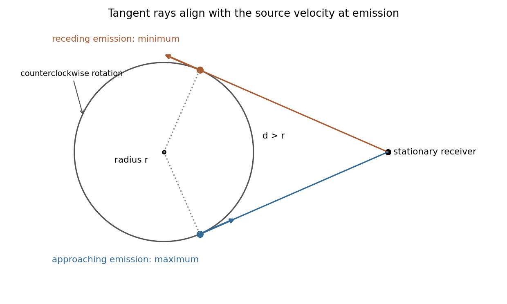

<h1 id="1/c/solution">Solution</h1>

↑ **Parent:** [C](../c.md)

Put $v=r\omega$, $\beta=v/c<1$ and $\gamma=(1-\beta^2)^{-1/2}$. For a [photon](../../../../../photon.md) emitted in laboratory direction $\mathbf n$ toward the stationary receiver, its [frequency](../../../../../frequency.md) there is

$$
\nu=\frac{\nu_0}{\gamma(1-\mathbf n\cdot\mathbf v_e/c)}.
$$

Since the receiver lies outside the circle, two emission points have a line of sight tangent to the circle. At those points the source [velocity](../../../../../velocity.md) is directly toward or away from the receiver, so $\mathbf n\cdot\mathbf v_e=\pm v$. Thus the [doppler extrema for a circularly moving source](../../../../../doppler-extrema-for-a-circularly-moving-source.md) are

$$
\boxed{\nu_{\max}=\nu_0\sqrt{\frac{1+\beta}{1-\beta}},\qquad \nu_{\min}=\nu_0\sqrt{\frac{1-\beta}{1+\beta}}.}
$$

They do not depend on $d$, provided $d>r$; changing $d$ changes the emission and reception phases of the extrema. Closest and farthest source positions instead have transverse [velocity](../../../../../velocity.md) relative to that ray, and are not the extrema.

**[Figure 1](#1/c/image-original-tangent-ray-geometry-for-the-largest-approaching-and-receding-shifts-of-a-circular-source). Original tangent-ray geometry for the largest approaching and receding shifts of a circular source**.

For the corotating receiver, [velocities](../../../../../velocity.md) must be evaluated at the actual emission and reception events. An unobstructed [vacuum](../../../../../vacuum.md) ray satisfies $\mathbf x_r-\mathbf x_e=c\Delta t\,\mathbf n$, while rigid steady rotation gives $\mathbf v_r-\mathbf v_e=\boldsymbol\omega\times(\mathbf x_r-\mathbf x_e)$. Therefore $\mathbf n\cdot\mathbf v_r=\mathbf n\cdot\mathbf v_e$. The emitter and receiver have equal [speed](../../../../../speed.md) magnitudes, hence equal [Lorentz factors](../../../../../lorentz-factor.md). The [frequency ratio of corotating clocks](../../../../../frequency-ratio-of-corotating-clocks.md) is consequently

$$
\frac{\nu_r}{\nu_0}=\frac{\gamma_r(1-\mathbf n\cdot\mathbf v_r/c)}{\gamma_e(1-\mathbf n\cdot\mathbf v_e/c)}=\boxed{1}.
$$

Thus **the rim receiver measures $\nu_0$**, independently of its angular separation. Different transit times or a [Sagnac effect](../../../../../sagnac-effect.md) do not by themselves imply a [frequency](../../../../../frequency.md) change between these identical-radius clocks. The model treats $\nu_0$ as a fixed proper clock [frequency](../../../../../frequency.md) and assumes a signal path is available; it does not specify the disc's electromagnetic opacity.

## ↑ Ancestors (14)

1. [C](../c.md)
2. [1](../../1.md)
3. [Paper 1](../../../paper-1-split.md)
4. [2016](../../../split.md)
5. [Past exam of the relativity course of the University of Cambridge](../../../../split.md)
6. [Relativity course of the University of Cambridge](../../../../../relativity-course-of-the-university-of-cambridge.md)
7. [Physics course of the year 3 of the natural sciences course of the University of Cambridge](../../../../../physics-course-of-the-year-3-of-the-natural-sciences-course-of-the-university-of-cambridge.md)
8. [Year 3 of the natural sciences course of the University of Cambridge](../../../../../year-3-of-the-natural-sciences-course-of-the-university-of-cambridge.md)
9. [Year of the natural sciences course of the University of Cambridge](../../../../../year-of-the-natural-sciences-course-of-the-university-of-cambridge.md)
10. [Natural sciences course of the University of Cambridge](../../../../../natural-sciences-course-of-the-university-of-cambridge.md)
11. [Course of the University of Cambridge](../../../../../course-of-the-university-of-cambridge.md)
12. [University of Cambridge](../../../../../university-of-cambridge-split.md)
13. [List of universities](../../../../../list-of-universities.md)
14. [Codex Wiki](../../../../../split.md)
