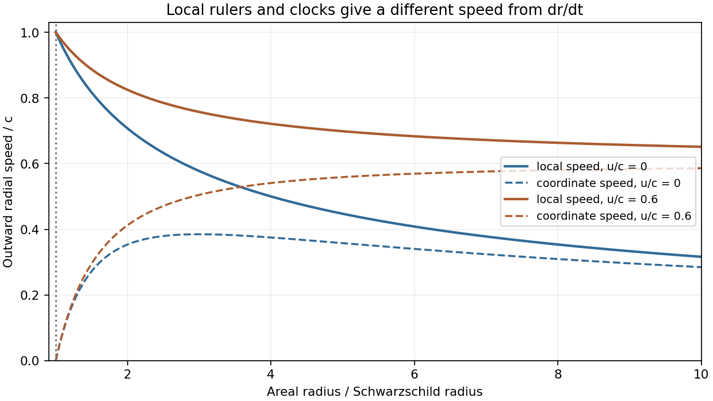

<h1 id="4/solution">Solution</h1>

↑ **Parent:** [4](../4.md)

Take $\tau$ as particle [proper time](../../../../proper-time.md), dots as $d/d\tau$, and $f(r)=1-2\mu/r$ with $\mu=GM/c^2$. In the equatorial plane the [geodesic Lagrangian](../../../../geodesic-lagrangian.md) is

$$
\mathcal L=\frac12\left(c^2f\dot t^2-f^{-1}\dot r^2-r^2\dot\phi^2\right).
$$

The [cyclic coordinates](../../../../cyclic-coordinate.md) give $d(c^2f\dot t)/d\tau=0$ and $d(-r^2\dot\phi)/d\tau=0$. Set the resulting constants to $c^2k$ and $-h$ respectively. The explicit second-order equations are

$$
\boxed{\ddot t+\frac{f'}f\dot r\dot t=0,\qquad \ddot\phi+\frac2r\dot r\dot\phi=0,}
$$

$$
\boxed{\ddot r-\frac{f'}{2f}\dot r^2+\frac{c^2ff'}2\dot t^2-rf\dot\phi^2=0,\qquad f'=\frac{2\mu}{r^2}.}
$$

The polar equation is satisfied by $\theta=\pi/2$, $\dot\theta=0$, consistently with [spherical symmetry](../../../../spherical-symmetry.md). The proper-time normalization $ds^2=c^2d\tau^2$ supplies the third first integral:

$$
\boxed{f\dot t=k,\qquad r^2\dot\phi=h,\qquad c^2f\dot t^2-f^{-1}\dot r^2-r^2\dot\phi^2=c^2.}
$$

The normalization is $2\mathcal L=c^2$; it is distinct from choosing an arbitrary affine tangent's norm.

Stationarity and axial symmetry make the covariant time and azimuthal momenta constant. For physical momentum and coordinate $t$ in seconds, $P_t=mc^2f\dot t=mc^2k$ and $P_\phi=-mr^2\dot\phi=-mh$. Thus **$mc^2k$ is the conserved [energy](../../../../energy-split.md) normalized at infinity and $mh$ is the signed axial [angular momentum](../../../../angular-momentum.md)**. This is [Killing energy with positive time signature](../../../../killing-energy-with-positive-time-signature.md); a convention with negative timelike norm uses the opposite contraction sign. The supplied covariant-momentum form of the [geodesic equation](../../../../geodesic-equation.md) makes these cyclic constants immediate, but its parametrization must be understood: for $p^\mu=dx^\mu/d\lambda$ it is exactly as written. For physical $P^\mu=m\,dx^\mu/d\tau$, proper-time differentiation instead gives $dP_\mu/d\tau=(\partial_\mu g_{\nu\sigma})P^\nu P^\sigma/(2m)$; equivalently, the displayed mass-free form uses $\lambda=\tau/m$. This affine momentum normalization does not change either conservation law.

Multiply the normalization equation by $f$ and substitute the two cyclic integrals. Rearrangement gives the radial [energy](../../../../energy-split.md) equation

$$
\boxed{\dot r^2+\frac{h^2}{r^2}\left(1-\frac{2\mu}r\right)-\frac{2c^2\mu}r=c^2(k^2-1).}
$$

For radial marginal escape $h=0$ and the future-directed constant is $k=1$, because the [speed](../../../../speed.md) at infinity vanishes. Choose the outward root:

$$
\dot r=\sqrt{\frac{2GM}{r}},\qquad \frac23(r^{3/2}-r_0^{3/2})=\sqrt{2GM}\,\tau.
$$

Hence the [marginal escape geodesic in Schwarzschild spacetime](../../../../marginal-escape-geodesic-in-schwarzschild-spacetime.md) has

$$
\boxed{r(\tau)=\left(r_0^{3/2}+a\tau\right)^{2/3},\qquad a=\frac32\sqrt{2GM}=\frac{3c}{2}\sqrt{2\mu}.}
$$

The constant $a$ has units of [length](../../../../length.md) to the power $3/2$ divided by time. This radius is an areal coordinate, not accumulated local proper [distance](../../../../distance.md).

A [Schwarzschild static observer](../../../../schwarzschild-static-observer.md) at exterior radius $r$ uses local radial rulers $d\ell=dr/\sqrt f$ and a local clock $dT=\sqrt f\,dt$. Therefore the [local radial speed of a Schwarzschild geodesic](../../../../local-radial-speed-of-a-schwarzschild-geodesic.md) is

$$
v_{\rm loc}=\frac{d\ell}{dT}=\frac1f\frac{dr}{dt}=\frac{\dot r}{k}.
$$

For the marginal trajectory $k=1$ this gives

$$
\boxed{v_{\rm loc}=\sqrt{\frac{2GM}{r}}.}
$$

Its equality to $\dot r$ is particular to $k=1$; the local definition, rather than that accidental equality, is the required observer measurement. The Schwarzschild-coordinate [velocity](../../../../velocity.md) is instead $dr/dt=f\sqrt{2GM/r}$.

For nonzero asymptotic [speed](../../../../speed.md) $0\le u<c$, the same [energy](../../../../energy-split.md) constant is $k=\gamma_\infty=(1-u^2/c^2)^{-1/2}$. Combining the radial equation with the local-ruler relation gives [radial Schwarzschild escape with asymptotic speed](../../../../radial-schwarzschild-escape-with-asymptotic-speed.md)

$$
\boxed{v_{\rm loc}(r)=c\sqrt{1-\frac{f}{k^2}}=\sqrt{u^2+\frac{2GM}{r}\left(1-\frac{u^2}{c^2}\right)}.}
$$

The positive root describes the outward particle, at radii on its trajectory with $r\ge r_0$. Independently, a static observer has [four-velocity](../../../../four-velocity.md) $U=(1/\sqrt f,0,0,0)$ in these coordinates, giving relative [Lorentz factor](../../../../lorentz-factor.md) $g(U,u_{\rm particle})/c^2=\sqrt f\dot t=k/\sqrt f$ and the same [speed](../../../../speed.md). As $r\to\infty$ it tends to $u$; for $u=0$ it gives the preceding result. Its limiting value approaches $c$ as $r\downarrow2GM/c^2$, but that is a limit through exterior observers: **no static timelike observer exists on or inside the horizon**.

**[Figure 4](#4/image-original-comparison-of-local-static-observer-and-schwarzschild-coordinate-radial-speeds-for-illustrative-asymptotic-speeds). Original comparison of local static-observer and Schwarzschild-coordinate radial speeds, for illustrative asymptotic speeds**.

## ↑ Ancestors (13)

1. [4](../4.md)
2. [Paper 1](../../paper-1-split.md)
3. [2016](../../split.md)
4. [Past exam of the relativity course of the University of Cambridge](../../../split.md)
5. [Relativity course of the University of Cambridge](../../../../relativity-course-of-the-university-of-cambridge.md)
6. [Physics course of the year 3 of the natural sciences course of the University of Cambridge](../../../../physics-course-of-the-year-3-of-the-natural-sciences-course-of-the-university-of-cambridge.md)
7. [Year 3 of the natural sciences course of the University of Cambridge](../../../../year-3-of-the-natural-sciences-course-of-the-university-of-cambridge.md)
8. [Year of the natural sciences course of the University of Cambridge](../../../../year-of-the-natural-sciences-course-of-the-university-of-cambridge.md)
9. [Natural sciences course of the University of Cambridge](../../../../natural-sciences-course-of-the-university-of-cambridge.md)
10. [Course of the University of Cambridge](../../../../course-of-the-university-of-cambridge.md)
11. [University of Cambridge](../../../../university-of-cambridge-split.md)
12. [List of universities](../../../../list-of-universities.md)
13. [Codex Wiki](../../../../split.md)
