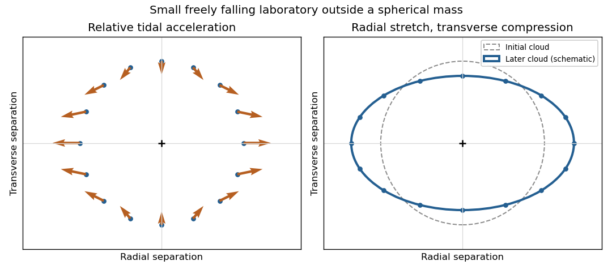

<h1 id="2/b/solution">Solution</h1>

↑ **Parent:** [B](../b.md)

Nearby freely falling particles can accelerate relative to one another even though each follows a [geodesic](../../../../geodesic.md). A local [inertial frame](../../../../inertial-frame.md) removes the common gravitational acceleration at one event; it cannot remove the variation across an extended laboratory. That variation is a [tidal force](../../../../tidal-force.md), measured covariantly by [geodesic deviation](../../../../geodesic-deviation.md).

Let $u^\mu$ be the reference [four-velocity](../../../../four-velocity.md) and $\xi^\mu$ an infinitesimal separation to a neighboring [geodesic](../../../../geodesic.md), with matching [affine parameters](../../../../affine-parameter.md). With the convention $[\nabla_\beta,\nabla_\gamma]V^\mu=R^\mu{}_{\nu\beta\gamma}V^\nu$,

$$
\boxed{\frac{D^2\xi^\mu}{D\tau^2}=R^\mu{}_{\alpha\beta\gamma}u^\alpha u^\beta\xi^\gamma.}
$$

This relates measured relative [acceleration](../../../../acceleration.md) to the [Riemann curvature tensor](../../../../riemann-curvature-tensor-split.md). Reversing the curvature-tensor convention reverses the displayed curvature sign, without changing the physical relative motion.

In a small freely falling frame outside a spherical mass, the weak-field [tidal tensor](../../../../tidal-tensor.md) has radial and transverse components proportional to $2,-1,-1$. Thus

$$
\boxed{\ddot\xi_r=\frac{2GM}{r^3}\xi_r,\qquad
\ddot\xi_{\perp}=-\frac{GM}{r^3}\xi_{\perp}.}
$$

An initially spherical cloud stretches radially and compresses in both transverse directions. Two separated test masses, with their changing separation measured by light, form the basic idea of a gravity gradiometer; the common falling motion drops out. A uniform apparent acceleration in an accelerated laboratory can occur even in flat [Minkowski spacetime](../../../../minkowski-spacetime.md), so it is the separation-dependent tidal response that diagnoses curvature.

**[Figure 1](#2/b/image-radial-stretching-and-transverse-compression-from-geodesic-deviation). Radial stretching and transverse compression from geodesic deviation**. Original local schematic of the weak-field [tidal tensor](../../../../tidal-tensor.md) around a freely falling reference particle. Arrows show relative [acceleration](../../../../acceleration.md), with radial direction horizontal; the cloud deformation is exaggerated and is not a trajectory calculation.

## ↑ Ancestors (13)

1. [B](../b.md)
2. [2](../../2.md)
3. [2017](../../../2017-split.md)
4. [Past exam of the relativity course of the University of Cambridge](../../../split.md)
5. [Relativity course of the University of Cambridge](../../../../relativity-course-of-the-university-of-cambridge.md)
6. [Physics course of the year 3 of the natural sciences course of the University of Cambridge](../../../../physics-course-of-the-year-3-of-the-natural-sciences-course-of-the-university-of-cambridge.md)
7. [Year 3 of the natural sciences course of the University of Cambridge](../../../../year-3-of-the-natural-sciences-course-of-the-university-of-cambridge.md)
8. [Year of the natural sciences course of the University of Cambridge](../../../../year-of-the-natural-sciences-course-of-the-university-of-cambridge.md)
9. [Natural sciences course of the University of Cambridge](../../../../natural-sciences-course-of-the-university-of-cambridge.md)
10. [Course of the University of Cambridge](../../../../course-of-the-university-of-cambridge.md)
11. [University of Cambridge](../../../../university-of-cambridge-split.md)
12. [List of universities](../../../../list-of-universities.md)
13. [Codex Wiki](../../../../split.md)
