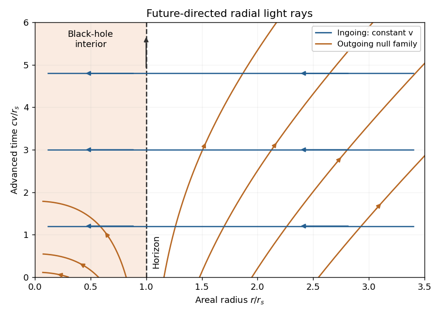

<h1 id="2/c/solution">Solution</h1>

↑ **Parent:** [C](../c.md)

Write $r_s=2GM/c^2$ and $f=1-r_s/r$. The [Schwarzschild tortoise coordinate](../../../../schwarzschild-tortoise-coordinate.md) satisfies $dr_*/dr=1/f$ and can be chosen as $r_*=r+r_s\ln|r/r_s-1|$. Define the advanced time $v=t+r_*/c$. Substituting $dt=dv-dr/(cf)$ into the [Schwarzschild metric](../../../../schwarzschild-spacetime-split.md) gives the [ingoing Eddington-Finkelstein coordinates](../../../../ingoing-eddington-finkelstein-coordinates.md) form

$$
\boxed{ds^2=f c^2dv^2-2c\,dv\,dr-r^2d\Omega^2.}
$$

The coefficients are regular at $r=r_s$ and the radial-block determinant is $-c^2$, so the exterior Schwarzschild-time divergence is a coordinate singularity at the future [event horizon](../../../../event-horizon.md). The physical curvature singularity at $r=0$ remains.

The two families of [radial null trajectories in ingoing Eddington-Finkelstein coordinates](../../../../radial-null-trajectories-in-ingoing-eddington-finkelstein-coordinates.md) obey

$$
\boxed{v=\mathrm{constant}\quad\text{(ingoing)},\qquad
\frac{dr}{dv}=\frac c2\left(1-\frac{r_s}{r}\right)\quad\text{(outgoing)}.}
$$

Outside the [event horizon](../../../../event-horizon.md), the outgoing family increases $r$; at the horizon it generates the horizon itself; inside, even the outgoing future-directed family decreases $r$. An infaller crosses the future horizon at finite $v$ and finite [proper time](../../../../proper-time.md). The chart makes this causal geometry visible without mistaking Schwarzschild coordinate time for the infaller's clock.

**[Figure 2](#2/c/image-radial-null-rays-in-advanced-eddington-finkelstein-coordinates). Radial null rays in advanced Eddington-Finkelstein coordinates**. Original plot of $v=\mathrm{constant}$ ingoing rays and $dr/dv=(1-r_s/r)/2$ outgoing rays in dimensionless units. Arrows indicate the future direction. Both families move toward smaller [areal radius](../../../../areal-radius.md) inside the [Schwarzschild event horizon](../../../../schwarzschild-event-horizon.md); this is an uncompactified coordinate diagram.

## ↑ Ancestors (13)

1. [C](../c.md)
2. [2](../../2.md)
3. [2017](../../../2017-split.md)
4. [Past exam of the relativity course of the University of Cambridge](../../../split.md)
5. [Relativity course of the University of Cambridge](../../../../relativity-course-of-the-university-of-cambridge.md)
6. [Physics course of the year 3 of the natural sciences course of the University of Cambridge](../../../../physics-course-of-the-year-3-of-the-natural-sciences-course-of-the-university-of-cambridge.md)
7. [Year 3 of the natural sciences course of the University of Cambridge](../../../../year-3-of-the-natural-sciences-course-of-the-university-of-cambridge.md)
8. [Year of the natural sciences course of the University of Cambridge](../../../../year-of-the-natural-sciences-course-of-the-university-of-cambridge.md)
9. [Natural sciences course of the University of Cambridge](../../../../natural-sciences-course-of-the-university-of-cambridge.md)
10. [Course of the University of Cambridge](../../../../course-of-the-university-of-cambridge.md)
11. [University of Cambridge](../../../../university-of-cambridge-split.md)
12. [List of universities](../../../../list-of-universities.md)
13. [Codex Wiki](../../../../split.md)
