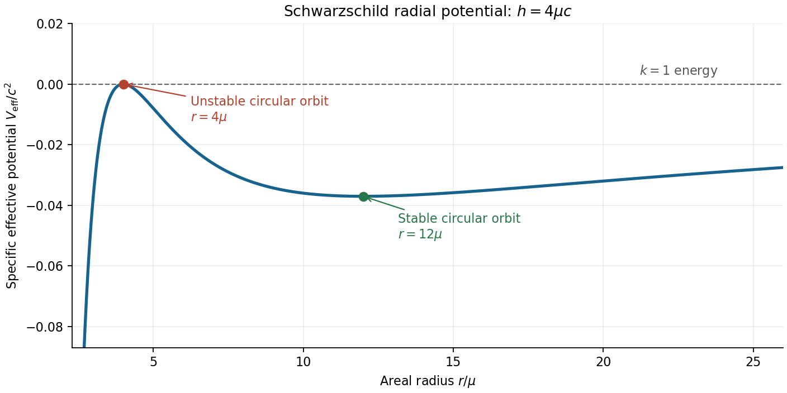

<h1 id="section-b/b3/solution">Solution</h1>

↑ **Parent:** [B3](../b3.md)

Use the $+---$ [metric signature](../../../../metric-signature.md) and abbreviate $f(r)=1-2\mu/r$, with $\mu=GM/c^2$ a length. Dots initially mean differentiation with respect to an [affine parameter](../../../../affine-parameter.md) $\lambda$. The [geodesic Lagrangian](../../../../geodesic-lagrangian.md) in the equatorial plane is

$$
\mathcal L=\frac12\left(c^2f\dot t^2-\frac{\dot r^2}{f}-r^2\dot\phi^2\right).
$$

The [planarity of geodesics in spherical symmetry](../../../../planarity-of-geodesics-in-spherical-symmetry.md) permits this plane to be chosen. More explicitly, the full angular [Euler-Lagrange equation](../../../../euler-lagrange-equation.md) is $\ddot\theta+2\dot r\dot\theta/r-\sin\theta\cos\theta\,\dot\phi^2=0$, so initial data $\theta=\pi/2$, $\dot\theta=0$ preserve it.

Both $t$ and $\phi$ are [cyclic coordinates](../../../../cyclic-coordinate.md). Their [Euler-Lagrange equations](../../../../euler-lagrange-equation.md) give conserved conjugate momenta $p_t=c^2f\dot t$ and $p_\phi=-r^2\dot\phi$. Defining constants $k,h$ therefore gives

$$
\boxed{f\dot t=k,\qquad r^2\dot\phi=h.}
$$

The corresponding second-order [geodesic equations](../../../../geodesic-equation.md) are

$$
\ddot t+\frac{f'}f\dot r\dot t=0,\qquad
\ddot\phi+\frac2r\dot r\dot\phi=0,
$$

and variation of $r$ gives

$$
\boxed{\ddot r-\frac{f'}{2f}\dot r^2+\frac{c^2ff'}2\dot t^2-fr\dot\phi^2=0,\qquad f'=\frac{2\mu}{r^2}.}
$$

The [geodesic Lagrangian](../../../../geodesic-lagrangian.md) has no explicit $\lambda$ dependence. Its conserved Lagrangian [energy function](../../../../energy-function.md) is $\dot x^\alpha\partial\mathcal L/\partial\dot x^\alpha-\mathcal L=\mathcal L$, since it is quadratic in the tangent components. Thus twice this function is a constant:

$$
\boxed{c^2f\dot t^2-\frac{\dot r^2}{f}-r^2\dot\phi^2=\kappa.}
$$

This is the constant squared tangent norm of an affinely parametrized [geodesic](../../../../geodesic.md).

For a massive particle choose $\lambda=\tau$, its [proper time](../../../../proper-time.md), and obtain **$\kappa=c^2$**. For a [photon](../../../../photon.md), the tangent is null and **$\kappa=0$**. A general rescaling of a massive particle's [affine parameter](../../../../affine-parameter.md) rescales a positive $\kappa$; the numerical value $c^2$ requires the [proper time](../../../../proper-time.md) choice. With that choice, $h=L_z/m$ is signed [specific angular momentum](../../../../specific-angular-momentum.md), of units $\mathrm{m^2\,s^{-1}}$, and $k=E/(mc^2)$ is dimensionless conserved specific [Killing energy](../../../../killing-energy.md). The time coordinate is normalized to [proper time](../../../../proper-time.md) at infinity, so this $E$ is the particle's conserved [energy](../../../../energy-split.md) referred to infinity. A [photon](../../../../photon.md)'s constants scale with the normalization of its null tangent; it has no [rest frame](../../../../rest-frame.md) or [proper time](../../../../proper-time.md) parametrization.

Substitution of $\dot t=k/f$ and $\dot\phi=h/r^2$ into the norm gives the general radial first integral

$$
\dot r^2=c^2k^2-f\left(\kappa+\frac{h^2}{r^2}\right).
$$

For a massive particle this becomes

$$
\boxed{c^2(k^2-1)=\dot r^2-\frac{2\mu c^2}{r}
+\frac{h^2}{r^2}\left(1-\frac{2\mu}{r}\right).}
$$

Adopting the usual half-normalization for the [effective potential for timelike Schwarzschild geodesics](../../../../effective-potential-for-timelike-schwarzschild-geodesics.md), define

$$
\frac12\dot r^2+V_{\rm eff}(r)=\frac{c^2}2(k^2-1),\qquad
\boxed{V_{\rm eff}(r)=-\frac{\mu c^2}{r}+\frac{h^2}{2r^2}-\frac{\mu h^2}{r^3}.}
$$

All terms have units $\mathrm{m^2\,s^{-2}}$, or [energy](../../../../energy-split.md) per unit [mass](../../../../mass.md). The first two terms are the Newtonian gravitational and centrifugal contributions; the last is the relativistic correction.

A [circular orbit](../../../../circular-orbit.md) requires both $\dot r=0$ and $V'_{\rm eff}(R)=0$. Differentiating at fixed $h$ gives

$$
0=\frac{\mu c^2}{R^2}-\frac{h^2}{R^3}+\frac{3\mu h^2}{R^4},
\qquad
\boxed{h^2=\frac{\mu c^2R^2}{R-3\mu}},\qquad R>3\mu.
$$

The radial first integral also gives

$$
k^2=\frac{(R-2\mu)^2}{R(R-3\mu)}.
$$

For the future-directed circular orbit at $R=4\mu$, these constants are $|h|=4\mu c$, $k=1$, and $f=1/2$. Therefore

$$
\dot t=2,\qquad |\dot\phi|=\frac{c}{4\mu},\qquad
\left|\frac{d\phi}{dt}\right|=\frac{c}{8\mu}.
$$

Since [Schwarzschild time](../../../../schwarzschild-time.md) agrees with the clock time of a static observer at infinity, the intended infinity-referred tangential [orbital speed](../../../../orbital-speed.md) is

$$
\boxed{v_\infty=R\left|\frac{d\phi}{dt}\right|=\frac c2.}
$$

This uses the circumferential [areal radius](../../../../areal-radius.md) $R$ with the clock at infinity; it is not a local measurement made at the orbit. A local static observer's clock instead has $d\tau_{\rm stat}=\sqrt f\,dt$ and measures $v_{\rm local}=v_\infty/\sqrt f=\boxed{c/\sqrt2}$. These two operationally different speeds explain the significance of the phrase “at infinity”.

The [effective-potential stability of a circular orbit](../../../../effective-potential-stability-of-a-circular-orbit.md) follows from

$$
V''_{\rm eff}(R)=\frac{\mu c^2(R-6\mu)}{R^3(R-3\mu)}.
$$

Consequently the $R=4\mu$ orbit exists but is unstable to radial perturbations. The original plot below shows its position at a maximum, for $h=4\mu c$.

**[Figure 1](#section-b/b3/image-schwarzschild-effective-potential-for-specific-angular-momentum-h-4-mu-c). Schwarzschild effective potential for specific angular momentum h = 4 mu c**.

For a weak-field [elliptic orbit](../../../../elliptic-orbit.md), the relativistic correction makes the direction of closest approach advance after each radial cycle. The derivations under i and ii below give

$$
\boxed{\Delta\phi=\frac{6\pi GM}{c^2a_{\rm orb}(1-e^2)}}
$$

per orbit to first order, where $a_{\rm orb}$ is the [semi-major axis](../../../../semi-major-axis.md) and $e$ the [orbital eccentricity](../../../../orbital-eccentricity.md). For [Mercury](../../../../mercury-planet.md), the additional [Schwarzschild perihelion precession](../../../../schwarzschild-perihelion-precession.md) is approximately **43 arcseconds per century**, over and above the much larger Newtonian precession produced primarily by other planets. It is the unexplained residual after those effects have been included that provides the classic quantitative test of [general relativity](../../../../general-relativity-split.md); one should not identify the whole observed precession with this relativistic correction.[PDF p. 2: planetary perturbations about 531.63 arcseconds per Julian century and additional relativistic precession about 42.98 arcseconds per Julian century](https://ntrs.nasa.gov/api/citations/20180000952/downloads/20180000952.pdf)

The labels i and ii in the original paper introduce optional orbit-equation aids, rather than separate mandatory subquestions. They are retained here for derivations of both aids and of the perihelion result.

## ↑ Ancestors (13)

1. [B3](../b3.md)
2. [Section B](../../section-b.md)
3. [2018](../../../2018-split.md)
4. [Past exam of the relativity course of the University of Cambridge](../../../split.md)
5. [Relativity course of the University of Cambridge](../../../../relativity-course-of-the-university-of-cambridge.md)
6. [Physics course of the year 3 of the natural sciences course of the University of Cambridge](../../../../physics-course-of-the-year-3-of-the-natural-sciences-course-of-the-university-of-cambridge.md)
7. [Year 3 of the natural sciences course of the University of Cambridge](../../../../year-3-of-the-natural-sciences-course-of-the-university-of-cambridge.md)
8. [Year of the natural sciences course of the University of Cambridge](../../../../year-of-the-natural-sciences-course-of-the-university-of-cambridge.md)
9. [Natural sciences course of the University of Cambridge](../../../../natural-sciences-course-of-the-university-of-cambridge.md)
10. [Course of the University of Cambridge](../../../../course-of-the-university-of-cambridge.md)
11. [University of Cambridge](../../../../university-of-cambridge-split.md)
12. [List of universities](../../../../list-of-universities.md)
13. [Codex Wiki](../../../../split.md)
