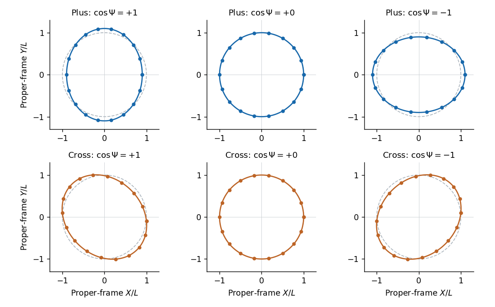

<h1 id="section-b/5/c/solution">Solution</h1>

↑ **Parent:** [C](../c.md)

For the supplied [plus polarization](../../../../../plus-polarization.md), the perturbation is traceless, so $h_{\mu\nu}=\phi_{\mu\nu}$. At a fixed longitudinal coordinate $z_0$, put $H(t)=h_\oplus\cos[\omega(t-z_0)]$. With the $+---$ convention chosen above, the transverse spatial metric measuring positive squared lengths is

$$
d\ell^2=(1-H)dx^2+(1+H)dy^2.
$$

The initial coordinate separation is $(\Delta\cos\theta,\Delta\sin\theta)$ and remains constant in [transverse-traceless gauge](../../../../../transverse-traceless-gauge.md): $h_{00}=h_{0i}=0$ implies $\Gamma^i{}_{00}=0$, so initially stationary particles stay at fixed spatial coordinates. Their measured [proper length](../../../../../proper-length.md) is instead

$$
\boxed{\ell(t)=\Delta\sqrt{1-h_\oplus\cos(2\theta)\cos[\omega(t-z_0)]}
=\Delta\left[1-\frac{h_\oplus}{2}\cos(2\theta)\cos[\omega(t-z_0)]\right]+O(h_\oplus^2).}
$$

The first expression is understood within the linearized metric; only its first-order expansion is controlled. Separation along the two transverse axes varies oppositely; at $45$ degrees there is no first-order length modulation. This is the [angular response of a gravitational-wave separation](../../../../../angular-response-of-a-gravitational-wave-separation.md), despite constant coordinate separation.

If the background is instead chosen as $-+++$ while keeping the same numerical spatial amplitude, the displayed length modulation has the opposite sign. The question does not state a signature here; the convention above agrees with its earlier explicitly specified [Minkowski metric](../../../../../minkowski-metric.md). The physical alternating stretch-compress pattern is unchanged by consistently redefining the signed amplitude.

**[Figure 1](#section-b/5/c/image-plus-and-cross-gravitational-wave-distortions-of-a-freely-falling-particle-ring). Plus and cross gravitational-wave distortions of a freely falling particle ring**. Original first-order proper-frame displacement calculation for an illustrative amplitude 0.2. The undeformed coordinate ring is shown faintly. The columns show opposite extrema and a zero of the wave phase; the cross pattern is rotated by 45 degrees relative to the plus pattern. Signs follow the $+---$ metric convention used in the solution.

## ↑ Ancestors (14)

1. [C](../c.md)
2. [5](../../5.md)
3. [Section B](../../../section-b.md)
4. [2021](../../../../2021-split.md)
5. [Past exam of the relativity course of the University of Cambridge](../../../../split.md)
6. [Relativity course of the University of Cambridge](../../../../../relativity-course-of-the-university-of-cambridge.md)
7. [Physics course of the year 3 of the natural sciences course of the University of Cambridge](../../../../../physics-course-of-the-year-3-of-the-natural-sciences-course-of-the-university-of-cambridge.md)
8. [Year 3 of the natural sciences course of the University of Cambridge](../../../../../year-3-of-the-natural-sciences-course-of-the-university-of-cambridge.md)
9. [Year of the natural sciences course of the University of Cambridge](../../../../../year-of-the-natural-sciences-course-of-the-university-of-cambridge.md)
10. [Natural sciences course of the University of Cambridge](../../../../../natural-sciences-course-of-the-university-of-cambridge.md)
11. [Course of the University of Cambridge](../../../../../course-of-the-university-of-cambridge.md)
12. [University of Cambridge](../../../../../university-of-cambridge-split.md)
13. [List of universities](../../../../../list-of-universities.md)
14. [Codex Wiki](../../../../../split.md)
