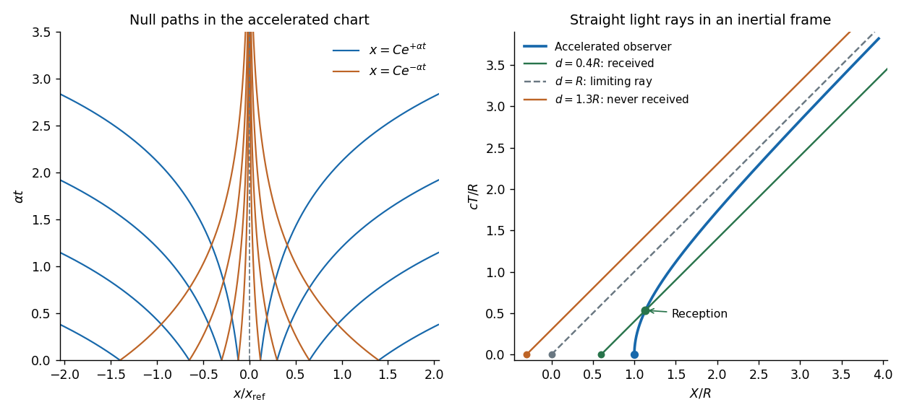

<h1 id="section-b/6/a/solution">Solution</h1>

↑ **Parent:** [A](../a.md)

Take $\alpha>0$ and work in a connected patch with $x\ne0$. Setting the line element to zero gives

$$
\frac{dx}{dt}=\pm\alpha x,\qquad
\boxed{x(t)=C e^{\pm\alpha t},\quad C\ne0.}
$$

These are the two families of [Rindler null geodesics](../../../../../rindler-null-geodesics.md). They remain on the same side of $x=0$ and approach it only at infinite coordinate time. $x=0$ itself is not an additional [geodesic](../../../../../geodesic.md) within this chart, since the metric is degenerate there.

The paths can also be written $t=\pm\alpha^{-1}\log|x/C|$. In two dimensions a null direction has only one independent orthogonal null direction, namely itself, so each smooth [null curve](../../../../../null-curve.md) is a [geodesic](../../../../../geodesic.md) after reparametrization. More explicitly, the transformation in part (d) makes these paths straight null lines. The coordinate $t$ is generally not an [affine parameter](../../../../../affine-parameter.md).

**[Figure 2](#section-b/6/a/image-rindler-light-rays-and-the-reception-horizon-of-a-uniformly-accelerated-observer). Rindler light rays and the reception horizon of a uniformly accelerated observer**. Original diagrams. The left panel shows the two exponential null families on both sides of the excluded $x=0$ chart boundary. The right panel uses inertial coordinates: a hyperbolic observer receives a signal emitted within its horizon, but cannot receive the horizon ray or a ray emitted farther behind. Length and time are normalized by $R=c^2/a$.

## ↑ Ancestors (14)

1. [A](../a.md)
2. [6](../../6.md)
3. [Section B](../../../section-b.md)
4. [2021](../../../../2021-split.md)
5. [Past exam of the relativity course of the University of Cambridge](../../../../split.md)
6. [Relativity course of the University of Cambridge](../../../../../relativity-course-of-the-university-of-cambridge.md)
7. [Physics course of the year 3 of the natural sciences course of the University of Cambridge](../../../../../physics-course-of-the-year-3-of-the-natural-sciences-course-of-the-university-of-cambridge.md)
8. [Year 3 of the natural sciences course of the University of Cambridge](../../../../../year-3-of-the-natural-sciences-course-of-the-university-of-cambridge.md)
9. [Year of the natural sciences course of the University of Cambridge](../../../../../year-of-the-natural-sciences-course-of-the-university-of-cambridge.md)
10. [Natural sciences course of the University of Cambridge](../../../../../natural-sciences-course-of-the-university-of-cambridge.md)
11. [Course of the University of Cambridge](../../../../../course-of-the-university-of-cambridge.md)
12. [University of Cambridge](../../../../../university-of-cambridge-split.md)
13. [List of universities](../../../../../list-of-universities.md)
14. [Codex Wiki](../../../../../split.md)
