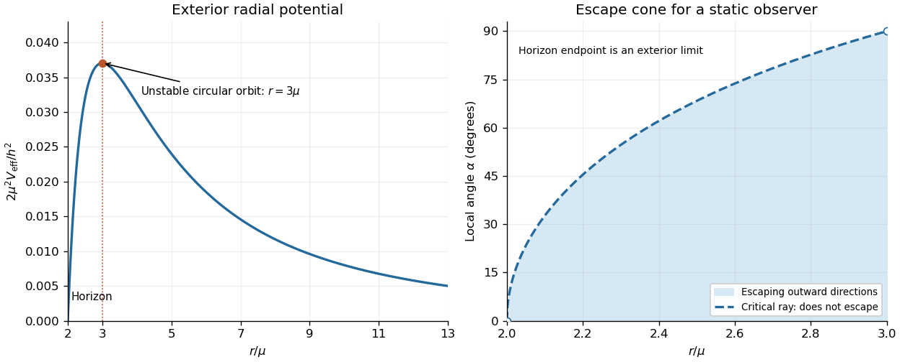

<h1 id="section-b/5/c/solution">Solution</h1>

↑ **Parent:** [C](../c.md)

For $h\ne0$, the [effective potential](../../../../../effective-potential.md) vanishes at $r=2\mu$, rises to a maximum, and then falls to zero as $r\to\infty$. Its [derivative](../../../../../derivative.md) is $V'_{\rm eff}=h^2(3\mu-r)/r^4$, so the only circular [null geodesic](../../../../../null-geodesic.md) has

$$
\boxed{r=3\mu,\qquad V_{\rm eff}=\frac{h^2}{54\mu^2}.}
$$

The second derivative there is $V''_{\rm eff}=-h^2/(81\mu^4)<0$, proving instability by the [effective potential stability criterion](../../../../../effective-potential-stability-criterion.md). These circular orbits make up the [photon sphere](../../../../../photon-sphere.md). If the formula is continued inside the horizon, the potential is negative and diverges to $-\infty$ as $r\downarrow0$. For purely radial light, $h=0$, the potential is identically zero and there is no circular orbit.

**[Figure 1](#section-b/5/c/image-schwarzschild-null-radial-potential-and-the-static-observer-escape-cone-inside-the-photon-sphere). Schwarzschild null radial potential and the static-observer escape cone inside the photon sphere**. Original dimensionless plots. The left panel shows the exterior potential and its maximum at $r=3\mu$; the right panel shows the critical escape half-angle for $2\mu<r\le3\mu$. The horizon endpoint is a limit of exterior static observations.

## ↑ Ancestors (14)

1. [C](../c.md)
2. [5](../../5.md)
3. [Section B](../../../section-b.md)
4. [2022](../../../../2022-split.md)
5. [Past exam of the relativity course of the University of Cambridge](../../../../split.md)
6. [Relativity course of the University of Cambridge](../../../../../relativity-course-of-the-university-of-cambridge.md)
7. [Physics course of the year 3 of the natural sciences course of the University of Cambridge](../../../../../physics-course-of-the-year-3-of-the-natural-sciences-course-of-the-university-of-cambridge.md)
8. [Year 3 of the natural sciences course of the University of Cambridge](../../../../../year-3-of-the-natural-sciences-course-of-the-university-of-cambridge.md)
9. [Year of the natural sciences course of the University of Cambridge](../../../../../year-of-the-natural-sciences-course-of-the-university-of-cambridge.md)
10. [Natural sciences course of the University of Cambridge](../../../../../natural-sciences-course-of-the-university-of-cambridge.md)
11. [Course of the University of Cambridge](../../../../../course-of-the-university-of-cambridge.md)
12. [University of Cambridge](../../../../../university-of-cambridge-split.md)
13. [List of universities](../../../../../list-of-universities.md)
14. [Codex Wiki](../../../../../split.md)
