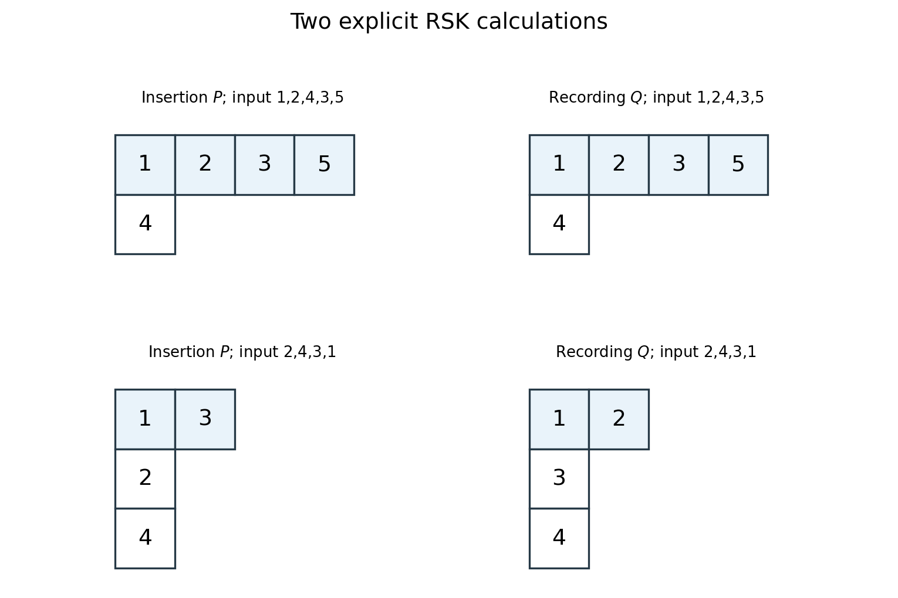

# 2011

↑ **Parent:** [Past exam of the representation Theory of Symmetric Groups course of the University of Oxford](../past-exam-of-the-representation-theory-of-symmetric-groups-course-of-the-university-of-oxford.md)

Source paper: [FOI request thread](https://www.whatdotheyknow.com/request/maths_past_papers_3). The cover identifies Representation Theory of Symmetric Groups, C2.1b, Tuesday 14 June 2011, 2.30pm to 4.00pm. Its three readable pages are original private-bundle pages 408–410. The characteristic-two scope of question 2 and the RSK premise in question 3 are addressed explicitly in the solutions.

**Table of contents**

- [1](#1)
  - [a](#1/a)
    - [Solution](#1/a/solution)
  - [b](#1/b)
    - [Solution](#1/b/solution)
  - [c](#1/c)
    - [Solution](#1/c/solution)
- [2](#2)
  - [a](#2/a)
    - [Solution](#2/a/solution)
  - [b](#2/b)
    - [Solution](#2/b/solution)
  - [c](#2/c)
    - [Solution](#2/c/solution)
  - [d](#2/d)
    - [Solution](#2/d/solution)
- [3](#3)
  - [a](#3/a)
    - [Solution](#3/a/solution)
  - [b](#3/b)
    - [Solution](#3/b/solution)
  - [c](#3/c)
    - [Solution](#3/c/solution)
  - [d](#3/d)
    - [Solution](#3/d/solution)

## 1

↑ **Parent:** [2011](2011.md)

<h3 id="1/a">a</h3>

↑ **Parent:** [1](#1)

<h4 id="1/a/solution">Solution</h4>

↑ **Parent:** [A](#1/a)

The [Murnaghan–Nakayama rule](../representation-theory-of-the-symmetric-group.md#murnaghan-nakayama-rule) computes an [irreducible character](../representation-theory.md#irreducible-character) on a [permutation](../combinatorics.md#permutation) with a specified cycle of [length](../physics.md#length) $r$ by

$$
\boxed{\chi_\lambda((r)\rho)=\sum_{\substack{\nu\vdash n-r\\\lambda/\nu\text{ a rim hook of size }r}}(-1)^{\ell(\lambda/\nu)}\chi_\nu(\rho).}
$$

Here the leg [length](../physics.md#length) is one less than the number of occupied rows, and iteration ends at the empty [partition](../representation-theory-of-the-symmetric-group.md#partition-of-an-integer) with [character](../representation-theory.md#character-of-a-representation) value one. Conjugating a [partition](../representation-theory-of-the-symmetric-group.md#partition-of-an-integer) twists its [character](../representation-theory.md#character-of-a-representation) by the sign [character](../representation-theory.md#character-of-a-representation):

$$
\boxed{\chi_{\lambda'}(\sigma)=\operatorname{sgn}(\sigma)\chi_\lambda(\sigma).}
$$

For a [transposition](../combinatorics.md#transposition-permutation), remove a rim domino and evaluate the remaining [character](../representation-theory.md#character-of-a-representation) at the identity of $S_3$. The three possible remaining shapes $(3),(2,1),(1^3)$ have degrees $1,2,1$ by the [hook](../representation-theory-of-the-symmetric-group.md#hook-of-a-young-diagram) formula. For $(5)$ the single removable horizontal domino leaves $(3)$, giving one. For $(4,1)$ the only rim domino leaves $(2,1)$, giving two. For $(3,2)$ the removable bottom-row domino leaves $(3)$, giving one. For $(3,1,1)$, a horizontal domino leaves $(1^3)$ and a vertical domino leaves $(3)$; their contributions are $1-1=0$. The conjugate-partition identity gives the remaining three values with reversed sign.

The [Hook-length formula](../representation-theory-of-the-symmetric-group.md#hook-length-formula) is $\chi_\lambda(1)=5!/\prod_{u\in[\lambda]}h(u)$. Both requested columns are therefore

$$
\boxed{\begin{array}{c|r|r|r}
\lambda&\prod h(u)&\chi_\lambda(1)&\chi_\lambda((12))\\\hline
(5)&120&1&1\\
(4,1)&30&4&2\\
(3,2)&24&5&1\\
(3,1,1)&20&6&0\\
(2,2,1)&24&5&-1\\
(2,1,1,1)&30&4&-2\\
(1^5)&120&1&-1
\end{array}}
$$

As a check, the squared degrees sum to $1+16+25+36+25+16+1=120=|S_5|$. The [transposition](../combinatorics.md#transposition-permutation) column above was obtained from rim-hook removal and conjugation, independently of [permutation characters](../representation-theory.md#permutation-character).

<h3 id="1/b">b</h3>

↑ **Parent:** [1](#1)

<h4 id="1/b/solution">Solution</h4>

↑ **Parent:** [B](#1/b)

Use the question's indexing convention: $m_{\lambda,\mu}$ is the [multiplicity](../polynomial.md#multiplicity-mathematics) of the [irreducible](../representation-theory.md#irreducible-representation) [Specht module](../representation-theory-of-the-symmetric-group.md#specht-module) $S^\mu_{\mathbb C}$ in the [permutation module](../representation-theory.md#permutation-module) $M^\lambda_{\mathbb C}$. In notation for semistandard-tableau [Kostka numbers](../representation-theory-of-the-symmetric-group.md#kostka-number) this is often written $K_{\mu\lambda}$, with the indices reversed.

Let $S_\lambda=S_{\lambda_1}\times S_{\lambda_2}\times\cdots$ be the [Young subgroup](../representation-theory-of-the-symmetric-group.md#young-subgroup). The [permutation character](../representation-theory.md#permutation-character) is

$$
\xi^\lambda=\operatorname{Ind}_{S_\lambda}^{S_n}\mathbf1,
$$

and $\xi^\lambda(g)$ counts the $\lambda$-tabloids fixed by $g$. Equivalently it counts [ordered partitions](../combinatorics.md#set-partition) into labelled rows of the prescribed sizes, each row [invariant](../mathematics.md#invariant-mathematics) under $g$. [Character](../representation-theory.md#character-of-a-representation) inner products and [Frobenius reciprocity](../representation-theory.md#frobenius-reciprocity) give the purely character-theoretic computation

$$
\boxed{m_{\lambda,\mu}=\langle\xi^\lambda,\chi_\mu\rangle_{S_n}
=\frac1{|S_\lambda|}\sum_{h\in S_\lambda}\chi_\mu(h).}
$$

The [characters](../representation-theory.md#character-of-a-representation) of [symmetric groups](../finite-group-theory.md#symmetric-group) are real-valued, so no conjugation is needed in the displayed [subgroup](../group.md#subgroup) average.

For $\lambda=(2,1^3)$, the [Young subgroup](../representation-theory-of-the-symmetric-group.md#young-subgroup) has two elements, the identity and one [transposition](../combinatorics.md#transposition-permutation). Thus $m_{(2,1^3),\mu}=(\chi_\mu(1)+\chi_\mu((12)))/2$, and part (a) gives

$$
\boxed{\begin{array}{c|rrrrrrr}
\mu&(5)&(4,1)&(3,2)&(3,1,1)&(2,2,1)&(2,1^3)&(1^5)\\\hline
m_{(2,1^3),\mu}&1&3&3&3&2&1&0
\end{array}}
$$

The resulting [dimension](../vector-space.md#dimension-vector-space) is $1+3\cdot4+3\cdot5+3\cdot6+2\cdot5+4=60=5!/2$, the [dimension](../vector-space.md#dimension-vector-space) of the [permutation module](../representation-theory.md#permutation-module).

This is the [character average for Kostka numbers](../representation-theory-of-the-symmetric-group.md#character-average-for-kostka-numbers).

<h3 id="1/c">c</h3>

↑ **Parent:** [1](#1)

<h4 id="1/c/solution">Solution</h4>

↑ **Parent:** [C](#1/c)

The [Young subgroup](../representation-theory-of-the-symmetric-group.md#young-subgroup) for $(1^n)$ is trivial. Hence $M^{(1^n)}_{\mathbb C}$ is the [regular representation](../representation-theory.md#regular-representation) of $S_n$. The subgroup-average formula reduces to

$$
\boxed{m_{(1^n),\mu}=\chi_\mu(1)=\dim S^\mu_{\mathbb C}=\frac{n!}{\prod_{u\in[\mu]}h(u)}.}
$$

This is the usual [multiplicity](../polynomial.md#multiplicity-mathematics) of an [irreducible representation](../representation-theory.md#irreducible-representation) in the [regular representation](../representation-theory.md#regular-representation).

## 2

↑ **Parent:** [2011](2011.md)

<h3 id="2/a">a</h3>

↑ **Parent:** [2](#2)

<h4 id="2/a/solution">Solution</h4>

↑ **Parent:** [A](#2/a)

The [permutation module](../representation-theory.md#permutation-module) $M_F^\mu$ is the $F$-vector space with the $\mu$-tabloids as [basis](../vector-space.md#basis), with $S_n$ acting by permuting their entries. For a tableau $t$ with column [stabilizer](../group-action.md#stabilizer-subgroup) $C_t$, its [polytabloid](../representation-theory-of-the-symmetric-group.md#polytabloid) is

$$
e_t=\sum_{g\in C_t}\operatorname{sgn}(g)\{gt\}.
$$

The [Specht module](../representation-theory-of-the-symmetric-group.md#specht-module) $S_F^\mu$ is the [submodule](../module-theory.md#submodule) of $M_F^\mu$ spanned by these [polytabloids](../representation-theory-of-the-symmetric-group.md#polytabloid), equivalently generated by any one $e_t$ under the [group action](../group-action.md).

The [standard basis](../vector-space.md#standard-basis) theorem states that

$$
\boxed{\{e_t:t\text{ is a standard }\mu\text{-tableau}\}}
$$

is an $F$-basis of $S_F^\mu$ in every [characteristic](../algebra.md#characteristic-of-a-field). Its [dimension](../vector-space.md#dimension-vector-space) is the number of [standard tableaux](../representation-theory-of-the-symmetric-group.md#standard-young-tableau) of shape $\mu$; in the [hook](../representation-theory-of-the-symmetric-group.md#hook-of-a-young-diagram) shape used below the [basis](../vector-space.md#basis) is exactly the displayed $e_{1ij}$ with $2\leq i<j\leq n$.

<h3 id="2/b">b</h3>

↑ **Parent:** [2](#2)

<h4 id="2/b/solution">Solution</h4>

↑ **Parent:** [B](#2/b)

Put $W=S_F^{(n-2,1,1)}$ and let $H\cong S_{n-1}$ be the [subgroup](../group.md#subgroup) fixing one. For $\tau=(r,s)\in H$, let $u=\min\{\tau(i),\tau(j)\}$ and $v=\max\{\tau(i),\tau(j)\}$. Permuting a tableau's entries and then ordering its first column gives

$$
\boxed{\tau e_{1ij}=\begin{cases}e_{1uv},&\tau(i)<\tau(j),\\-e_{1uv},&\tau(i)>\tau(j).\end{cases}}
$$

The underlying [basis](../vector-space.md#basis) element is $e_{1ij}$ exactly when $\tau$ preserves the unordered pair $\{i,j\}$: either $\{r,s\}=\{i,j\}$, giving the minus sign, or the two pairs are disjoint, giving the plus sign.

If $p\neq2$, invariance of $x$ under $(i,j)$ forces its $e_{1ij}$ [coefficient](../vector-space.md#coefficient) to satisfy $a_{ij}=-a_{ij}$, because no other [basis vector](../vector-space.md#basis-vector) is sent to that [basis vector](../vector-space.md#basis-vector). Thus every [coefficient](../vector-space.md#coefficient) vanishes. Consequently $W^H=0$, and in particular $W^{S_n}=0$, so there is no nonzero [homomorphism](../algebra.md#homomorphism) from the trivial [module](../module-theory.md#module-mathematics). Any [homomorphism](../algebra.md#homomorphism) $M_F^{(n-1,1)}\to W$ is determined by the [image](../set-theory.md#image-of-a-function) of its [tabloid](../representation-theory-of-the-symmetric-group.md#tabloid) with singleton row $\{1\}$. That [image](../set-theory.md#image-of-a-function) is fixed by $H$ and is zero, making the whole [homomorphism](../algebra.md#homomorphism) zero.

**The printed vanishing assertion is false in [characteristic two](../algebra.md#characteristic-two).** Signs then coincide, so $H$ permutes the [basis](../vector-space.md#basis) indexed by unordered pairs from $\{2,\ldots,n\}$. This action is [transitive](../set-theory.md#transitive-relation), and

$$
\boxed{W^H=Fv,\qquad v=\sum_{2\leq i<j\leq n}e_{1ij}\neq0\quad(p=2).}
$$

The vector is nonzero by standard-basis independence. It also gives a nonzero map from the [permutation module](../representation-theory.md#permutation-module): send the singleton-row [basis vector](../vector-space.md#basis-vector) indexed by $r$ to $g_rv$, where $g_r(1)=r$. This is well defined because two choices of $g_r$ differ by an element of $H$, and it is $S_n$-equivariant by construction. Thus the claimed vanishing of permutation-module [homomorphisms](../algebra.md#homomorphism) fails for every $n\geq4$ in [characteristic two](../algebra.md#characteristic-two).

The full-group fixed space can be determined explicitly. Denote a [hook](../representation-theory-of-the-symmetric-group.md#hook-of-a-young-diagram) [tabloid](../representation-theory-of-the-symmetric-group.md#tabloid) by $[a,b]$, recording its second- and third-row entries. In [characteristic two](../algebra.md#characteristic-two), $e_{1ij}$ is the sum of the six [tabloids](../representation-theory-of-the-symmetric-group.md#tabloid) using ordered pairs from $\{1,i,j\}$. In $v$, a [tabloid](../representation-theory-of-the-symmetric-group.md#tabloid) whose two recorded entries both differ from one appears once; a [tabloid](../representation-theory-of-the-symmetric-group.md#tabloid) using one appears $n-2$ times. Hence for odd $n$, $v$ is the sum of all [hook](../representation-theory-of-the-symmetric-group.md#hook-of-a-young-diagram) [tabloids](../representation-theory-of-the-symmetric-group.md#tabloid) and is fixed by $S_n$. For even $n$, it is the sum of precisely the [tabloids](../representation-theory-of-the-symmetric-group.md#tabloid) avoiding one and is moved by $(1,2)$. Since every full-group fixed vector already lies in $Fv$, the corrected [dimensions](../vector-space.md#dimension-vector-space) are

$$
\boxed{\begin{array}{c|cc}
&\dim W^H&\dim W^{S_n}\\\hline
p\neq2&0&0\\
p=2,\ n\text{ even}&1&0\\
p=2,\ n\text{ odd}&1&1
\end{array}}
$$

Thus even the trivial-module vanishing fails for odd $n$ in [characteristic two](../algebra.md#characteristic-two); for example $n=5$ gives the explicit nonzero [invariant](../mathematics.md#invariant-mathematics) $v$. These corrected fixed spaces allow the valid later conclusions to be proved in all characteristics.

The corrected parity dependence is described by [fixed vectors in a hook Specht module in characteristic two](../representation-theory-of-the-symmetric-group.md#fixed-vectors-in-a-hook-specht-module-in-characteristic-two).

<h3 id="2/c">c</h3>

↑ **Parent:** [2](#2)

<h4 id="2/c/solution">Solution</h4>

↑ **Parent:** [C](#2/c)

Identify $M=M_F^{(n-1,1)}$ with $F^n$, whose [basis vectors](../vector-space.md#basis-vector) record the singleton row. Put

$$
T=F(1,\ldots,1),\qquad U=\{(a_1,\ldots,a_n):\textstyle\sum_i a_i=0\}=S_F^{(n-1,1)}.
$$

If the [characteristic](../algebra.md#characteristic-of-a-field) does not divide $n$, then $M=T\oplus U$, and $U$ is simple. If it divides $n$, then $0<T<U<M$ is the [submodule](../module-theory.md#submodule) chain, with $T$ and $M/U$ trivial and $U/T$ simple of [dimension](../vector-space.md#dimension-vector-space) $n-2$. In both cases there are no additional [submodules](../module-theory.md#submodule): any vector with unequal coordinates yields a nonzero multiple of $e_i-e_j$ by subtracting its [image](../set-theory.md#image-of-a-function) under $(i,j)$, and the [orbit](../dynamical-systems.md#orbit-dynamical-system) of such a difference spans $U$. A [submodule](../module-theory.md#submodule) containing no nonconstant vector is contained in $T$.

Now suppose $p\nmid n$. When $p\neq2$, part (b)'s valid vanishing $\operatorname{Hom}_{S_n}(M,W)=0$ implies $\operatorname{Hom}_{S_n}(U,W)=0$: extend a putative map using the [projection](../vector-space.md#projection-linear-algebra) $M\to U$.

When $p=2$, the assumption $p\nmid n$ makes $n$ odd. The corrected calculation in part (b) says every map $M\to W$ sends its singleton-row [basis vectors](../vector-space.md#basis-vector) to the same multiple of the globally [invariant](../mathematics.md#invariant-mathematics) vector $v$. Hence it kills the augmentation [submodule](../module-theory.md#submodule) $U$. Extending a map $U\to W$ along the direct-sum [projection](../vector-space.md#projection-linear-algebra) again makes it zero. Thus, despite the characteristic-two error in the earlier claim, the requested conclusion remains valid:

$$
\boxed{p\nmid n\quad\Longrightarrow\quad\operatorname{Hom}_{FS_n}(S_F^{(n-1,1)},S_F^{(n-2,1,1)})=0.}
$$

The structural input is the [submodule lattice of the standard symmetric-group permutation module](../representation-theory-of-the-symmetric-group.md#submodule-lattice-of-the-standard-symmetric-group-permutation-module).

<h3 id="2/d">d</h3>

↑ **Parent:** [2](#2)

<h4 id="2/d/solution">Solution</h4>

↑ **Parent:** [D](#2/d)

If $p\nmid n$, the preceding part says $U=S_F^{(n-1,1)}$ is simple and has no nonzero [homomorphism](../algebra.md#homomorphism) into $W$. Its only nonzero simple [quotient](../arithmetic.md#quotient) is itself, so $W$ cannot contain a [submodule](../module-theory.md#submodule) isomorphic to such a [quotient](../arithmetic.md#quotient).

If $p\mid n$, use the given nonzero [homomorphism](../algebra.md#homomorphism) $\phi:U\to W$. The [submodule](../module-theory.md#submodule) chain shows that $T$ is the unique maximal proper [submodule](../module-theory.md#submodule) of $U$ and $U/T$ is simple. Moreover $\operatorname{Hom}_{S_n}(T,W)=0$: for odd [characteristic](../algebra.md#characteristic-of-a-field) this follows from part (b), and in [characteristic two](../algebra.md#characteristic-two) the divisibility condition makes $n$ even, where the corrected fixed-space calculation also gives zero. Thus $\phi$ kills $T$ and descends to a nonzero map $U/T\to W$. Simplicity makes this map [injective](../algebra.md#injective-function).

Its [image](../set-theory.md#image-of-a-function) is the required simple [submodule](../module-theory.md#submodule), proving

$$
\boxed{W\text{ contains a simple quotient of }U\iff p\mid n.}
$$

In the divisible case the [quotient](../arithmetic.md#quotient) is explicitly $U/T$, of [dimension](../vector-space.md#dimension-vector-space) $n-2$. The argument uses the supplied existence of $\phi$ and only the fixed-space vanishing that remains valid in that case.

## 3

↑ **Parent:** [2011](2011.md)

<h3 id="3/a">a</h3>

↑ **Parent:** [3](#3)

<h4 id="3/a/solution">Solution</h4>

↑ **Parent:** [A](#3/a)

For [permutations](../combinatorics.md#permutation), the [Robinson-Schensted-Knuth correspondence](../representation-theory-of-the-symmetric-group.md#robinson-schensted-knuth-correspondence), also called the [permutation](../combinatorics.md#permutation) case of [RSK](../representation-theory-of-the-symmetric-group.md#robinson-schensted-knuth-correspondence), is a [bijection](../function.md#bijection)

$$
\boxed{S_n\longleftrightarrow\{(P,Q):P,Q\text{ standard tableaux of the same shape }\lambda\vdash n\}.}
$$

Process the word $\sigma(1),\ldots,\sigma(n)$ by [row insertion](../representation-theory-of-the-symmetric-group.md#row-insertion) to form $P$. To insert a new entry $a$, replace the leftmost entry of the first row larger than $a$ and bump that displaced entry into the next row by the same rule. If a row has no larger entry, append $a$ at its end and stop. Exactly one outer-corner cell is added. Record the current insertion time in that new cell of $Q$.

Rows stay increasing by the choice of the leftmost larger entry. The inequalities between successive bumped entries and the entries above them preserve increasing columns. Successive shapes are [Young diagrams](../representation-theory-of-the-symmetric-group.md#young-diagram), so the recording labels also increase across rows and down columns. Reverse insertion at the corner labelled $n$ in $Q$ recovers the last input entry; repeating it recovers the full [permutation](../combinatorics.md#permutation), proving bijectivity. The more general [RSK correspondence](../representation-theory-of-the-symmetric-group.md#robinson-schensted-knuth-correspondence) extends this construction to suitable two-line arrays and [semistandard tableaux](../representation-theory-of-the-symmetric-group.md#semistandard-young-tableau).

<h3 id="3/b">b</h3>

↑ **Parent:** [3](#3)

<h4 id="3/b/solution">Solution</h4>

↑ **Parent:** [B](#3/b)

Write $\lambda=(a,b)$ with $a\geq b>0$. If the removed corner is in the first row, it must be its last cell, with $a>b$. Remove that entry and output it as $v$; all remaining row and column inequalities persist, and the shape is $(a-1,b)$.

If the corner is the last cell of the second row, remove its value $c$. In the first row find the rightmost entry $d<c$, replace it by $c$, and output $v=d$. Such an entry exists: the first-row cell above the removed corner has smaller value than $c$. The chosen position is therefore at least column $b$.

The new first-row entry exceeds all entries to its left, while every entry to its right is larger than $c$ by the rightmost-choice rule. After deleting the lower corner, no second-row cell remains below the changed position, since that row now has [length](../physics.md#length) $b-1$. Thus all column inequalities remain valid too. The resulting shape is $(a,b-1)$, omitting a zero part if $b=1$.

$$
\boxed{\operatorname{shape}(P^-)=\lambda\setminus\{x\}.}
$$

The entries remain distinct and increasing along rows and columns, but the missing label is the ejected $v$, not necessarily the original corner value. The resulting tableau is therefore standard on its remaining ordered entry [set](../set.md), the generalized-standard convention in the question.

<h3 id="3/c">c</h3>

↑ **Parent:** [3](#3)

<h4 id="3/c/solution">Solution</h4>

↑ **Parent:** [C](#3/c)

Let $a$ be the single entry in the second row of $P$. It lies in $\{2,\ldots,n\}$; the first row is all the other entries in increasing order. Consider the [adjacent transposition](../combinatorics.md#adjacent-transposition) $\sigma=(a-1,a)$, whose word is

$$
1,2,\ldots,a-2,\ a,\ a-1,\ a+1,\ldots,n.
$$

The first $a-1$ entries append in increasing order to the first row. At insertion time $a$, the value $a-1$ bumps $a$ into the second row, creating its only cell. Every later entry appends to the first row. Thus the insertion tableau has second-row entry $a$ and all other entries in the first row, precisely $P$.

The recording tableau also has second-row entry $a$, the time of the unique bump, and all other time labels in increasing first-row order. It too is $P$. Bijectivity of the correspondence therefore gives

$$
\boxed{\operatorname{RSK}^{-1}(P,P)=(a-1,a).}
$$

This includes $n=2,a=2$. It identifies the actual [permutation](../combinatorics.md#permutation) without needing a general theorem about [involutions](../group-theory.md#involution).

This is [RSK of an adjacent transposition](../representation-theory-of-the-symmetric-group.md#rsk-of-an-adjacent-transposition).

<h3 id="3/d">d</h3>

↑ **Parent:** [3](#3)

<h4 id="3/d/solution">Solution</h4>

↑ **Parent:** [D](#3/d)

Track the first row after any prefix of the input [permutation](../combinatorics.md#permutation). Its $j$th entry is the smallest possible final value of an [increasing subsequence](../combinatorics.md#increasing-subsequence) of [length](../physics.md#length) $j$ in that prefix. This minimum-tail [invariant](../mathematics.md#invariant-mathematics) follows inductively from the row-insertion update.

Indeed, when a new value $z$ replaces the first first-row entry larger than it, at position $r$, the previous entry in position $r-1$ is smaller than $z$ when $r>1$. An [increasing subsequence](../combinatorics.md#increasing-subsequence) ending there can be extended by $z$, so $z$ supplies a new attainable tail of [length](../physics.md#length) $r$. It improves the old length-$r$ [minimum](../set.md#minimum-of-a-subset-of-a-total-order). The minima for shorter lengths were already smaller than $z$ and remain unchanged; a longer subsequence ending at $z$ is impossible because its previous tail would have to be smaller than $z$, contradicting the choice of $r$. If no first-row entry exceeds $z$, it appends and creates a new longest subsequence. This proves the [invariant](../mathematics.md#invariant-mathematics) at every step.

In particular, the number of first-row cells is the [maximum](../set.md#maximum-of-a-subset-of-a-total-order) increasing-subsequence [length](../physics.md#length). At the final tableau it is $\lambda_1$, so

$$
\boxed{\text{No increasing subsequence of }\sigma\text{ has length }\lambda_1+1.}
$$

This proves the required nonextension assertion, even without requiring the first-row tuple itself to occur as a subsequence.

That occurrence is not automatic for a general [permutation](../combinatorics.md#permutation). For example the word $2,4,3,1$ gives $P$ with rows $(1,3),(2),(4)$. Its first-row tuple $(1,3)$ is not a subsequence of the word, because one occurs after three. The first row collects [minimum](../set.md#minimum-of-a-subset-of-a-total-order) tails for different subsequence lengths; those tails need not come from one common subsequence. If the source's premise is read as an additional hypothesis that the tuple does occur, the preceding maximum-length proof establishes its claimed maximality directly.

**[Figure 1](#3/d/image-two-explicit-row-insertion-calculations-and-their-recording-tableaux). Two explicit row-insertion calculations and their recording tableaux**. The upper example is the adjacent transposition exchanging three and four, which gives identical insertion and recording tableaux of shape four plus one. The lower example has first insertion row one, three, although one occurs after three in its input word.

The [invariant](../mathematics.md#invariant-mathematics) is the [first row of RSK as a minimum-tail table](../combinatorics.md#first-row-of-rsk-as-a-minimum-tail-table).

## ↑ Ancestors (9)

1. [Past exam of the representation Theory of Symmetric Groups course of the University of Oxford](../past-exam-of-the-representation-theory-of-symmetric-groups-course-of-the-university-of-oxford.md)
2. [Representation Theory of Symmetric Groups course of the University of Oxford](../university-of-oxford.md#representation-theory-of-symmetric-groups-course-of-the-university-of-oxford)
3. [Year 4 of the mathematics course of the University of Oxford](../university-of-oxford.md#year-4-of-the-mathematics-course-of-the-university-of-oxford)
4. [Mathematics course of the University of Oxford](../university-of-oxford.md#mathematics-course-of-the-university-of-oxford)
5. [Undergraduate course of the University of Oxford](../university-of-oxford.md#undergraduate-course-of-the-university-of-oxford)
6. [Course of the University of Oxford](../university-of-oxford.md#course-of-the-university-of-oxford)
7. [University of Oxford](../university-of-oxford.md)
8. [List of universities](../README.md#list-of-universities)
9. [Codex Wiki](../README.md)
