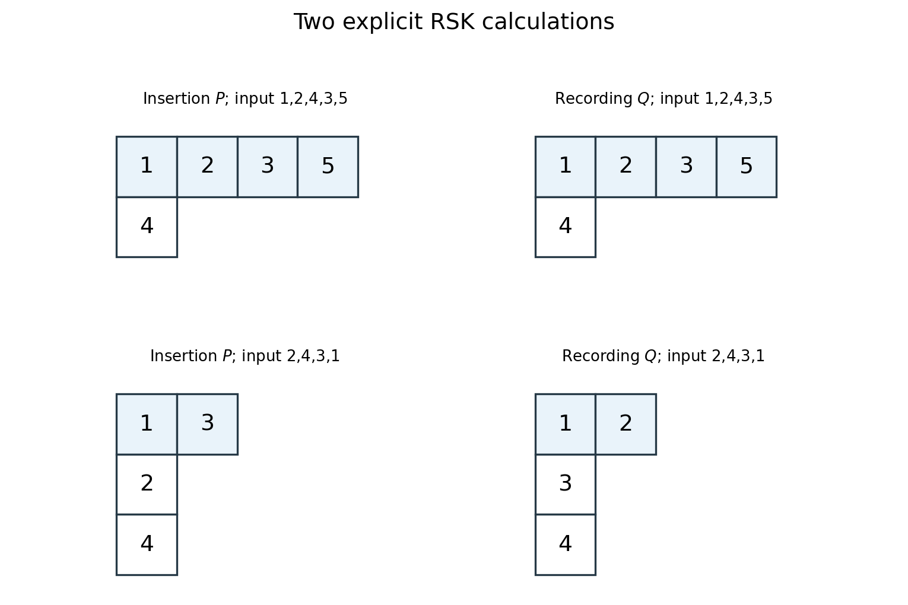

<h1 id="3/d/solution">Solution</h1>

↑ **Parent:** [D](../d.md)

Track the first row after any prefix of the input [permutation](../../../../permutation.md). Its $j$th entry is the smallest possible final value of an [increasing subsequence](../../../../increasing-subsequence.md) of [length](../../../../length.md) $j$ in that prefix. This minimum-tail [invariant](../../../../invariant-mathematics.md) follows inductively from the row-insertion update.

Indeed, when a new value $z$ replaces the first first-row entry larger than it, at position $r$, the previous entry in position $r-1$ is smaller than $z$ when $r>1$. An [increasing subsequence](../../../../increasing-subsequence.md) ending there can be extended by $z$, so $z$ supplies a new attainable tail of [length](../../../../length.md) $r$. It improves the old length-$r$ [minimum](../../../../minimum-of-a-subset-of-a-total-order.md). The minima for shorter lengths were already smaller than $z$ and remain unchanged; a longer subsequence ending at $z$ is impossible because its previous tail would have to be smaller than $z$, contradicting the choice of $r$. If no first-row entry exceeds $z$, it appends and creates a new longest subsequence. This proves the [invariant](../../../../invariant-mathematics.md) at every step.

In particular, the number of first-row cells is the [maximum](../../../../maximum-of-a-subset-of-a-total-order.md) increasing-subsequence [length](../../../../length.md). At the final tableau it is $\lambda_1$, so

$$
\boxed{\text{No increasing subsequence of }\sigma\text{ has length }\lambda_1+1.}
$$

This proves the required nonextension assertion, even without requiring the first-row tuple itself to occur as a subsequence.

That occurrence is not automatic for a general [permutation](../../../../permutation.md). For example the word $2,4,3,1$ gives $P$ with rows $(1,3),(2),(4)$. Its first-row tuple $(1,3)$ is not a subsequence of the word, because one occurs after three. The first row collects [minimum](../../../../minimum-of-a-subset-of-a-total-order.md) tails for different subsequence lengths; those tails need not come from one common subsequence. If the source's premise is read as an additional hypothesis that the tuple does occur, the preceding maximum-length proof establishes its claimed maximality directly.

**[Figure 1](#3/d/image-two-explicit-row-insertion-calculations-and-their-recording-tableaux). Two explicit row-insertion calculations and their recording tableaux**. The upper example is the adjacent transposition exchanging three and four, which gives identical insertion and recording tableaux of shape four plus one. The lower example has first insertion row one, three, although one occurs after three in its input word.

The [invariant](../../../../invariant-mathematics.md) is the [first row of RSK as a minimum-tail table](../../../../first-row-of-rsk-as-a-minimum-tail-table.md).

## ↑ Ancestors (12)

1. [D](../d.md)
2. [3](../../3.md)
3. [2011](../../../2011-split.md)
4. [Past exam of the representation Theory of Symmetric Groups course of the University of Oxford](../../../split.md)
5. [Representation Theory of Symmetric Groups course of the University of Oxford](../../../../representation-theory-of-symmetric-groups-course-of-the-university-of-oxford.md)
6. [Year 4 of the mathematics course of the University of Oxford](../../../../year-4-of-the-mathematics-course-of-the-university-of-oxford.md)
7. [Mathematics course of the University of Oxford](../../../../mathematics-course-of-the-university-of-oxford.md)
8. [Undergraduate course of the University of Oxford](../../../../undergraduate-course-of-the-university-of-oxford.md)
9. [Course of the University of Oxford](../../../../course-of-the-university-of-oxford.md)
10. [University of Oxford](../../../../university-of-oxford-split.md)
11. [List of universities](../../../../list-of-universities.md)
12. [Codex Wiki](../../../../split.md)
