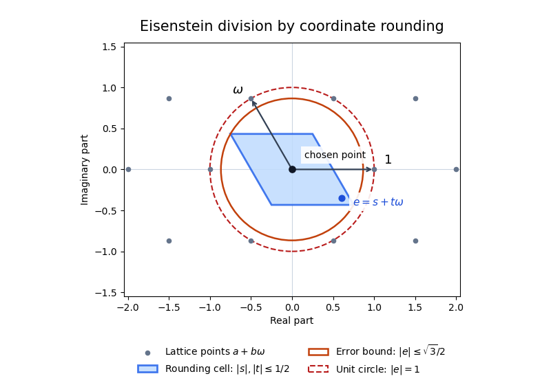

# 2017

↑ **Parent:** [Past exam of the rings and modules course of the University of Oxford](../past-exam-of-the-rings-and-modules-course-of-the-university-of-oxford.md)

Source paper: [released examination archive](https://www.whatdotheyknow.com/request/ba_computer_science_past_papers/response/2577745/attach/2/202402%20183%20CS%20Papers.zip?cookie_passthrough=1), member `2016/T/a15291w1.pdf`. The printed cover dates the examination to 17 June 2017.

**Table of contents**

- [1](#1)
  - [a](#1/a)
    - [Solution](#1/a/solution)
  - [b](#1/b)
    - [i](#1/b/i)
      - [Solution](#1/b/i/solution)
    - [ii](#1/b/ii)
      - [Solution](#1/b/ii/solution)
    - [iii](#1/b/iii)
      - [Solution](#1/b/iii/solution)
    - [iv](#1/b/iv)
      - [Solution](#1/b/iv/solution)
    - [v](#1/b/v)
      - [Solution](#1/b/v/solution)
    - [vi](#1/b/vi)
      - [Solution](#1/b/vi/solution)
- [2](#2)
  - [a](#2/a)
    - [Solution](#2/a/solution)
  - [b](#2/b)
    - [Solution](#2/b/solution)
  - [c](#2/c)
    - [Solution](#2/c/solution)
- [3](#3)
  - [a](#3/a)
    - [Solution](#3/a/solution)
  - [b](#3/b)
    - [Solution](#3/b/solution)
  - [c](#3/c)
    - [Solution](#3/c/solution)

## 1

↑ **Parent:** [2017](2017.md)

<h3 id="1/a">a</h3>

↑ **Parent:** [1](#1)

<h4 id="1/a/solution">Solution</h4>

↑ **Parent:** [A](#1/a)

For a [ring](../commutative-algebra.md#ring) $R$, its [ring characteristic](../commutative-algebra.md#characteristic-of-a-ring) is the least positive [integer](../integer.md) $n$ with $n1_R=0$, or zero if no positive such integer exists. Equivalently it is the least positive integer satisfying $nr=0$ for every $r\in R$, because $nr=(n1_R)r$. This additive formulation also defines the [characteristic of a rng](../commutative-algebra.md#characteristic-of-a-rng) when an identity is not assumed.

Let $R$ be an [integral domain](../commutative-algebra.md#integral-domain). Since $1_R\ne0$, its characteristic is not one. If its positive characteristic were a composite integer $n=ab$ with $1<a,b<n$, minimality would give $a1_R\ne0$ and $b1_R\ne0$, but

$$
(a1_R)(b1_R)=n1_R=0.
$$

This contradicts the absence of [zero divisors](../mathematics.md#zero-divisor). Therefore

$$
\boxed{\operatorname{char}R=0\quad\text{or a prime number}.}
$$

This is the [characteristic of an integral domain](../commutative-algebra.md#characteristic-of-an-integral-domain) theorem. If an integral domain is defined without requiring an identity, the same conclusion follows from the additive definition: for a hypothetical composite characteristic $n=ab$, choose $r$ with $ar\ne0$, which exists by minimality of $n$. Then $(ar)(bs)=n(rs)=0$ for every $s$, forcing $bs=0$ for every $s$ and contradicting minimality again.

<h3 id="1/b">b</h3>

↑ **Parent:** [1](#1)

<h4 id="1/b/i">i</h4>

↑ **Parent:** [B](#1/b)

<h5 id="1/b/i/solution">Solution</h5>

↑ **Parent:** [I](#1/b/i)

Take **$R=\mathbb Z/4\mathbb Z$**, a [quotient ring](../commutative-algebra.md#quotient-ring) with four residue classes. The class $\overline2$ is nonzero but $\overline2\,\overline2=\overline0$. Thus $R$ has a [zero divisor](../mathematics.md#zero-divisor) and is not an [integral domain](../commutative-algebra.md#integral-domain).

<h4 id="1/b/ii">ii</h4>

↑ **Parent:** [B](#1/b)

<h5 id="1/b/ii/solution">Solution</h5>

↑ **Parent:** [Ii](#1/b/ii)

**No such ring exists.** Characteristic two gives $r+r=0$ for every $r$. Choose a nonzero element $a$, which exists in a five-element set. Translation $r\mapsto r+a$ is an [involution](../group-theory.md#involution) without fixed points: applying it twice gives $r$, while $r+a=r$ would force $a=0$ by additive cancellation. Its disjoint pairs would partition all five elements, which is impossible because five is [odd](../calculus.md#odd-function).

This argument applies even to a [nonunital ring](../commutative-algebra.md#rng-algebra). With the unital convention, it is also the case $n=2$ of [finite ring characteristic divides cardinality](../commutative-algebra.md#finite-ring-characteristic-divides-cardinality).

<h4 id="1/b/iii">iii</h4>

↑ **Parent:** [B](#1/b)

<h5 id="1/b/iii/solution">Solution</h5>

↑ **Parent:** [Iii](#1/b/iii)

**No such ring exists:** every [finite integral domain is a field](../commutative-algebra.md#finite-integral-domain-is-a-field). Here is the proof. For $a\ne0$, the map $L_a:R\to R$ defined by $L_a(x)=ax$ is [injective](../algebra.md#injective-function), since $ax=ay$ gives $a(x-y)=0$ and therefore $x=y$. An [injective](../algebra.md#injective-function) self-map of a [finite set](../set.md#finite-set) is [surjective](../algebra.md#surjective-function), so some $x$ satisfies $ax=1$. Since an [integral domain](../commutative-algebra.md#integral-domain) is commutative, $xa=1$ as well. Thus every nonzero element has a [multiplicative inverse](../arithmetic.md#multiplicative-inverse), making $R$ a [field](../algebra.md#field).

The conclusion still holds if an identity was not initially required. Surjectivity first gives an element $e$ with $ae=a$. Then $a(ex-x)=0$ implies $ex=x$ for every $x$, and commutativity makes $e$ a two-sided identity. Applying the preceding argument with $e$ supplies all inverses.

<h4 id="1/b/iv">iv</h4>

↑ **Parent:** [B](#1/b)

<h5 id="1/b/iv/solution">Solution</h5>

↑ **Parent:** [Iv](#1/b/iv)

A suitable [field with four elements](../algebra.md#field-with-four-elements) is

$$
\boxed{R=\mathbb F_2[t]/(t^2+t+1).}
$$

Write $\alpha$ for the class of $t$. [Monic polynomial division over a ring](../polynomial.md#monic-polynomial-division-over-a-ring) gives a unique representative $a+b\alpha$, with $a,b\in\mathbb F_2$: existence follows by division, and uniqueness follows because a nonzero multiple of the degree-two modulus cannot have degree less than two. The four elements are therefore $0,1,\alpha,\alpha+1$.

The defining relation gives $\alpha^2=\alpha+1$, and hence $\alpha(\alpha+1)=1$. Thus the nonzero elements have inverses

$$
1^{-1}=1,\qquad\alpha^{-1}=\alpha+1,\qquad(\alpha+1)^{-1}=\alpha.
$$

The [quotient ring](../commutative-algebra.md#quotient-ring) is commutative and every nonzero element is a [unit](../algebra.md#unit-in-a-ring), so it is a [field](../algebra.md#field). This verifies the field property directly, without quoting a theorem about irreducible-polynomial quotients.

<h4 id="1/b/v">v</h4>

↑ **Parent:** [B](#1/b)

<h5 id="1/b/v/solution">Solution</h5>

↑ **Parent:** [V](#1/b/v)

**No field has six elements.** A [finite field](../algebra.md#finite-field) has positive [characteristic](../algebra.md#characteristic-of-a-field): the sequence $0,1,2\cdot1,\ldots$ must repeat. By part (a), this characteristic is a [prime number](../prime-number.md) $p$. Translation by $1$ partitions the field into cycles of length $p$, since returning to a starting point after $k$ steps is equivalent to $k1=0$. Thus $p$ divides six and $p=2$ or $p=3$.

The multiples of $1$ form a copy of the [prime field](../algebra.md#prime-field) $\mathbb F_p$. For completeness, the inverse of a nonzero residue $a$ lies among these multiples: the integer [Bezout identity](../algebra.md#bezout-s-identity) $ab+cp=1$ gives $(a1)(b1)=1$. The entire field is a [vector space](../vector-space.md) over this subfield. A maximal [linearly independent set](../vector-space.md#linear-independence) is finite and spans, so it is a [basis](../vector-space.md#basis) of some positive size $d$. Unique basis coordinates give exactly $p^d$ elements. This proves [finite field cardinality is a prime power](../algebra.md#finite-field-cardinality-is-a-prime-power) here. But six is neither a power of two nor a power of three, a contradiction.

<h4 id="1/b/vi">vi</h4>

↑ **Parent:** [B](#1/b)

<h5 id="1/b/vi/solution">Solution</h5>

↑ **Parent:** [Vi](#1/b/vi)

Under the unital [ring](../commutative-algebra.md#ring) convention used elsewhere in this wiki, **no such pair exists**. In a two-element ring the elements are $0$ and $1$. Additive cancellation forces $1+1=0$, and the identity axiom forces $1\cdot1=1$. The [distributive property](../algebraic-operation.md#distributive-property) forces products involving zero to vanish. Every operation is therefore determined, giving the [prime field](../algebra.md#prime-field) $\mathbb F_2$ as the unique possibility up to [ring isomorphism](../algebra.md#ring-isomorphism).

If the word ring allows a [nonunital ring](../commutative-algebra.md#rng-algebra), there are instead **two non-isomorphic examples: $\mathbb F_2$ and the [zero-multiplication rng](../commutative-algebra.md#zero-multiplication-rng) on the additive group $\mathbb Z/2\mathbb Z$**. In the second example the unique nonzero element $u$ satisfies $u+u=0$ and $u^2=0$; every product is zero, so associativity and both distributive laws hold. An isomorphism would have to send $1$ to $u$ because it preserves zero and is bijective, but then it would send $1^2=1$ to both $u^2=0$ and $u$, which is impossible. These exhaust the [rngs with two elements](../commutative-algebra.md#rng-with-two-elements), since $u^2$ can only be $0$ or $u$. Specifying the identity convention is essential for this part.

## 2

↑ **Parent:** [2017](2017.md)

<h3 id="2/a">a</h3>

↑ **Parent:** [2](#2)

<h4 id="2/a/solution">Solution</h4>

↑ **Parent:** [A](#2/a)

A [Euclidean domain](../commutative-algebra.md#euclidean-domain) is an [integral domain](../commutative-algebra.md#integral-domain) $R$ with a [Euclidean function](../commutative-algebra.md#euclidean-function) $\nu:R\setminus\{0\}\to\mathbb Z_{\geq0}$ such that, for $a,b\in R$ with $b\ne0$, there exist $q,r\in R$ satisfying

$$
a=qb+r,\qquad r=0\ \text{or}\ \nu(r)<\nu(b).
$$

The [polynomial ring](../commutative-algebra.md#polynomial-ring) $\mathbb Q[x]$ has this property with $\nu(f)=\deg f$. To perform [polynomial division](../polynomial.md#polynomial-division), subtract an appropriate multiple of the divisor to cancel the leading term of the current remainder. Its [polynomial degree](../polynomial.md#degree-of-a-polynomial) decreases strictly at each step, so the process terminates below the divisor's degree. The required division of leading coefficients is possible in the [field](../algebra.md#field) $\mathbb Q$. Thus a [polynomial ring over a field is Euclidean](../commutative-algebra.md#polynomial-ring-over-a-field-is-euclidean), with the same argument applying to every field.

Now let $I$ be a nonzero [ideal](../commutative-algebra.md#ideal) of a [Euclidean domain](../commutative-algebra.md#euclidean-domain), and choose $b\in I\setminus\{0\}$ with the least possible value of $\nu(b)$. For every $a\in I$, divide $a=qb+r$. The remainder belongs to $I$, since $r=a-qb$. If it were nonzero, its smaller Euclidean value would contradict the choice of $b$. Thus $r=0$ and every $a\in I$ lies in $(b)$. Conversely $(b)\subseteq I$ because $I$ is an ideal. Hence $I=(b)$. The zero ideal is already $(0)$, proving **[every Euclidean domain is a principal ideal domain](../commutative-algebra.md#every-euclidean-domain-is-a-principal-ideal-domain)**.

<h3 id="2/b">b</h3>

↑ **Parent:** [2](#2)

<h4 id="2/b/solution">Solution</h4>

↑ **Parent:** [B](#2/b)

The three answers, in the given order, are **no, yes, yes**.

For $\mathbb Z[x]$, consider the [ideal](../commutative-algebra.md#ideal) $I=(2,x)$. Its members have even constant coefficient, so $1\notin I$ and the ideal is proper. If $I=(g)$, then $g$ divides the constant $2$, forcing $g$ to be constant by additivity of [polynomial degree](../polynomial.md#degree-of-a-polynomial) in this [integral domain](../commutative-algebra.md#integral-domain). Since $g$ also divides $x$, it must divide the coefficient $1$, giving $g=\pm1$. That would make $I$ the whole ring, a contradiction. Thus $\mathbb Z[x]$ is not a [principal ideal domain](../commutative-algebra.md#principal-ideal-domain), and part (a) shows it cannot be a [Euclidean domain](../commutative-algebra.md#euclidean-domain). This is the [nonprincipal ideal generated by a prime and an indeterminate](../commutative-algebra.md#nonprincipal-ideal-generated-by-a-prime-and-an-indeterminate) obstruction.

Evaluation at $i$ gives the [ring isomorphism](../algebra.md#ring-isomorphism)

$$
\boxed{\mathbb Z[x]/(x^2+1)\cong\mathbb Z[i].}
$$

Indeed, division by the [monic polynomial](../polynomial.md#monic-polynomial) $x^2+1$ leaves a unique remainder $a+bx$, and its value $a+bi$ is zero only when both integer coefficients vanish. Thus the quotient maps bijectively, with operations preserved, onto the [Gaussian integers](../commutative-algebra.md#gaussian-integer). These form a [Euclidean domain](../commutative-algebra.md#euclidean-domain) for the [Gaussian integer norm](../commutative-algebra.md#gaussian-integer-norm) $N(a+bi)=a^2+b^2$, a standard Euclidean example allowed in this part. Geometrically, rounding the real and imaginary coordinates gives a quotient error with squared modulus at most $1/2<1$.

Finally,

$$
\boxed{\mathbb Z[x,y]/(2,x)\cong\mathbb F_2[y],}
$$

via $f(x,y)\mapsto f(0,y)\bmod2$. Every polynomial over $\mathbb F_2$ occurs. The kernel consists exactly of polynomials whose $x$-independent part has even coefficients: write $f(x,y)=xg(x,y)+h(y)$ to see that this is precisely $(2,x)$. Hence the induced quotient map is a bijective [ring homomorphism](../commutative-algebra.md#ring-homomorphism). Its target is a [Euclidean domain](../commutative-algebra.md#euclidean-domain) with Euclidean function $\deg$: a [polynomial ring over a field is Euclidean](../commutative-algebra.md#polynomial-ring-over-a-field-is-euclidean) by the division algorithm in part (a).

<h3 id="2/c">c</h3>

↑ **Parent:** [2](#2)

<h4 id="2/c/solution">Solution</h4>

↑ **Parent:** [C](#2/c)

Since $\omega^2=-1-\omega$, products of integer linear combinations of $1,\omega$ remain of the same form. Thus the [Eisenstein integers](../commutative-algebra.md#eisenstein-integer) $E=\mathbb Z[\omega]$ form a subring of $\mathbb C$, and hence an [integral domain](../commutative-algebra.md#integral-domain). Their [Eisenstein norm](../commutative-algebra.md#eisenstein-norm) is

$$
N(a+b\omega)=(a+b\omega)(a+b\overline\omega)=a^2-ab+b^2
=\left(a-\frac b2\right)^2+\frac34b^2.
$$

It is a positive [integer](../integer.md) on nonzero elements and is multiplicative, because the [complex modulus](../complex-analysis.md#complex-modulus) is multiplicative.

For $\alpha,\beta\in E$ with $\beta\ne0$, write $\alpha/\beta=u+v\omega$ with real $u,v$. Choose integers $m,n$ with $|u-m|,|v-n|\leq1/2$, and let $q=m+n\omega$. With $s=u-m$ and $t=v-n$,

$$
\left|\frac\alpha\beta-q\right|^2=s^2-st+t^2
\leq s^2+|st|+t^2\leq\frac34<1.
$$

Consequently $r=\alpha-q\beta$ belongs to $E$ and satisfies $N(r)\leq\tfrac34N(\beta)<N(\beta)$ when $r\ne0$. This proves **$E$ is a [Euclidean domain](../commutative-algebra.md#euclidean-domain) with Euclidean function $N$**, the [Euclidean norm on the Eisenstein integers](../commutative-algebra.md#euclidean-norm-on-the-eisenstein-integers).

**[Figure 1](#2/c/image-rounding-the-coordinates-in-the-eisenstein-integer-lattice-gives-a-euclidean-remainder). Rounding the coordinates in the Eisenstein integer lattice gives a Euclidean remainder**. After subtracting the chosen lattice point, the error lies in the shaded parallelogram. Its squared modulus is at most $3/4$, strictly smaller than one. The parallelogram is a rounding cell, not the hexagonal nearest-point cell.

For the representation of the prime $p$, first note that **$3=N(1-\omega)$**. Now suppose $p>3$ and $p\mid n^2+3$. The factorization

$$
n^2+3=(n+1+2\omega)(n-1-2\omega)
$$

shows that the [Eisenstein integer](../commutative-algebra.md#eisenstein-integer) $p$ divides a product. It divides neither factor: an element $a+b\omega$ lies in $pE$ exactly when both integer coefficients are divisible by $p$, and the second coefficients here are $2$ and $-2$. Hence $p$ is not a [prime element](../commutative-algebra.md#prime-element) of $E$.

To justify the necessary factorization step, in any [principal ideal domain](../commutative-algebra.md#principal-ideal-domain) an [irreducible element](../commutative-algebra.md#irreducible-element) $\pi$ is prime. If $\pi\nmid a$, write $(\pi,a)=(d)$. Since $d\mid\pi$, irreducibility makes $d$ a unit or an associate of $\pi$. The latter would give $\pi\mid a$, so $d$ is a unit and $u\pi+va=1$ for some $u,v$. If $\pi\mid ab$, multiplication of this identity by $b$ gives $\pi\mid b$. This proves [irreducible elements of a principal ideal domain are prime](../commutative-algebra.md#irreducible-elements-of-a-principal-ideal-domain-are-prime) without assuming unique factorization.

By part (a), $E$ is a [principal ideal domain](../commutative-algebra.md#principal-ideal-domain). The integer $p$ has norm $p^2>1$, so it is a nonzero nonunit. Since it is not prime, the result just proved implies that it is reducible: $p=uv$ with $u,v$ both nonunits. A nonzero element of $E$ is a [unit](../algebra.md#unit-in-a-ring) exactly when its norm is one, since $N(z)=1$ gives inverse $\overline z$ and multiplicativity proves the converse. Thus

$$
1<N(u),N(v),\qquad N(u)N(v)=N(p)=p^2.
$$

The only possible positive integer factors exceeding one are $N(u)=N(v)=p$. Writing $u=a+b\omega$ gives

$$
\boxed{a^2-ab+b^2=p.}
$$

This is the [prime representation by the Eisenstein norm](../commutative-algebra.md#prime-representation-by-the-eisenstein-norm) argument.

## 3

↑ **Parent:** [2017](2017.md)

<h3 id="3/a">a</h3>

↑ **Parent:** [3](#3)

<h4 id="3/a/solution">Solution</h4>

↑ **Parent:** [A](#3/a)

Write $d=\dim V$. A [cyclic vector](../linear-operator-theory.md#cyclic-vector) for $S$ is a vector $v$ whose successive iterates span $V$; equivalently, when $d>0$,

$$
v,Sv,\ldots,S^{d-1}v
$$

are a [basis](../vector-space.md#basis). The equivalence follows because the first linear dependence in the iterates makes their preceding span invariant under $S$, so no later iterate can enlarge it.

In this basis there are unique coefficients $c_0,\ldots,c_{d-1}$ with $S^dv=-\sum_{j<d}c_jS^jv$. Put $f(t)=t^d+\sum_{j<d}c_jt^j$. Then $f(S)v=0$, and commutation with powers of $S$ gives $f(S)S^jv=S^jf(S)v=0$. Therefore $f(S)$ kills an entire basis and is the zero map. No nonzero polynomial of degree less than $d$ annihilates $v$, because that would be a linear dependence of the displayed basis. Thus $m_S=f$.

The matrix of $S$ in the cyclic basis is the [companion matrix](../linear-operator-theory.md#companion-matrix) $C(f)$ with ones on its subdiagonal and last column $(-c_0,\ldots,-c_{d-1})^{\mathsf T}$. Expanding $\det(tI-C(f))$ along its last column gives

$$
c_0+c_1t+\cdots+c_{d-2}t^{d-2}+(t+c_{d-1})t^{d-1}=f(t):
$$

the cofactors are $1,t,\ldots,t^{d-1}$. This proves the [characteristic polynomial of a companion matrix](../linear-operator-theory.md#characteristic-polynomial-of-a-companion-matrix) formula here. Hence

$$
\boxed{m_S(t)=c_S(t)=f(t).}
$$

This proves that a [cyclic operator has equal minimal and characteristic polynomials](../linear-operator-theory.md#cyclic-operator-has-equal-minimal-and-characteristic-polynomials). If $V=\{0\}$, both polynomials are one by convention, so the equality remains valid.

<h3 id="3/b">b</h3>

↑ **Parent:** [3](#3)

<h4 id="3/b/solution">Solution</h4>

↑ **Parent:** [B](#3/b)

The [rational canonical form](../linear-operator-theory.md#rational-canonical-form) of $T$ is a block diagonal matrix

$$
C(f_1)\oplus\cdots\oplus C(f_r),\qquad
f_1\mid f_2\mid\cdots\mid f_r,
$$

similar to a matrix of $T$, where the $f_j\in F[t]$ are monic nonconstant polynomials and the sum of their degrees is $\dim V$. They are the [invariant factors of a linear operator](../linear-operator-theory.md#invariant-factors-of-a-linear-operator). The block $C(f_j)$ is the [companion matrix](../linear-operator-theory.md#companion-matrix) for $f_j$, representing multiplication by $t$ on $F[t]/(f_j)$. The invariant factors are uniquely determined by $T$.

Every companion block has a [cyclic vector](../linear-operator-theory.md#cyclic-vector) and therefore has both [minimal polynomial](../linear-operator-theory.md#minimal-polynomial) and [characteristic polynomial](../linear-operator-theory.md#characteristic-polynomial) equal to $f_j$, by part (a). The [determinant of a block diagonal matrix](../multilinear-algebra.md#determinant-of-a-block-diagonal-matrix) is the product of its block determinants, giving

$$
\boxed{c_T(t)=\prod_{j=1}^r f_j(t).}
$$

A polynomial $h$ annihilates the whole matrix exactly when it annihilates every block. On block $j$, dividing $h$ by $f_j$ leaves a remainder of smaller degree; if that remainder annihilated the block without being zero, it would contradict minimality of $f_j$. Thus the annihilation condition is exactly $f_j\mid h$ for every $j$. The monic polynomial of least degree with this property is their [least common multiple](../divisibility.md#least-common-multiple). The divisibility chain makes this $f_r$, so

$$
\boxed{m_T(t)=f_r(t).}
$$

These are the [minimal and characteristic polynomials from invariant factors](../linear-operator-theory.md#minimal-and-characteristic-polynomials-from-invariant-factors) formulae. On the zero vector space the product is empty and both polynomials are defined to be one.

<h3 id="3/c">c</h3>

↑ **Parent:** [3](#3)

<h4 id="3/c/solution">Solution</h4>

↑ **Parent:** [C](#3/c)

Let $J=\begin{pmatrix}0&-2\\1&0\end{pmatrix}$, so the displayed [rational canonical form](../linear-operator-theory.md#rational-canonical-form) of $T$ is $J\oplus J$. Since $J^2=-2I_2$, we have $T^2=-2I_4$.

If $a=0$, then $U=bI_4$ is a [scalar matrix](../linear-algebra.md#scalar-matrix). Its [invariant factors of a linear operator](../linear-operator-theory.md#invariant-factors-of-a-linear-operator) are four copies of $t-b$, so its rational canonical form is

$$
\boxed{C(t-b)^{\oplus4}=bI_4\qquad(a=0).}
$$

Here $m_U=t-b$ and $c_U=(t-b)^4$, including when $b=0$.

Now let $a\ne0$ and put

$$
q(t)=(t-b)^2+2a^2=t^2-2bt+(b^2+2a^2).
$$

On each two-dimensional invariant block, $A=aJ+bI_2$ satisfies $q(A)=0$. The vectors $e_1,Ae_1$ form a [cyclic vector](../linear-operator-theory.md#cyclic-vector) basis, since their coordinate matrix is $P=\begin{pmatrix}1&b\\0&a\end{pmatrix}$ with [determinant](../multilinear-algebra.md#determinant) $a\ne0$. Directly,

$$
P^{-1}AP=
\begin{pmatrix}0&-(b^2+2a^2)\\1&2b\end{pmatrix}=C(q).
$$

Applying this basis change to both blocks gives

$$
\boxed{\operatorname{RCF}(U)=
\begin{pmatrix}
0&-(b^2+2a^2)&0&0\\
1&2b&0&0\\
0&0&0&-(b^2+2a^2)\\
0&0&1&2b
\end{pmatrix}\qquad(a\ne0).}
$$

Thus $m_U=q$ and $c_U=q^2$. In particular there are two invariant factors $q,q$, rather than a single block for $q^2$. Also $q(t)>0$ for every real $t$, so it is an [irreducible polynomial](../polynomial.md#irreducible-polynomial) over $\mathbb R$. This is an instance of [rational canonical form under an affine change](../linear-operator-theory.md#rational-canonical-form-under-an-affine-change).

Finally $T^2=-2I_4$ implies $T^{-1}=-T/2$. Substituting $a=-1/2$, $b=0$ in the preceding result gives $q(t)=t^2+1/2$, and hence

$$
\boxed{\operatorname{RCF}(T^{-1})=
\begin{pmatrix}
0&-1/2&0&0\\
1&0&0&0\\
0&0&0&-1/2\\
0&0&1&0
\end{pmatrix}.}
$$

Its minimal polynomial is $t^2+1/2$ and its characteristic polynomial is $(t^2+1/2)^2$. The normalized reciprocal of $t^2+2$ is also $t^2+1/2$, agreeing with [rational canonical form of an inverse](../linear-operator-theory.md#rational-canonical-form-of-an-inverse).

## ↑ Ancestors (9)

1. [Past exam of the rings and modules course of the University of Oxford](../past-exam-of-the-rings-and-modules-course-of-the-university-of-oxford.md)
2. [Rings and modules course of the University of Oxford](../university-of-oxford.md#rings-and-modules-course-of-the-university-of-oxford)
3. [Year 2 of the mathematics course of the University of Oxford](../university-of-oxford.md#year-2-of-the-mathematics-course-of-the-university-of-oxford)
4. [Mathematics course of the University of Oxford](../university-of-oxford.md#mathematics-course-of-the-university-of-oxford)
5. [Undergraduate course of the University of Oxford](../university-of-oxford.md#undergraduate-course-of-the-university-of-oxford)
6. [Course of the University of Oxford](../university-of-oxford.md#course-of-the-university-of-oxford)
7. [University of Oxford](../university-of-oxford.md)
8. [List of universities](../README.md#list-of-universities)
9. [Codex Wiki](../README.md)
