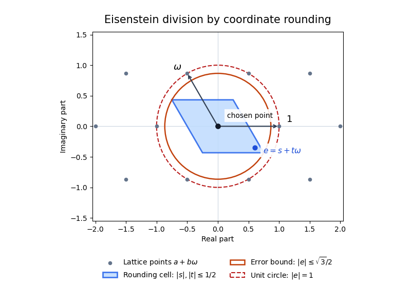

<h1 id="2/c/solution">Solution</h1>

↑ **Parent:** [C](../c.md)

Since $\omega^2=-1-\omega$, products of integer linear combinations of $1,\omega$ remain of the same form. Thus the [Eisenstein integers](../../../../eisenstein-integer.md) $E=\mathbb Z[\omega]$ form a subring of $\mathbb C$, and hence an [integral domain](../../../../integral-domain.md). Their [Eisenstein norm](../../../../eisenstein-norm.md) is

$$
N(a+b\omega)=(a+b\omega)(a+b\overline\omega)=a^2-ab+b^2
=\left(a-\frac b2\right)^2+\frac34b^2.
$$

It is a positive [integer](../../../../integer-split.md) on nonzero elements and is multiplicative, because the [complex modulus](../../../../complex-modulus.md) is multiplicative.

For $\alpha,\beta\in E$ with $\beta\ne0$, write $\alpha/\beta=u+v\omega$ with real $u,v$. Choose integers $m,n$ with $|u-m|,|v-n|\leq1/2$, and let $q=m+n\omega$. With $s=u-m$ and $t=v-n$,

$$
\left|\frac\alpha\beta-q\right|^2=s^2-st+t^2
\leq s^2+|st|+t^2\leq\frac34<1.
$$

Consequently $r=\alpha-q\beta$ belongs to $E$ and satisfies $N(r)\leq\tfrac34N(\beta)<N(\beta)$ when $r\ne0$. This proves **$E$ is a [Euclidean domain](../../../../euclidean-domain.md) with Euclidean function $N$**, the [Euclidean norm on the Eisenstein integers](../../../../euclidean-norm-on-the-eisenstein-integers.md).

**[Figure 1](#2/c/image-rounding-the-coordinates-in-the-eisenstein-integer-lattice-gives-a-euclidean-remainder). Rounding the coordinates in the Eisenstein integer lattice gives a Euclidean remainder**. After subtracting the chosen lattice point, the error lies in the shaded parallelogram. Its squared modulus is at most $3/4$, strictly smaller than one. The parallelogram is a rounding cell, not the hexagonal nearest-point cell.

For the representation of the prime $p$, first note that **$3=N(1-\omega)$**. Now suppose $p>3$ and $p\mid n^2+3$. The factorization

$$
n^2+3=(n+1+2\omega)(n-1-2\omega)
$$

shows that the [Eisenstein integer](../../../../eisenstein-integer.md) $p$ divides a product. It divides neither factor: an element $a+b\omega$ lies in $pE$ exactly when both integer coefficients are divisible by $p$, and the second coefficients here are $2$ and $-2$. Hence $p$ is not a [prime element](../../../../prime-element.md) of $E$.

To justify the necessary factorization step, in any [principal ideal domain](../../../../principal-ideal-domain.md) an [irreducible element](../../../../irreducible-element.md) $\pi$ is prime. If $\pi\nmid a$, write $(\pi,a)=(d)$. Since $d\mid\pi$, irreducibility makes $d$ a unit or an associate of $\pi$. The latter would give $\pi\mid a$, so $d$ is a unit and $u\pi+va=1$ for some $u,v$. If $\pi\mid ab$, multiplication of this identity by $b$ gives $\pi\mid b$. This proves [irreducible elements of a principal ideal domain are prime](../../../../irreducible-elements-of-a-principal-ideal-domain-are-prime.md) without assuming unique factorization.

By part (a), $E$ is a [principal ideal domain](../../../../principal-ideal-domain.md). The integer $p$ has norm $p^2>1$, so it is a nonzero nonunit. Since it is not prime, the result just proved implies that it is reducible: $p=uv$ with $u,v$ both nonunits. A nonzero element of $E$ is a [unit](../../../../unit-in-a-ring.md) exactly when its norm is one, since $N(z)=1$ gives inverse $\overline z$ and multiplicativity proves the converse. Thus

$$
1<N(u),N(v),\qquad N(u)N(v)=N(p)=p^2.
$$

The only possible positive integer factors exceeding one are $N(u)=N(v)=p$. Writing $u=a+b\omega$ gives

$$
\boxed{a^2-ab+b^2=p.}
$$

This is the [prime representation by the Eisenstein norm](../../../../prime-representation-by-the-eisenstein-norm.md) argument.

## ↑ Ancestors (12)

1. [C](../c.md)
2. [2](../../2.md)
3. [2017](../../../2017-split.md)
4. [Past exam of the rings and modules course of the University of Oxford](../../../split.md)
5. [Rings and modules course of the University of Oxford](../../../../rings-and-modules-course-of-the-university-of-oxford.md)
6. [Year 2 of the mathematics course of the University of Oxford](../../../../year-2-of-the-mathematics-course-of-the-university-of-oxford.md)
7. [Mathematics course of the University of Oxford](../../../../mathematics-course-of-the-university-of-oxford.md)
8. [Undergraduate course of the University of Oxford](../../../../undergraduate-course-of-the-university-of-oxford.md)
9. [Course of the University of Oxford](../../../../course-of-the-university-of-oxford.md)
10. [University of Oxford](../../../../university-of-oxford-split.md)
11. [List of universities](../../../../list-of-universities.md)
12. [Codex Wiki](../../../../split.md)
