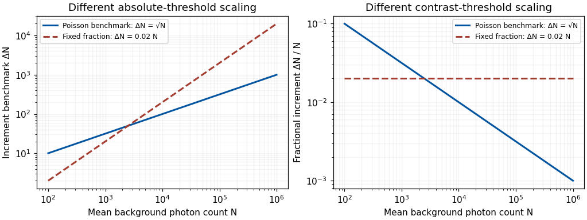

<h1 id="2/solution">Solution</h1>

↑ **Parent:** [2](../2.md)

**Sensitivity adjustments occur at several stages and over several timescales. They reveal adaptive gain control and flexible reference points, but no single aftereffect uniquely identifies one anatomical site.** Changes in threshold, apparent [hue](../../../hue.md), an achromatic setting and a receptor current must be distinguished before explaining them with one adaptation mechanism.

At the receptor level, a finite photocurrent range has to represent environments with very different mean [light](../../../light.md) levels. [Julie L. Schnapf](../../../julie-l-schnapf.md) and colleagues measured membrane currents from individual macaque cone outer segments. Responses to a maintained [light](../../../light.md) step had an initial component followed by a smaller steady response, and a steady background reduced sensitivity to an added weak flash. This desensitization was distinguishable from loss of pigment through bleaching.[J Physiol 427, 681–713; outer-segment recording, steps, backgrounds and bleaching comparisons](../../../visual-transduction-in-cones-of-the-monkey-macaca-fascicularis-by-julie-l-schnapf-and-others.md) Direct recording establishes that some gain adjustment occurs before any [color](../../../color.md) name, decision or cortical object representation. The preparation is macaque tissue, and a measured cone current is not identical to a human appearance judgment.

An idealized normalization model illustrates the benefit. If a mechanism's incremental gain is proportional to $1/(I+I_0)$, maintaining a fixed response increment requires $\Delta I\propto I+I_0$. At high backgrounds this gives approximately constant fractional contrast $\Delta I/I$, a Weber-like regime. It should not be confused with a universal law across all intensities. Under a known-background Poisson counting model with mean $N$, the noise [standard deviation](../../../standard-deviation.md) is $\sqrt N$; a small increment has [signal-to-noise ratio](../../../signal-to-noise-ratio.md) approximately $\Delta N/\sqrt N$. A fixed signal-to-noise criterion then gives fractional threshold proportional to $N^{-1/2}$ instead. The two predictions derive from different assumptions about what limits performance.

**[Figure 1](#2/image-original-poisson-counting-and-fixed-fraction-threshold-benchmarks-arbitrary-criterion-constants-not-measured-human-adaptation-data). Original Poisson-counting and fixed-fraction threshold benchmarks; arbitrary criterion constants, not measured human adaptation data**.

Mean adaptation and contrast adaptation also differ. A diagonal cone-gain model replaces $Q_j$ by $g_jQ_j$, with gains related to recent stimulation. It can reduce the effect of a persistent chromatic shift in the [illuminant](../../../illuminant.md). If the signal changes approximately as $Q'_j=k_jQ_j$, choosing $g'_j=g_j/k_j$ cancels that change. This is exact only for the assumed channelwise scaling; real spectral [illuminant](../../../illuminant.md) changes need not transform every surface's catches by the same three factors.

To test adjustments beyond mean cone excitation, experiments can modulate [color](../../../color.md) around an unchanged time average. [John Krauskopf](../../../john-krauskopf.md) and colleagues found direction-selective threshold elevation after temporal chromatic or [luminance](../../../luminance.md) modulation, supporting separable adaptable mechanisms for particular directions near threshold.[Vision Res 22, 1123–1131; selective threshold elevation for chromatic and luminance directions](../../../cardinal-directions-of-color-space-by-john-krauskopf-and-others.md) [Michael A. Webster](../../../michael-a-webster.md) and colleagues then measured appearance after adaptation to modulation along different color-space directions. A [color](../../../color.md) monitor, a modulated adapting field and asymmetric appearance matches allowed testing effects beyond detection thresholds. Appearance shifted away from the adapting direction, including directions intermediate to the simplest [cardinal color directions](../../../cardinal-directions-of-color-space.md).[Nature 349, 235–238; constant-mean modulation and asymmetric matching](../../../changes-in-colour-appearance-following-post-receptoral-adaptation-by-michael-a-webster-and-others.md) Thus a three-independent-channel account sufficient for some threshold results was not sufficient for all suprathreshold appearance changes. Constant mean catches constrain a simple mean-receptor explanation, but do not prove that all receptor nonlinearities have been removed.

Longer experience changes reference points too. [Jay Neitz](../../../jay-neitz.md) and colleagues altered chromatic experience with colored filters over days and measured [unique yellow](../../../unique-yellow.md) settings. Shifts persisted for one to two weeks after filter use ended.[Neuron 35, 783–792; altered chromatic experience and persistent unique-yellow changes](../../../color-perception-is-mediated-by-a-plastic-neural-mechanism-that-is-adjustable-in-adults-by-jay-neitz-and-others.md) Persistence after removing the immediate adapting stimulus demonstrates more than an instantaneous receptor response. It supports experience-dependent normalization without showing that a [color](../../../color.md) category or verbal label has been rewritten. Any interocular transfer must also be measured explicitly; duration alone does not identify cortex.

A natural perturbation extends the range to months. [Peter B. Delahunt](../../../peter-b-delahunt.md) and colleagues followed achromatic settings before and after removal of cataractous lenses. Removal greatly changed short-wavelength input; settings continued to readjust over roughly three months, whereas chromatic discrimination recovered much faster.[Vis Neurosci 21, 301–307; longitudinal achromatic settings and comparison with discrimination](../../../long-term-renormalization-of-chromatic-mechanisms-following-cataract-surgery-by-peter-b-delahunt-and-others.md) An achromatic setting compensates for a perceived tint, so its physical shift should not be mistaken for a same-direction tint in appearance. The findings indicate distinct adjustment timescales. They are observational evidence with a changing optical input, not a randomized isolation of one neural site or a general treatment recommendation.

These studies support a multilevel experimental strategy. Measure receptor responses, detection thresholds and appearance separately; manipulate mean and contrast independently; test spatial specificity, interocular transfer and recovery. Control exposure, eye position, stimulus calibration, response criterion and [learning](../../../learning.md). A loss of sensitivity can reflect adaptation that preserves dynamic range rather than damage, and stable appearance can coexist with changed receptor inputs. Conversely, perfect compensation is not guaranteed.

**Adaptation is a family of adjustments serving different constraints. Its most informative use is to distinguish which signal statistics, stages and reference points change, rather than treating every aftereffect as evidence for one fatigued [color](../../../color.md) channel.**

## ↑ Ancestors (11)

1. [2](../2.md)
2. [2022](../../2022-split.md)
3. [Past exam of the sensing and perceiving light, colour and materials course of the University of Oxford](../../split.md)
4. [Sensing and perceiving light, colour and materials course of the University of Oxford](../../../sensing-and-perceiving-light-colour-and-materials-course-of-the-university-of-oxford.md)
5. [Year 3 of the psychology (experimental) course of the University of Oxford](../../../year-3-of-the-psychology-experimental-course-of-the-university-of-oxford.md)
6. [Psychology (experimental) course of the University of Oxford](../../../psychology-experimental-course-of-the-university-of-oxford.md)
7. [Undergraduate course of the University of Oxford](../../../undergraduate-course-of-the-university-of-oxford.md)
8. [Course of the University of Oxford](../../../course-of-the-university-of-oxford.md)
9. [University of Oxford](../../../university-of-oxford-split.md)
10. [List of universities](../../../list-of-universities.md)
11. [Codex Wiki](../../../split.md)
