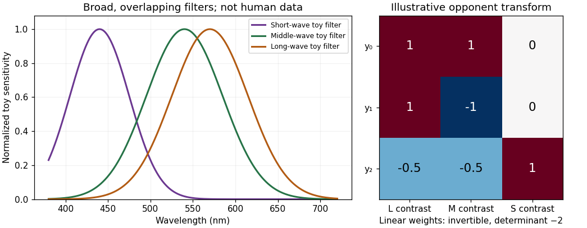

<h1 id="4/solution">Solution</h1>

↑ **Parent:** [4](../4.md)

**L, M and S describe the relative [spectral sensitivities](../../../spectral-sensitivity.md) of cone classes. Calling them red, green and blue confuses receptor sampling with the [color appearance](../../../color-appearance.md) constructed from comparisons and context.** The shorthand also wrongly suggests three narrow, nonoverlapping detectors or the primaries of a display.

First, each class has a broad sensitivity curve. A long-wavelength-sensitive cone responds to many [wavelengths](../../../wavelength.md), and its sensitivity maximum is not a unique red stimulus. L- and M-cone sensitivities overlap extensively, while S [cone cells](../../../cone-cell.md) are relatively more sensitive at shorter [wavelengths](../../../wavelength.md). [Light](../../../light.md) at one [wavelength](../../../wavelength.md) can therefore excite more than one class. [Andrew Stockman](../../../andrew-stockman.md) and colleagues derived L- and M-cone sensitivity estimates using color-matching data and measurements from observers of known pigment genotype. Their analysis emphasizes broad overlap and the need for isolation procedures to measure one class without contamination from others.[Vision Res 40, 1711–1737; spectral-sensitivity measurements and cone fundamentals](../../../the-spectral-sensitivities-of-the-middle-and-long-wavelength-sensitive-cones-derived-from-measurements-in-observers-of-known-genotype-by-andrew-stockman-and-others.md) Exact curves depend on pigment variant and optical filtering, so the letters denote relative classes rather than three invariant [color](../../../color.md) labels.

**[Figure 2](#4/image-original-gaussian-toy-receptor-filters-and-an-invertible-opponent-transform-the-filters-illustrate-broad-overlap-and-are-not-measured-human-cone-fundamentals-or-a-calibrated-color-chart). Original Gaussian toy receptor filters and an invertible opponent transform; the filters illustrate broad overlap and are not measured human cone fundamentals or a calibrated color chart**.

Second, the principle of univariance prevents one cone from identifying [hue](../../../hue.md). For a monochromatic stimulus, let mean [absorption](../../../absorption-electromagnetic-radiation.md) be $Q=I\,a(\lambda)$. Whenever $a(\lambda_1)$ and $a(\lambda_2)$ are positive, intensities satisfying $I_2=I_1a(\lambda_1)/a(\lambda_2)$ give the same $Q$. The single receptor cannot distinguish those two inputs on [absorption](../../../absorption-electromagnetic-radiation.md) count alone. Calling that receptor a red detector would assign a [color](../../../color.md) judgment to a signal that cannot even uniquely distinguish the two [wavelengths](../../../wavelength.md). It remains true that [spectral sensitivity](../../../spectral-sensitivity.md) constrains the comparison; univariance does not mean all receptor types are identical.

Third, perceptual [color](../../../color.md) requires combinations. Comparing L and M signals and comparing S with L+M supplies chromatic information; summing appropriately weighted signals contributes to luminance-related processing. An L-cone increment can be part of several stimulus changes depending on what happens to M and S and on the adapted background. Neither an L response nor a raw L:M ratio by itself specifies a context-independent [color](../../../color.md) word. The retinal and cortical opponent circuitry demonstrated by [Dennis M. Dacey](../../../dennis-m-dacey.md) and [Bevil R. Conway](../../../bevil-conway.md) provides mechanisms for comparisons, rather than a relabelling of three cone outputs as three sensations.[Nature 367, 731–735](../../../the-blue-on-opponent-pathway-in-primate-retina-originates-from-a-distinct-bistratified-ganglion-cell-type-by-dennis-m-dacey-and-others.md)[J Neurosci 21, 2768–2783](../../../spatial-structure-of-cone-inputs-to-color-cells-in-alert-macaque-primary-visual-cortex-by-bevil-r-conway.md)

Fourth, “blue” or “red” need not identify a single [wavelength](../../../wavelength.md). Spectrally different [lights](../../../light.md) can be metamers, and a purple appearance can arise from a mixture rather than a monochromatic [wavelength](../../../wavelength.md). Conversely, the same physical spectrum can look different against another surround or after adaptation. Cone labels cannot replace the distinction between emitted or reflected spectrum, receptor catch, opponent representation and reported [hue](../../../hue.md).

Fifth, the display analogy is backwards. An RGB screen emits mixtures from three selected primary spectra. The [cone cells](../../../cone-cell.md) receive and integrate the resulting spectrum; their response curves are not identical to those primary spectra. If primary intensities are $p_k$ and cone sensitivities to each primary form [matrix](../../../matrix.md) $B$, then $\mathbf Q=B\mathbf p$. Off-diagonal terms are generally nonzero because each primary can excite several cone classes. If $B$ is nonsingular, an intended catch change can be computed through $B^{-1}$ within the display's feasible [gamut](../../../gamut.md). It does not follow that every requested catch vector is realizable with nonnegative bounded primary intensities. Calibration and observer differences therefore matter in cone-isolating experiments.

Finally, [color](../../../color.md) terms themselves vary across languages and tasks, whereas receptor class is a biological classification. Receptor genes, [color](../../../color.md) matches, discrimination and linguistic categorization are related but distinct measurements. The labels L, M and S prevent an unwarranted assumption that one anatomical cell class directly instantiates one learned word or unique subjective [hue](../../../hue.md).

**The useful statement is that trichromatic vision starts with three broad, overlapping receptor classes and extracts chromatic information by comparison. “Red, green and blue [cone cells](../../../cone-cell.md)” conceals both the information loss at each receptor and the transformations needed to see [color](../../../color.md).**

## ↑ Ancestors (11)

1. [4](../4.md)
2. [2022](../../2022-split.md)
3. [Past exam of the sensing and perceiving light, colour and materials course of the University of Oxford](../../split.md)
4. [Sensing and perceiving light, colour and materials course of the University of Oxford](../../../sensing-and-perceiving-light-colour-and-materials-course-of-the-university-of-oxford.md)
5. [Year 3 of the psychology (experimental) course of the University of Oxford](../../../year-3-of-the-psychology-experimental-course-of-the-university-of-oxford.md)
6. [Psychology (experimental) course of the University of Oxford](../../../psychology-experimental-course-of-the-university-of-oxford.md)
7. [Undergraduate course of the University of Oxford](../../../undergraduate-course-of-the-university-of-oxford.md)
8. [Course of the University of Oxford](../../../course-of-the-university-of-oxford.md)
9. [University of Oxford](../../../university-of-oxford-split.md)
10. [List of universities](../../../list-of-universities.md)
11. [Codex Wiki](../../../split.md)
