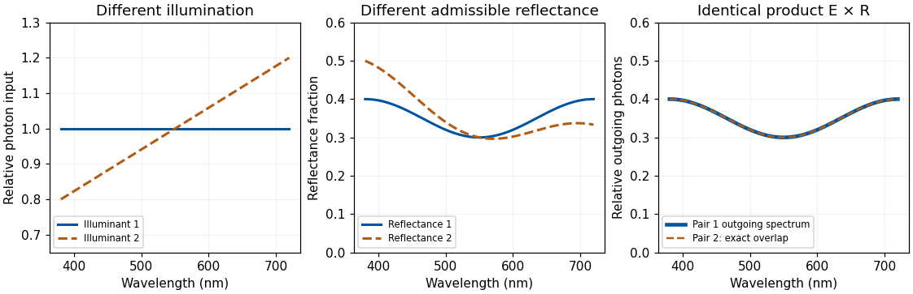

<h1 id="5/b/solution">Solution</h1>

↑ **Parent:** [B](../b.md)

**The visual system must infer relatively stable object properties from images jointly determined by illumination, shape, material and viewpoint.** The problem is intrinsically ambiguous; robust performance exploits several constraints and tolerates uncertainty rather than perfectly recovering a unique physical scene from every image.

Even a diffuse model contains a [surface-illuminant ambiguity](../../../../surface-illuminant-ambiguity.md). Ignoring a fixed geometric factor, $N(\lambda)=E(\lambda)R(\lambda)$. For any positive function $g$ that leaves the resulting [reflectance](../../../../reflectance.md) physically admissible, define $E'=Eg$ and $R'=R/g$. Then $E'R'=ER$, so even an observer measuring the complete outgoing spectrum could not distinguish those two explanations from that surface alone. Three cone catches introduce further spectral metamerism. Thus perfect [color constancy](../../../../color-constancy.md) cannot be obtained by a universal local inversion of three numbers.

**[Figure 3](#5/b/image-original-physically-admissible-diffuse-model-example-two-different-illuminant-reflectance-pairs-produce-the-same-outgoing-photon-spectrum-theoretical-curves-rather-than-measured-surfaces). Original physically admissible diffuse-model example: two different illuminant–reflectance pairs produce the same outgoing photon spectrum; theoretical curves rather than measured surfaces**.

For directional [optical reflection](../../../../optical-reflection.md), an image sample instead depends on an integral such as

$$
L_o(\lambda,\omega_o)=\int_{\Omega^+} f_r(\lambda,\omega_i,\omega_o)L_i(\lambda,\omega_i)\cos\theta_i\,d\omega_i.
$$

The expression sums contributions from incident directions, weighted by the [bidirectional reflectance distribution function](../../../../bidirectional-reflectance-distribution-function.md) and projected area. It assumes a local, nonfluorescent [optical reflection](../../../../optical-reflection.md) model and omits emission. A glossy surface therefore reflects aspects of its environment, and moving the observer changes the sampled outgoing direction even if the material is unchanged. Subsurface transport and transmission require further terms or models.

The system can constrain illumination by comparing surfaces, spatial boundaries and changes over time, while using shape and scene layout to distinguish a shadow from a pigment boundary. Cone-gain adjustment can approximately compensate shared spectral changes but cannot solve every mixture of differently colored [lights](../../../../light.md), interreflections and specular components. A spatial average is unreliable if a scene is genuinely dominated by one colored material. A bright region might be a lamp, a highlight or a high-reflectance object, so “assume the brightest point is white” is not a universal solution.

Material judgments require distinguishing diffuse shading from highlights and transparency or [translucency](../../../../translucency.md) cues. [Isamu Motoyoshi](../../../../isamu-motoyoshi.md) and colleagues showed that manipulating image statistics, including luminance-distribution skewness, could influence apparent [gloss](../../../../gloss.md) and [lightness](../../../../lightness.md) in their surface-image conditions.[Nature 447, 206–209; image-statistic manipulations and surface appearance](../../../../image-statistics-and-the-perception-of-surface-qualities-by-isamu-motoyoshi-and-others.md) Such regularities offer efficient cues. They cannot uniquely specify a material: a [histogram-preserving spatial permutation](../../../../histogram-preserving-spatial-permutation.md) changes spatial organization while retaining the [luminance histogram](../../../../luminance-histogram.md) and all its moments. That mathematical ambiguity motivates experiments separating histogram cues from geometric consistency; it does not, by itself, predict every appearance judgment after scrambling.

[Juno Kim](../../../../juno-kim.md) and colleagues directly tested the relation between highlights and diffuse shading. Manipulating their positional and orientation congruence reduced perceived [gloss](../../../../gloss.md), including when simple proximity to broad [luminance](../../../../luminance.md) maxima was controlled.[J Vis 11(9):4; Experiments 1–4](../../../../the-perception-of-gloss-depends-on-highlight-congruence-with-surface-shading-by-juno-kim-and-others.md) The visual system therefore uses relationships among image structures, not merely the presence of a few bright pixels. The conclusion concerns the tested images and judgments, rather than a claim that one cue explains every shiny or transparent material.

Temporal information and active viewing help further. A highlight can move differently from a surface marking; multiple views constrain geometry, while familiar object structure and expected illumination supply [priors](../../../../prior-probability.md). These strategies can fail under unusual lighting or deliberately misleading images. The system must also decide which differences matter: recognizing a material category, judging [gloss](../../../../gloss.md) and estimating [spectral reflectance](../../../../spectral-reflectance.md) are related but separable goals.

**Robustness comes from combining adaptation, spatial and temporal relations, shape information and learned scene constraints. It does not remove the physical ambiguities, and performance should be judged against a specified task rather than an impossible demand for exact recovery in every scene.**

## ↑ Ancestors (12)

1. [B](../b.md)
2. [5](../../5.md)
3. [2022](../../../2022-split.md)
4. [Past exam of the sensing and perceiving light, colour and materials course of the University of Oxford](../../../split.md)
5. [Sensing and perceiving light, colour and materials course of the University of Oxford](../../../../sensing-and-perceiving-light-colour-and-materials-course-of-the-university-of-oxford.md)
6. [Year 3 of the psychology (experimental) course of the University of Oxford](../../../../year-3-of-the-psychology-experimental-course-of-the-university-of-oxford.md)
7. [Psychology (experimental) course of the University of Oxford](../../../../psychology-experimental-course-of-the-university-of-oxford.md)
8. [Undergraduate course of the University of Oxford](../../../../undergraduate-course-of-the-university-of-oxford.md)
9. [Course of the University of Oxford](../../../../course-of-the-university-of-oxford.md)
10. [University of Oxford](../../../../university-of-oxford-split.md)
11. [List of universities](../../../../list-of-universities.md)
12. [Codex Wiki](../../../../split.md)
