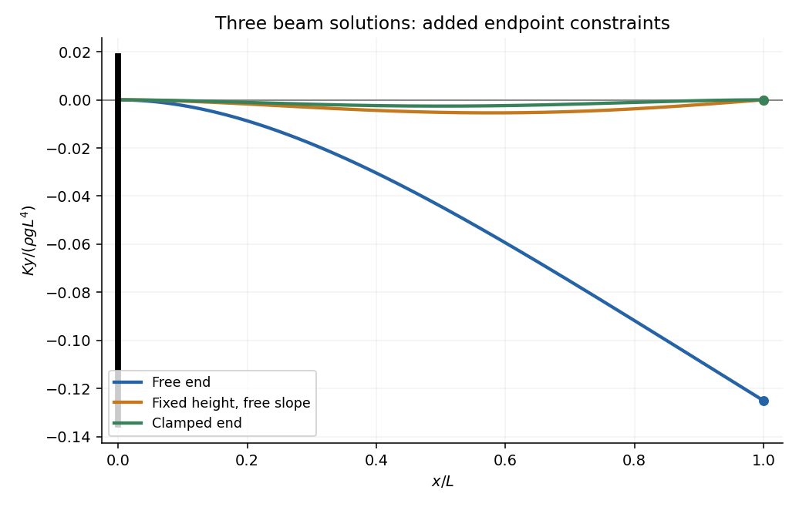
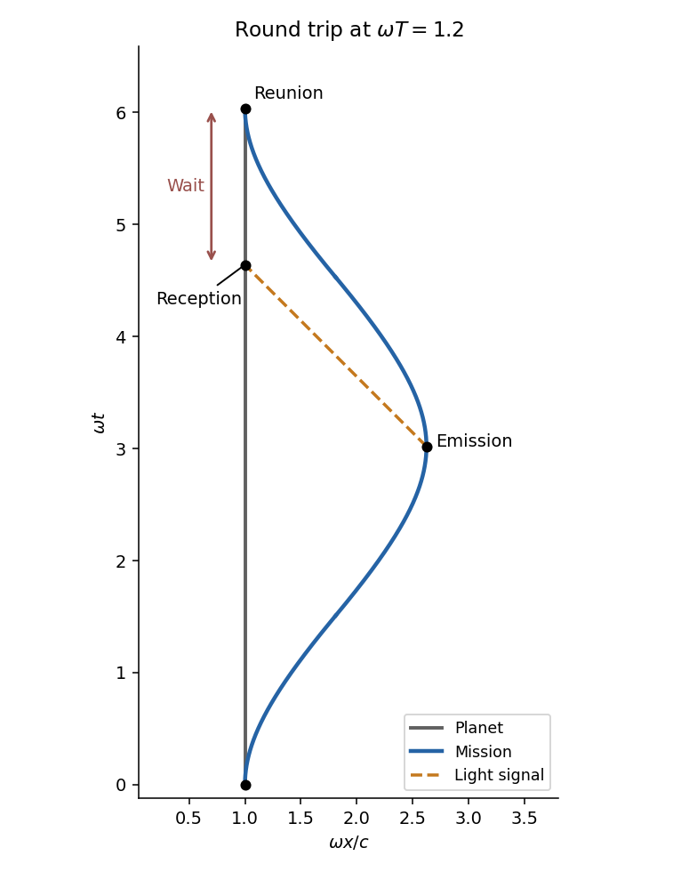

# 2014

↑ **Parent:** [Past exam of the short options course of the University of Oxford](../past-exam-of-the-short-options-course-of-the-university-of-oxford.md)

Source release: [Oxford examination archive](https://www.whatdotheyknow.com/request/maths_papers_2/response/1850333/attach/3/FOI%2020210708%201%20Data.zip?cookie_passthrough=1), member `FOI-20210708-1 - Data/4319.pdf`. The cover dates this examination to 23 June 2014, 9.30–11.00am. All seven questions and their 34 leaf subparts are answered below.

**Table of contents**

- [1](#1)
  - [a](#1/a)
    - [i](#1/a/i)
      - [Solution](#1/a/i/solution)
    - [ii](#1/a/ii)
      - [Solution](#1/a/ii/solution)
    - [iii](#1/a/iii)
      - [Solution](#1/a/iii/solution)
    - [iv](#1/a/iv)
      - [Solution](#1/a/iv/solution)
  - [b](#1/b)
    - [i](#1/b/i)
      - [Solution](#1/b/i/solution)
    - [ii](#1/b/ii)
      - [Solution](#1/b/ii/solution)
- [2](#2)
  - [a](#2/a)
    - [Solution](#2/a/solution)
  - [b](#2/b)
    - [Solution](#2/b/solution)
  - [c](#2/c)
    - [Solution](#2/c/solution)
- [3](#3)
  - [a](#3/a)
    - [Solution](#3/a/solution)
  - [b](#3/b)
    - [Solution](#3/b/solution)
  - [c](#3/c)
    - [Solution](#3/c/solution)
  - [d](#3/d)
    - [Solution](#3/d/solution)
- [4](#4)
  - [a](#4/a)
    - [Solution](#4/a/solution)
  - [b](#4/b)
    - [Solution](#4/b/solution)
  - [c](#4/c)
    - [Solution](#4/c/solution)
  - [d](#4/d)
    - [Solution](#4/d/solution)
  - [e](#4/e)
    - [i](#4/e/i)
      - [Solution](#4/e/i/solution)
    - [ii](#4/e/ii)
      - [Solution](#4/e/ii/solution)
- [5](#5)
  - [a](#5/a)
    - [Solution](#5/a/solution)
  - [b](#5/b)
    - [Solution](#5/b/solution)
  - [c](#5/c)
    - [Solution](#5/c/solution)
- [6](#6)
  - [a](#6/a)
    - [i](#6/a/i)
      - [Solution](#6/a/i/solution)
    - [ii](#6/a/ii)
      - [Solution](#6/a/ii/solution)
    - [iii](#6/a/iii)
      - [Solution](#6/a/iii/solution)
  - [b](#6/b)
    - [i](#6/b/i)
      - [Solution](#6/b/i/solution)
    - [ii](#6/b/ii)
      - [Solution](#6/b/ii/solution)
    - [iii](#6/b/iii)
      - [Solution](#6/b/iii/solution)
- [7](#7)
  - [a](#7/a)
    - [Solution](#7/a/solution)
  - [b](#7/b)
    - [i](#7/b/i)
      - [Solution](#7/b/i/solution)
    - [ii](#7/b/ii)
      - [Solution](#7/b/ii/solution)
    - [iii](#7/b/iii)
      - [Solution](#7/b/iii/solution)
  - [c](#7/c)
    - [i](#7/c/i)
      - [Solution](#7/c/i/solution)
    - [ii](#7/c/ii)
      - [Solution](#7/c/ii/solution)

## 1

↑ **Parent:** [2014](2014.md)

<h3 id="1/a">a</h3>

↑ **Parent:** [1](#1)

<h4 id="1/a/i">i</h4>

↑ **Parent:** [A](#1/a)

<h5 id="1/a/i/solution">Solution</h5>

↑ **Parent:** [I](#1/a/i)

For an [odd prime](../prime-number.md#odd-prime) $p$, the [Legendre symbol](../quadratic-residue.md#legendre-symbol) is

$$
\boxed{\left(\frac ap\right)=\begin{cases}0,&p\mid a,\\1,&p\nmid a\text{ and }a\text{ is a square modulo }p,\\-1,&a\text{ is a nonsquare modulo }p.\end{cases}}
$$

It depends only on the [congruence class](../modular-arithmetic.md#congruence-class) of the [integer](../integer.md) $a$. The values $1$ and $-1$ distinguish a nonzero [quadratic residue](../quadratic-residue.md) from a [quadratic nonresidue](../quadratic-residue.md#quadratic-nonresidue); zero is a separate case.

<h4 id="1/a/ii">ii</h4>

↑ **Parent:** [A](#1/a)

<h5 id="1/a/ii/solution">Solution</h5>

↑ **Parent:** [Ii](#1/a/ii)

[Euler's criterion](../quadratic-residue.md#euler-s-criterion) states, for an [odd prime](../prime-number.md#odd-prime) $p$,

$$
a^{(p-1)/2}\equiv\left(\frac ap\right)\pmod p.
$$

Apply it to $a=-1$. The [integer](../integer.md) $(-1)^{(p-1)/2}$ is $1$ when $p\equiv1\pmod4$ and $-1$ when $p\equiv3\pmod4$. Since those signs are distinct modulo an [odd prime](../prime-number.md#odd-prime), the [modular congruence](../modular-arithmetic.md#modular-congruence) determines the actual [Legendre symbol](../quadratic-residue.md#legendre-symbol):

$$
\boxed{\left(\frac{-1}p\right)=\begin{cases}1,&p\equiv1\pmod4,\\-1,&p\equiv3\pmod4.\end{cases}}
$$

This is the [first supplementary law for quadratic reciprocity](../quadratic-residue.md#first-supplementary-law-for-quadratic-reciprocity).

<h4 id="1/a/iii">iii</h4>

↑ **Parent:** [A](#1/a)

<h5 id="1/a/iii/solution">Solution</h5>

↑ **Parent:** [Iii](#1/a/iii)

[Gauss's lemma](../riemannian-geometry.md#gauss-s-lemma-riemannian-geometry) states that, for $p\nmid a$, if $N$ of the least positive residues of $a,2a,\ldots,((p-1)/2)a$ exceed $p/2$, then $(a/p)=(-1)^N$.

For $a=2$, the residues are simply $2,4,\ldots,p-1$, with no reduction needed. Write $m=(p-1)/2$. A term $2j$ exceeds $p/2$ exactly when $j>p/4$, so

$$
N=\frac{p-1}2-\left\lfloor\frac p4\right\rfloor.
$$

If $p$ is congruent to $1,3,5,7$ modulo eight, the parity of this count is respectively even, odd, odd, even. [Gauss's lemma](../riemannian-geometry.md#gauss-s-lemma-riemannian-geometry) therefore gives

$$
\boxed{\left(\frac2p\right)=\begin{cases}1,&p\equiv1,7\pmod8,\\-1,&p\equiv3,5\pmod8.\end{cases}}
$$

This proves the [second supplementary law for quadratic reciprocity](../quadratic-residue.md#second-supplementary-law-for-quadratic-reciprocity), rather than merely applying it.

<h4 id="1/a/iv">iv</h4>

↑ **Parent:** [A](#1/a)

<h5 id="1/a/iv/solution">Solution</h5>

↑ **Parent:** [Iv](#1/a/iv)

Because $p$ is odd, $x$ must be odd. Every odd square is $1$ modulo eight. If $y$ is even, $2y^2$ is zero modulo eight; if $y$ is odd, it is two modulo eight. Thus

$$
\boxed{p\equiv1\text{ or }3\pmod8.}
$$

More precisely, the first case has even $y$ and the second has odd $y$. These are necessary conditions on the [congruence class](../modular-arithmetic.md#congruence-class), as requested; the elementary calculation alone does not prove their sufficiency.

Equivalently, reduction modulo $p$ makes $-2$ a [quadratic residue](../quadratic-residue.md): $p$ cannot divide $y$, since that would also force $p\mid x$ and hence $p^2\mid p$. The two supplementary laws and [multiplicativity of the Legendre symbol](../quadratic-residue.md#multiplicativity-of-the-legendre-symbol) give the same two allowed classes.

<h3 id="1/b">b</h3>

↑ **Parent:** [1](#1)

<h4 id="1/b/i">i</h4>

↑ **Parent:** [B](#1/b)

<h5 id="1/b/i/solution">Solution</h5>

↑ **Parent:** [I](#1/b/i)

Writing $a=21r$, the second condition becomes $r\equiv4\pmod5$. Writing $b=15s$, its second condition becomes $s\equiv6\pmod7$. Consequently

$$
\boxed{a=84+105m,\qquad b=90+105n,\qquad m,n\in\mathbb Z_{\geq0}}
$$

gives an infinite set of positive [integer](../integer.md) solutions. Conversely these are the positive solutions in the indicated [congruence classes](../modular-arithmetic.md#congruence-class), by the [Chinese remainder theorem](../mathematics.md#chinese-remainder-theorem).

<h4 id="1/b/ii">ii</h4>

↑ **Parent:** [B](#1/b)

<h5 id="1/b/ii/solution">Solution</h5>

↑ **Parent:** [Ii](#1/b/ii)

Choose any pair $(a,b)$ from part (i), and put $A=2^a3^b$. The divisibilities of the exponents make

$$
\boxed{x=2^{a/3}3^{b/3},\qquad
y=2^{(a+1)/5}3^{b/5},\qquad
z=2^{a/7}3^{(b+1)/7}}
$$

positive [integers](../integer.md). Their powers are

$$
x^3=A,\qquad y^5=2A,\qquad z^7=3A.
$$

Thus $x^3+y^5=z^7$, with all three powers nonzero and distinct. For example, take $a=84+105t$, $b=90+105t$ for every nonnegative [integer](../integer.md) $t$. Then $A$ strictly increases, giving **infinitely many distinct solutions**. The construction uses [modular congruences](../modular-arithmetic.md#modular-congruence) to turn the elementary identity $A+2A=3A$ into three prescribed perfect powers.

## 2

↑ **Parent:** [2014](2014.md)

<h3 id="2/a">a</h3>

↑ **Parent:** [2](#2)

<h4 id="2/a/solution">Solution</h4>

↑ **Parent:** [A](#2/a)

A **[simple group](../finite-group-theory.md#simple-group)** is a nontrivial [group](../group.md) whose only [normal subgroups](../group-theory.md#normal-subgroup) are itself and the trivial [subgroup](../group.md#subgroup).

A **[composition series](../finite-group-theory.md#composition-series)** is a chain $G=G_0\triangleright G_1\triangleright\cdots\triangleright G_r=1$ in which each $G_{i+1}$ is a [normal subgroup](../group-theory.md#normal-subgroup) of $G_i$ and each [quotient group](../group-theory.md#quotient-group) $G_i/G_{i+1}$ is simple and nontrivial. Its length is $r$, and these quotients are its [composition factors](../module-theory.md#composition-factor). The individual terms need not all be normal in $G$.

A **[solvable group](../group-theory.md#solvable-group)** is a [group](../group.md) whose [derived series](../group-theory.md#derived-series) reaches the trivial [group](../group.md): starting with $G^{(0)}=G$, define $G^{(i+1)}=[G^{(i)},G^{(i)}]$. For finite [groups](../group.md) this is equivalent to having a [composition series](../finite-group-theory.md#composition-series) whose factors are all [cyclic groups](../group.md#cyclic-group) of [prime](../prime-number.md) order.

<h3 id="2/b">b</h3>

↑ **Parent:** [2](#2)

<h4 id="2/b/solution">Solution</h4>

↑ **Parent:** [B](#2/b)

Let $1\triangleleft N\triangleleft G$ be the given length-two [composition series](../finite-group-theory.md#composition-series). Thus $N$ and $G/N$ are [simple groups](../finite-group-theory.md#simple-group). Let $M$ be any proper nontrivial [normal subgroup](../group-theory.md#normal-subgroup) of $G$, such as the penultimate term of another [composition series](../finite-group-theory.md#composition-series).

If $M=N$, its two factors are already the given ones. Suppose $M\ne N$. Since $M\cap N$ is normal in the simple [group](../group.md) $N$, it is either $1$ or $N$. The latter would mean $N\subseteq M$, but then $M/N$ would be a proper nontrivial [normal subgroup](../group-theory.md#normal-subgroup) of $G/N$, impossible. Thus $M\cap N=1$.

Also $M$ cannot be contained in $N$, since it would then be a nontrivial [normal subgroup](../group-theory.md#normal-subgroup) of $N$ distinct from $N$. The product $MN$ is a [normal subgroup](../group-theory.md#normal-subgroup) of $G$, strictly containing $N$. Simplicity of $G/N$ therefore forces $MN=G$. The [second isomorphism theorem for groups](../group-theory.md#second-isomorphism-theorem-for-groups) gives

$$
\boxed{M\cong G/N,\qquad G/M\cong N.}
$$

In particular $M$ is simple. Every other [composition series](../finite-group-theory.md#composition-series) has such an $M$ as its last proper term, and no nontrivial refinement inside a simple $M$ is possible. Hence **every [composition series](../finite-group-theory.md#composition-series) has length two**.

The general **[Jordan–Hölder theorem](../finite-group-theory.md#jordan-holder-theorem)** states that any two [composition series](../finite-group-theory.md#composition-series) of a finite [group](../group.md) have the same length and the same [composition factors](../module-theory.md#composition-factor) up to [group isomorphism](../algebra.md#group-isomorphism) and permutation. The argument above proves both assertions in this length-two case: another series either uses $N$ itself or has factors isomorphic to the original pair in the opposite order. No general uniqueness theorem was used to prove this special case.

<h3 id="2/c">c</h3>

↑ **Parent:** [2](#2)

<h4 id="2/c/solution">Solution</h4>

↑ **Parent:** [C](#2/c)

Factor the [group order](../group.md#order-of-a-finite-group) as $588=2^2\cdot3\cdot7^2$. The [Sylow theorems](../finite-group-theory.md#sylow-theorems) say that the number of [Sylow subgroups](../finite-group-theory.md#sylow-subgroup) for the prime seven divides $12$ and is congruent to one modulo seven. Among $1,2,3,4,6,12$, only one qualifies. Thus there is a unique [normal subgroup](../group-theory.md#normal-subgroup) $N$ of order $49$.

Every [group](../group.md) of prime-square order is [Abelian](../group.md#abelian-group). Indeed its [center of a group](../group-theory.md#center-of-a-group) is nontrivial, and a cyclic quotient by the [center of a group](../group-theory.md#center-of-a-group) forces the whole [group](../group.md) to be abelian. Consequently $N$ is either $C_{49}$ or $C_7\times C_7$, and in either case it has two [composition factors](../module-theory.md#composition-factor), both $C_7$.

It remains to consider $Q=H/N$, of order twelve. Its number of [Sylow subgroups](../finite-group-theory.md#sylow-subgroup) for the prime three is either one or four:

- If it is one, the normal order-three [subgroup](../group.md#subgroup) has factor $C_3$, and the remaining quotient has order four. An order-four [group](../group.md) is abelian and has two factors $C_2$.
- If it is four, these order-three [subgroups](../group.md#subgroup) have disjoint nonidentity elements and account for eight elements. Any [Sylow subgroup](../finite-group-theory.md#sylow-subgroup) for the prime two, of order four, must consist of the four remaining elements, since its nonidentity elements have power-of-two orders. It is therefore unique and normal. Its two factors are $C_2$, and the quotient has order three, giving $C_3$.

Lift the [composition series](../finite-group-theory.md#composition-series) of $Q$ to $H$ using the [subgroup correspondence theorem](../group-theory.md#subgroup-correspondence-theorem), and join it to a [composition series](../finite-group-theory.md#composition-series) inside $N$. This gives

$$
\boxed{C_2,\ C_2,\ C_3,\ C_7,\ C_7}
$$

as the multiset of [composition factors](../module-theory.md#composition-factor). The [Jordan–Hölder theorem](../finite-group-theory.md#jordan-holder-theorem) makes this independent of the chosen series. In particular every [group](../group.md) of order $588$ is a [solvable group](../group-theory.md#solvable-group), with composition length five; that is a statement about composition length, not necessarily its [derived length](../group-theory.md#derived-length).

## 3

↑ **Parent:** [2014](2014.md)

<h3 id="3/a">a</h3>

↑ **Parent:** [3](#3)

<h4 id="3/a/solution">Solution</h4>

↑ **Parent:** [A](#3/a)

The required [general linear position](../projective-space.md#general-linear-position) condition is that every $n+1$ of the $n+2$ representing vectors are [linearly independent](../vector-space.md#linear-independence). Such an ordered configuration is a [projective frame](../projective-space.md#projective-frame).

Choose representatives $p_0,\ldots,p_n$ of the first $n+1$ [projective points](../projective-space.md#projective-point); they form a [basis](../vector-space.md#basis). Write a representative of the last point as $p_{n+1}=\sum_i a_ip_i$. Every $a_i$ is nonzero: otherwise the last point together with the other $n$ basis points would fail the independence condition. Rescale the basis representatives to $\widetilde p_i=a_ip_i$, so that $p_{n+1}=\sum_i\widetilde p_i$.

Do the same for the target configuration, obtaining representatives $\widetilde q_i$ with $q_{n+1}=\sum_i\widetilde q_i$. The unique [linear map](../vector-space.md#linear-map) sending the basis $\widetilde p_i$ to $\widetilde q_i$ is invertible and also sends $p_{n+1}$ to $q_{n+1}$. Its induced [projective transformation](../projective-space.md#projective-linear-transformation) sends every point to its prescribed partner. Thus **any two ordered [projective frames](../projective-space.md#projective-frame) are projectively equivalent**.

<h3 id="3/b">b</h3>

↑ **Parent:** [3](#3)

<h4 id="3/b/solution">Solution</h4>

↑ **Parent:** [B](#3/b)

A [projective quadric](../euclidean-geometry.md#projective-quadric) is the zero locus of a nonzero homogeneous [quadratic polynomial](../polynomial.md#quadratic-polynomial) $q(v)=v^TBv$, with $B$ symmetric over a [field](../algebra.md#field) of [characteristic](../algebra.md#characteristic-of-a-field) different from two. A [projective point](../projective-space.md#projective-point) on it is singular when all first [partial derivatives](../multivariable-calculus.md#partial-derivative) vanish. Since $\nabla q(v)=2Bv$, the quadric is nonsingular exactly when $B$ is invertible.

Over the [complex numbers](../complex-analysis.md#complex-number), a nonzero [quadratic form](../quadratic-form.md) in three variables can be diagonalized by an invertible [change of basis](../linear-algebra.md#change-of-basis). Its rank classifies a [projective conic](../projective-space.md#projective-conic):

- Rank three gives a nonsingular conic.
- Rank two gives **two distinct [projective lines](../finite-group-theory.md#projective-line)**, since the reduced form $X^2+Y^2$ factors as $(X+iY)(X-iY)$. Their intersection is the singular point.
- Rank one gives **a double [projective line](../finite-group-theory.md#projective-line)**, defined by a squared linear form. The gradient vanishes along that line.

The zero polynomial is excluded from the definition of a conic. Thus these last two cases are precisely the singular conics.

<h3 id="3/c">c</h3>

↑ **Parent:** [3](#3)

<h4 id="3/c/solution">Solution</h4>

↑ **Parent:** [C](#3/c)

Use part (a) to put the four [projective points](../projective-space.md#projective-point) at

$$
[1:0:0],\quad[0:1:0],\quad[0:0:1],\quad[1:1:1].
$$

A [quadratic polynomial](../polynomial.md#quadratic-polynomial) vanishing at the first three has no square terms, and vanishing at the fourth gives

$$
q=Axy+Bxz+Cyz,\qquad A+B+C=0.
$$

These form a two-dimensional [vector space](../vector-space.md). Choose the two members

$$
q_0=xy+xz-2yz,\qquad q_1=xy-2xz+yz.
$$

Their coefficient triples are independent and both satisfy the relation. Their symmetric [bilinear form](../bilinear-form.md) matrices are of the form

$$
B(A,B,C)=\frac12\begin{pmatrix}0&A&B\\A&0&C\\B&C&0\end{pmatrix},\qquad
\det B(A,B,C)=\frac{ABC}{4}.
$$

For $(A,B,C)=(1,1,-2)$ and $(1,-2,1)$, both determinants are $-1/2$, so both selected conics are nonsingular. Any coefficient triple with zero sum is uniquely a [linear combination](../vector-space.md#linear-combination) of these two. Hence every conic through the four points has matrix

$$
\boxed{\lambda B_0+\mu B_1,\qquad(\lambda,\mu)\ne(0,0).}
$$

Undoing the [projective transformation](../projective-space.md#projective-linear-transformation) carries the entire family back to the original four points, preserving nonsingularity. This is a [pencil of conics through four points](../projective-space.md#pencil-of-conics-through-four-points).

<h3 id="3/d">d</h3>

↑ **Parent:** [3](#3)

<h4 id="3/d/solution">Solution</h4>

↑ **Parent:** [D](#3/d)

For the explicit basis in part (c), $q_0+tq_1$ has coefficients $(1+t,1-2t,t-2)$. Thus

$$
\det(B_0+tB_1)=\frac{(1+t)(1-2t)(t-2)}4,
\qquad\boxed{t=-1,\ \tfrac12,\ 2.}
$$

At these values the conics factor, up to nonzero constants, as

$$
\begin{aligned}
t=-1 &: z(x-y)=0,\\
t=\tfrac12 &: y(x-z)=0,\\
t=2 &: x(y-z)=0.
\end{aligned}
$$

Geometrically these are exactly the **three pairings of the four base points into two pairs**, with a [projective line](../finite-group-theory.md#projective-line) joining each pair. No double line can contain four points in [general linear position](../projective-space.md#general-linear-position).

The numerical parameter values depend on the selected basis, but the three distinct singular members do not. Another pair of independent nonsingular basis conics gives an invertible projective change of pencil parameter. Its parameter infinity is nonsingular because the second basis form is nonsingular. Therefore all three singular members again occur at three distinct finite values of $t$. This proves the claimed count for any such basis.

## 4

↑ **Parent:** [2014](2014.md)

<h3 id="4/a">a</h3>

↑ **Parent:** [4](#4)

<h4 id="4/a/solution">Solution</h4>

↑ **Parent:** [A](#4/a)

The [Fréchet derivative](../multivariable-calculus.md#frechet-derivative) at a point $a$ is the unique [linear map](../vector-space.md#linear-map) $Df_a:\mathbb R^n\to\mathbb R^m$ such that

$$
\boxed{f(a+h)=f(a)+Df_a(h)+o(\|h\|).}
$$

The error divided by $\|h\|$ tends to zero as $h\to0$. In standard coordinates this [linear map](../vector-space.md#linear-map) is represented by the [Jacobian matrix](../multivariable-calculus.md#jacobian-matrix), but the derivative itself is the map acting on increments, not merely a list of directional rates.

<h3 id="4/b">b</h3>

↑ **Parent:** [4](#4)

<h4 id="4/b/solution">Solution</h4>

↑ **Parent:** [B](#4/b)

Factor $A+H=A(I+A^{-1}H)$. The [determinant](../multilinear-algebra.md#determinant) expansion near the identity is

$$
\det(I+K)=1+\operatorname{tr}K+O(\|K\|^2):
$$

the linear terms in the permutation formula come from choosing one diagonal increment and all remaining identity entries. Therefore

$$
\det(A+H)=\det A+\det A\operatorname{tr}(A^{-1}H)+O(\|H\|^2).
$$

The required [Fréchet derivative](../multivariable-calculus.md#frechet-derivative) is the [linear functional](../dual-space.md#linear-functional)

$$
\boxed{D(\det)_A(H)=\det(A)\operatorname{tr}(A^{-1}H).}
$$

The quadratic remainder proves full differentiability, rather than only the existence of each directional [derivative](../calculus.md#derivative). This is the [derivative of the determinant](../multilinear-algebra.md#derivative-of-the-determinant).

<h3 id="4/c">c</h3>

↑ **Parent:** [4](#4)

<h4 id="4/c/solution">Solution</h4>

↑ **Parent:** [C](#4/c)

The [regular level set theorem](../differential-geometry.md#regular-level-set-theorem) says that a $C^1$ map $f:\mathbb R^n\to\mathbb R^m$ with [surjective](../algebra.md#surjective-function) derivative at every point of $f^{-1}(0)$ has a zero set that is an embedded $C^1$ [submanifold](../differential-geometry.md#submanifold) of dimension $n-m$. At each point $a$ of that zero set,

$$
\boxed{T_a(f^{-1}(0))=\ker Df_a.}
$$

For a smooth map the [submanifold](../differential-geometry.md#submanifold) is smooth. The full-rank hypothesis is essential for this kernel description when using a particular defining map.

<h3 id="4/d">d</h3>

↑ **Parent:** [4](#4)

<h4 id="4/d/solution">Solution</h4>

↑ **Parent:** [D](#4/d)

Apply the [regular level set theorem](../differential-geometry.md#regular-level-set-theorem) to $F(A)=\det A-1$ on the $n^2$-dimensional [vector space](../vector-space.md) of real [matrices](../vector-space.md#matrix). At a point with determinant one, part (b) gives $DF_A(H)=\operatorname{tr}(A^{-1}H)$. Choosing $H=A/n$ gives $DF_A(H)=1$, so this derivative is [surjective](../algebra.md#surjective-function).

Hence **the [special linear group](../group-theory.md#special-linear-group) $\operatorname{SL}(n,\mathbb R)$ is a smooth [submanifold](../differential-geometry.md#submanifold) of dimension $n^2-1$**. At the identity,

$$
\boxed{T_I\operatorname{SL}(n,\mathbb R)=\{H:\operatorname{tr}H=0\}.}
$$

This is the [special linear Lie algebra](../semisimple-lie-algebra.md#special-linear-lie-algebra). When $n=1$, the group is a single point and the tangent space is zero, consistent with the same formula.

<h3 id="4/e">e</h3>

↑ **Parent:** [4](#4)

<h4 id="4/e/i">i</h4>

↑ **Parent:** [E](#4/e)

<h5 id="4/e/i/solution">Solution</h5>

↑ **Parent:** [I](#4/e/i)

Use the six-dimensional [vector space](../vector-space.md) of real symmetric $3\times3$ [matrices](../vector-space.md#matrix) as the target, rather than all nine matrix entries independently. Define

$$
F:M_3(\mathbb R)\longrightarrow\operatorname{Sym}_3(\mathbb R),\qquad F(A)=A^TJA-J.
$$

Its derivative is

$$
DF_A(H)=H^TJA+A^TJH.
$$

The given $J$ is symmetric with $J^2=I$. Every $A\in G$ is invertible, since taking determinants of $A^TJA=J$ gives $(\det A)^2=1$. For any symmetric target $S$, choose

$$
H=\tfrac12AJS.
$$

Then $A^TJH=\tfrac12JJS=S/2$, and its transpose is also $S/2$. Thus $DF_A(H)=S$ and the derivative is [surjective](../algebra.md#surjective-function) at every point of $G$.

The [regular level set theorem](../differential-geometry.md#regular-level-set-theorem) now gives

$$
\boxed{\dim G=9-6=3.}
$$

It also proves smooth embeddedness in the entire ambient [vector space](../vector-space.md) of [matrices](../vector-space.md#matrix). The target symmetry is what gives the correct codimension.

<h4 id="4/e/ii">ii</h4>

↑ **Parent:** [E](#4/e)

<h5 id="4/e/ii/solution">Solution</h5>

↑ **Parent:** [Ii](#4/e/ii)

The [tangent space](../tangent-vector.md#tangent-space) at the identity is the [kernel of a linear map](../kernel-of-a-linear-map.md) from part (i):

$$
\boxed{T_IG=\{H:H^TJ+JH=0\}.}
$$

This says precisely that $JH$ is [skew-symmetric](../linear-algebra.md#skew-symmetric-matrix). Since $J^{-1}=J$, multiplication by $J$ identifies this tangent space with the three-dimensional space of skew-symmetric $3\times3$ [matrices](../vector-space.md#matrix). In entries it is

$$
\boxed{H=\begin{pmatrix}a&b&0\\c&0&-b\\0&-c&-a\end{pmatrix},\qquad a,b,c\in\mathbb R.}
$$

Substitution verifies the equation directly and displays its three independent parameters.

## 5

↑ **Parent:** [2014](2014.md)

<h3 id="5/a">a</h3>

↑ **Parent:** [5](#5)

<h4 id="5/a/solution">Solution</h4>

↑ **Parent:** [A](#5/a)

Take a smooth [variation](../calculus-of-variations.md#variation) $y_\varepsilon=y+\varepsilon\eta$. Differentiating the [functional](../calculus-of-variations.md#functional) at zero gives the [first variation](../calculus-of-variations.md#first-variation)

$$
\delta I=\int_a^b(F_y\eta+F_{y'}\eta'+F_{y''}\eta'')\,dx.
$$

Integrate the second term once and the third term twice by [integration by parts](../calculus.md#integration-by-parts):

$$
\delta I=\int_a^b\left(F_y-\frac d{dx}F_{y'}+\frac{d^2}{dx^2}F_{y''}\right)\eta\,dx
+\left[\left(F_{y'}-\frac d{dx}F_{y''}\right)\eta+F_{y''}\eta'\right]_a^b.
$$

Choose variations supported away from the endpoints. Stationarity and the [fundamental lemma of the calculus of variations](../calculus-of-variations.md#fundamental-lemma-of-the-calculus-of-variations) force

$$
\boxed{F_y-\frac d{dx}F_{y'}+\frac{d^2}{dx^2}F_{y''}=0.}
$$

This is the [Euler-Lagrange equation for a second-derivative functional](../calculus-of-variations.md#euler-lagrange-equation-for-a-second-derivative-functional). With the interior equation imposed, the remaining boundary expression must vanish for every admissible [variation](../calculus-of-variations.md#variation).

At each endpoint, a freely varying value $y$ requires $\boxed{F_{y'}-(F_{y''})'=0}$, and a freely varying slope $y'$ requires $\boxed{F_{y''}=0}$. A fixed value or slope instead makes its corresponding variation zero and supplies no natural condition for that variable. These are the [natural boundary conditions for second-derivative functionals](../calculus-of-variations.md#natural-boundary-conditions-for-second-derivative-functionals), with the value and slope variations treated independently.

<h3 id="5/b">b</h3>

↑ **Parent:** [5](#5)

<h4 id="5/b/solution">Solution</h4>

↑ **Parent:** [B](#5/b)

Here $F_y=\rho g$, $F_{y'}=0$, and $F_{y''}=Ky''$. The [Euler-Lagrange equation for a second-derivative functional](../calculus-of-variations.md#euler-lagrange-equation-for-a-second-derivative-functional) is therefore

$$
\boxed{Ky^{(4)}+\rho g=0.}
$$

Write $q=\rho g/K>0$. After imposing the clamped conditions at zero, the general solution is

$$
y(x)=-\frac q{24}x^4+\frac A6x^3+\frac B2x^2.
$$

**Free right endpoint.** Both endpoint variations are free, so the [natural boundary conditions for second-derivative functionals](../calculus-of-variations.md#natural-boundary-conditions-for-second-derivative-functionals) give $y''(L)=y'''(L)=0$. Since $y'''=-qx+A$ and $y''=-qx^2/2+Ax+B$, they give $A=qL$, $B=-qL^2/2$. Hence

$$
\boxed{y_{\mathrm{free}}(x)=-\frac{\rho g}{24K}(x^4-4Lx^3+6L^2x^2).}
$$

**Right endpoint with fixed height and free slope.** Now $y(L)=0$ is imposed, while the free slope gives $y''(L)=0$. These equations yield $A=5qL/8$ and $B=-qL^2/8$, so

$$
\boxed{y_{\mathrm{pinned}}(x)=-\frac{\rho g}{48K}(2x^4-5Lx^3+3L^2x^2).}
$$

**Both endpoints clamped.** The right conditions are $y(L)=y'(L)=0$, giving $A=qL/2$, $B=-qL^2/12$. Thus

$$
\boxed{y_{\mathrm{clamped}}(x)=-\frac{\rho g}{24K}x^2(x-L)^2.}
$$

Each formula has fourth derivative $-\rho g/K$ and satisfies all four boundary conditions of its case. The three endpoint choices therefore change the integration constants, not the interior [differential equation](../differential-equation.md).

**[Figure 1](#5/b/image-elastic-beam-deflections-under-three-right-end-boundary-conditions). Elastic beam deflections under three right-end boundary conditions**. Original dimensionless plots of the three quartic solutions. Each beam is clamped horizontally at the left. Requiring the right height, then the right slope as well, progressively restricts the admissible deflections.

<h3 id="5/c">c</h3>

↑ **Parent:** [5](#5)

<h4 id="5/c/solution">Solution</h4>

↑ **Parent:** [C](#5/c)

The sets of admissible [functions](../function.md) are nested:

$$
\mathcal A_{\mathrm{clamped}}\subseteq\mathcal A_{\mathrm{pinned}}\subseteq\mathcal A_{\mathrm{free}}.
$$

All impose the same left conditions; the right height adds a restriction, and the right slope adds another. Minimizing the same [functional](../calculus-of-variations.md#functional) over a smaller set cannot lower its minimum. Therefore

$$
\boxed{E_{\mathrm{free}}\leq E_{\mathrm{pinned}}\leq E_{\mathrm{clamped}}.}
$$

**The doubly clamped beam has the greatest minimum energy, and the free-ended beam the smallest.** No energy integrals are needed. In fact the inequalities are strict: the positive quadratic bending term makes the minimizer unique on the left-clamped space, and the three solutions in part (b) are different. The relevant principle is [monotonicity of a constrained minimum under added constraints](../mathematical-optimization.md#monotonicity-of-a-constrained-minimum-under-added-constraints).

## 6

↑ **Parent:** [2014](2014.md)

<h3 id="6/a">a</h3>

↑ **Parent:** [6](#6)

<h4 id="6/a/i">i</h4>

↑ **Parent:** [A](#6/a)

<h5 id="6/a/i/solution">Solution</h5>

↑ **Parent:** [I](#6/a/i)

A [Hamilton cycle](../graph-theory.md#hamilton-cycle) is a [cycle](../finite-group-theory.md#permutation-cycle) visiting every [vertex](../graph.md#vertex-graph-theory) of a finite [graph](../graph.md) exactly once before returning to its starting point. A [Hamilton path](../graph-theory.md#hamiltonian-path) is a [path](../geometry-and-topology.md#continuous-path) visiting every [vertex](../graph.md#vertex-graph-theory) exactly once, with no requirement to return or to have its endpoints adjacent. Both conditions concern visiting vertices, rather than traversing every edge.

<h4 id="6/a/ii">ii</h4>

↑ **Parent:** [A](#6/a)

<h5 id="6/a/ii/solution">Solution</h5>

↑ **Parent:** [Ii](#6/a/ii)

Let $v_1\ldots v_k$ be a longest [path](../geometry-and-topology.md#continuous-path) in the finite simple [graph](../graph.md). Every neighbor of either endpoint lies on this path, since an outside neighbor would extend it. Define two subsets of $\{1,\ldots,k-1\}$:

$$
I=\{i:v_1v_{i+1}\in E\},\qquad J=\{i:v_iv_k\in E\}.
$$

Their sizes are $d(v_1)$ and $d(v_k)$. The degree hypothesis gives $|I|+|J|\geq n\geq k$, but there are only $k-1$ possible indices. Hence some $i$ belongs to both. The edges at that index close a cycle through every vertex of the path:

$$
v_1,v_2,\ldots,v_i,v_k,v_{k-1},\ldots,v_{i+1},v_1.
$$

The [graph](../graph.md) is connected: any component has at least $n/2+1$ vertices by the minimum degree, so two components would exceed $n$ vertices. If $k<n$, connectedness gives an edge from this cycle to an outside vertex. Starting at that vertex and traversing the cycle without its closing edge gives a path with $k+1$ vertices, a contradiction.

Thus $k=n$ and the cycle is a [Hamilton cycle](../graph-theory.md#hamilton-cycle), proving **[Dirac's theorem](../graph-theory.md#dirac-s-theorem)**. The overlap-of-indices argument is why the degree threshold is half the number of vertices.

<h4 id="6/a/iii">iii</h4>

↑ **Parent:** [A](#6/a)

<h5 id="6/a/iii/solution">Solution</h5>

↑ **Parent:** [Iii](#6/a/iii)

Take the [complete bipartite graph](../bipartite-graph.md#complete-bipartite-graph) $\boxed{K_{3,4}}$. Its seven [vertices](../graph.md#vertex-graph-theory) have degrees four on one side and three on the other. Deleting any two vertices leaves at least one vertex on each side, so the remaining complete bipartite graph is connected.

Every [cycle](../finite-group-theory.md#permutation-cycle) in a [bipartite graph](../bipartite-graph.md) alternates between its two parts, using equal numbers of vertices from each. A [Hamilton cycle](../graph-theory.md#hamilton-cycle) here would have to use three vertices from one part and four from the other, which is impossible. Thus **three-vertex connectivity and minimum degree three do not suffice** for Hamiltonicity in this seven-vertex example.

<h3 id="6/b">b</h3>

↑ **Parent:** [6](#6)

<h4 id="6/b/i">i</h4>

↑ **Parent:** [B](#6/b)

<h5 id="6/b/i/solution">Solution</h5>

↑ **Parent:** [I](#6/b/i)

The [Ramsey number](../ramsey-theory.md#ramsey-number) $R(k,\ell)$ is the least positive [integer](../integer.md) $N$ such that every red-blue coloring of the edges of $K_N$ has a red $K_k$ or a blue $K_\ell$. Equivalently, every $N$-vertex [graph](../graph.md) has a [clique](../graph-theory.md#clique-graph-theory) of size $k$ or an [independent set](../graph-theory.md#independent-set-graph-theory) of size $\ell$.

For $N=k$, either there is a blue edge or every edge is red, producing the red $K_k$. Conversely an entirely red $K_{k-1}$ has neither a red $K_k$ nor a blue edge. Therefore

$$
\boxed{R(k,2)=k.}
$$

<h4 id="6/b/ii">ii</h4>

↑ **Parent:** [B](#6/b)

<h5 id="6/b/ii/solution">Solution</h5>

↑ **Parent:** [Ii](#6/b/ii)

Put $A=R(k-1,\ell)$, $B=R(k,\ell-1)$ and consider any coloring of $K_{A+B}$. Choose a vertex $v$. Among its $A+B-1$ neighbors, either at least $A$ are joined to it by red edges, or at least $B$ by blue edges.

In the red case, the induced [complete graph](../graph-theory.md#complete-graph) on those neighbors contains either a red $K_{k-1}$, which joins with $v$ to make a red $K_k$, or a blue $K_\ell$. The blue case similarly gives a red $K_k$ or a blue $K_{\ell-1}$ which extends with $v$ to a blue $K_\ell$. Hence every coloring has the required configuration, and

$$
\boxed{R(k,\ell)\leq R(k-1,\ell)+R(k,\ell-1).}
$$

This is the [Ramsey number recursion](../ramsey-theory.md#ramsey-number-recursion).

<h4 id="6/b/iii">iii</h4>

↑ **Parent:** [B](#6/b)

<h5 id="6/b/iii/solution">Solution</h5>

↑ **Parent:** [Iii](#6/b/iii)

Fix $w\in W$. It has five incident edges, so three of them have the same color by the [pigeonhole principle](../combinatorics.md#pigeonhole-principle). Suppose they are red, with other endpoints $a,b,c$. Any existing edge among $a,b,c$ must be blue, or it would complete a red triangle with $w$.

If all three edges among $a,b,c$ existed, they would therefore form a blue triangle. Thus their triple must contain the unique missing edge $uv$. In particular, both $u$ and $v$ belong to the three red neighbors, so $wu$ and $wv$ are both red. The identical argument works if the chosen three edges are blue.

Therefore **$wu$ and $wv$ have the same color for every $w\in W$**. The missing edge is crucial: it is the only way the monochromatic neighbor triangle can fail to be present.

## 7

↑ **Parent:** [2014](2014.md)

<h3 id="7/a">a</h3>

↑ **Parent:** [7](#7)

<h4 id="7/a/solution">Solution</h4>

↑ **Parent:** [A](#7/a)

Use the [Minkowski metric](../special-relativity.md#minkowski-metric) with signature $(+---)$ and write $U=(U^0,\mathbf u)$, $V=(V^0,\mathbf v)$. Future-pointing timelike means $U^0>\|\mathbf u\|$ and $V^0>\|\mathbf v\|$. Thus

$$
U^0+V^0>\|\mathbf u\|+\|\mathbf v\|\geq\|\mathbf u+\mathbf v\|,
$$

so $U+V$ is again future-pointing timelike.

Let $a=\sqrt{g(U,U)}>0$ and $b=\sqrt{g(V,V)}>0$. In a [Lorentz frame](../general-relativity.md#lorentz-frame) where $U=(a,0,0,0)$, the future-pointing vector $V$ has $V^0\geq b$. Consequently $g(U,V)=aV^0\geq ab$, with equality exactly when $V$ has no spatial component in that frame. Hence

$$
g(U+V,U+V)=a^2+b^2+2g(U,V)\geq(a+b)^2.
$$

Taking positive square roots proves

$$
\boxed{\sqrt{g(U+V,U+V)}\geq\sqrt{g(U,U)}+\sqrt{g(V,V)}.}
$$

**Equality holds exactly when $U,V$ are positive scalar multiples of each other.** This is the [reverse triangle inequality for future timelike vectors](../special-relativity.md#reverse-triangle-inequality-for-future-timelike-vectors), not the Euclidean triangle inequality.

<h3 id="7/b">b</h3>

↑ **Parent:** [7](#7)

<h4 id="7/b/i">i</h4>

↑ **Parent:** [B](#7/b)

<h5 id="7/b/i/solution">Solution</h5>

↑ **Parent:** [I](#7/b/i)

Take spacetime coordinates $X=(ct,x,y,z)$. Differentiating the initial segment gives the [four-velocity](../special-relativity.md#four-velocity)

$$
\boxed{U=\frac{dX}{ds}=c(\cosh\omega s,\sinh\omega s,0,0).}
$$

The identity $\cosh^2r-\sinh^2r=1$ gives $g(U,U)=c^2$, and $dt/ds=\cosh\omega s>0$. The [proper time](../special-relativity.md#proper-time) element therefore satisfies $d\tau^2=g(dX,dX)/c^2=ds^2$, with the future orientation selecting $d\tau=ds$. Thus **$s$ is proper time** along this path.

<h4 id="7/b/ii">ii</h4>

↑ **Parent:** [B](#7/b)

<h5 id="7/b/ii/solution">Solution</h5>

↑ **Parent:** [Ii](#7/b/ii)

Since $s$ is [proper time](../special-relativity.md#proper-time), the [four-acceleration](../special-relativity.md#four-acceleration) is

$$
A=\frac{dU}{ds}=c\omega(\sinh\omega s,\cosh\omega s,0,0).
$$

Its [Minkowski norm](../special-relativity.md#minkowski-norm) squared is $g(A,A)=-c^2\omega^2$, so the invariant magnitude of [proper acceleration](../special-relativity.md#proper-acceleration) is

$$
\boxed{\sqrt{-g(A,A)}=c\omega.}
$$

The vector is spacelike, which accounts for the minus sign under the square root.

<h4 id="7/b/iii">iii</h4>

↑ **Parent:** [B](#7/b)

<h5 id="7/b/iii/solution">Solution</h5>

↑ **Parent:** [Iii](#7/b/iii)

Differentiate each segment and express the [four-velocity](../special-relativity.md#four-velocity) using a continuous [rapidity](../special-relativity.md#rapidity):

$$
U(s)=c(\cosh\theta(s),\sinh\theta(s),0,0),\qquad
\theta(s)=\begin{cases}
\omega s,&0\leq s<T,\\
\omega(2T-s),&T\leq s<3T,\\
\omega(s-4T),&3T\leq s\leq4T.
\end{cases}
$$

At $T$ both rapidities are $\omega T$; at $3T$ both are $-\omega T$. Hence **the [four-velocity](../special-relativity.md#four-velocity) is continuous at both junctions**. This expression also gives $g(U,U)=c^2$ everywhere, so the parameter remains [proper time](../special-relativity.md#proper-time) on the later segments.

Away from the junctions,

$$
A(s)=c\theta'(s)(\sinh\theta(s),\cosh\theta(s),0,0),
$$

with $\theta'$ successively $+\omega,-\omega,+\omega$. The rapidity is continuous but its slope reverses. Thus **the [four-acceleration](../special-relativity.md#four-acceleration) has a finite jump to its negative at each junction**, while its magnitude stays $c\omega$ on either side. There is no velocity jump; the idealized path is continuously differentiable but not twice differentiable at the switching events.

<h3 id="7/c">c</h3>

↑ **Parent:** [7](#7)

<h4 id="7/c/i">i</h4>

↑ **Parent:** [C](#7/c)

<h5 id="7/c/i/solution">Solution</h5>

↑ **Parent:** [I](#7/c/i)

At $s=0$ and $s=4T$, the mission is at the planet's position $x=c/\omega$. The final coordinate time from the last segment is

$$
t_{\mathrm{return}}=\frac4\omega\sinh(\omega T).
$$

The planet is at rest in these coordinates, so its [proper time](../special-relativity.md#proper-time) elapsed equals this coordinate-time difference. The astronauts' [proper time](../special-relativity.md#proper-time) is the parameter interval, $4T$. Therefore

$$
\boxed{\Delta\tau_{\mathrm{planet}}=\frac4\omega\sinh(\omega T),\qquad
\Delta\tau_{\mathrm{ship}}=4T.}
$$

For [proper acceleration](../special-relativity.md#proper-acceleration) $c\omega=10\ \mathrm{m\,s^{-2}}$ and $c=3\times10^8\ \mathrm{m\,s^{-1}}$, $\omega^{-1}=3\times10^7$ seconds, approximately one year. Thus $\omega T=16$ and $e^{16}\approx3000^2=9\times10^6$. Neglecting $e^{-16}$ in the [hyperbolic sine](../calculus.md#hyperbolic-sine),

$$
\boxed{\Delta\tau_{\mathrm{planet}}\approx18\times10^6\text{ years},\qquad
\Delta\tau_{\mathrm{ship}}=64\text{ years}.}
$$

The clocks compare two different timelike paths between the same departure and reunion events.

<h4 id="7/c/ii">ii</h4>

↑ **Parent:** [C](#7/c)

<h5 id="7/c/ii/solution">Solution</h5>

↑ **Parent:** [Ii](#7/c/ii)

Put $a=\omega T$. At emission, $s=2T$, the middle segment gives

$$
t_e=\frac2\omega\sinh a,\qquad x_e=\frac c\omega(2\cosh a-1).
$$

The planet is at $x_p=c/\omega$, so the inward [light](../optics.md#light) signal takes coordinate time

$$
\frac{x_e-x_p}{c}=\frac2\omega(\cosh a-1).
$$

Its arrival time on the planet is therefore $t_r=2(e^a-1)/\omega$. Subtract this from the mission's return time $4\sinh a/\omega$:

$$
\boxed{t_{\mathrm{return}}-t_r=\frac2\omega(1-e^{-\omega T}).}
$$

For large $T$ at fixed acceleration this tends to $2/\omega=2c/(c\omega)$. With the Earth-gravity value above, the wait is **approximately two years**, despite the millions of planet-years elapsed since departure in part (i).

**[Figure 2](#7/c/ii/image-an-accelerated-round-trip-and-the-midpoint-signal-received-before-reunion). An accelerated round trip and the midpoint signal received before reunion**. Original spacetime diagram at omega T=1.2 for visibility. The planet follows the vertical line. The mission sends an inward light signal from its most distant point; the signal reaches the planet before the final reunion. Both axes use the same dimensionless spacetime scale.

## ↑ Ancestors (9)

1. [Past exam of the short options course of the University of Oxford](../past-exam-of-the-short-options-course-of-the-university-of-oxford.md)
2. [Short options course of the University of Oxford](../university-of-oxford.md#short-options-course-of-the-university-of-oxford)
3. [Year 2 of the mathematics course of the University of Oxford](../university-of-oxford.md#year-2-of-the-mathematics-course-of-the-university-of-oxford)
4. [Mathematics course of the University of Oxford](../university-of-oxford.md#mathematics-course-of-the-university-of-oxford)
5. [Undergraduate course of the University of Oxford](../university-of-oxford.md#undergraduate-course-of-the-university-of-oxford)
6. [Course of the University of Oxford](../university-of-oxford.md#course-of-the-university-of-oxford)
7. [University of Oxford](../university-of-oxford.md)
8. [List of universities](../README.md#list-of-universities)
9. [Codex Wiki](../README.md)
