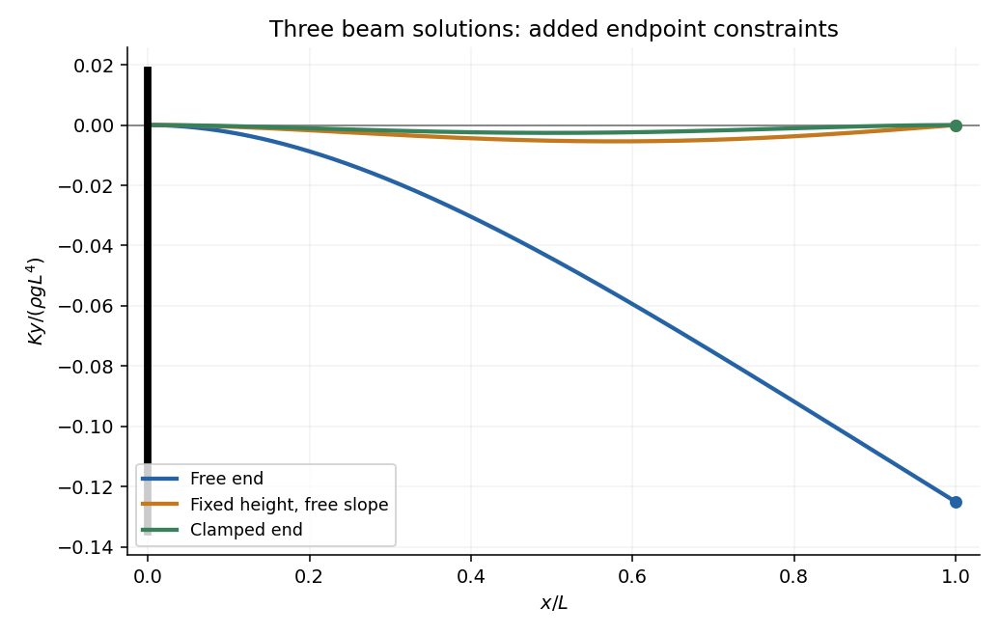

<h1 id="5/b/solution">Solution</h1>

↑ **Parent:** [B](../b.md)

Here $F_y=\rho g$, $F_{y'}=0$, and $F_{y''}=Ky''$. The [Euler-Lagrange equation for a second-derivative functional](../../../../euler-lagrange-equation-for-a-second-derivative-functional.md) is therefore

$$
\boxed{Ky^{(4)}+\rho g=0.}
$$

Write $q=\rho g/K>0$. After imposing the clamped conditions at zero, the general solution is

$$
y(x)=-\frac q{24}x^4+\frac A6x^3+\frac B2x^2.
$$

**Free right endpoint.** Both endpoint variations are free, so the [natural boundary conditions for second-derivative functionals](../../../../natural-boundary-conditions-for-second-derivative-functionals.md) give $y''(L)=y'''(L)=0$. Since $y'''=-qx+A$ and $y''=-qx^2/2+Ax+B$, they give $A=qL$, $B=-qL^2/2$. Hence

$$
\boxed{y_{\mathrm{free}}(x)=-\frac{\rho g}{24K}(x^4-4Lx^3+6L^2x^2).}
$$

**Right endpoint with fixed height and free slope.** Now $y(L)=0$ is imposed, while the free slope gives $y''(L)=0$. These equations yield $A=5qL/8$ and $B=-qL^2/8$, so

$$
\boxed{y_{\mathrm{pinned}}(x)=-\frac{\rho g}{48K}(2x^4-5Lx^3+3L^2x^2).}
$$

**Both endpoints clamped.** The right conditions are $y(L)=y'(L)=0$, giving $A=qL/2$, $B=-qL^2/12$. Thus

$$
\boxed{y_{\mathrm{clamped}}(x)=-\frac{\rho g}{24K}x^2(x-L)^2.}
$$

Each formula has fourth derivative $-\rho g/K$ and satisfies all four boundary conditions of its case. The three endpoint choices therefore change the integration constants, not the interior [differential equation](../../../../differential-equation-split.md).

**[Figure 1](#5/b/image-elastic-beam-deflections-under-three-right-end-boundary-conditions). Elastic beam deflections under three right-end boundary conditions**. Original dimensionless plots of the three quartic solutions. Each beam is clamped horizontally at the left. Requiring the right height, then the right slope as well, progressively restricts the admissible deflections.

## ↑ Ancestors (12)

1. [B](../b.md)
2. [5](../../5.md)
3. [2014](../../../2014-split.md)
4. [Past exam of the short options course of the University of Oxford](../../../split.md)
5. [Short options course of the University of Oxford](../../../../short-options-course-of-the-university-of-oxford.md)
6. [Year 2 of the mathematics course of the University of Oxford](../../../../year-2-of-the-mathematics-course-of-the-university-of-oxford.md)
7. [Mathematics course of the University of Oxford](../../../../mathematics-course-of-the-university-of-oxford.md)
8. [Undergraduate course of the University of Oxford](../../../../undergraduate-course-of-the-university-of-oxford.md)
9. [Course of the University of Oxford](../../../../course-of-the-university-of-oxford.md)
10. [University of Oxford](../../../../university-of-oxford-split.md)
11. [List of universities](../../../../list-of-universities.md)
12. [Codex Wiki](../../../../split.md)
