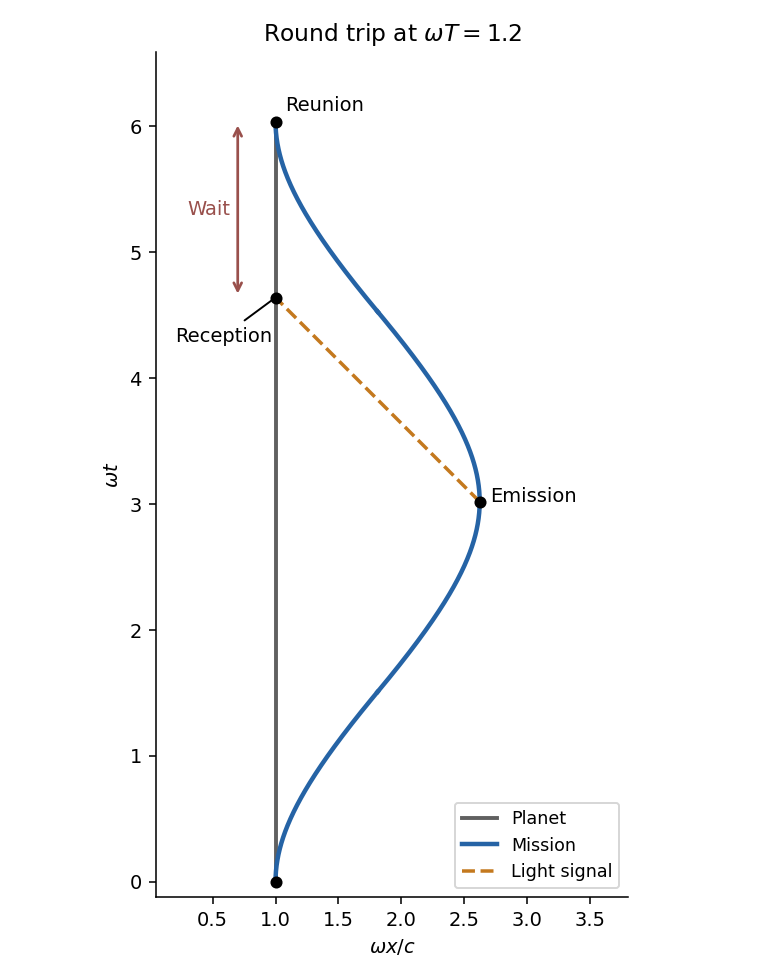

<h1 id="7/c/ii/solution">Solution</h1>

↑ **Parent:** [Ii](../ii.md)

Put $a=\omega T$. At emission, $s=2T$, the middle segment gives

$$
t_e=\frac2\omega\sinh a,\qquad x_e=\frac c\omega(2\cosh a-1).
$$

The planet is at $x_p=c/\omega$, so the inward [light](../../../../../light.md) signal takes coordinate time

$$
\frac{x_e-x_p}{c}=\frac2\omega(\cosh a-1).
$$

Its arrival time on the planet is therefore $t_r=2(e^a-1)/\omega$. Subtract this from the mission's return time $4\sinh a/\omega$:

$$
\boxed{t_{\mathrm{return}}-t_r=\frac2\omega(1-e^{-\omega T}).}
$$

For large $T$ at fixed acceleration this tends to $2/\omega=2c/(c\omega)$. With the Earth-gravity value above, the wait is **approximately two years**, despite the millions of planet-years elapsed since departure in part (i).

**[Figure 2](#7/c/ii/image-an-accelerated-round-trip-and-the-midpoint-signal-received-before-reunion). An accelerated round trip and the midpoint signal received before reunion**. Original spacetime diagram at omega T=1.2 for visibility. The planet follows the vertical line. The mission sends an inward light signal from its most distant point; the signal reaches the planet before the final reunion. Both axes use the same dimensionless spacetime scale.

## ↑ Ancestors (13)

1. [Ii](../ii.md)
2. [C](../../c.md)
3. [7](../../../7.md)
4. [2014](../../../../2014-split.md)
5. [Past exam of the short options course of the University of Oxford](../../../../split.md)
6. [Short options course of the University of Oxford](../../../../../short-options-course-of-the-university-of-oxford.md)
7. [Year 2 of the mathematics course of the University of Oxford](../../../../../year-2-of-the-mathematics-course-of-the-university-of-oxford.md)
8. [Mathematics course of the University of Oxford](../../../../../mathematics-course-of-the-university-of-oxford.md)
9. [Undergraduate course of the University of Oxford](../../../../../undergraduate-course-of-the-university-of-oxford.md)
10. [Course of the University of Oxford](../../../../../course-of-the-university-of-oxford.md)
11. [University of Oxford](../../../../../university-of-oxford-split.md)
12. [List of universities](../../../../../list-of-universities.md)
13. [Codex Wiki](../../../../../split.md)
