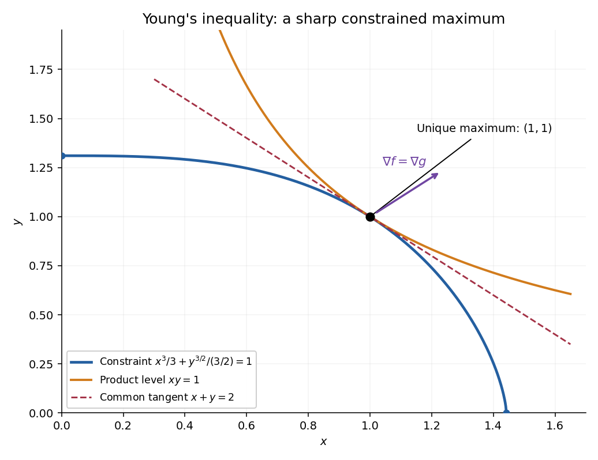
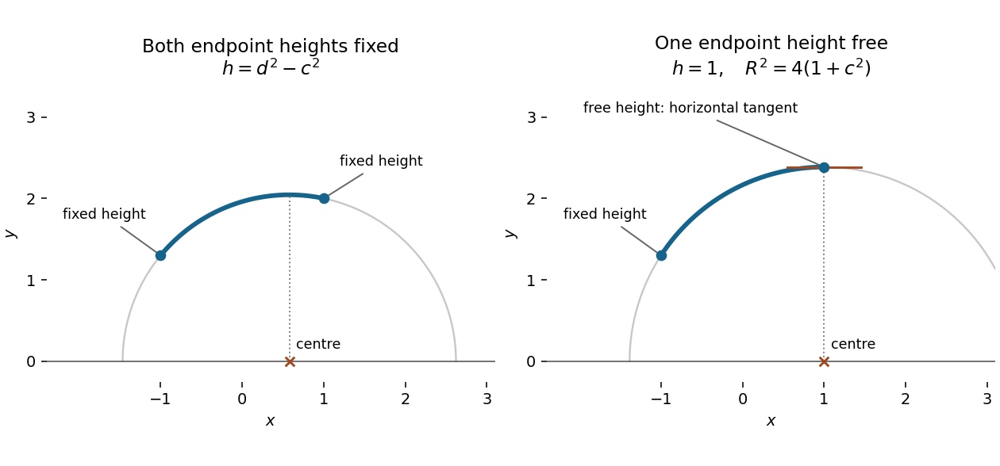

# 2015

↑ **Parent:** [Past exam of the short options course of the University of Oxford](../past-exam-of-the-short-options-course-of-the-university-of-oxford.md)

The original cover dates this examination to 22 June 2015, 9.30–11.00am. The archive stores it under `2014/T/a13752w1.pdf`; the cover determines the year. Source: [released examination archive](https://www.whatdotheyknow.com/request/ba_computer_science_past_papers/response/2577745/attach/2/202402%20183%20CS%20Papers.zip?cookie_passthrough=1).

The intact copy in [the Mathematics Part A release](https://www.whatdotheyknow.com/request/maths_papers_2/response/1850333/attach/3/FOI%2020210708%201%20Data.zip?cookie_passthrough=1), member `FOI-20210708-1 - Data/a13752w1 (4).pdf`, restores the previously missing printed page 3 and supplies a complete readable counterpart. Questions 1–2 had already been recovered and answered; those answers and all answers to questions 5–8 are retained. The solutions now cover all eight questions and their 37 leaf subparts. The earlier source provenance above is unchanged.

**Table of contents**

- [1](#1)
  - [a](#1/a)
    - [i](#1/a/i)
      - [Solution](#1/a/i/solution)
    - [ii](#1/a/ii)
      - [Solution](#1/a/ii/solution)
    - [iii](#1/a/iii)
      - [Solution](#1/a/iii/solution)
  - [b](#1/b)
    - [Solution](#1/b/solution)
  - [c](#1/c)
    - [Solution](#1/c/solution)
- [2](#2)
  - [a](#2/a)
    - [Solution](#2/a/solution)
  - [b](#2/b)
    - [Solution](#2/b/solution)
  - [c](#2/c)
    - [Solution](#2/c/solution)
  - [d](#2/d)
    - [Solution](#2/d/solution)
- [3](#3)
  - [a](#3/a)
    - [Solution](#3/a/solution)
  - [b](#3/b)
    - [Solution](#3/b/solution)
  - [c](#3/c)
    - [Solution](#3/c/solution)
  - [d](#3/d)
    - [Solution](#3/d/solution)
  - [e](#3/e)
    - [Solution](#3/e/solution)
- [4](#4)
  - [a](#4/a)
    - [Solution](#4/a/solution)
  - [b](#4/b)
    - [Solution](#4/b/solution)
  - [c](#4/c)
    - [Solution](#4/c/solution)
  - [d](#4/d)
    - [Solution](#4/d/solution)
- [5](#5)
  - [a](#5/a)
    - [i](#5/a/i)
      - [Solution](#5/a/i/solution)
    - [ii](#5/a/ii)
      - [Solution](#5/a/ii/solution)
    - [iii](#5/a/iii)
      - [Solution](#5/a/iii/solution)
  - [b](#5/b)
    - [i](#5/b/i)
      - [Solution](#5/b/i/solution)
    - [ii](#5/b/ii)
      - [Solution](#5/b/ii/solution)
  - [c](#5/c)
    - [Solution](#5/c/solution)
- [6](#6)
  - [a](#6/a)
    - [Solution](#6/a/solution)
  - [b](#6/b)
    - [Solution](#6/b/solution)
  - [c](#6/c)
    - [Solution](#6/c/solution)
- [7](#7)
  - [a](#7/a)
    - [i](#7/a/i)
      - [Solution](#7/a/i/solution)
    - [ii](#7/a/ii)
      - [Solution](#7/a/ii/solution)
    - [iii](#7/a/iii)
      - [Solution](#7/a/iii/solution)
  - [b](#7/b)
    - [i](#7/b/i)
      - [Solution](#7/b/i/solution)
    - [ii](#7/b/ii)
      - [Solution](#7/b/ii/solution)
    - [iii](#7/b/iii)
      - [Solution](#7/b/iii/solution)
- [8](#8)
  - [a](#8/a)
    - [Solution](#8/a/solution)
  - [b](#8/b)
    - [i](#8/b/i)
      - [Solution](#8/b/i/solution)
    - [ii](#8/b/ii)
      - [Solution](#8/b/ii/solution)
  - [c](#8/c)
    - [Solution](#8/c/solution)

## 1

↑ **Parent:** [2015](2015.md)

<h3 id="1/a">a</h3>

↑ **Parent:** [1](#1)

<h4 id="1/a/i">i</h4>

↑ **Parent:** [A](#1/a)

<h5 id="1/a/i/solution">Solution</h5>

↑ **Parent:** [I](#1/a/i)

The [binomial theorem](../binomial-coefficient.md#binomial-theorem) isolates the only terms that can survive reduction modulo the [prime number](../prime-number.md) $p$:

$$
(a+b)^p=a^p+b^p+\sum_{r=1}^{p-1}\binom pr a^{p-r}b^r.
$$

For $1\le r\le p-1$, neither $r!$ nor $(p-r)!$ is divisible by $p$, whereas $p!$ is. Consequently $p\mid\binom pr$, and every intermediate term vanishes in [modular arithmetic](../modular-arithmetic.md). Thus

$$
\boxed{(a+b)^p\equiv a^p+b^p\pmod p.}
$$

This works for arbitrary [integers](../integer.md) $a,b$, including those divisible by $p$. It is the additive identity behind the [Frobenius endomorphism](../galois-theory.md#frobenius-endomorphism) in [characteristic](../algebra.md#characteristic-of-a-field) $p$.

<h4 id="1/a/ii">ii</h4>

↑ **Parent:** [A](#1/a)

<h5 id="1/a/ii/solution">Solution</h5>

↑ **Parent:** [Ii](#1/a/ii)

For an odd [prime number](../prime-number.md) $p$, [Euler's criterion](../quadratic-residue.md#euler-s-criterion) states that

$$
\boxed{a^{(p-1)/2}\equiv\left(\frac ap\right)\pmod p,}
$$

where the [Legendre symbol](../quadratic-residue.md#legendre-symbol) is zero if $p\mid a$, one if $a$ is a nonzero [quadratic residue](../quadratic-residue.md), and minus one otherwise. Including the zero case makes this formulation valid for every [integer](../integer.md) $a$.

Apply [Euler's criterion](../quadratic-residue.md#euler-s-criterion) to $a$, $b$, and $ab$. Multiplication in [modular arithmetic](../modular-arithmetic.md) gives

$$
\left(\frac{ab}p\right)\equiv (ab)^{(p-1)/2}
\equiv a^{(p-1)/2}b^{(p-1)/2}
\equiv\left(\frac ap\right)\left(\frac bp\right)\pmod p.
$$

If $p$ divides either factor, both sides are zero. Otherwise both sides belong to $\{-1,1\}$; these two values are distinct modulo the odd [prime number](../prime-number.md) $p$. The congruence is therefore an equality of [integers](../integer.md), proving [multiplicativity of the Legendre symbol](../quadratic-residue.md#multiplicativity-of-the-legendre-symbol):

$$
\boxed{\left(\frac{ab}p\right)=\left(\frac ap\right)\left(\frac bp\right).}
$$

<h4 id="1/a/iii">iii</h4>

↑ **Parent:** [A](#1/a)

<h5 id="1/a/iii/solution">Solution</h5>

↑ **Parent:** [Iii](#1/a/iii)

For distinct odd [prime numbers](../prime-number.md) $p,q$, the law of [quadratic reciprocity](../number-theory.md#quadratic-reciprocity) is

$$
\boxed{\left(\frac pq\right)\left(\frac qp\right)=(-1)^{(p-1)(q-1)/4}.}
$$

Thus the two [Legendre symbols](../quadratic-residue.md#legendre-symbol) agree unless both [prime numbers](../prime-number.md) are congruent to $3$ modulo $4$, in which case they have opposite signs.

<h3 id="1/b">b</h3>

↑ **Parent:** [1](#1)

<h4 id="1/b/solution">Solution</h4>

↑ **Parent:** [B](#1/b)

In [Pollard's p-1 algorithm](../number-theory.md#pollard-s-p-1-algorithm), a large exponent containing many small factors makes $a^M-1$ divisible by a [prime factor](../prime-number.md#prime-factor) whose predecessor divides $M$, by [Fermat's little theorem](../number-theory.md#fermat-little-theorem). A [greatest common divisor](../divisibility.md#greatest-common-divisor) with the number being factored can then separate that [prime factor](../prime-number.md#prime-factor) from the others.

Choose base $a=2$ and build factorial exponents using [modular exponentiation](../number-theory.md#modular-exponentiation). The successive exponents $2!$, $3!$, and $4!$ give

$$
2^2\equiv4,\qquad 2^6\equiv64,\qquad
2^{24}\equiv64^4\equiv35\pmod{1003}.
$$

The first two [greatest common divisors](../divisibility.md#greatest-common-divisor) are $\gcd(3,1003)=\gcd(63,1003)=1$. At the next step the [Euclidean algorithm](../number-theory.md#euclidean-algorithm) gives

$$
\gcd(2^{24}-1,1003)=\gcd(34,1003)=17,
\qquad 1003=29\cdot34+17.
$$

Hence

$$
\boxed{17\text{ is a factor of }1003,\qquad1003=17\cdot59.}
$$

Here the [element order](../group-theory.md#order-of-a-group-element) of $2$ modulo $17$ is $8$, which divides $24$, even though $17-1=16$ does not divide $24$. The algorithm only needs the [element order](../group-theory.md#order-of-a-group-element) to divide the chosen exponent; divisibility by the full predecessor is a sufficient condition, not a necessary one.

<h3 id="1/c">c</h3>

↑ **Parent:** [1](#1)

<h4 id="1/c/solution">Solution</h4>

↑ **Parent:** [C](#1/c)

First simplify the specified residue by [modular exponentiation](../number-theory.md#modular-exponentiation). Modulo the [prime number](../prime-number.md) $113$,

$$
102^2\equiv8,\quad102^4\equiv64,\quad102^8\equiv28,\quad
102^{16}\equiv106,\quad102^{32}\equiv49,\quad102^{64}\equiv28.
$$

Therefore $102^{70}\equiv28\cdot64\cdot8\equiv98$, so the required equation becomes $x^{37}\equiv97\pmod{113}$. Its right side is nonzero, so any solution is a [unit](../algebra.md#unit-in-a-ring) modulo $113$.

By [Fermat's little theorem](../number-theory.md#fermat-little-theorem), exponents of such [units](../algebra.md#unit-in-a-ring) can be reduced modulo $112$. Since

$$
37\cdot109=1+36\cdot112,
$$

raising to the $109$th power is the inverse of raising to the $37$th power. There is therefore exactly one residue class of solutions:

$$
x\equiv97^{109}\equiv97^{-3}\pmod{113}.
$$

Now $97\equiv-16$ and $97^3\equiv-4096\equiv85$. Since $4\cdot85\equiv1$, we obtain

$$
\boxed{x\equiv4\pmod{113}.}
$$

As a direct check, $4^4\equiv30$, $4^8\equiv109$, $4^{16}\equiv16$, and $4^{32}\equiv30$, whence $4^{37}\equiv30\cdot30\cdot4\equiv97$.

## 2

↑ **Parent:** [2015](2015.md)

<h3 id="2/a">a</h3>

↑ **Parent:** [2](#2)

<h4 id="2/a/solution">Solution</h4>

↑ **Parent:** [A](#2/a)

The defining relation $yx=x^4y$ lets us move every occurrence of $y$ to the right of every occurrence of $x$. More generally, repeated [conjugation](../group-action.md#conjugation) gives

$$
yx^r=x^{4r}y,\qquad y^jx^r=x^{4^jr}y^j.
$$

Negative powers cause no problem because $x^{-1}=x^8$ and $y^{-1}=y^2$. Thus every word in the [group presentation](../geometric-group-theory.md#group-presentation) can be put in the required form, reducing powers using $x^9=y^3=e$:

$$
\boxed{g=x^iy^j,\qquad0\le i\le8,\quad0\le j\le2.}
$$

At this stage existence is proved; uniqueness will follow from the concrete [semidirect product](../group-theory.md#semidirect-product) in part (b). Moving $x^r$ past $y^j$ gives the multiplication law

$$
\boxed{(x^iy^j)(x^ry^s)=x^{\,i+4^jr\bmod9}y^{\,j+s\bmod3}.}
$$

The action is consistent with reduction of $j$ modulo $3$ because $4^3\equiv1\pmod9$.

<h3 id="2/b">b</h3>

↑ **Parent:** [2](#2)

<h4 id="2/b/solution">Solution</h4>

↑ **Parent:** [B](#2/b)

For the given [group homomorphism](../group-theory.md#group-homomorphism) $\varphi:H\to\operatorname{Aut}(N)$, the external [semidirect product](../group-theory.md#semidirect-product) has underlying [Cartesian product](../set-theory.md#cartesian-product) $N\times H$ and operation

$$
\boxed{(n,h)(m,k)=\bigl(n\varphi(h)(m),hk\bigr).}
$$

The notation $\operatorname{Aut}(N)$ denotes the [automorphism group](../group-theory.md#automorphism-group) of $N$. Closure follows because $\varphi(h)$ is an [automorphism](../algebra.md#automorphism) of $N$. To check [associativity](../algebraic-operation.md#associative-property), calculate both bracketings:

$$
\begin{aligned}
((n,h)(m,k))(r,l)
&=\bigl(n\varphi(h)(m)\varphi(hk)(r),hkl\bigr),\\
(n,h)((m,k)(r,l))
&=\bigl(n\varphi(h)(m\varphi(k)(r)),hkl\bigr)\\
&=\bigl(n\varphi(h)(m)\varphi(h)\varphi(k)(r),hkl\bigr).
\end{aligned}
$$

They agree because $\varphi(hk)=\varphi(h)\varphi(k)$. The identity is $(e_N,e_H)$, using $\varphi(e_H)=\mathrm{id}_N$, and the two-sided inverse is

$$
(n,h)^{-1}=\bigl(\varphi(h^{-1})(n^{-1}),h^{-1}\bigr).
$$

Indeed multiplication in either order gives the identity, using $\varphi(h)\varphi(h^{-1})=\mathrm{id}_N$. This verifies the [group axioms](../group.md#group-axioms).

For the specified [group presentation](../geometric-group-theory.md#group-presentation), take $N=C_9=\langle X\rangle$ and $H=C_3=\langle Y\rangle$. The rule $\alpha(X)=X^4$ defines an [automorphism](../algebra.md#automorphism) because $4$ is coprime to $9$. Furthermore $4^3\equiv1\pmod9$, so $Y\mapsto\alpha$ defines the required [group homomorphism](../group-theory.md#group-homomorphism) $C_3\to\operatorname{Aut}(C_9)$. In the resulting [semidirect product](../group-theory.md#semidirect-product) $S$, the canonical generators satisfy

$$
X^9=Y^3=e,\qquad YXY^{-1}=X^4.
$$

Consequently the [group presentation](../geometric-group-theory.md#group-presentation) defines a surjective [group homomorphism](../group-theory.md#group-homomorphism) $G\to S$, sending $x$ to $X$ and $y$ to $Y$. The underlying [Cartesian product](../set-theory.md#cartesian-product) gives $|S|=27$, whereas part (a) gives $|G|\le27$. Surjectivity forces equality, so the map is an [isomorphism](../algebra.md#isomorphism):

$$
\boxed{G\cong C_9\rtimes_{\alpha}C_3,\qquad\alpha(X)=X^4,\qquad|G|=27.}
$$

This also proves that the $27$ normal forms in part (a) are distinct and that $x$ has [element order](../group-theory.md#order-of-a-group-element) exactly $9$.

<h3 id="2/c">c</h3>

↑ **Parent:** [2](#2)

<h4 id="2/c/solution">Solution</h4>

↑ **Parent:** [C](#2/c)

The [cyclic subgroup](../group.md#cyclic-subgroup) $\langle x^3\rangle$ is normal: [conjugation](../group-action.md#conjugation) by $y$ sends $x^3$ to $x^{12}=x^3$, and [conjugation](../group-action.md#conjugation) by $x$ fixes it. Modulo this [subgroup](../group.md#subgroup), the relation $yxy^{-1}=x^4$ becomes $yxy^{-1}=x$, so the [quotient group](../group-theory.md#quotient-group) is [Abelian](../group.md#abelian-group). Thus the [commutator subgroup](../group-theory.md#commutator-subgroup) $G'$ is contained in $\langle x^3\rangle$.

Conversely the displayed relation gives the [commutator](../lie-algebra.md#commutator) $yxy^{-1}x^{-1}=x^3$, so $\langle x^3\rangle\subseteq G'$. Hence

$$
G'=\langle x^3\rangle\cong C_3,\qquad G''=\{e\}.
$$

Since $x$ has [element order](../group-theory.md#order-of-a-group-element) $9$, $x^3\ne e$, so the first [commutator subgroup](../group-theory.md#commutator-subgroup) is nontrivial. Therefore

$$
\boxed{G\text{ is solvable, with derived length }2.}
$$

Here [derived length](../group-theory.md#derived-length) counts the number of steps needed for the [derived series](../group-theory.md#derived-series) to reach the trivial [group](../group.md).

<h3 id="2/d">d</h3>

↑ **Parent:** [2](#2)

<h4 id="2/d/solution">Solution</h4>

↑ **Parent:** [D](#2/d)

The given [unitriangular group of degree three over F3](../finite-group-theory.md#unitriangular-group-of-degree-three-over-f3) has $27$ elements, just as $G$ does, so counting alone cannot distinguish them. Instead compare [element orders](../group-theory.md#order-of-a-group-element).

Write an element as $I+U$, with $U$ strictly upper triangular of size $3$. Then $U^3=0$. Over the [finite field](../algebra.md#finite-field) $\mathbb F_3$, the [binomial theorem for commuting matrices](../binomial-coefficient.md#binomial-theorem-for-commuting-matrices) gives

$$
(I+U)^3=I+3U+3U^2+U^3=I.
$$

Every nonidentity element of $H$ consequently has [element order](../group-theory.md#order-of-a-group-element) $3$. In contrast, $x\in G$ has [element order](../group-theory.md#order-of-a-group-element) $9$, by part (b). An [isomorphism](../algebra.md#isomorphism) preserves [element order](../group-theory.md#order-of-a-group-element), so

$$
\boxed{H\not\cong G.}
$$

Equivalently, the [exponent of a finite group](../group-theory.md#exponent-of-a-finite-group) is $3$ for $H$ and $9$ for $G$.

## 3

↑ **Parent:** [2015](2015.md)

<h3 id="3/a">a</h3>

↑ **Parent:** [3](#3)

<h4 id="3/a/solution">Solution</h4>

↑ **Parent:** [A](#3/a)

Use the [cross-ratio](../group-theory.md#cross-ratio) convention compatible with the permutation identities in this paper. Represent a [projective point](../projective-space.md#projective-point) $P_i\in\mathbb{CP}^1$ by a nonzero vector $p_i\in\mathbb C^2$, and write $[p_i,p_j]=\det(p_i,p_j)$. Define

$$
\boxed{(P_0P_1:P_2P_3)=\frac{[p_0,p_2][p_1,p_3]}{[p_0,p_3][p_1,p_2]}.}
$$

The denominator is nonzero because the four [projective points](../projective-space.md#projective-point) are distinct. Rescaling any one representative multiplies numerator and denominator by the same nonzero [scalar](../vector-space.md#scalar), so the definition is independent of the chosen [homogeneous coordinates](../projective-space.md#homogeneous-coordinate). In finite affine coordinates it reads

$$
(z_0z_1:z_2z_3)=\frac{(z_0-z_2)(z_1-z_3)}{(z_0-z_3)(z_1-z_2)},
$$

with the [point at infinity of the complex projective line](../finite-group-theory.md#point-at-infinity-of-the-complex-projective-line) handled by the homogeneous formula.

A [projective transformation](../projective-space.md#projective-linear-transformation) is represented by an [invertible matrix](../linear-algebra.md#invertible-matrix) $A\in\operatorname{GL}_2(\mathbb C)$. Since $[Ap_i,Ap_j]=\det(A)[p_i,p_j]$, the two factors of $\det(A)$ in the numerator cancel the two in the denominator. Therefore **every [projective transformation](../projective-space.md#projective-linear-transformation) preserves this [cross-ratio](../group-theory.md#cross-ratio)**. This also shows that the formula descends from matrices to the [projective linear group](../group-theory.md#projective-linear-group), whose representatives differ by a nonzero common [scalar](../vector-space.md#scalar).

<h3 id="3/b">b</h3>

↑ **Parent:** [3](#3)

<h4 id="3/b/solution">Solution</h4>

↑ **Parent:** [B](#3/b)

The needed general-position theorem is **sharp triple transitivity of the [projective linear group](../group-theory.md#projective-linear-group) on the [projective line](../finite-group-theory.md#projective-line)**: for any two ordered triples of distinct [projective points](../projective-space.md#projective-point), exactly one [projective transformation](../projective-space.md#projective-linear-transformation) takes the first triple to the second.

In particular, let $T_P$ take $(P_0,P_1,P_2)$ to $(\infty,0,1)$. In these coordinates,

$$
(\infty\,0:1\,z)=z,
$$

so [cross-ratio](../group-theory.md#cross-ratio) invariance gives $T_P(P_3)=\lambda$, where $\lambda=(P_0P_1:P_2P_3)$. Distinctness implies $\lambda\ne0,1$ and $\lambda$ is finite. The entire ordered quadruple is thus normalized to

$$
\boxed{(\infty,0,1,\lambda).}
$$

For a second quadruple $(Q_0,Q_1,Q_2,Q_3)$ with the same [cross-ratio](../group-theory.md#cross-ratio), its normalizing map $T_Q$ yields the same quadruple. Consequently

$$
\boxed{T_Q^{-1}\circ T_P(P_i)=Q_i\quad(0\leq i\leq3).}
$$

This proves the equivalence. Uniqueness on the first three points also shows that the projectivity carrying one ordered quadruple to the other is unique. The [cross-ratio normalization of four projective points](../group-theory.md#cross-ratio-normalization-of-four-projective-points) therefore gives a complete invariant for this ordered classification.

<h3 id="3/c">c</h3>

↑ **Parent:** [3](#3)

<h4 id="3/c/solution">Solution</h4>

↑ **Parent:** [C](#3/c)

Choose three distinct [projective points](../projective-space.md#projective-point) $A,B,C$. Their images under the [injective](../algebra.md#injective-function) map $\tau$ are distinct. Sharp triple transitivity gives a [projective transformation](../projective-space.md#projective-linear-transformation) $S$ agreeing with $\tau$ on these three points. The map $\sigma=S^{-1}\circ\tau$ fixes $A,B,C$ and preserves their [cross-ratios](../group-theory.md#cross-ratio).

For any other [projective point](../projective-space.md#projective-point) $P$, invariance gives

$$
(AB:C\,\sigma(P))=(AB:CP).
$$

Let $T$ normalize $(A,B,C)$ to $(\infty,0,1)$. By part (b), the left side is $T(\sigma(P))$ and the right side is $T(P)$. Since $T$ is a [bijection](../function.md#bijection), $\sigma(P)=P$. It fixes the original three points too, so $\sigma$ is the [identity map](../function.md#identity-function) everywhere. Therefore

$$
\boxed{\tau=S\text{ is a projective transformation}.}
$$

No continuity or prior [surjectivity](../algebra.md#surjective-function) assumption was needed. This is the rigidity assertion that [cross-ratio preserving maps are projective](../group-theory.md#cross-ratio-preserving-maps-are-projective).

<h3 id="3/d">d</h3>

↑ **Parent:** [3](#3)

<h4 id="3/d/solution">Solution</h4>

↑ **Parent:** [D](#3/d)

By invariance under [projective transformations](../projective-space.md#projective-linear-transformation) and part (b), it is enough to calculate on the normalized quadruple $(\infty,0,1,\lambda)$. Direct evaluation of the [cross-ratio](../group-theory.md#cross-ratio) gives

$$
\begin{aligned}
(0\,\infty:\lambda\,1)&=\lambda,&
(1\,\lambda:\infty\,0)&=\lambda,\\
(0\,\infty:1\,\lambda)&=\lambda^{-1},&
(\infty\,1:0\,\lambda)&=1-\lambda.
\end{aligned}
$$

For instance, $(0\,\infty:1\,\lambda)=(0-1)/(0-\lambda)=1/\lambda$, and $(\infty\,1:0\,\lambda)=(1-\lambda)/(1-0)$. Thus

$$
\boxed{(P_0P_1:P_2P_3)=(P_1P_0:P_3P_2)=(P_2P_3:P_0P_1),}
$$

$$
\boxed{(P_0P_1:P_2P_3)=(P_1P_0:P_2P_3)^{-1},}
$$

$$
\boxed{(P_0P_2:P_1P_3)=1-(P_0P_1:P_2P_3).}
$$

All denominators are legitimate because $\lambda\notin\{0,1\}$. The first identity explains why some distinct permutations always give the same [cross-ratio](../group-theory.md#cross-ratio).

<h3 id="3/e">e</h3>

↑ **Parent:** [3](#3)

<h4 id="3/e/solution">Solution</h4>

↑ **Parent:** [E](#3/e)

The [cross-ratio permutation orbit](../group-theory.md#cross-ratio-permutation-orbit) is generated by the two operations $\lambda\mapsto1/\lambda$ and $\lambda\mapsto1-\lambda$ from part (d). The full list is

$$
\boxed{\lambda,\quad\frac1\lambda,\quad1-\lambda,\quad
\frac1{1-\lambda},\quad\frac{\lambda-1}{\lambda},\quad
\frac{\lambda}{\lambda-1}.}
$$

These are all the possibilities: the four permutations generated by interchanging both pairs and by exchanging the two pairs leave the [cross-ratio](../group-theory.md#cross-ratio) unchanged. They form the [Klein four-group](../finite-group-theory.md#klein-four-group) inside the [symmetric group](../finite-group-theory.md#symmetric-group) on four symbols, leaving at most $24/4=6$ different values; the displayed operations attain all six rational expressions.

There are fewer than six values exactly when a nonidentity operation in this six-element action fixes $\lambda$: if two operations give the same value, composing one with the inverse of the other gives such a fixed point. For real $\lambda\ne0,1$, the fixed-point equations are

$$
\begin{aligned}
\lambda=1/\lambda&\Longrightarrow\lambda=-1,\\
\lambda=1-\lambda&\Longrightarrow\lambda=\tfrac12,\\
\lambda=\lambda/(\lambda-1)&\Longrightarrow\lambda=2.
\end{aligned}
$$

The other two equations reduce to $\lambda^2-\lambda+1=0$, which has no real root. Hence

$$
\boxed{\lambda\in\{-1,\tfrac12,2\}\text{ are exactly the real exceptional values}.}
$$

Each exceptional value has the same three-element [orbit](../dynamical-systems.md#orbit-dynamical-system) $\{-1,\tfrac12,2\}$. Every other permitted real value gives six different values.

For the geometric interpretation, put $P_0=[1:0]=\infty$ and $P_i=[x_i:1]$ for $i>0$. Then

$$
\lambda=\frac{x_1-x_3}{x_1-x_2}.
$$

The three exceptional cases become

$$
\begin{aligned}
\lambda=-1&\Longleftrightarrow x_1=\tfrac12(x_2+x_3),\\
\lambda=\tfrac12&\Longleftrightarrow x_3=\tfrac12(x_1+x_2),\\
\lambda=2&\Longleftrightarrow x_2=\tfrac12(x_1+x_3).
\end{aligned}
$$

Thus **the three finite points are collinear and equally spaced, with one their midpoint**, even when the $x_i$ are viewed as points of the [complex plane](../complex-analysis.md#complex-plane). Equivalently they form an [arithmetic progression](../arithmetic.md#arithmetic-progression) in some order. These are the [harmonic conjugate points](../group-theory.md#harmonic-conjugate-points) configurations with the fourth point equal to the [point at infinity of the complex projective line](../finite-group-theory.md#point-at-infinity-of-the-complex-projective-line).

## 4

↑ **Parent:** [2015](2015.md)

<h3 id="4/a">a</h3>

↑ **Parent:** [4](#4)

<h4 id="4/a/solution">Solution</h4>

↑ **Parent:** [A](#4/a)

A map $g$ is [differentiable](../analysis.md#differentiable-function) at $a$ when a [linear map](../vector-space.md#linear-map) $Dg_a:\mathbb R^n\to\mathbb R^k$ approximates its increment to first order:

$$
\boxed{g(a+h)=g(a)+Dg_a(h)+o(\|h\|).}
$$

This [Fréchet derivative](../multivariable-calculus.md#frechet-derivative) is unique, and its matrix in the standard bases is the [Jacobian matrix](../multivariable-calculus.md#jacobian-matrix). Differentiability on a domain means differentiability at each point there.

A standard sufficient condition for a zero locus to be a [submanifold](../differential-geometry.md#submanifold) is the [regular level set theorem](../differential-geometry.md#regular-level-set-theorem): if $g$ is $C^1$ on an open domain and $Dg_a$ is [surjective](../algebra.md#surjective-function) at every $a\in g^{-1}(0)$, then

$$
\boxed{M=g^{-1}(0)\text{ is an embedded }C^1\text{ submanifold of dimension }n-k.}
$$

For smooth $g$, the [submanifold](../differential-geometry.md#submanifold) is smooth. The full-rank condition is the relevant [constraint qualification](../mathematical-optimization.md#constraint-qualification).

Under this regularity hypothesis, its [tangent space](../tangent-vector.md#tangent-space) is

$$
\boxed{T_aM=\ker Dg_a.}
$$

Indeed, if a differentiable curve $\gamma$ lies in $M$ and passes through $a$, the [chain rule](../calculus.md#chain-rule) gives $Dg_a(\gamma'(0))=0$. Thus all tangent velocities lie in the [kernel of a linear map](../kernel-of-a-linear-map.md). The [rank-nullity theorem](../kernel-of-a-linear-map.md#rank-nullity-theorem) makes this kernel $(n-k)$-dimensional, the same dimension as the [tangent space](../tangent-vector.md#tangent-space), proving equality. In coordinates, solve the homogeneous linear equations given by the [Jacobian matrix](../multivariable-calculus.md#jacobian-matrix).

The regularity qualification matters: $g(x)=x^2$ has zero set $\{0\}$, a zero-dimensional [submanifold](../differential-geometry.md#submanifold), but $Dg_0=0$. Its [kernel](../kernel-of-a-linear-map.md) is all of $\mathbb R$, whereas its [tangent space](../tangent-vector.md#tangent-space) is zero. This is the phenomenon that [singular defining maps can overestimate tangent spaces](../tangent-vector.md#singular-defining-maps-can-overestimate-tangent-spaces).

<h3 id="4/b">b</h3>

↑ **Parent:** [4](#4)

<h4 id="4/b/solution">Solution</h4>

↑ **Parent:** [B](#4/b)

At a constrained [critical point](../analysis.md#critical-point), the directional [derivative](../calculus.md#derivative) of $f$ vanishes along every admissible tangent velocity:

$$
Df_a(v)=0\qquad(v\in T_aM).
$$

For a regular zero locus, $T_aM=\ker Dg_a$. A [linear functional](../dual-space.md#linear-functional) vanishing on this kernel lies in the [row space](../vector-space.md#row-space) of $Dg_a$. Equivalently there are [Lagrange multipliers](../mathematical-optimization.md#lagrange-multiplier) $\lambda_1,\ldots,\lambda_k$ such that

$$
\boxed{\nabla f(a)=Dg_a^T\lambda
=\sum_{j=1}^k\lambda_j\nabla g_j(a),\qquad g(a)=0.}
$$

Geometrically, $\nabla f$ is orthogonal to the [tangent space](../tangent-vector.md#tangent-space), so it lies in its [orthogonal complement](../hilbert-space.md#orthogonal-complement), spanned by the independent constraint [gradients](../multivariable-calculus.md#gradient). Thus the level set of $f$ has no first-order change in a tangent direction. The equations provide candidates for constrained extrema; they must still be classified and compared, and boundary or singular cases must be treated separately. The condition is necessary for a regular constrained extremum, not a guarantee of a maximum.

<h3 id="4/c">c</h3>

↑ **Parent:** [4](#4)

<h4 id="4/c/solution">Solution</h4>

↑ **Parent:** [C](#4/c)

The feasible set is closed and contained in the rectangle

$$
0\leq x\leq p^{1/p},\qquad0\leq y\leq q^{1/q}.
$$

It is therefore [compact](../topology.md#compact-space), and the continuous [function](../function.md) $xy$ attains a global maximum there by the [extreme value theorem](../real-analysis.md#extreme-value-theorem). At the two boundary endpoints where a coordinate is zero, the product is zero. Meanwhile $(1,1)$ is feasible because the [conjugate exponents](../functional-analysis.md#conjugate-exponents) satisfy $1/p+1/q=1$, and its product is one. Hence every maximizer has $x,y>0$.

On that positive region the constraint is $C^1$ with nonzero [gradient](../multivariable-calculus.md#gradient). The [Lagrange multiplier](../mathematical-optimization.md#lagrange-multiplier) equations are

$$
y=\lambda x^{p-1},\qquad x=\lambda y^{q-1},\qquad
\frac{x^p}{p}+\frac{y^q}{q}=1.
$$

The first two identities imply $xy=\lambda x^p=\lambda y^q$. Since $x,y>0$, the multiplier is nonzero, so $x^p=y^q=r$. The constraint now gives

$$
r\left(\frac1p+\frac1q\right)=1,\qquad r=1.
$$

Thus the sole interior candidate is $(1,1)$. Existence of a maximum and the boundary comparison prove the unique global result

$$
\boxed{\max xy=1,\qquad\text{attained exactly at }x=y=1.}
$$

This [conjugate-power constrained product maximum](../mathematical-optimization.md#conjugate-power-constrained-product-maximum) is valid for all real $p,q>1$ with $1/p+1/q=1$; no integrality of the exponents is needed.

**[Figure 1](#4/c/image-the-constrained-product-reaches-one-where-the-two-level-curves-are-tangent). The constrained product reaches one where the two level curves are tangent**. Original illustration for p=3 and q=3/2. The constraint arc meets the product level xy=1 only at (1,1), where both gradients point along (1,1). The red dashed line is their common tangent.

<h3 id="4/d">d</h3>

↑ **Parent:** [4](#4)

<h4 id="4/d/solution">Solution</h4>

↑ **Parent:** [D](#4/d)

Use a [normalization proof of Young's inequality](../nonlinear-analysis.md#normalization-proof-of-young-s-inequality). For arbitrary $x,y\geq0$, put

$$
A=\frac{x^p}{p}+\frac{y^q}{q}.
$$

If $A=0$, both coordinates are zero and the desired inequality is equality. If $A>0$, define

$$
X=\frac{x}{A^{1/p}},\qquad Y=\frac{y}{A^{1/q}}.
$$

Then $X^p/p+Y^q/q=1$. Part (c) gives $XY\leq1$, and the [conjugate exponent](../real-analysis.md#conjugate-exponent) identity gives $XY=xy/A$. Therefore [Young's inequality for products](../nonlinear-analysis.md#young-s-inequality-for-products) is

$$
\boxed{xy\leq\frac{x^p}{p}+\frac{y^q}{q}.}
$$

The unique equality case in part (c) says $X=Y=1$. Translated back, and including the zero case, this gives the sharp condition

$$
\boxed{\text{equality holds exactly when }x^p=y^q.}
$$

Conversely, if both powers equal $r\geq0$, then $xy=r^{1/p+1/q}=r$ and the right side is $r(1/p+1/q)=r$, directly verifying equality.

## 5

↑ **Parent:** [2015](2015.md)

<h3 id="5/a">a</h3>

↑ **Parent:** [5](#5)

<h4 id="5/a/i">i</h4>

↑ **Parent:** [A](#5/a)

<h5 id="5/a/i/solution">Solution</h5>

↑ **Parent:** [I](#5/a/i)

Use the unilateral [Laplace transform](../integral-transform.md#laplace-transform) convention $\overline f(p)=\int_0^\infty e^{-px}f(x)\,dx$. The [Laplace transform of a derivative](../integral-transform.md#laplace-transform-of-a-derivative) is

$$
\boxed{\mathcal L[f'](p)=p\overline f(p)-f(0).}
$$

The formula holds in the common [Laplace convergence region](../integral-transform.md#region-of-absolute-convergence-of-a-laplace-transform) under the usual endpoint and growth hypotheses. The initial value is the right-hand value at zero.

<h4 id="5/a/ii">ii</h4>

↑ **Parent:** [A](#5/a)

<h5 id="5/a/ii/solution">Solution</h5>

↑ **Parent:** [Ii](#5/a/ii)

With the same unilateral [Laplace transform](../integral-transform.md#laplace-transform) convention, the standard [sine](../geometry-and-topology.md#sine) formula is

$$
\boxed{\mathcal L[\sin x](p)=\frac1{p^2+1},\qquad\operatorname{Re}p>0.}
$$

<h4 id="5/a/iii">iii</h4>

↑ **Parent:** [A](#5/a)

<h5 id="5/a/iii/solution">Solution</h5>

↑ **Parent:** [Iii](#5/a/iii)

The defining evaluation rule of the [Dirac delta](../distribution-theory.md#dirac-delta-function) gives

$$
\boxed{\mathcal L[\delta(x-a)](p)=e^{-ap},\qquad a>0.}
$$

The impulse lies strictly inside the integration domain, so there is no endpoint convention to settle. This [Laplace transform](../integral-transform.md#laplace-transform) exists for every complex $p$.

<h3 id="5/b">b</h3>

↑ **Parent:** [5](#5)

<h4 id="5/b/i">i</h4>

↑ **Parent:** [B](#5/b)

<h5 id="5/b/i/solution">Solution</h5>

↑ **Parent:** [I](#5/b/i)

Let $K(p)=\mathcal L[k](p)$ and $F(p)=\mathcal L[f](p)$. Apply the [Laplace transform of a derivative](../integral-transform.md#laplace-transform-of-a-derivative) twice and use the two zero [initial conditions](../differential-equation.md#initial-condition). The [differential equation](../differential-equation.md) becomes

$$
(p^2+1)F(p)=K(p),\qquad
\boxed{F(p)=\frac{K(p)}{p^2+1}.}
$$

The factor $1/(p^2+1)$ is the [Laplace transform](../integral-transform.md#laplace-transform) of $\sin x$. The [convolution theorem for Laplace transforms](../integral-transform.md#convolution-theorem-for-laplace-transforms) therefore gives

$$
\boxed{f(x)=(\sin*k)(x)=\int_0^x\sin(x-t)k(t)\,dt.}
$$

This is a causal [convolution](../fourier-analysis.md#convolution): the value at $x$ uses only the forcing up to $x$. For ordinary continuous $k$, direct [differentiation](../calculus.md#differentiation) gives $f'(x)=\int_0^x\cos(x-t)k(t)\,dt$ and $f''(x)=k(x)-f(x)$, verifying both the [differential equation](../differential-equation.md) and the [initial conditions](../differential-equation.md#initial-condition). For an impulsive $k$, the same formula is interpreted using [distributions](../distribution-theory.md#distribution-mathematical-analysis).

<h4 id="5/b/ii">ii</h4>

↑ **Parent:** [B](#5/b)

<h5 id="5/b/ii/solution">Solution</h5>

↑ **Parent:** [Ii](#5/b/ii)

An impulse at $a$ shifts the causal [sine](../geometry-and-topology.md#sine) response. Substituting the [Dirac delta](../distribution-theory.md#dirac-delta-function) in the [convolution](../fourier-analysis.md#convolution) from part (i), or using the [Laplace transform time-shift rule](../integral-transform.md#laplace-transform-time-shift-rule), gives

$$
\boxed{f(x)=H(x-a)\sin(x-a)=
\begin{cases}0,&0\le x<a,\\\sin(x-a),&x\ge a,\end{cases}}
$$

where $H$ is the [Heaviside step function](../integral-transform.md#heaviside-step-function). The answer is continuous at $a$, while its first [derivative](../calculus.md#derivative) jumps from $0$ to $1$. Consequently its second [distributional derivative](../distribution-theory.md#distributional-derivative) contains exactly one unit [Dirac delta](../distribution-theory.md#dirac-delta-function) at $a$, giving $f''+f=\delta(x-a)$. Since $a>0$, both [initial conditions](../differential-equation.md#initial-condition) vanish.

<h3 id="5/c">c</h3>

↑ **Parent:** [5](#5)

<h4 id="5/c/solution">Solution</h4>

↑ **Parent:** [C](#5/c)

Put $G(p)=\mathcal L[J_0](p)$, initially for real $p>0$. Besides the [Laplace transform of a derivative](../integral-transform.md#laplace-transform-of-a-derivative), use multiplication by the original variable in the form

$$
\mathcal L[xg(x)](p)=-\frac d{dp}\mathcal L[g](p).
$$

Transforming the [Bessel differential equation](../bessel-function.md#bessel-differential-equation), with its given [initial conditions](../differential-equation.md#initial-condition), yields

$$
-\frac d{dp}\bigl(p^2G-p\bigr)+(pG-1)-G'=0.
$$

The constant terms cancel, leaving $(1+p^2)G'+pG=0$. This first-order [ordinary differential equation](../differential-equation.md#ordinary-differential-equation) integrates to

$$
G(p)=\frac C{\sqrt{1+p^2}}.
$$

The [initial value theorem for Laplace transforms](../integral-transform.md#initial-value-theorem-for-laplace-transforms) gives $\lim_{p\to\infty}pG(p)=J_0(0)=1$, so $C=1$. Thus the [Laplace transform of the Bessel function J0](../integral-transform.md#laplace-transform-of-the-bessel-function-j0) is

$$
\boxed{\overline{J_0}(p)=\frac1{\sqrt{1+p^2}},\qquad p>0.}
$$

For complex $p$ with $\operatorname{Re}p>0$, choose the analytic square-root branch agreeing with the positive square root on the positive real axis.

For the forcing $k=J_0$, part (b) now gives $F(p)=(1+p^2)^{-3/2}$. On the other hand, the same multiplication rule gives

$$
\mathcal L[xJ_0(x)](p)=-G'(p)=\frac p{(1+p^2)^{3/2}}.
$$

Taking an [integral](../integral.md) from zero divides the [Laplace transform](../integral-transform.md#laplace-transform) by $p$. By [uniqueness of the Laplace transform](../integral-transform.md#uniqueness-of-the-laplace-transform),

$$
\boxed{f(x)=\int_0^x tJ_0(t)\,dt.}
$$

A direct check also explains the cancellation. This expression has $f'=xJ_0$ and $f''=J_0+xJ_0'$. The [Bessel differential equation](../bessel-function.md#bessel-differential-equation) says $(xJ_0')'=-xJ_0$, so integration from zero gives $xJ_0'=-\int_0^x tJ_0(t)\,dt=-f$. Hence $f''+f=J_0$, and both [initial conditions](../differential-equation.md#initial-condition) hold.

## 6

↑ **Parent:** [2015](2015.md)

<h3 id="6/a">a</h3>

↑ **Parent:** [6](#6)

<h4 id="6/a/solution">Solution</h4>

↑ **Parent:** [A](#6/a)

Use the [chain rule](../calculus.md#chain-rule) along a sufficiently smooth [extremal](../calculus-of-variations.md#extremal) of the [functional](../calculus-of-variations.md#functional). For $E=y'F_{y'}-F$,

$$
\begin{aligned}
\frac{dE}{dx}
&=y''F_{y'}+y'\frac d{dx}F_{y'}
-F_x-F_yy'-F_{y'}y''\\
&=y'\left(\frac d{dx}F_{y'}-F_y\right)-F_x.
\end{aligned}
$$

The bracket vanishes by the [Euler-Lagrange equation](../analysis.md#euler-lagrange-equation). When $F$ has no explicit $x$ dependence, $F_x=0$, giving the [Beltrami identity](../analysis.md#beltrami-identity):

$$
\boxed{y'F_{y'}-F=\text{constant along the extremal}.}
$$

<h3 id="6/b">b</h3>

↑ **Parent:** [6](#6)

<h4 id="6/b/solution">Solution</h4>

↑ **Parent:** [B](#6/b)

For the specified [functional](../calculus-of-variations.md#functional),

$$
F_{y'}=\frac{y'}{y\sqrt{1+y'^2}},\qquad
y'F_{y'}-F=-\frac1{y\sqrt{1+y'^2}}.
$$

Since $y>0$, the [Beltrami identity](../analysis.md#beltrami-identity) gives $y\sqrt{1+y'^2}=R$ for some $R>0$. This suggests a [circular arc](../topology.md#circular-arc), but it is worth deriving its equation without dividing by $y'$: such division would lose the point where the arc is horizontal.

Substitute the displayed [partial derivative](../multivariable-calculus.md#partial-derivative) and $F_y=-\sqrt{1+y'^2}/y^2$ in the full [Euler-Lagrange equation](../analysis.md#euler-lagrange-equation). Combining terms over the common denominator gives

$$
\frac d{dx}F_{y'}-F_y
=\frac{yy''+1+y'^2}{y^2(1+y'^2)^{3/2}}=0.
$$

Thus $(yy')'=-1$, so $yy'=h-x$ and a second integration gives

$$
(x-h)^2+y^2=R^2.
$$

This establishes the [semicircular extremals of the hyperbolic length functional](../analysis.md#semicircular-extremals-of-the-hyperbolic-length-functional) and excludes constant $y$, which would satisfy the first-order [Beltrami identity](../analysis.md#beltrami-identity) for a suitable $R$ but not the full [Euler-Lagrange equation](../analysis.md#euler-lagrange-equation).

The two prescribed endpoints give

$$
(-1-h)^2+4c^2=R^2=(1-h)^2+4d^2.
$$

Subtracting yields $4h=4(d^2-c^2)$. Therefore

$$
\boxed{h=d^2-c^2,\qquad R^2=(1+h)^2+4c^2,\qquad
y(x)=\sqrt{R^2-(x-h)^2}.}
$$

In particular the centre is $\boxed{(d^2-c^2,0)}$. Admissibility requires $c,d>0$, as the prescribed heights must lie in $y>0$. Under that condition the radicand is positive throughout $[-1,1]$: it is a concave [quadratic polynomial](../polynomial.md#quadratic-polynomial) whose two endpoint values are $4c^2$ and $4d^2$. The positive root consequently gives one smooth admissible arc, uniquely determined by the endpoints.

**[Figure 2](#6/b/image-fixed-endpoint-heights-determine-the-circle-centre-a-free-endpoint-height-forces-a-horizontal-tangent). Fixed endpoint heights determine the circle centre; a free endpoint height forces a horizontal tangent**.

<h3 id="6/c">c</h3>

↑ **Parent:** [6](#6)

<h4 id="6/c/solution">Solution</h4>

↑ **Parent:** [C](#6/c)

When an endpoint's horizontal coordinate is fixed but its height is free, the [natural boundary conditions for a free endpoint](../analysis.md#natural-boundary-conditions-for-a-free-endpoint) require $F_{y'}=0$ there. In this problem,

$$
\boxed{\left.\frac{y'}{y\sqrt{1+y'^2}}\right|_{\text{free endpoint}}=0,
\qquad\text{equivalently }y'=0.}
$$

Every admissible [extremal](../calculus-of-variations.md#extremal) is an upper [circular arc](../topology.md#circular-arc) with centre on $y=0$, by part (b). Its tangent is horizontal precisely above its centre. Thus imposing the [natural boundary conditions for a free endpoint](../analysis.md#natural-boundary-conditions-for-a-free-endpoint) at $x=1$ forces $h=1$. The fixed height at $x=-1$ gives $R^2=4+4c^2$, so

$$
\boxed{y(x)=\sqrt{4(1+c^2)-(x-1)^2},\qquad -1\le x\le1,\quad c>0.}
$$

Its free endpoint height is $y(1)=2\sqrt{1+c^2}$. Positivity on the whole [interval](../real-analysis.md#interval-mathematics) follows because the radicand is at least $4c^2$.

There can be no solution satisfying the [natural boundary conditions for a free endpoint](../analysis.md#natural-boundary-conditions-for-a-free-endpoint) at both ends: an upper [circular arc](../topology.md#circular-arc) has only one point with a horizontal tangent, whereas the two endpoints have distinct horizontal coordinates. Therefore

$$
\boxed{\text{There is no admissible extremal with both endpoint heights free.}}
$$

## 7

↑ **Parent:** [2015](2015.md)

<h3 id="7/a">a</h3>

↑ **Parent:** [7](#7)

<h4 id="7/a/i">i</h4>

↑ **Parent:** [A](#7/a)

<h5 id="7/a/i/solution">Solution</h5>

↑ **Parent:** [I](#7/a/i)

A [tree](../tree-graph-theory.md) is a nonempty [connected graph](../graph.md#connected-graph) with no [graph cycle](../graph-theory.md#cycle-in-a-graph). A [leaf of a tree](../tree-graph-theory.md#leaf-of-a-tree) is a [vertex](../graph.md#vertex-graph-theory) of [vertex degree](../graph-theory.md#degree-graph-theory) one. As usual in this finite [graph theory](../graph-theory.md) problem, [trees](../tree-graph-theory.md) are finite; the assertion would fail for a doubly infinite [graph path](../graph-theory.md#path-in-a-graph).

Take a [longest path](../graph-theory.md#longest-path) $v_0,v_1,\ldots,v_m$ in a [tree](../tree-graph-theory.md) with at least two [vertices](../graph.md#vertex-graph-theory). Connectedness gives $m\ge1$. If $v_0$ had a neighbour outside this [graph path](../graph-theory.md#path-in-a-graph), the path could be extended, contradicting maximal length. If it had a neighbour $v_j$ with $j\ge2$, that [edge](../graph-theory.md#edge-of-a-graph) together with the segment $v_0,v_1,\ldots,v_j$ would make a [graph cycle](../graph-theory.md#cycle-in-a-graph). Thus its only neighbour is $v_1$, and it is a [leaf of a tree](../tree-graph-theory.md#leaf-of-a-tree). The same argument at the other end makes $v_m$ a second, distinct [leaf of a tree](../tree-graph-theory.md#leaf-of-a-tree). Hence

$$
\boxed{\text{Every finite tree with at least two vertices has at least two leaves.}}
$$

<h4 id="7/a/ii">ii</h4>

↑ **Parent:** [A](#7/a)

<h5 id="7/a/ii/solution">Solution</h5>

↑ **Parent:** [Ii](#7/a/ii)

Deleting a [vertex](../graph.md#vertex-graph-theory) and its incident [edge](../graph-theory.md#edge-of-a-graph) cannot create a [graph cycle](../graph-theory.md#cycle-in-a-graph), so $T\setminus v$ is acyclic. It remains to establish connectedness and nonemptiness.

Since the [leaf of a tree](../tree-graph-theory.md#leaf-of-a-tree) $v$ has one neighbour, $T$ has at least two [vertices](../graph.md#vertex-graph-theory), so $T\setminus v$ is nonempty. For any two remaining [vertices](../graph.md#vertex-graph-theory) $a,b$, take their unique simple [graph path](../graph-theory.md#path-in-a-graph) in $T$. It cannot pass through $v$: an internal [vertex](../graph.md#vertex-graph-theory) on such a [graph path](../graph-theory.md#path-in-a-graph) has two incident [edges](../graph-theory.md#edge-of-a-graph), whereas $v$ has [vertex degree](../graph-theory.md#degree-graph-theory) one. Neither endpoint is $v$, so the entire [graph path](../graph-theory.md#path-in-a-graph) remains after deletion. The remaining [graph](../graph.md) is connected and acyclic, giving

$$
\boxed{T\setminus v\text{ is a tree}.}
$$

This includes the two-[vertex](../graph.md#vertex-graph-theory) case, where deletion leaves the one-[vertex](../graph.md#vertex-graph-theory) [tree](../tree-graph-theory.md).

<h4 id="7/a/iii">iii</h4>

↑ **Parent:** [A](#7/a)

<h5 id="7/a/iii/solution">Solution</h5>

↑ **Parent:** [Iii](#7/a/iii)

Here each $T_i$ is a nonempty [connected subgraph of a tree](../tree-graph-theory.md#connected-subgraph-of-a-tree), rather than a descendant-closed data-structure [subtree](../data-structure.md#subtree). We prove the [Helly property for connected subgraphs of a tree](../tree-graph-theory.md#helly-property-for-connected-subgraphs-of-a-tree) by [mathematical induction](../foundations-of-mathematics.md#mathematical-induction) on the number of [vertices](../graph.md#vertex-graph-theory) of $T$.

For a one-[vertex](../graph.md#vertex-graph-theory) [tree](../tree-graph-theory.md), every nonempty $T_i$ contains that [vertex](../graph.md#vertex-graph-theory). For a larger [tree](../tree-graph-theory.md), choose a [leaf of a tree](../tree-graph-theory.md#leaf-of-a-tree) $v$ using part (i), and denote its unique neighbour by $w$. If some $T_i$ consists only of $v$, the assumed pairwise intersections force every $T_j$ to contain $v$, and we are done.

Otherwise, remove $v$ from every $T_i$ that contains it, leaving all other $T_i$ unchanged. Any affected $T_i$ has at least two [vertices](../graph.md#vertex-graph-theory); connectedness forces it to contain $w$ and the [edge](../graph-theory.md#edge-of-a-graph) $vw$. Thus $v$ is a [leaf of a tree](../tree-graph-theory.md#leaf-of-a-tree) of $T_i$, and part (ii) shows that its deletion leaves a nonempty [tree](../tree-graph-theory.md). All reduced $T_i$ are therefore nonempty [connected subgraphs of a tree](../tree-graph-theory.md#connected-subgraph-of-a-tree) $T\setminus v$.

They still intersect pairwise. An original common [vertex](../graph.md#vertex-graph-theory) other than $v$ survives. If a pair had only $v$ in common, both members would also contain $w$, by the previous paragraph, contradicting that it was their only common [vertex](../graph.md#vertex-graph-theory). The induction hypothesis now supplies a common [vertex](../graph.md#vertex-graph-theory) of the reduced family, which is also common to the original family. Consequently

$$
\boxed{\bigcap_{i=1}^kV(T_i)\ne\varnothing.}
$$

<h3 id="7/b">b</h3>

↑ **Parent:** [7](#7)

<h4 id="7/b/i">i</h4>

↑ **Parent:** [B](#7/b)

<h5 id="7/b/i/solution">Solution</h5>

↑ **Parent:** [I](#7/b/i)

A [matching in a graph](../matching-graph-theory.md) is a set of [edges](../graph-theory.md#edge-of-a-graph) no two of which share a [vertex](../graph.md#vertex-graph-theory). A cover here means a [vertex cover](../graph-theory.md#vertex-cover): a set $C$ of [vertices](../graph.md#vertex-graph-theory) such that every [edge](../graph-theory.md#edge-of-a-graph) has at least one endpoint in $C$. It is not an [edge cover](../graph-theory.md#edge-cover).

[Kőnig's theorem for bipartite matching](../flow-network.md#konig-s-theorem-graph-theory) states that, in any finite [bipartite graph](../bipartite-graph.md), the maximum size of a [matching in a graph](../matching-graph-theory.md) equals the minimum size of a [vertex cover](../graph-theory.md#vertex-cover):

$$
\boxed{\nu(G)=\tau(G).}
$$

Here $\nu$ is the [matching number](../matching-graph-theory.md#matching-number) and $\tau$ is the [vertex cover number](../graph-theory.md#vertex-cover-number).

<h4 id="7/b/ii">ii</h4>

↑ **Parent:** [B](#7/b)

<h5 id="7/b/ii/solution">Solution</h5>

↑ **Parent:** [Ii](#7/b/ii)

Choose a [maximum matching](../matching-graph-theory.md#maximum-cardinality-matching) $M$ and a [minimum vertex cover](../graph-theory.md#minimum-vertex-cover) $C$. By [Kőnig's theorem for bipartite matching](../flow-network.md#konig-s-theorem-graph-theory), $|M|=|C|$. Every [edge](../graph-theory.md#edge-of-a-graph) of $M$ must have at least one endpoint in $C$, because $C$ is a [vertex cover](../graph-theory.md#vertex-cover). Distinct [edges](../graph-theory.md#edge-of-a-graph) of the [matching in a graph](../matching-graph-theory.md) have disjoint endpoints, so these requirements already use at least $|M|$ distinct [vertices](../graph.md#vertex-graph-theory) of $C$.

Since $C$ has exactly that many [vertices](../graph.md#vertex-graph-theory), each [edge](../graph-theory.md#edge-of-a-graph) of $M$ has exactly one endpoint in $C$, and no [vertex](../graph.md#vertex-graph-theory) of $C$ lies outside the endpoints of $M$. Thus selecting the unique endpoint in $C$ from each [edge](../graph-theory.md#edge-of-a-graph) of $M$ produces precisely the [vertex cover](../graph-theory.md#vertex-cover) $C$:

$$
\boxed{C=\{\text{one chosen endpoint of each edge of }M\}.}
$$

The argument also covers an edgeless [graph](../graph.md): take both sets empty.

<h4 id="7/b/iii">iii</h4>

↑ **Parent:** [B](#7/b)

<h5 id="7/b/iii/solution">Solution</h5>

↑ **Parent:** [Iii](#7/b/iii)

For every [matching in a graph](../matching-graph-theory.md) $M'$ and every [vertex cover](../graph-theory.md#vertex-cover) $C'$, the disjoint [edges](../graph-theory.md#edge-of-a-graph) of $M'$ need distinct covering [vertices](../graph.md#vertex-graph-theory). Therefore

$$
|M'|\le|C'|,\qquad\nu(G)\le\tau(G).
$$

Now assume the assertion in part (ii). It supplies a [matching in a graph](../matching-graph-theory.md) $M$ and a [vertex cover](../graph-theory.md#vertex-cover) $C$ formed by choosing one endpoint of each [edge](../graph-theory.md#edge-of-a-graph) of $M$. Because these [edges](../graph-theory.md#edge-of-a-graph) are disjoint, the chosen endpoints are distinct, so $|C|=|M|$. By the definitions of maximum and minimum,

$$
\tau(G)\le|C|=|M|\le\nu(G)\le\tau(G).
$$

Every inequality must be equality, proving [Kőnig's theorem for bipartite matching](../flow-network.md#konig-s-theorem-graph-theory):

$$
\boxed{\nu(G)=\tau(G).}
$$

## 8

↑ **Parent:** [2015](2015.md)

<h3 id="8/a">a</h3>

↑ **Parent:** [8](#8)

<h4 id="8/a/solution">Solution</h4>

↑ **Parent:** [A](#8/a)

Use coordinates $X=(ct,x,y,z)^T$ and [Minkowski metric](../special-relativity.md#minkowski-metric) $\eta=\operatorname{diag}(1,-1,-1,-1)$. A real $4\times4$ [matrix](../vector-space.md#matrix) $L$ is a [Lorentz transformation](../special-relativity.md#lorentz-transformation) precisely when it preserves the [Minkowski interval](../special-relativity.md#minkowski-interval) for every $X$, equivalently

$$
\boxed{L^T\eta L=\eta.}
$$

It is proper when $\boxed{\det L=+1}$, and orthochronous when $\boxed{L^0{}_0>0}$, equivalently $L^0{}_0\ge1$. The latter selects the [orthochronous Lorentz group](../special-relativity.md#orthochronous-lorentz-group), which preserves future-directed timelike [four-vectors](../special-relativity.md#four-vector). Indeed the time-time entry of the preservation identity gives $(L^0{}_0)^2-\sum_{i=1}^3(L^i{}_0)^2=1$, so $|L^0{}_0|\ge1$. Imposing both conditions gives a [proper orthochronous Lorentz transformation](../special-relativity.md#proper-orthochronous-lorentz-transformation).

<h3 id="8/b">b</h3>

↑ **Parent:** [8](#8)

<h4 id="8/b/i">i</h4>

↑ **Parent:** [B](#8/b)

<h5 id="8/b/i/solution">Solution</h5>

↑ **Parent:** [I](#8/b/i)

Now use $(ct,x)^T$ and $\eta_2=\operatorname{diag}(1,-1)$. Write

$$
L=\begin{pmatrix}a&b\\d&e\end{pmatrix}.
$$

Preservation of the [Minkowski metric](../special-relativity.md#minkowski-metric) says that the first column has squared norm $1$, the second has squared norm $-1$, and the columns are orthogonal for the [Minkowski inner product](../hyperbolic-geometry.md#minkowski-inner-product):

$$
a^2-d^2=1,\qquad b^2-e^2=-1,\qquad ab-de=0.
$$

Orthochronousness gives $a\ge1$. From the orthogonality equation, $b=de/a$; substituting in the second norm identity gives $e^2=a^2$. Hence $(b,e)=\varepsilon(d,a)$ with $\varepsilon=\pm1$. The [determinant](../multilinear-algebra.md#determinant) is then $\varepsilon(a^2-d^2)=\varepsilon$, so properness forces $\varepsilon=1$. Thus $b=d$ and $e=a$.

Set $\beta=d/a$. The first norm identity implies $|\beta|<1$ and $a=(1-\beta^2)^{-1/2}$. With $u=c\beta$, this gives

$$
\boxed{L=\begin{pmatrix}\gamma&\gamma u/c\\\gamma u/c&\gamma\end{pmatrix},
\qquad\gamma=(1-u^2/c^2)^{-1/2},\quad |u|<c.}
$$

Conversely, the displayed [matrix](../vector-space.md#matrix) has $\gamma^2-(\gamma u/c)^2=1$, equal off-diagonal entries, [determinant](../multilinear-algebra.md#determinant) one, and positive time-time entry. Direct multiplication therefore gives $L^T\eta_2L=\eta_2$, proving both directions. The plus signs are the [Lorentz boost](../special-relativity.md#lorentz-boost) convention used in the paper; reversing the boost direction replaces $u$ by $-u$.

<h4 id="8/b/ii">ii</h4>

↑ **Parent:** [B](#8/b)

<h5 id="8/b/ii/solution">Solution</h5>

↑ **Parent:** [Ii](#8/b/ii)

The signed [rapidity](../special-relativity.md#rapidity) corresponding to [velocity](../classical-mechanics.md#velocity) $u$ is

$$
\boxed{\phi=\operatorname{artanh}(u/c)=\frac12\log\frac{1+u/c}{1-u/c}.}
$$

Equivalently $u/c=\tanh\phi$, $\gamma=\cosh\phi$, and $\gamma u/c=\sinh\phi$. Thus the [Lorentz boost](../special-relativity.md#lorentz-boost) from part (i) becomes

$$
B(\phi)=\begin{pmatrix}\cosh\phi&\sinh\phi\\\sinh\phi&\cosh\phi\end{pmatrix}.
$$

Multiplying two such [matrices](../vector-space.md#matrix) gives diagonal entries $\cosh\phi\cosh\psi+\sinh\phi\sinh\psi=\cosh(\phi+\psi)$ and off-diagonal entries $\cosh\phi\sinh\psi+\sinh\phi\cosh\psi=\sinh(\phi+\psi)$, by the addition identities for [hyperbolic functions](../calculus.md#hyperbolic-function). Hence

$$
\boxed{B(\phi)B(\psi)=B(\phi+\psi).}
$$

The resulting [rapidity](../special-relativity.md#rapidity) is $\phi+\psi$. In [velocity](../classical-mechanics.md#velocity) variables this is the [relativistic velocity-addition formula](../special-relativity.md#velocity-addition-formula) $u\oplus v=(u+v)/(1+uv/c^2)$.

<h3 id="8/c">c</h3>

↑ **Parent:** [8](#8)

<h4 id="8/c/solution">Solution</h4>

↑ **Parent:** [C](#8/c)

For $N\ge2$, each adjacent pair of walkways has relative [rapidity](../special-relativity.md#rapidity) $\phi_N=\operatorname{artanh}(1/N)$. There are $N$ such steps between $P_0$ and $P_N$, so the [equal-rapidity chain of collinear Lorentz boosts](../special-relativity.md#equal-rapidity-chain-of-collinear-lorentz-boosts) has total [rapidity](../special-relativity.md#rapidity) $N\phi_N$. Thus the actual [velocity](../classical-mechanics.md#velocity) is

$$
\boxed{v_N=c\tanh\left(N\operatorname{artanh}\frac1N\right)
=c\frac{\left(\frac{N+1}{N-1}\right)^N-1}{\left(\frac{N+1}{N-1}\right)^N+1}.}
$$

It is strictly below the [speed of light](../special-relativity.md#speed-of-light) for every finite $N\ge2$. Adding the adjacent [velocities](../classical-mechanics.md#velocity) as ordinary numbers ignores the [relativistic velocity-addition formula](../special-relativity.md#velocity-addition-formula).

For large $N$, the [Taylor series](../calculus.md#taylor-series) of the inverse [hyperbolic tangent](../calculus.md#hyperbolic-tangent) gives

$$
N\operatorname{artanh}(1/N)=1+\frac1{3N^2}+O(N^{-4}).
$$

Consequently

$$
\boxed{v_N\sim c\tanh1=\frac{e^2-1}{e^2+1}\,c\approx0.761594156\,c.}
$$

More precisely, $v_N/c=\tanh1+\operatorname{sech}^2(1)/(3N^2)+O(N^{-4})$, so the limit is approached from above. The case $N=1$ would prescribe an adjacent relative [velocity](../classical-mechanics.md#velocity) equal to the [speed of light](../special-relativity.md#speed-of-light); it does not define an admissible walkway [inertial frame](../mathematical-physics.md#inertial-frame).

## ↑ Ancestors (9)

1. [Past exam of the short options course of the University of Oxford](../past-exam-of-the-short-options-course-of-the-university-of-oxford.md)
2. [Short options course of the University of Oxford](../university-of-oxford.md#short-options-course-of-the-university-of-oxford)
3. [Year 2 of the mathematics course of the University of Oxford](../university-of-oxford.md#year-2-of-the-mathematics-course-of-the-university-of-oxford)
4. [Mathematics course of the University of Oxford](../university-of-oxford.md#mathematics-course-of-the-university-of-oxford)
5. [Undergraduate course of the University of Oxford](../university-of-oxford.md#undergraduate-course-of-the-university-of-oxford)
6. [Course of the University of Oxford](../university-of-oxford.md#course-of-the-university-of-oxford)
7. [University of Oxford](../university-of-oxford.md)
8. [List of universities](../README.md#list-of-universities)
9. [Codex Wiki](../README.md)
